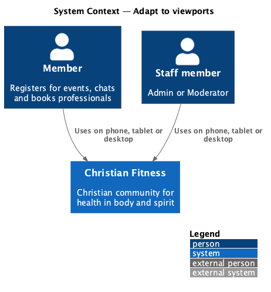
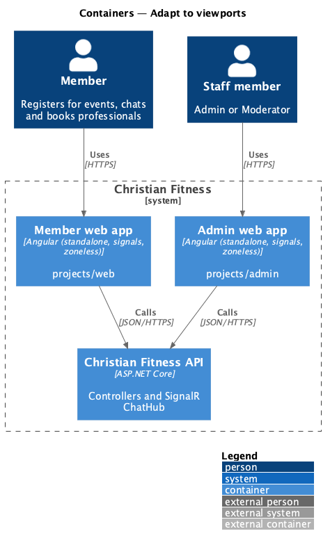
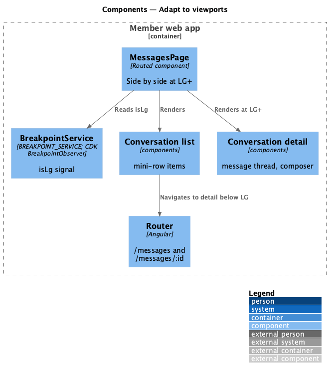
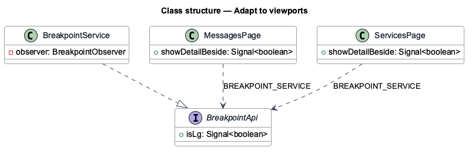
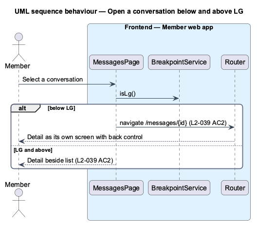
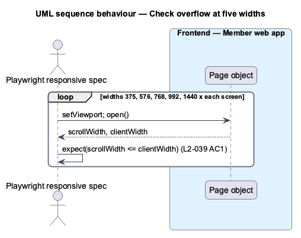

# Adapt to viewports

## Overview

Christian Fitness runs on phones, tablets and desktops. This feature defines how
each screen of both apps adapts across the specification's viewports so nothing
overflows, list-and-detail screens split or join, and forms stay usable on small
screens.

- **viewport classes** — XS < 576 px, SM >= 576 px, MD >= 768 px, LG >= 992 px, XL >= 1200 px
- **list-and-detail screen** — screen showing a list beside the selected item's detail: Services and Messages
- **primary action** — main button of a form, such as Save or Send

## Description

- **Breakpoint tokens** — `docs/design-system/tokens` defines the five breakpoints and the layout grid; component stylesheets use the shared mixins only.
- **`BreakpointService`** — service behind `BREAKPOINT_SERVICE` in the `api` library, implemented with CDK `BreakpointObserver` and exposing `isLg: Signal<boolean>`. Screens read it to choose layout; it releases its observer on destroy.
- **Services and Messages routes** — below LG, `/services` and `/messages` show the list and `/services/:id` and `/messages/:id` show the detail as separate screens; at LG and above the parent component renders both side by side (mocks `pages/services`, `pages/messages` `list` and `default` states).
- **Forms** — form layouts in the `dialogs/` mocks use a single full-width column at XS; the primary action sits in a sticky footer so it stays visible.
- **Library components** — the design-system components of slice 1.4 carry their pages' responsive rules in their own stylesheets, with the breakpoints written as `rem` media queries that mirror `--layout-breakpoint-sm` (custom properties cannot be used in `@media`): `cf-form-layout`'s `field-grid` and `cf-button-row`'s `btn-row--stack` are one column below 640 px and two (or a row) from there; `cf-search-field` is full width on phones and `--layout-search-width` from 640 px; `cf-chip-bar` wraps and drops its divider below 640 px; form controls fill their column at every width; long switch labels wrap beside the switch; badges and chips never wrap or truncate (ADR 0018).
- **Admin tables** — below LG, tables become stacked cards (`L2-021`). Until a screen needs the cards, the components library's `cf-table` keeps its minimum width and scrolls sideways inside its focusable, labelled wrapper, so the page itself never scrolls sideways (ADR 0017).
- **Feedback, overlays and content components** — the dialog is a bottom sheet below 640 px and a centred panel above; the drawer fills the width on phones; the toast region sits above the member tab bar on phones and bottom right from 768 px; pagination swaps its page numbers for "Page 2 of 8" below 640 px; tabs scroll sideways and bring the current tab into view; banners put their icon, text and actions on one row from 640 px; message bubbles take at most 80 % of the thread on phones and 65 % from 640 px (`L2-039`, `L2-048`).
- **Layout and navigation components** — slice 1.6's components carry the layout and navigation pages' responsive rules (ADR 0019): `cf-container` pads 16 px, then 24 px from 640 px, and `page` adds 32 px above and below, 40 px from LG (a detail page 24 px, then 32 px); `cf-split` stacks below LG and sets its columns side by side from there (the five page ratios), with `minmax(0, …)` tracks so a long word never widens the page; `cf-stack` and `cf-cluster` keep their gaps at every width and the cluster wraps; `cf-grid` keeps the layout grid's columns and gutter, and `cards` fills each row with as many cards of at least 288 px as fit, never wider than the page. The top bar shows its `app-nav` links from 768 px and only the lockup, profile button and Sign out below; the tab bar is fixed at the bottom below 768 px and gone from there; the sidebar navigation is a sticky 256 px column from LG and a band below, its links scrolling sideways within it; a `collapsible` breadcrumb is only its "← Parent" link below 768 px; the footer stacks its lines below 640 px and spreads them on one row from there.
- **Responsive sweep** — a Playwright spec, tagged `@sweep` and run on request (`CF_SWEEPS=1`), opens each screen at 375, 576, 768, 992 and 1440 px and asserts `document.documentElement.scrollWidth <= clientWidth`.

## Requirements

The feature realizes the following level-2 (L2) requirements. Each L2
requirement refines a level-1 (L1) requirement, cited by identifier. The
specification states these as acceptance criteria rather than one `shall`
sentence, so the criteria are quoted.

| L2 ID | Refines (L1) | Requirement |
|-------|--------------|-------------|
| `L2-039` | `L1-015` | 1. Given each screen of both apps, when viewed at 375, 576, 768, 992 and 1440 px wide, then nothing overflows horizontally and no content is clipped. 2. Given list-and-detail screens (Services, Messages), when below LG, then list and detail are separate screens; at LG and above, they sit side by side. 3. Given forms, when viewed at XS, then fields span the full width and the primary action stays visible. |

## Diagrams

### System context

Members and staff use Christian Fitness at every viewport size.

### Containers

Responsive behaviour belongs to the two Angular apps; the API serves the same data at every size.

### Components

The Messages parent reads `BreakpointService` and either shows list and detail together or routes between them.

### Class structure

`BreakpointService` implements the `BreakpointApi` contract; list-and-detail pages depend on it through its token.

### Behaviour — open a conversation below and above LG

Below LG the list navigates to a separate detail screen; at LG and above the detail renders beside the list.

### Behaviour — check overflow at five widths

The on-request sweep opens each screen at each width and asserts no horizontal overflow.

