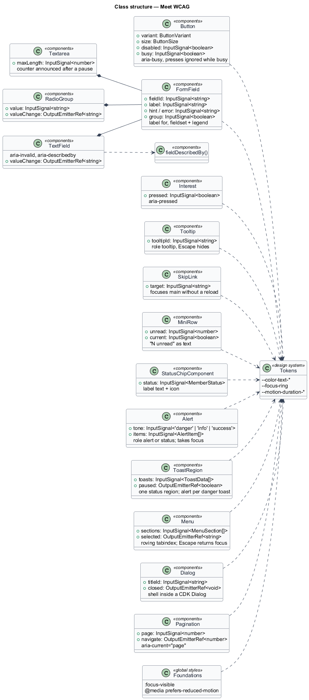
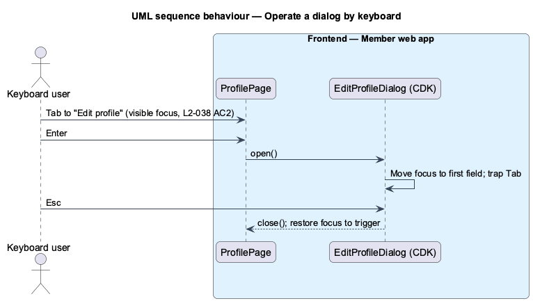
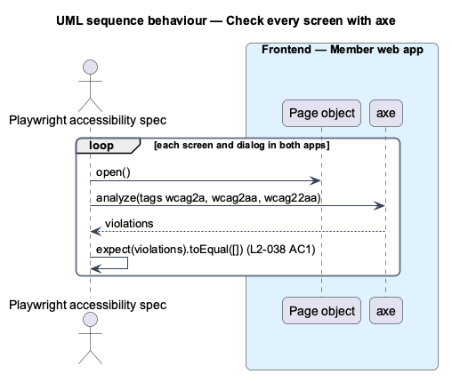
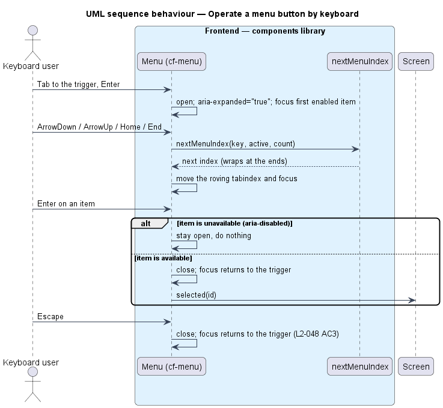

# Meet WCAG

## Overview

Christian Fitness serves a community that includes people who use keyboards,
screen readers, magnification and reduced-motion settings. This feature defines
how both apps meet WCAG 2.2 level AA: automated checks, keyboard operation,
non-colour state, contrast, touch target size and reduced motion.

- **axe** — automated accessibility rules engine run against a rendered page
- **visible focus indicator** — outline or ring that marks the element holding keyboard focus
- **touch target** — interactive area of a control, at least 44 × 44 px
- **reduced motion** — user preference exposed by `prefers-reduced-motion: reduce`

## Description

- **Design system tokens** — `docs/design-system/tokens` defines colour roles with contrast verified at 4.5:1 for text in light and dark themes; components read roles, never hex values.
- **Focus** — a global foundation style sets `:focus-visible` outlines from a focus token; no component removes outlines without a replacement.
- **Components library** — each control in `projects/components` meets 44 × 44 px; state uses attributes (`aria-current`, `aria-invalid`, `aria-pressed`, `aria-selected`, `disabled`) and the BEM stylesheet styles through them, adding an icon or text so colour is not the only carrier. Examples: unread conversations in `mini-row` carry a count badge with text; member status chips in `admin-members` carry the status word.
- **Design-system components, built once** — every page of `docs/design-system/components/` is one folder of `projects/components/src/` under the page's name, with its block, variants, sizes and states (`L2-038` AC7, ADR 0018). Slice 1.4 built the primitives and form controls:
  - *Actions* — `cf-button` (primary, secondary, ghost, danger, link, inverse, on-brand, quiet; xs to lg; `disabled`; `busy` sets `aria-busy` and ignores presses), `cf-icon-button` (named by `label` or by a tooltip through `labelledBy`), `cf-button-row`, and `cf-link` (inline, text, quiet, back; `external` opens a new tab and says so in hidden text; `current` sets `aria-current="page"`).
  - *Form controls* — `cf-form-field` is the one wrapper: label tied by `for`, "(optional)", hint or error, and `fieldDescribedBy` for the control's `aria-describedby`; with `group` it is a `fieldset` and legend. `cf-text-field`, `cf-search-field` (Escape clears), `cf-textarea` (counter in the hint, an error past the limit, announced politely once typing pauses), `cf-select`, `cf-checkbox` and `cf-checkbox-group`, `cf-radio-group` (every radio `aria-invalid` with the group's error) and `cf-switch` (`role="switch"`, `aria-busy` while saving) compose it; `cf-form-layout` stacks fields or pairs them in a `field-grid`.
  - *Display* — `cf-chip` (filter link, `aria-current`), `cf-chip-bar` (`role="group"`), `cf-interest` (`aria-pressed` toggle), `cf-interest-list`, `cf-tag`, `cf-status`, `cf-count-badge` (read with its noun, "99+" above 99, gone at zero), `cf-unread-dot` (`role="img"`), `cf-avatar` (decorative, initials when the photo fails), `cf-avatar-stack` and `cf-divider`.
  - *Feedback, overlays, brand* — `cf-spinner` (after 300 ms, always labelled), `cf-progress-bar` (`role="progressbar"`, value in words), `cf-tooltip` (names its control, hides on Escape without moving focus), `cf-skip-link` (focuses its target without a reload) and `cf-brand-lockup` with `cf-seal`.
  - Each behaviour has a component test (Vitest through the CLI's unit-test builder), one case per row of a page's state table; screens adopt the components in slice 1.6.
- **Feedback, overlays and content** — each design-system component is built once in `projects/components` and reused (`L2-048`, ADR 0017). Alerts, banners, inline messages and toasts take the role their tone needs (`alert` for danger, `status` otherwise); a form alert takes focus and links each item to its field; the toast region keeps one polite `status` region and an `alert` per danger toast, and asks its store to pause while hovered or focused. The menu button keeps one item in the tab order, moves with the arrow keys, Home and End (`nextMenuIndex`), and returns focus to its trigger on Escape. Pagination and tabs are labelled `nav`s of real links with `aria-current="page"`; the table is a native table with a caption and `th scope="col"` in a focusable, labelled region; a failed message says "Not sent." in an alert with Try again. Every control reaches 44 × 44 px on coarse pointers, words are rendered as text, and entrances, shimmer and turns stop under reduced motion.
- **Keyboard order** — DOM order follows visual order; dialogs use CDK Dialog with focus trap and return focus on close, around the components library's dialog and drawer shells, whose heading ids the opener passes as `ariaLabelledBy` (ADR 0017); the app shells provide a skip link, `<a class="skip-link" href="#main">Skip to content</a>`, as the first focusable element (confirmed by every page mock that has a header or navigation; it arrives with the first shell that has something to skip, the member and admin layouts).
- **Title and landmark** — each app's `index.html` names the app in `<title>` ("Christian Fitness", "Christian Fitness Admin") and every routed screen puts its content in one `<main id="main">`, the skip link's target (`L2-038` AC6).
- **Error screens** — the not-found and server-error screens of both apps move focus to their heading when they open and hide the decorative code ("404", "500") from assistive technology (`L2-043` AC7; [show error screens](../../errors/show-error-screens/README.md)).
- **Reduced motion** — a foundation media query `@media (prefers-reduced-motion: reduce)` in `tokens.css` sets the motion duration tokens to `0.01ms`; components use those tokens only, and the reset turns off smooth scrolling.
- **Foundations** — each app's global stylesheet is foundations only: a byte-for-byte copy of `docs/design-system/tokens/tokens.css` with the self-hosted Barlow and Barlow Condensed fonts, a reset and utilities (`visually-hidden`, and `icon` for inline SVG icons, added with the error screens), plus the `:focus-visible` outline.
- **Checks** — an accessibility Playwright sweep, tagged `@sweep` and run on request (`CF_SWEEPS=1`), opens each screen and dialog of both apps and runs axe with WCAG 2.2 A and AA tags; behaviour specs drive key flows by keyboard only through page objects.

## Requirements

The feature realizes the following level-2 (L2) requirements. Each L2
requirement refines a level-1 (L1) requirement, cited by identifier. The
specification states these as acceptance criteria rather than one `shall`
sentence, so the criteria are quoted.

| L2 ID | Refines (L1) | Requirement |
|-------|--------------|-------------|
| `L2-048` | `L1-015` | 1. Alerts, banners, inline messages and toasts are announced with `alert` for danger and `status` otherwise, the toast region with one polite region and an `alert` per danger toast. 2. A form alert takes focus and links each invalid field. 3. A menu button focuses its first item, moves with ArrowUp, ArrowDown, Home and End and wraps, closes on Escape and Tab, returns focus on Escape, and an unavailable item cannot be chosen. 4. A dialog or drawer shell's heading carries the id its CDK Dialog is labelled by, and Close and the scrim report `closed`. 5. No state is carried by colour alone. 6. Targets reach 44 × 44 px on coarse pointers and motion stops for reduced motion. 7. Passed words render as text. |
| `L2-038` | `L1-015` | 1. Given any screen, when checked with axe, then it has no WCAG 2.2 A or AA violations. 2. Given any interaction, when performed by keyboard only, then it is reachable in a logical order with a visible focus indicator. 3. Given any state (selected, invalid, unread, status), when shown, then it is not conveyed by colour alone. 4. Given text and controls, when measured, then text contrast is at least 4.5:1 and touch targets at least 44 × 44 px. 5. Given a user who prefers reduced motion, when they use the apps, then non-essential animation is disabled. 6. Given any screen of either app, when it loads, then the document title names the app ("Christian Fitness" in the member app, "Christian Fitness Admin" in the admin app) and the screen's content sits in one `main` landmark. 7. Given a component in `docs/design-system/components/`, when a screen needs it, then it comes from the components library under its design-system name, with that page's variants, sizes and states, its keyboard behaviour and its states as ARIA attributes. |

## Diagrams

### System context

Members and staff reach Christian Fitness with touch, keyboard and assistive technology.

### Containers

Accessibility is a property of the two Angular apps and the shared components library; the API is unaffected.

### Components

Both apps compose screens from the components library, which reads design tokens and global foundations for contrast, focus and motion.

### Class structure

Presentation components expose state through ARIA inputs and report what people do through outputs; the form controls share one form field; foundations and tokens supply focus, contrast and motion.

### Behaviour — operate a dialog by keyboard

The CDK Dialog traps focus while open and returns it to the trigger on close, with a visible focus indicator throughout.

### Behaviour — check every screen with axe

The on-request sweep opens each screen through its page object and fails on any WCAG 2.2 A or AA violation.

### Behaviour — operate a menu button by keyboard

The menu keeps one item in the tab order, moves focus with the arrow keys, Home and End, ignores an unavailable item and returns focus to its trigger when it closes.

