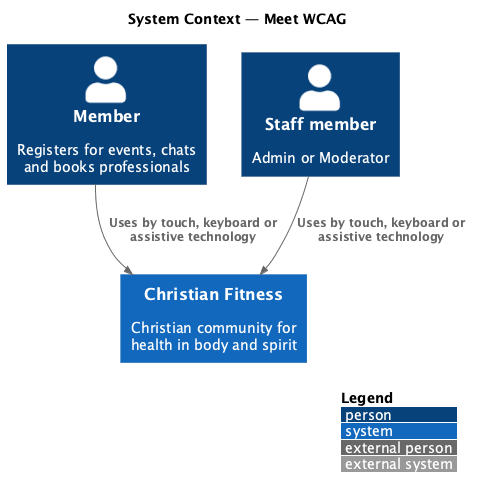
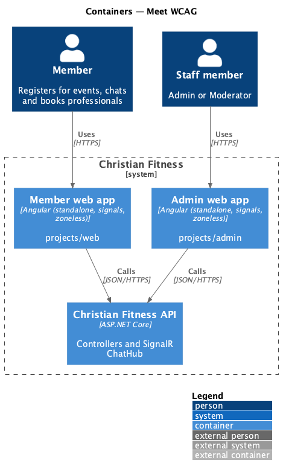
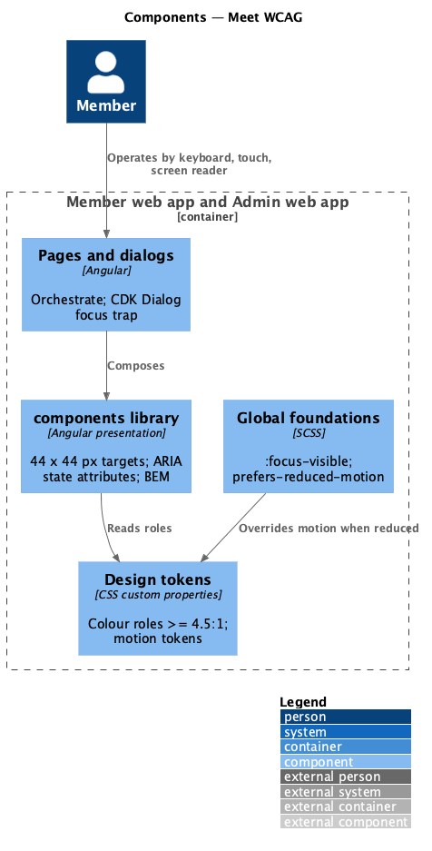

# Meet WCAG

## Overview

Christian Fitness serves a community that includes people who use keyboards,
screen readers, magnification and reduced-motion settings. This feature defines
how both apps meet WCAG 2.2 level AA: automated checks, keyboard operation,
non-colour state, contrast, touch target size and reduced motion.

- **axe** — automated accessibility rules engine run against a rendered page
- **visible focus indicator** — outline or ring that marks the element holding keyboard focus
- **touch target** — interactive area of a control, at least 44 × 44 px
- **reduced motion** — user preference exposed by `prefers-reduced-motion: reduce`

## Description

- **Design system tokens** — `docs/design-system/tokens` defines colour roles with contrast verified at 4.5:1 for text in light and dark themes; components read roles, never hex values.
- **Focus** — a global foundation style sets `:focus-visible` outlines from a focus token; no component removes outlines without a replacement.
- **Components library** — each control in `projects/components` meets 44 × 44 px; state uses attributes (`aria-current`, `aria-invalid`, `aria-pressed`, `aria-selected`, `disabled`) and the BEM stylesheet styles through them, adding an icon or text so colour is not the only carrier. Examples: unread conversations in `mini-row` carry a count badge with text; member status chips in `admin-members` carry the status word.
- **Keyboard order** — DOM order follows visual order; dialogs use CDK Dialog with focus trap and return focus on close; the app shells provide a skip link, `<a class="skip-link" href="#main">Skip to content</a>`, as the first focusable element (confirmed by every page mock that has a header or navigation; it arrives with the first shell that has something to skip, the member and admin layouts).
- **Title and landmark** — each app's `index.html` names the app in `<title>` ("Christian Fitness", "Christian Fitness Admin") and every routed screen puts its content in one `<main id="main">`, the skip link's target (`L2-038` AC6).
- **Reduced motion** — a foundation media query `@media (prefers-reduced-motion: reduce)` in `tokens.css` sets the motion duration tokens to `0.01ms`; components use those tokens only, and the reset turns off smooth scrolling.
- **Foundations** — each app's global stylesheet is foundations only: a byte-for-byte copy of `docs/design-system/tokens/tokens.css` with the self-hosted Barlow and Barlow Condensed fonts, a reset and utilities (`visually-hidden`), plus the `:focus-visible` outline.
- **Checks** — an accessibility Playwright sweep, tagged `@sweep` and run on request (`CF_SWEEPS=1`), opens each screen and dialog of both apps and runs axe with WCAG 2.2 A and AA tags; behaviour specs drive key flows by keyboard only through page objects.

## Requirements

The feature realizes the following level-2 (L2) requirements. Each L2
requirement refines a level-1 (L1) requirement, cited by identifier. The
specification states these as acceptance criteria rather than one `shall`
sentence, so the criteria are quoted.

| L2 ID | Refines (L1) | Requirement |
|-------|--------------|-------------|
| `L2-038` | `L1-015` | 1. Given any screen, when checked with axe, then it has no WCAG 2.2 A or AA violations. 2. Given any interaction, when performed by keyboard only, then it is reachable in a logical order with a visible focus indicator. 3. Given any state (selected, invalid, unread, status), when shown, then it is not conveyed by colour alone. 4. Given text and controls, when measured, then text contrast is at least 4.5:1 and touch targets at least 44 × 44 px. 5. Given a user who prefers reduced motion, when they use the apps, then non-essential animation is disabled. 6. Given any screen of either app, when it loads, then the document title names the app ("Christian Fitness" in the member app, "Christian Fitness Admin" in the admin app) and the screen's content sits in one `main` landmark. |

## Diagrams

### System context

Members and staff reach Christian Fitness with touch, keyboard and assistive technology.

### Containers

Accessibility is a property of the two Angular apps and the shared components library; the API is unaffected.

### Components

Both apps compose screens from the components library, which reads design tokens and global foundations for contrast, focus and motion.

### Class structure

Presentation components expose state through ARIA inputs; foundations and tokens supply focus, contrast and motion.

### Behaviour — operate a dialog by keyboard

The CDK Dialog traps focus while open and returns it to the trigger on close, with a visible focus indicator throughout.

### Behaviour — check every screen with axe

The on-request sweep opens each screen through its page object and fails on any WCAG 2.2 A or AA violation.

