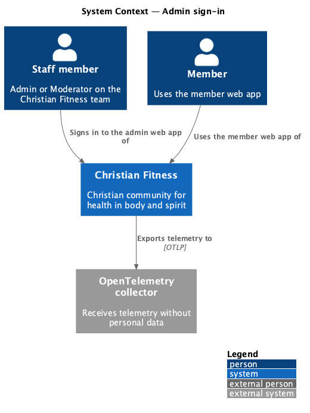
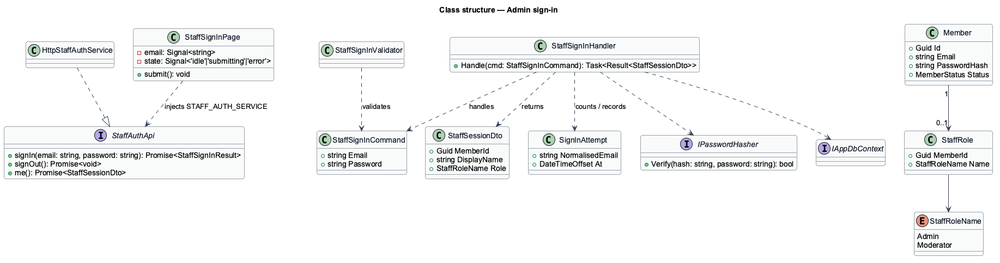

# Admin sign-in

## Overview

Christian Fitness is a Christian community for health in body and spirit in the Greater Toronto
Area. It runs two web apps: the *Member web app* for members and the *Admin web app* for the team.
This feature is the door to the Admin web app. It lets a staff member sign in, keeps every admin
endpoint closed to anyone without a staff session, and ends an idle session.

- **staff member** — person whose account holds a staff role (Admin or Moderator, see `staff-roles`)
- **staff session** — authenticated cookie session issued by the admin sign-in and accepted only by admin endpoints
- **idle timeout** — interval of 30 minutes without a request after which a staff session expires
- **lockout** — refusal of further sign-ins for one email after 5 failures within 15 minutes (`L2-004` AC3)

A member account without a staff role holds valid credentials but is refused with code
`not_staff`. Wrong credentials produce one generic message that does not reveal whether the
email or the password was wrong.

## Description

The slice runs from the Staff sign in screen (mock `docs/mocks/pages/admin-sign-in/`) to the
member store.

- **`StaffSignInPage`** — routed page in `projects/admin`, loaded with `loadComponent`. It renders
  the `staff` block from the mock (Work email, Password, Sign in), shows the `invalid`,
  `submitting` and `error` states, and branches on the error `code` only.
- **`StaffAuthApi` / `STAFF_AUTH_SERVICE`** — contract and injection token in the `api` library:
  `signIn(email, password)`, `signOut()`, `me()`. Refusals arrive as a typed result with `code`.
- **`HttpStaffAuthService`** — HTTP implementation bound in the admin `app.config.ts`.
- **`staffGuard`** — route guard on every admin route except sign-in. It calls `me()` and sends
  the visitor to sign-in on HTTP 401.
- **`sessionExpiredInterceptor`** — HTTP interceptor that routes to sign-in, with a "session
  expired" notice, when any admin call returns HTTP 401.
- **`StaffSessionController`** — ASP.NET Core controller. `POST /api/admin/session` is
  `[AllowAnonymous]`; `DELETE /api/admin/session` and `GET /api/admin/session` require `StaffOnly`.
  Each action sends one MediatR request.
- **`StaffSignInCommand`**, **`StaffSignInValidator`**, **`StaffSignInHandler`** — the handler
  checks the lockout window, verifies the password through `IPasswordHasher`, loads the
  `StaffRole`, and returns `not_staff` when none exists.
- **`SignInAttempt`** — record of a failed attempt per normalised email, used for the lockout.
- **`StaffCookieAuthentication`** — Infrastructure configuration of a separate cookie scheme
  `__Host-cf-admin`: `Secure`, `HttpOnly`, `SameSite=Strict`, sliding expiry of 30 minutes
  (`L2-018` AC5).
- **Fallback policy and `StaffOnly`** — the API requires authentication by default; `StaffOnly`
  requires the staff scheme and a `StaffRole` claim. Requests without it get HTTP 401 or 403 and
  no body beyond ProblemDetails (`L2-018` AC4).

Error codes: `not_staff` (403), `too_many_attempts` (429), `invalid_credentials` (401, shown as
one generic message). The mock also shows a two-step verification screen
(`docs/mocks/pages/admin-two-step/`); no L2 requirement defines it, so its flow is `<TO SUPPLY>`.
The mock's locked message says "wait 30 minutes" while `L2-004` AC3 gives a 15-minute window;
the copy is `<TO SUPPLY>`. Telemetry records the route template and outcome code, never the email.

## Requirements

| L2 ID | Refines (L1) | Requirement |
|-------|--------------|-------------|
| `L2-018` | `L1-008` | Given a staff account, when it signs in to the admin app with correct credentials, then it lands on the Dashboard. Given a member account without a staff role, when it signs in to the admin app, then it is refused with code `not_staff` and HTTP 403. Given wrong credentials, when signing in, then one generic message is shown, and the L2-004 AC3 lockout applies. Given a request to any admin endpoint without a staff session, when it arrives, then it is refused with HTTP 401 or 403 and no data is returned. Given an admin session idle for 30 minutes, when the next request arrives, then the session has expired and the user must sign in again. |

## Diagrams

### System context

Staff members sign in to Christian Fitness through its Admin web app; the system exports
telemetry without personal data.

### Containers

The Admin web app posts credentials to the Christian Fitness API, which checks the member store
and issues the staff cookie.

### Components

The page calls the `STAFF_AUTH_SERVICE` contract; the controller sends `StaffSignInCommand`, and
the handler uses the password hasher and the lockout record.

### Class structure

`StaffSignInHandler` handles `StaffSignInCommand`, reads `Member`, `StaffRole` and
`SignInAttempt`, and returns `StaffSessionDto` or an error code.

### Behaviour — sign in

The handler enforces the lockout first, then credentials, then the staff role (`L2-018` AC1–AC3).

### Behaviour — idle session expires

A request after 30 minutes of inactivity finds an expired cookie; the API refuses it with HTTP
401 and the interceptor returns the user to sign-in (`L2-018` AC4–AC5).

