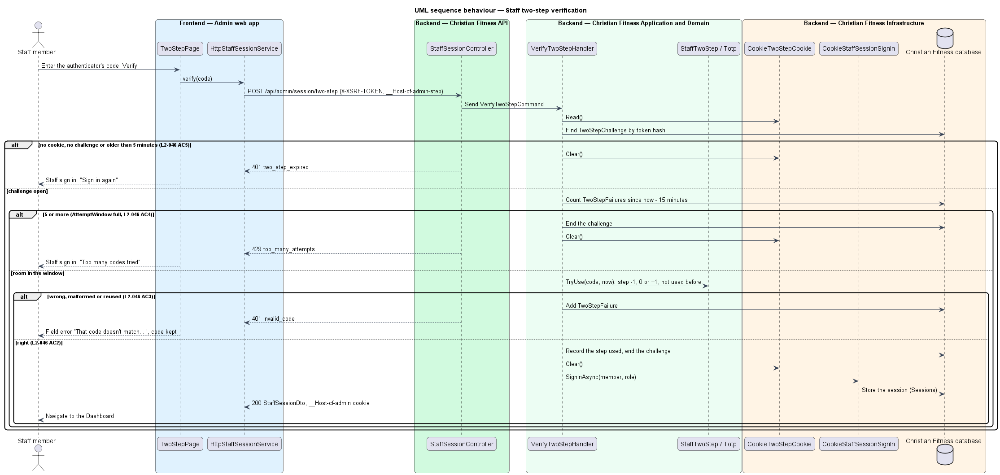

# Admin sign-in

## Overview

Christian Fitness is a Christian community for health in body and spirit in the Greater Toronto
Area. It runs two web apps: the *Member web app* for members and the *Admin web app* for the team.
This feature is the door to the Admin web app. It lets a staff member sign in with a password and
a second-step code, keeps every admin endpoint closed to anyone without a staff session, ends
an idle session, and shows a "Staff only" screen when the API refuses staff something they may not
see.

- **staff member** — person whose account holds a staff role (Admin or Moderator, see `staff-roles`)
- **staff session** — authenticated cookie session issued by the admin sign-in and accepted only by admin endpoints
- **second step** — a 6-digit code from the staff member's authenticator app (TOTP, RFC 6238), asked after the password on every sign-in
- **pending sign-in** — `TwoStepChallenge` held for 5 minutes between the password and the code, named by the `__Host-cf-admin-step` cookie
- **idle timeout** — interval of 30 minutes without a request after which a staff session expires
- **lockout** — refusal of further sign-ins for one email after 5 failures within 15 minutes (`L2-004` AC3), counted across both apps
- **forbidden screen** — the "Staff only" screen shown in place of the current one when a read is refused 403 (`L2-047`)

A member account without a staff role holds valid credentials but is refused with code
`not_staff`. Wrong credentials produce one generic message that does not reveal whether the
email or the password was wrong.

## Description

The slice runs from the Staff sign in screen (mock `docs/mocks/pages/admin-sign-in/`) through
the code screen (mock `docs/mocks/pages/admin-two-step/`) to the member store
([ADR 0011](../../../adr/0011-staff-sign-in-and-admin-shell.md),
[ADR 0013](../../../adr/0013-staff-two-step-verification.md),
[ADR 0014](../../../adr/0014-staff-idle-expiry-sign-in-pause-and-forbidden-screen.md)).

- **`SignInPage`** — routed page `/sign-in` in `projects/admin`, loaded with `loadComponent`. It
  renders the `staff` card through `StaffLayout` (`components`) with `TextField`, `FormAlert` and
  `Button`: Work email, Password, Sign in, and the `submitting` state ("Signing in…", disabled,
  fields read-only). A refusal shows one `form-alert` that takes focus, chosen from the error
  `code` by `staffSignInRefusalOf` (`domain`): `invalid` (no field marked, L2-018 AC3),
  `not-staff` (AC2), `two-step-not-set-up` (L2-046 AC6), `too-many-attempts` ("Sign-in paused for
  15 minutes", AC3, mock `error`; Sign in stays enabled) or `failed`. What was typed stays. The
  note "Two-step verification required" shows under the button. Success (202) navigates to
  `/sign-in/verify`. Arriving back from the code screen with a router navigation state of
  `expired` or `locked` (read once by `twoStepEndingOf`) shows "Sign in again" or "Too many
  codes tried" (mock states `two-step-expired`, `two-step-locked`); with `{ session: 'expired' }`
  (read once by `sessionEndingOf`) it shows "Your session expired" (mock state `session-expired`,
  L2-018 AC5). Only an imperative navigation after an earlier one counts, so a reload never brings
  a notice back.
- **`TwoStepPage`** — routed page `/sign-in/verify`, loaded with `loadComponent`, in the same
  `StaffLayout` card: "Enter your code", the authenticator lead, one Verification code
  `TextField` (`autocomplete="one-time-code"`, `inputmode="numeric"`, the `input--code` look),
  Verify and "Verifying…" (disabled, field read-only), and the note "Lost your phone? Ask an Admin
  to set up two-step verification again." `twoStepRefusalOf` (`domain`) reads a refusal:
  `invalid-code` marks the field with the mock's sentence, `failed` puts "We couldn't check your
  code. Try again in a moment." in the same place (both keep the code), and `expired` or `locked`
  return to Staff sign in with that state. A right code navigates to the Dashboard.
- **`StaffSessionApi` / `STAFF_SESSION_SERVICE`** — contract and injection token in the `api`
  library: `current()`, `signIn(request)` (completes on 202, no session), `verify(request)`
  (answers the session) and `signOut()`. Refusals arrive as an `ApiError` with `code`.
- **`HttpStaffSessionService`** — HTTP implementation bound in the admin `app.config.ts`, which
  also provides the HTTP client with `serverErrorInterceptor` and `antiforgeryInterceptor`.
- **`staffAuthGuard`** (`domain`) — `canActivateChild` on the shell that parents every staff
  route, so it runs on the first visit and on every move between areas. It calls `current()`; a
  401 `session_expired` is left to `sessionExpiredInterceptor`, any other 401 sends the visitor to
  `/sign-in`, and a 403 or a 5xx is left to the forbidden or server-error screen.
- **`sessionExpiredInterceptor`** (`domain`) — registered in the admin `app.config.ts`. A request
  to `/api/admin/` refused 401 with code `session_expired` navigates to `/sign-in` with the state
  `{ session: 'expired' }`, unless Staff sign in already shows; the error passes on (L2-018 AC5).
- **`forbiddenInterceptor`** (`domain`) — registered beside it. A GET to `/api/` answered 403 opens
  `/forbidden` with `browserUrl` set to the URL asked for (the navigation in flight, or else the
  current URL), unless it already shows; a write's 403
  passes on to its screen (L2-047 AC1, AC3).
- **`ForbiddenPage`** — routed page `/forbidden` in `projects/admin`, loaded with
  `loadComponent`, title "Staff only · Christian Fitness Admin", in the `StaffLayout` card (mock
  `docs/mocks/pages/admin-forbidden/`): the heading "Staff only", focused on arrival through
  `StaffLayout`'s `focusHeading`, the lead, Sign out as the card's one button ("Signing out…",
  disabled, while it waits; enabled again on a failure) and the note "On the team? Ask a community
  director to give you staff access." Sign out calls `signOut()` and opens Staff sign in
  (L2-047 AC2).
- **`StaffSessionController`** — ASP.NET Core controller. `POST /api/admin/session` is
  `[AllowAnonymous]` and answers 202; `POST /api/admin/session/two-step` is `[AllowAnonymous]`
  too; `GET` and `DELETE` require the `Staff` policy. Each action sends one MediatR request:
  `StaffSignInCommand`, `VerifyTwoStepCommand`, `GetStaffSessionQuery`, `StaffSignOutCommand`.
- **`MemberCredentials`** — the credential check both sign-ins share, with the sign-in pause of
  `L2-004` AC3 (ADR 0014): with 5 `SignInFailures` for the email's key in the last 15 minutes
  (`SignInFailure.Attempts`, the shared `AttemptWindow`) the attempt is refused
  `too_many_attempts` (429) before the password is checked and is not recorded; otherwise an
  unknown email, a wrong password (a failure recorded) or a blank field (none recorded) is refused
  `invalid_credentials`. `ForgetFailuresAsync` clears the email's failures; each handler calls it
  only on its own success.
- **`StaffSignInHandler`** — checks the credentials through `MemberCredentials`, the check the
  member sign-in shares (unknown email and wrong password give the same `invalid_credentials`,
  in the same time, and the pause counts failures from either app), then reads the `StaffRole`: none refuses `not_staff` (403) and sets no
  cookie. Staff without a `StaffTwoStep` are refused `two_step_not_set_up` (403). Otherwise the
  handler forgets the email's sign-in failures, replaces the account's `TwoStepChallenge` (token
  hash only, 5 minutes) and sets the step cookie through `ITwoStepCookie`; no session yet. No validator: a blank field is simply
  wrong credentials.
- **`VerifyTwoStepHandler`** — reads the step cookie and its challenge (none or expired:
  `two_step_expired`, 401), counts the account's `TwoStepFailure`s against
  `TwoStepChallenge.FailureWindow`, the shared `AttemptWindow(5, 15 minutes)` (full:
  `too_many_attempts`, 429, the challenge ends), then `StaffTwoStep.TryUse(code, now)`: `Totp`
  accepts the code of the current step or one either side, spaces ignored, never a step already
  used. Wrong: one failure recorded, `invalid_code` (401). Right: the step is recorded, the
  challenge and its cookie end, the role is read again and `IStaffSessionSignIn` starts the
  session, answered as `StaffSessionDto`.
- **`cf two-step <email>`** — the CLI command that gives a staff account a fresh 20-byte secret
  (`StaffTwoStepSetUp`) and prints its `otpauth://` link once; running it again replaces the
  secret, which is how a lost phone is handled.
- **Step cookie** — `__Host-cf-admin-step`: `Secure`, `HttpOnly`, `SameSite=Strict`, path `/`,
  expiring with its challenge; set and cleared by `CookieTwoStepCookie` (Infrastructure). `GetStaffSessionHandler` reads the role again, so a role removed since
  sign-in is refused `not_staff`.
- **Staff cookie scheme** — `Staff`, cookie `__Host-cf-admin`: `Secure`, `HttpOnly`,
  `SameSite=Strict`, path `/`, not persistent. The ticket (member id and role claim) lives in the
  `Sessions` table through the same `DatabaseTicketStore` as the member session, so sign-out
  (L2-018 AC6) ends it on the server. `ExpireTimeSpan` is 30 minutes (`StaffIdleTimeout`) with
  sliding expiration, and `OnCheckSlidingExpiration` renews on every authenticated request, so
  the session ends exactly 30 minutes after the last one (L2-018 AC5); the store deletes the
  expired row when it is next read and marks the request (`DatabaseTicketStore.FoundExpired`),
  and the challenge then answers 401 with code `session_expired` (`ProblemCodes.Override`) and
  expires the cookie; no cookie, a signed-out copy or an unknown key stays `unauthenticated`.
- **`Staff` policy** — authenticates only the `Staff` scheme and requires a role claim; a
  convention adds it to every controller routed under `api/admin`. A visitor or a member session
  gets 401 with a ProblemDetails and nothing else (`L2-018` AC4).

Error codes: `invalid_credentials` (401, one generic message), `not_staff` (403),
`two_step_not_set_up` (403), `invalid_code` (401), `two_step_expired` (401),
`too_many_attempts` (429, for the password pause and for wrong codes) and `session_expired`
(401). There is no "Trust this browser" and no backup code (ADR 0013). A reload of an admin URL
after the session expired opens Staff sign in without the notice: no navigation has succeeded to
tell it from a state the browser restored (ADR 0014). Telemetry records the route template and
outcome code, never the email, the code, the secret or the step cookie (L2-046 AC8).

## Requirements

| L2 ID | Refines (L1) | Requirement |
|-------|--------------|-------------|
| `L2-046` | `L1-008`, `L1-013` | Given a staff account with two-step verification set up, when it signs in with correct credentials, then the API answers 202 and the app opens "Enter your code" at `/sign-in/verify`. Given the current authenticator code (or one 30 seconds either side) within 5 minutes, then the staff session starts; a used code is refused. A wrong code is refused `invalid_code` (401) with the field marked; after 5 wrong codes in 15 minutes, `too_many_attempts` (429); after 5 minutes, `two_step_expired` (401); staff without two-step set up are refused `two_step_not_set_up` (403); "Verifying…" while checking; no telemetry carries the code, the secret or the cookie. |
| `L2-018` | `L1-008` | Given a staff account, when it signs in to the admin app with correct credentials and confirms with its second-step code (L2-046), then it lands on the Dashboard. Given a member account without a staff role, when it signs in to the admin app, then it is refused with code `not_staff` and HTTP 403. Given wrong credentials, when signing in, then one generic message is shown, and the L2-004 AC3 lockout applies: 5 failed sign-ins for one email within 15 minutes, in either app, refuse the next with `too_many_attempts` (429) and "Sign-in paused for 15 minutes". Given a request to any admin endpoint without a staff session, when it arrives, then it is refused with HTTP 401 or 403 and no data is returned. Given an admin session idle for 30 minutes, when the next request arrives, then it is refused `session_expired` (401), the session ends on the server and the admin app opens Staff sign in with "Your session expired"; every request within 30 minutes of the one before keeps the session open. Given a signed-in staff member, when they choose Sign out, then the staff session is ended on the server and they return to Staff sign in. |
| `L2-047` | `L1-008`, `L1-015` | Given a GET from the admin app answered 403, then the "Staff only" screen shows in place of the current screen with the URL asked for in the address bar, its heading focused, with the lead, Sign out and the note; Sign out reads "Signing out…" while it waits, ends the staff session and opens Staff sign in; a write's 403 is left to its screen. |

## Diagrams

### System context

Staff members sign in to Christian Fitness through its Admin web app; the system exports
telemetry without personal data.

### Containers

The Admin web app posts credentials to the Christian Fitness API, which checks the member store
and issues the staff cookie.

### Components

The page calls the `STAFF_SESSION_SERVICE` contract; the controller, behind the `Staff` policy,
sends `StaffSignInCommand`, and the handler checks the credentials and the staff role.

### Class structure

`StaffSignInHandler` handles `StaffSignInCommand`, verifies through `MemberCredentials`, reads
`StaffRole`, and returns `StaffSessionDto` or refuses with a code.

### Behaviour — sign in

The credential check refuses a paused email before the password, then the handler checks the
staff role and two-step set-up, and starts a pending sign-in (`L2-018` AC1–AC3, `L2-046` AC1,
AC6).

### Behaviour — second step

The code is checked only while the pending sign-in is open and the failure window has room; a
right code starts the staff session (`L2-046` AC2–AC5).

### Behaviour — idle session expires

A request 30 minutes or more after the last one finds the session expired: the store deletes it,
the API refuses `session_expired` (401) and the interceptor returns staff to sign in with the
notice; a request in time renews the session for 30 minutes (`L2-018` AC4–AC5).

### Behaviour — a read refused 403

A GET answered 403, such as the session after the staff role was taken away, opens "Staff only"
in place of the screen; Sign out ends the session (`L2-047`).

