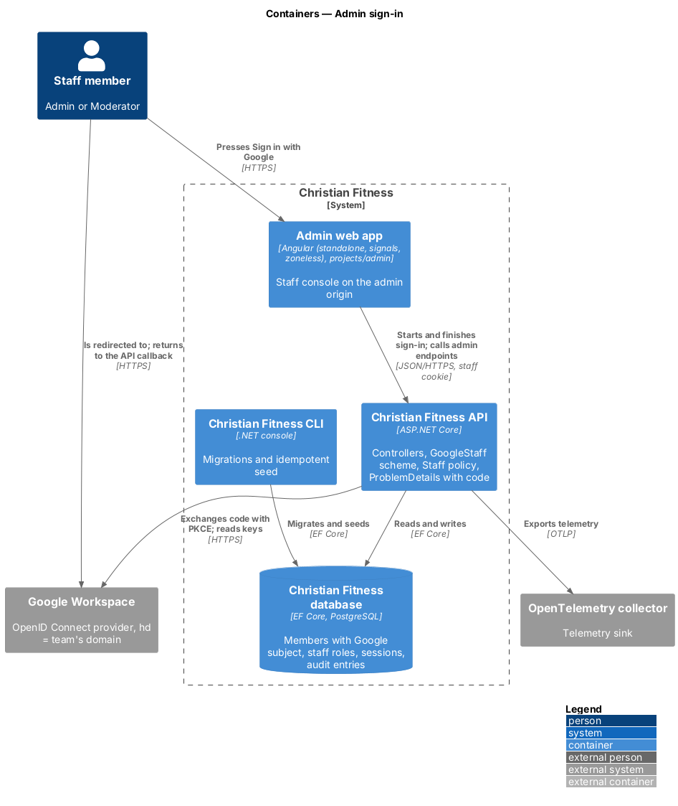
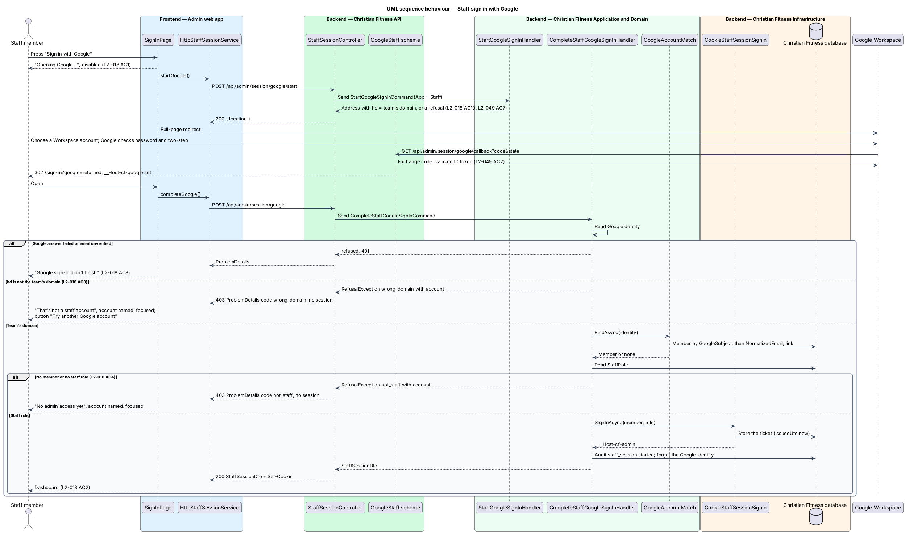
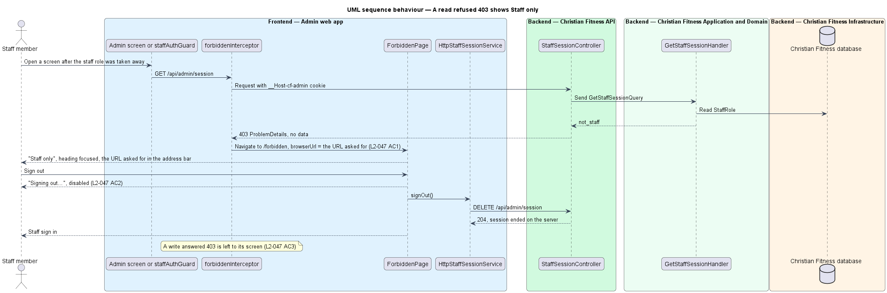

# Admin sign-in

## Overview

Christian Fitness is a Christian community for health in body and spirit in the Greater Toronto
Area. It runs two web apps: the _Member web app_ for members and the _Admin web app_ for the team.
This feature is the door to the Admin web app. Staff sign in only with a Google Workspace account of
the team's domain that holds a console role; the Admin web app keeps no staff password and asks for
no code of its own (`L1-008`). The feature also keeps every admin endpoint closed to anyone without a
staff session, ends an idle or old session, and shows a "Staff only" screen when the API refuses
staff something they may not see.

- **staff member** — person whose account holds a staff role (Admin or Moderator, see `staff-roles`)
- **team's domain** — Google Workspace domain whose accounts may open the console (`christianfitness.ca` in the mocks)
- **staff session** — authenticated cookie session issued by the admin sign-in and accepted only by admin endpoints
- **idle timeout** — interval of 30 minutes without a request after which a staff session expires
- **maximum session age** — interval of 12 hours after which a staff session ends whatever its activity, so Google is asked again
- **forbidden screen** — the "Staff only" screen shown in place of the current one when a read is refused 403 (`L2-047`)

Staff sign in with Google ([sign in with Google](../../member-access/sign-in-with-google/README.md)),
limited to the team's domain. A Google account outside the domain is refused with `wrong_domain`; an
account of the domain without a staff role is refused with `not_staff`. Passwords and two-step
verification belong to Google Workspace, which the team enforces for its domain there; `L2-046`
(two-step verification for staff) is withdrawn.

## Description

The slice runs from the Staff sign in screen (mock `docs/mocks/pages/admin-sign-in/`, states
`default`, `redirecting`, `wrong-domain`, `no-access`, `session-expired` and `error`) to the member
store. The Google part of the flow, shared with the member app, is designed in
[sign in with Google](../../member-access/sign-in-with-google/README.md). The staff cookie scheme,
idle expiry and the forbidden screen are those of
[ADR 0011](../../../adr/0011-staff-sign-in-and-admin-shell.md) and
[ADR 0016](../../../adr/0016-staff-idle-expiry-sign-in-pause-and-forbidden-screen.md);
[ADR 0013](../../../adr/0013-staff-two-step-verification.md) (two-step verification) no longer
applies.

- **`SignInPage`** — routed page `/sign-in` in `projects/admin`, loaded with `loadComponent`. It
  renders the `staff` card through `StaffLayout` (`components`): the brand, the heading "Staff sign
  in", the lead "Use your @christianfitness.ca Google Workspace account." with the domain in
  `strong`, one `GoogleButton` ("Sign in with Google") and the note "Passwords and two-step
  verification are managed by Google Workspace. Leaving the team ends console access the same day."
  There is no email or password field (`L2-018` AC1). Pressing the button calls
  `StaffSessionApi.startGoogle()`; the button reads "Opening Google…" and is disabled and busy
  (mock `redirecting`) until the page leaves for Google. On return, `googleReturnOf` reads the
  marker once: `failed` shows the `form-alert` "Google sign-in didn't finish" with "You're not signed
  in. Try again in a moment." (`L2-018` AC8, mock `error`); `returned` calls `completeGoogle()`. A
  session navigates to the Dashboard (`L2-018` AC2). A refusal is read by `staffSignInRefusalOf`
  (`domain`), reworked for Google:
  - 403 `wrong_domain` — an `SsoNotice` (`role="alert"`, focused) titled "That's not a staff
    account", naming the account and saying "Only @christianfitness.ca accounts can open the
    console. Pick your work account instead."; the button reads "Try another Google account"
    (`L2-018` AC3, mock `wrong-domain`);
  - 403 `not_staff` — the notice titled "No admin access yet", naming the account and saying "Your
    Workspace account is fine, but it hasn't been given a console role. Ask an Admin to add you to
    the team."; the button reads "Try another Google account" (`L2-018` AC4, mock `no-access`);
  - 401 for a missing or unverified Google identity — the "didn't finish" alert;
  - anything else — the "didn't finish" alert.

  The account named comes from the refusal's `account` extension and is rendered as text. With the
  router state `{ session: 'expired' }` (read once by `sessionEndingOf`) the page shows "Your session
  expired" with "You were signed out after 30 minutes without activity. Sign in again to carry on."
  (`L2-018` AC6, mock `session-expired`).
- **`SsoNotice`** — presentation component in the components library under its design-system name
  (`components/src/sso-notice/`, block `sso-notice`, design-system page "Sign-in notice"): optional
  title, the account line, the text and optional actions; inputs only; `role="alert"` with
  `tabindex="-1"`, taking focus when it appears. The member Sign in screen reuses it.
- **`StaffSessionApi` / `STAFF_SESSION_SERVICE`** — contract and injection token in the `api`
  library: `current()`, `startGoogle()` (answers `GoogleRedirectDto`), `completeGoogle()` (answers
  `StaffSessionDto`) and `signOut()`. `signIn(request)` and `verify(request)` and
  `TwoStepRequestDto` are removed. Refusals arrive as an `ApiError` with `code`.
- **`HttpStaffSessionService`** — HTTP implementation bound in the admin `app.config.ts`, which also
  provides the HTTP client with `serverErrorInterceptor` and `antiforgeryInterceptor`.
- **`staffAuthGuard`** (`domain`) — `canActivateChild` on the shell that parents every staff route.
  It calls `current()`; a 401 `session_expired` is left to `sessionExpiredInterceptor`, any other 401
  sends the visitor to `/sign-in`, and a 403 or a 5xx is left to the forbidden or server-error
  screen.
- **`sessionExpiredInterceptor`** (`domain`) — registered in the admin `app.config.ts`. A request to
  `/api/admin/` refused 401 with code `session_expired` navigates to `/sign-in` with the state
  `{ session: 'expired' }`, unless Staff sign in already shows; the error passes on (`L2-018` AC6).
- **`forbiddenInterceptor`** (`domain`) and **`ForbiddenPage`** — unchanged. A GET to `/api/` answered
  403, except `forbidden_role`, opens `/forbidden` ("Staff only", title "Staff only · Christian
  Fitness Admin", mock `docs/mocks/pages/admin-forbidden/`) with `browserUrl` set to the URL asked
  for; its Sign out reads "Signing out…", ends the session and opens Staff sign in; a write's 403
  passes on to its screen, as `wrong_domain` and `not_staff` do to Staff sign in (`L2-047`).
- **`StaffSessionController`** — ASP.NET Core controller routed at `api/admin/session`.
  `POST google/start` and `POST google` are `[AllowAnonymous]`; `GET` and `DELETE` require the
  `Staff` policy. Each action sends one MediatR request: `StartGoogleSignInCommand` (with
  `App = Staff`), `CompleteStaffGoogleSignInCommand`, `GetStaffSessionQuery`, `StaffSignOutCommand`.
  The password action and `POST two-step` are removed.
- **`GoogleStaff` scheme** — the OpenID Connect scheme of the admin app, callback
  `/api/admin/session/google/callback` on the admin origin, which asks Google to limit the choice to
  the team's domain (`hd`) ([sign in with Google](../../member-access/sign-in-with-google/README.md)).
- **`CompleteStaffGoogleSignInHandler`** — the command is an `IAuditableCommand` audited as
  `staff_session.started` (`L2-019` AC3; ADR 0023). In this order:
  1. no Google identity, or an unverified email, refuses with the code of
     [sign in with Google](../../member-access/sign-in-with-google/README.md) and HTTP 401;
  2. a `HostedDomain` that is not `Google:StaffDomain` (compared case-insensitively) refuses
     `wrong_domain` with HTTP 403, the account's email in the `account` extension and no session.
     The domain is read from the ID token Google signed, never from what the browser sends
     (`L2-018` AC3);
  3. `GoogleAccountMatch` finds the member by Google subject, then by email, linking it; no member,
     or a member with no `StaffRole`, refuses `not_staff` with HTTP 403, the account and no session
     (`L2-018` AC4);
  4. a `Suspended` member is refused `account_suspended` (HTTP 403), as in the member app (`L2-029`
     AC8; ADR 0028);
  5. otherwise the Google identity is forgotten and `IStaffSessionSignIn` starts the staff session,
     answered as `StaffSessionDto` (`L2-018` AC2).
- **Staff cookie scheme** — `Staff`, cookie `__Host-cf-admin`: `Secure`, `HttpOnly`,
  `SameSite=Strict`, path `/`, not persistent. The ticket (member id and role claim) lives in the
  `Sessions` table through `DatabaseTicketStore`, so sign-out ends it on the server (`L2-018` AC7).
  `ExpireTimeSpan` is 30 minutes (`StaffIdleTimeout`) with sliding expiration renewed on every
  authenticated request (`L2-018` AC6). New: `StaffSessionMaxAge` of 12 hours from the ticket's
  `IssuedUtc`; `OnValidatePrincipal` ends an older session on the server and answers 401
  `session_expired`, so Google is asked again at least every 12 hours and a Workspace account
  suspended or deleted loses console access the same day (`L2-018` AC9).
- **`StaffSignOutHandler`** — ends the staff session on the server and expires its cookie; the
  staff member's Google session is left alone (`L2-018` AC7).
- **`Staff` policy** — authenticates only the `Staff` scheme and requires a role claim; a
  convention adds it to every controller routed under `api/admin`. A visitor or a member session
  gets 401 with a ProblemDetails and nothing else (`L2-018` AC5).

Error codes: `wrong_domain` (403), `not_staff` (403), `account_suspended` (403),
`too_many_attempts` (429, more than 20 Google starts from one network in 15 minutes, `L2-049` AC7)
and `session_expired` (401). Telemetry records the route template and outcome code, never the
email, the account, a token or the cookie (`L2-049` AC8). The settings `Google__ClientId`,
`Google__ClientSecret` and `Google__StaffDomain` are documented in `docs/operations/settings.md`;
while one is missing, the start is refused and nothing leaves for Google (`L2-018` AC10). The
deployment guide (`docs/operations/deployment.md`) states that two-step verification is enforced
for the team's domain in Google Workspace (`L2-046` AC2).

### Open questions

- **Existing code contradicts the amended requirement.** The admin app still signs staff in with a
  password and a second-step code: `StaffSignInCommand` and its handler, `VerifyTwoStepCommand`
  (`Application/Admin/TwoStep.cs`), `StaffTwoStep`, `Totp`, `TwoStepChallenge`, `TwoStepFailure`,
  `ITwoStepCookie` and `CookieTwoStepCookie` (`__Host-cf-admin-step`), `StaffTwoStepSetUp` and the
  `cf two-step` CLI command, `POST /api/admin/session` and `POST /api/admin/session/two-step`, and
  in the admin app `TwoStepPage` (`/sign-in/verify`), `twoStepRefusalOf`, `TwoStepRequestDto` and the
  password form of `SignInPage`. `docs/operations/settings.md` and `docs/operations/deployment.md`
  still describe `cf two-step` and the seeded staff password (`seed-staff-password`). The next
  slices remove each of them, with a migration that drops the two-step tables, so that
  `/sign-in/verify` is the admin not-found page (`L2-046` AC1), and supersede ADR 0013.
- **The first staff account.** `cf seed` creates the first staff account with a password. With
  Google, it needs only the account's email of the team's domain and the Admin role; how the seed
  names that email is `<TO SUPPLY>`.
- **Session-expired wording after 12 hours.** The mock `session-expired` says "after 30 minutes
  without activity". A session ended by the 12-hour maximum also answers `session_expired`; whether
  it needs words of its own is not settled.
- **Not configured, too many attempts and suspended staff.** No mock state of Staff sign in shows
  the start refused for a missing setting (`L2-018` AC10), a 429 (`L2-049` AC7) or a suspended staff
  account; each needs a mock state, or a stand-in in an ADR, before its slice.
- **The sign-in pause.** `L2-018` no longer counts failed staff sign-ins with the member sign-in's
  window (`L2-004` AC3); with no staff password, staff sign-in records no `SignInFailure`.

## Requirements

The feature realizes the following level-2 (L2) requirements. Each L2 requirement refines a level-1
(L1) requirement, cited by identifier. The L2 specification states its requirements as acceptance
criteria; the text below condenses those criteria faithfully. `L2-046` (two-step verification for
staff) is withdrawn; it stays in the table as the specification states it, since its number is
kept.

| L2 ID | Refines (L1) | Requirement |
|-------|--------------|-------------|
| `L2-018` | `L1-008` | Staff shall sign in only with a Google Workspace account of the team's domain that has a console role; the admin app holds no staff password and asks for no code of its own. Staff sign in shall name the domain, offer only "Sign in with Google", say that passwords and two-step verification are managed by Google Workspace, and have no email or password field; pressing the button reads "Opening Google…", disables it and starts Google sign-in limited to the domain. A verified account of the domain with a staff role shall start a staff session and land on the Dashboard. An account outside the domain shall be refused `wrong_domain` (HTTP 403, no session), with a focused alert "That's not a staff account" naming the account and the button reading "Try another Google account"; the domain is checked on the server from Google's signed answer. An account of the domain with no staff role shall be refused `not_staff` (HTTP 403, no session), with the notice "No admin access yet" naming the account and saying an Admin can add it. Any admin endpoint without a staff session shall refuse with HTTP 401 or 403 and no data. A session idle for 30 minutes shall be refused `session_expired` (HTTP 401), ended on the server, and Staff sign in opened with "Your session expired"; a request within 30 minutes of the last keeps it open. Sign out shall end the staff session on the server and return to Staff sign in, leaving the Google session alone. A Google sign-in that does not finish shall show "Google sign-in didn't finish" with nobody signed in. A suspended or deleted Workspace account shall be refused by Google; a staff session shall last at most 12 hours before Google is asked again. The team's domain and the Google client shall be settings documented with the deployment, and the admin app shall refuse to start sign-in while either is missing. |
| `L2-046` | `L1-008`, `L1-013` | Withdrawn with the move of staff sign-in to Google Workspace (`L2-018`): the admin app no longer takes a staff password, so it no longer asks for an authenticator code of its own; the second step is Google Workspace's. Given the admin app, no "Enter your code" screen shall exist and `/sign-in/verify` shall be the admin not-found page. The deployment guide shall state that the team enforces two-step verification for its domain in Google Workspace, since the admin app relies on it. |
| `L2-047` | `L1-008`, `L1-015` | A GET from the admin app answered 403 with any code but `forbidden_role` shall show the "Staff only" screen in place of the current screen, with the URL staff opened or were moving to in the address bar: the heading "Staff only" in one `main` landmark, focused, the title "Staff only · Christian Fitness Admin", the sentence, a Sign out button and the note. Sign out shall read "Signing out…" and be disabled while it waits, end the staff session on the server and open Staff sign in, and be enabled again if it fails. A request that changes data answered 403 shall be left to the screen that sent it, as Staff sign in does for `not_staff`. |

## Diagrams

### System context

Staff members sign in to Christian Fitness through its Admin web app with a Google Workspace
account; Google checks the password and the team's two-step verification. The system exports
telemetry without personal data.

### Containers

The Admin web app starts and finishes a Google sign-in through the Christian Fitness API, which
exchanges the code with Google, checks the member store for a staff role and issues the staff
cookie.

### Components

The page calls the `STAFF_SESSION_SERVICE` contract; `StaffSessionController` sends the start and
finish requests; `CompleteStaffGoogleSignInHandler` checks the hosted domain, matches the account and
requires a staff role before the staff cookie scheme starts the session.

### Class structure

`CompleteStaffGoogleSignInHandler` handles `CompleteStaffGoogleSignInCommand`, reads the
`GoogleIdentity`, finds the `Member` through `GoogleAccountMatch`, reads `StaffRole`, and returns
`StaffSessionDto` or refuses with a code. The two-step types are gone.

### Behaviour — sign in with Google

The page starts a Google sign-in limited to the team's domain; on return it asks the API to finish,
which refuses another domain with `wrong_domain`, an account with no console role with `not_staff`,
and otherwise starts the staff session (`L2-018` AC1–AC4, AC8).

### Behaviour — session expires

A request 30 minutes or more after the last one, or 12 hours or more after sign-in, finds the
session expired: the session ends on the server, the API refuses `session_expired` (401) and the
interceptor returns staff to sign in with the notice; a request in time renews the session for 30
minutes (`L2-018` AC5, AC6, AC9).

### Behaviour — a read refused 403

A GET answered 403, such as the session after the staff role was taken away, opens "Staff only"
in place of the screen; Sign out ends the session (`L2-047`).

