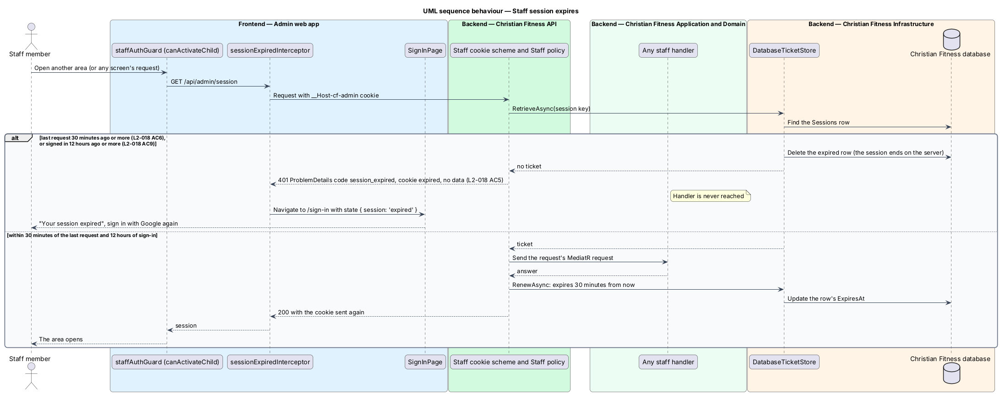

# Admin sign-in

## Overview

Christian Fitness is a Christian community for health in body and spirit in the Greater Toronto
Area. It runs two web apps: the *Member web app* for members and the *Admin web app* for the team.
This feature is the door to the Admin web app. It lets a staff member sign in, keeps every admin
endpoint closed to anyone without a staff session, and ends an idle session.

- **staff member** — person whose account holds a staff role (Admin or Moderator, see `staff-roles`)
- **staff session** — authenticated cookie session issued by the admin sign-in and accepted only by admin endpoints
- **idle timeout** — interval of 30 minutes without a request after which a staff session expires
- **lockout** — refusal of further sign-ins for one email after 5 failures within 15 minutes (`L2-004` AC3)

A member account without a staff role holds valid credentials but is refused with code
`not_staff`. Wrong credentials produce one generic message that does not reveal whether the
email or the password was wrong.

## Description

The slice runs from the Staff sign in screen (mock `docs/mocks/pages/admin-sign-in/`) to the
member store ([ADR 0010](../../../adr/0010-staff-sign-in-and-admin-shell.md)).

- **`SignInPage`** — routed page `/sign-in` in `projects/admin`, loaded with `loadComponent`. It
  renders the `staff` card through `StaffLayout` (`components`) with `TextField`, `FormAlert` and
  `Button`: Work email, Password, Sign in, and the `submitting` state ("Signing in…", disabled,
  fields read-only). A refusal shows one `form-alert` that takes focus, chosen from the error
  `code` by `staffSignInRefusalOf` (`domain`): `invalid` (no field marked, L2-018 AC3),
  `not-staff` (AC2) or `failed`. What was typed stays. Success navigates to the Dashboard.
- **`StaffSessionApi` / `STAFF_SESSION_SERVICE`** — contract and injection token in the `api`
  library: `current()`, `signIn(request)`, `signOut()`. Refusals arrive as an `ApiError` with
  `code`.
- **`HttpStaffSessionService`** — HTTP implementation bound in the admin `app.config.ts`, which
  also provides the HTTP client with `serverErrorInterceptor` and `antiforgeryInterceptor`.
- **`staffAuthGuard`** (`domain`) — on the shell that parents every staff route. It calls
  `current()`; a 401 sends the visitor to `/sign-in`, a 5xx is left to the server-error screen.
- **`StaffSessionController`** — ASP.NET Core controller. `POST /api/admin/session` is
  `[AllowAnonymous]`; `GET` and `DELETE` require the `Staff` policy. Each action sends one MediatR
  request: `StaffSignInCommand`, `GetStaffSessionQuery`, `StaffSignOutCommand`.
- **`StaffSignInHandler`** — checks the credentials through `MemberCredentials`, the check the
  member sign-in shares (unknown email and wrong password give the same `invalid_credentials`,
  in the same time), then reads the `StaffRole`: none refuses `not_staff` (403) and sets no
  cookie; a role signs in through `IStaffSessionSignIn`. No validator: a blank field is simply
  wrong credentials. `GetStaffSessionHandler` reads the role again, so a role removed since
  sign-in is refused `not_staff`.
- **Staff cookie scheme** — `Staff`, cookie `__Host-cf-admin`: `Secure`, `HttpOnly`,
  `SameSite=Strict`, path `/`, not persistent. The ticket (member id and role claim) lives in the
  `Sessions` table through the same `DatabaseTicketStore` as the member session, so sign-out
  (L2-018 AC6) ends it on the server.
- **`Staff` policy** — authenticates only the `Staff` scheme and requires a role claim; a
  convention adds it to every controller routed under `api/admin`. A visitor or a member session
  gets 401 with a ProblemDetails and nothing else (`L2-018` AC4).

Error codes: `invalid_credentials` (401, one generic message), `not_staff` (403). The lockout of
`L2-004` AC3 (`too_many_attempts`, 429), which AC3 applies here too, arrives with slice 3.2 in
`MemberCredentials`, so both sign-ins get it; the mock's locked copy is that slice's. The two-step
screen (`docs/mocks/pages/admin-two-step/`) is slice 9.2's, and the mock's "Two-step verification
required" note shows from then. The 30-minute idle expiry (AC5) and its session-expired notice
are slice 9.3's. Telemetry records the route template and outcome code, never the email.

## Requirements

| L2 ID | Refines (L1) | Requirement |
|-------|--------------|-------------|
| `L2-018` | `L1-008` | Given a staff account, when it signs in to the admin app with correct credentials, then it lands on the Dashboard. Given a member account without a staff role, when it signs in to the admin app, then it is refused with code `not_staff` and HTTP 403. Given wrong credentials, when signing in, then one generic message is shown, and the L2-004 AC3 lockout applies. Given a request to any admin endpoint without a staff session, when it arrives, then it is refused with HTTP 401 or 403 and no data is returned. Given an admin session idle for 30 minutes, when the next request arrives, then the session has expired and the user must sign in again. Given a signed-in staff member, when they choose Sign out, then the staff session is ended on the server and they return to Staff sign in. |

## Diagrams

### System context

Staff members sign in to Christian Fitness through its Admin web app; the system exports
telemetry without personal data.

### Containers

The Admin web app posts credentials to the Christian Fitness API, which checks the member store
and issues the staff cookie.

### Components

The page calls the `STAFF_SESSION_SERVICE` contract; the controller, behind the `Staff` policy,
sends `StaffSignInCommand`, and the handler checks the credentials and the staff role.

### Class structure

`StaffSignInHandler` handles `StaffSignInCommand`, verifies through `MemberCredentials`, reads
`StaffRole`, and returns `StaffSessionDto` or refuses with a code.

### Behaviour — sign in

The handler checks the credentials, then the staff role (`L2-018` AC1–AC3); the lockout joins the
credential check in slice 3.2.

### Behaviour — idle session expires

A request after 30 minutes of inactivity finds an expired cookie; the API refuses it with HTTP
401 and the interceptor returns the user to sign-in (`L2-018` AC4–AC5).

