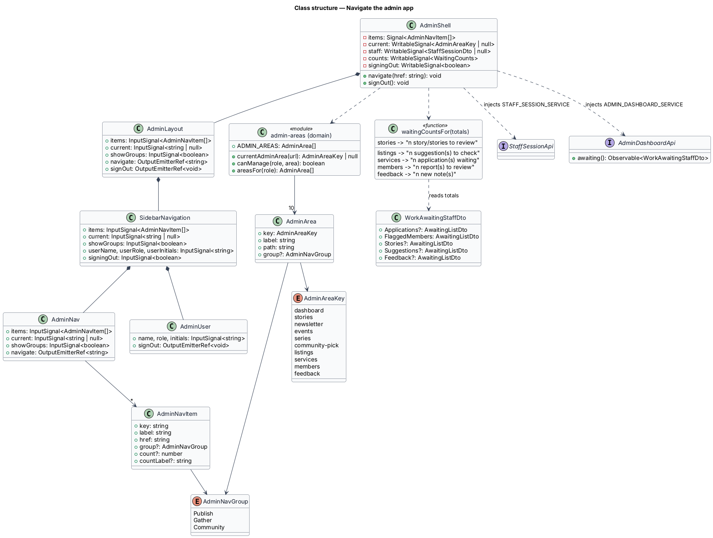

# Navigate the admin app

## Overview

Every admin screen shares one layout: a brand block, a side navigation, the signed-in staff
member and a main area. This feature defines that shell and how it adapts to small screens. It
has no backend behaviour of its own; it calls only the session endpoint from `admin-sign-in`.

- **admin shell** — layout component that hosts every admin route
- **side navigation** — list of the four areas Dashboard, Events, Services and Members
- **stacked card** — table row rendered as a vertical card below viewport LG (992 px)

## Description

- **`AdminShell`** — routed layout component in `projects/admin` that parents every staff route
  behind `staffAuthGuard`, a `canActivateChild` guard, so every move between areas checks the
  staff session: an expired one returns staff to Staff sign in and a refused one (403) shows the
  "Staff only" screen (`admin-sign-in`; [ADR 0014](../../../adr/0014-staff-idle-expiry-sign-in-pause-and-forbidden-screen.md)). It reads the staff session once for the name, role and initials
  (`initialsOf`), keeps the current area (`currentAdminArea` over the router's URL after each
  `NavigationEnd`), hands a plain click on a link to the router and signs out
  ([ADR 0011](../../../adr/0011-staff-sign-in-and-admin-shell.md)).
- **`AdminLayout`** — presentation component in `components` for block `admin`: `admin__sidebar`,
  `admin__brand`, `admin__main`, `admin__page`, with the routed page projected. From 1024 px a
  sticky 256 px column; below, a band with the brand and Sign out on one row and the links under
  them.
- **`AdminNav`** — presentation component for block `admin-nav` (`admin-nav__item`). Inputs: the
  items and the current key; it sets `aria-current="page"` on the current item. Links are real
  `href`s; a plain click emits `navigate` instead of loading the page. Counts
  (`admin-nav__count`) come with the dashboard summary (slice 28.1) and the queues' slices.
- **`AdminUser`** — presentation component for `admin__user`: initials, name and role from LG,
  and the 44 × 44 px Sign out icon button (`admin__signout`) at every viewport.
- **`ADMIN_AREAS`**, **`currentAdminArea`** — in `domain`: the four areas and their paths, and
  which one a URL is in. `canManage` from `staff-roles` filters them by role in slice 29.1.
- **`AreaPage`** — the stand-in each area opens until its slice: its heading only (Dashboard 28.1,
  Events 10.1, Services 21.1, Members 26.1).
- **`DataTable`** — presentation component for block `table` inside `table-wrap`, built with the
  first admin table (slice 10.1). Below LG a container style turns each row into a stacked card
  with `table__strong` as its heading, so the page never scrolls horizontally.

The design system's LG is 1024 px (`64rem`), which the components follow; `docs/specs/L2.md`
gives 992 px. A menu button was planned below LG; the design system and the mocks draw a band
instead, and `L2-021` AC2 was corrected to it (ADR 0011).

## Requirements

| L2 ID | Refines (L1) | Requirement |
|-------|--------------|-------------|
| `L2-021` | `L1-009` | Given viewport LG or wider, when staff use the admin app, then a side navigation shows Dashboard, Events, Services and Members with `aria-current="page"` on the current one. Given viewport below LG, when staff use the admin app, then the side navigation becomes a band at the top: the same four links in one row that scrolls sideways within itself, Sign out stays reachable, and tables become stacked cards without horizontal page scroll. |

## Diagrams

### System context

Staff members move between the four admin areas of Christian Fitness.

### Containers

Navigation runs in the Admin web app; it calls the API only to read the staff session.

### Components

`AdminShell` renders `AdminLayout`, which composes `AdminNav` and `AdminUser`, around the routed page.

### Class structure

The shell reads the router and the session; presentation components take inputs only.

### Behaviour — navigate between areas

Choosing an item checks the staff session, loads the area lazily without reloading the page and moves `aria-current`;
below LG the same links sit in the band (`L2-021` AC1–AC2).

