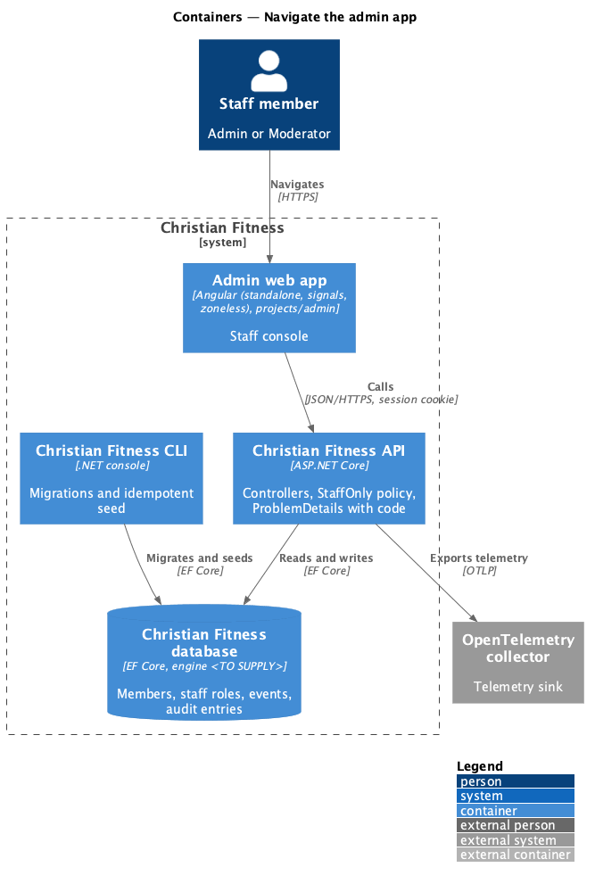
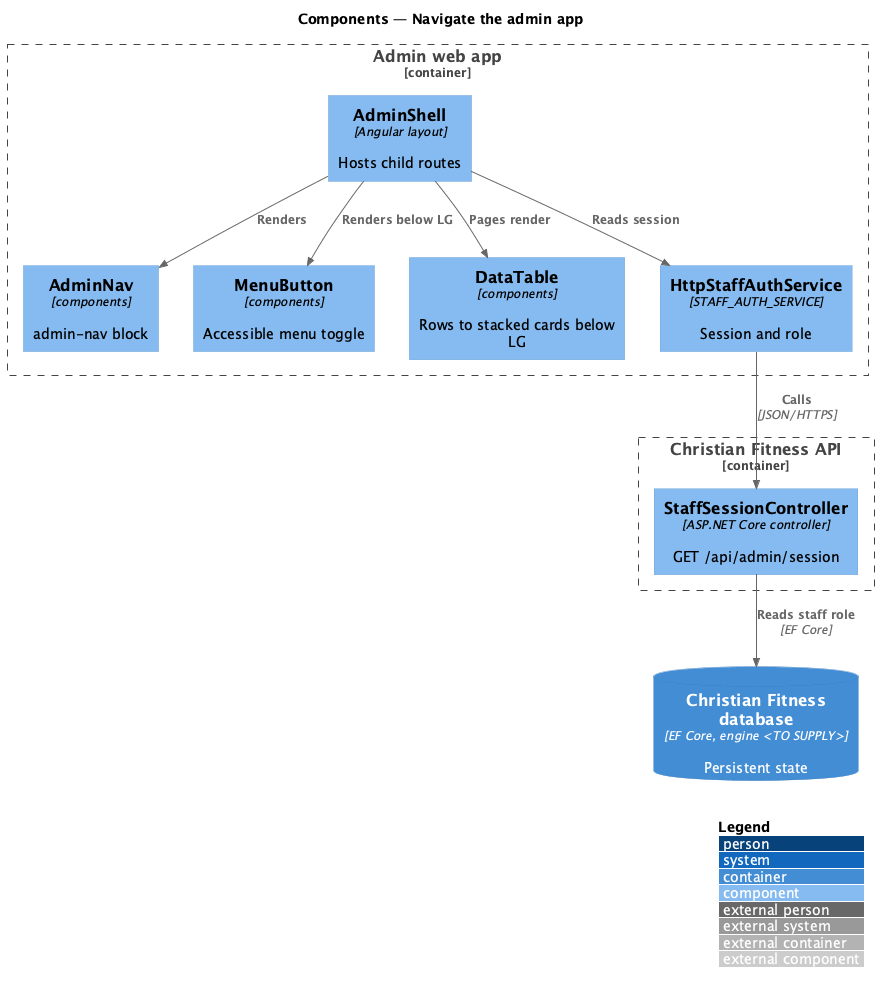

# Navigate the admin app

## Overview

Every admin screen shares one layout: a brand block, a side navigation, the signed-in staff
member and a main area. This feature defines that shell and how it adapts to small screens. It
has no backend behaviour of its own; it calls only the session endpoint from `admin-sign-in`.

- **admin shell** — layout component that hosts every admin route
- **side navigation** — list of the four areas Dashboard, Events, Services and Members
- **stacked card** — table row rendered as a vertical card below viewport LG (992 px)

## Description

- **`AdminShell`** — routed layout component in `projects/admin` that hosts child routes through
  `loadChildren`. It owns the menu-open signal and closes the menu on navigation.
- **`AdminNav`** — presentation component in `components` (block `admin-nav`, element
  `admin-nav__item`, `admin-nav__count`, per the mocks). Input: items and the current path.
  It sets `aria-current="page"` on the current item. Counts beside Services and Members come
  from the dashboard summary; the source when the Dashboard is not loaded is `<TO SUPPLY>`.
- **`AdminSidebar`** — presentation component for block `admin` elements `admin__sidebar`,
  `admin__brand`, `admin__user`, `admin__signout`.
- **`MenuButton`** — presentation component; a 44 × 44 px button with accessible name "Menu"
  and `aria-expanded`, shown below LG. The open menu is a CDK overlay that traps focus and
  closes on Escape.
- **`DataTable`** — presentation component for block `table` inside `table-wrap`. Below LG a
  container style turns each row into a stacked card with `table__strong` as its heading, so
  the page never scrolls horizontally.
- **`ADMIN_NAV_ITEMS`** — constant in the `domain` library listing the four areas and their
  paths; `canManage` from `staff-roles` filters it by role.

## Requirements

| L2 ID | Refines (L1) | Requirement |
|-------|--------------|-------------|
| `L2-021` | `L1-009` | Given viewport LG or wider, when staff use the admin app, then a side navigation shows Dashboard, Events, Services and Members with `aria-current="page"` on the current one. Given viewport below LG, when staff use the admin app, then the navigation collapses behind a menu button with an accessible name, and tables become stacked cards without horizontal page scroll. |

## Diagrams

### System context

Staff members move between the four admin areas of Christian Fitness.

### Containers

Navigation runs in the Admin web app; it calls the API only to read the staff session.

### Components

`AdminShell` composes `AdminSidebar`, `AdminNav`, `MenuButton` and the routed page.

### Class structure

The shell reads the router and the session; presentation components take inputs only.

### Behaviour — navigate on a small screen

Below LG the menu button opens the navigation; choosing an item loads the area lazily and
moves `aria-current` (`L2-021` AC1–AC2).

