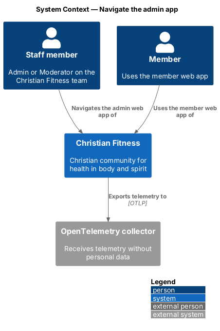
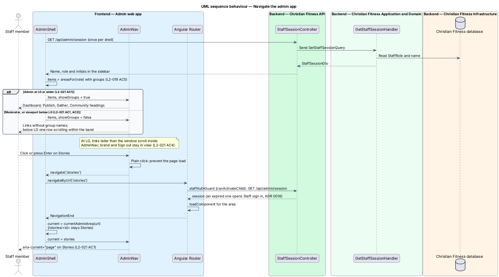
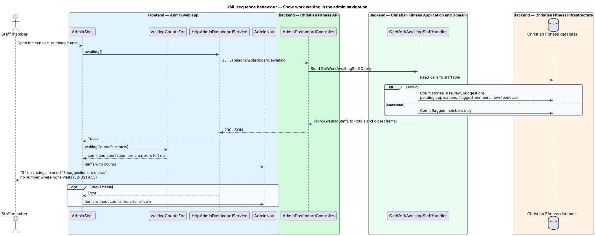

# Navigate the admin app

## Overview

Every admin screen shares one layout: a brand block, a side navigation, the signed-in staff member
and a main area. This feature defines that shell, how its links are grouped, how it shows work
waiting in each area, and how it adapts to small screens. Its only requests are the staff session
from `admin-sign-in` and the counts of work waiting.

- **admin shell** — layout component that hosts every admin route
- **area** — one top-level screen of the console, reached by one link of the side navigation
- **side navigation** — Dashboard, then the areas in three named groups: Publish (Stories,
  Newsletter), Gather (Events, Event series, Community Pick) and Community (Listings, Services,
  Members, Feedback)
- **navigation group** — named heading over related areas, shown only to an Admin at LG or wider
- **waiting count** — number on an area's link of the items that wait for staff there
- **stacked card** — table row rendered as a vertical card below viewport LG

An Admin sees all ten links (mocks `docs/mocks/pages/admin-*/default.html`, block `admin-nav`).
A Moderator sees only the areas the role opens, Dashboard and Members, with no group names
(`L2-019` AC5; mock `docs/mocks/pages/admin-dashboard/moderator.html`). The new areas have designs
of their own: [manage stories](../../publishing/manage-stories/README.md),
[review listing suggestions](../../admin-directory/review-listing-suggestions/README.md) and
[read the feedback inbox](../../feedback/read-feedback-inbox/README.md).

## Description

- **`AdminShell`** — routed layout component in `projects/admin` that parents every staff route
  behind `staffAuthGuard`, a `canActivateChild` guard, so every move between areas checks the staff
  session: an expired one returns staff to Staff sign in and a refused one (403) shows the "Staff
  only" screen (`admin-sign-in`; [ADR 0016](../../../adr/0016-staff-idle-expiry-sign-in-pause-and-forbidden-screen.md)).
  It reads the staff session once for the name, role and initials (`initialsOf`), lists only the
  areas that role opens (`areasFor`; [ADR 0020](../../../adr/0020-staff-roles-by-area.md)), keeps
  the current area (`currentAdminArea` after each `NavigationEnd`), merges the waiting counts into
  the items, hands a plain click on a link to the router and signs out
  ([ADR 0011](../../../adr/0011-staff-sign-in-and-admin-shell.md)).
- **`ADMIN_AREAS`** — the `domain` library's ordered list of areas (`admin/admin-areas.ts`). The
  design grows it from four to ten entries and adds each entry's `group`:

  | Key | Label | Group | Path |
  |-----|-------|-------|------|
  | `dashboard` | Dashboard | none | `/` |
  | `stories` | Stories | Publish | `/stories` |
  | `newsletter` | Newsletter | Publish | `/newsletter` |
  | `events` | Events | Gather | `/events` |
  | `series` | Event series | Gather | `/series` |
  | `community-pick` | Community Pick | Gather | `/community-pick` |
  | `listings` | Listings | Community | `/listings` |
  | `services` | Services | Community | `/services` |
  | `members` | Members | Community | `/members` |
  | `feedback` | Feedback | Community | `/feedback` |

  The paths are fixed by ADR 0079; `/series` is used rather than `/events/series` so that
  `currentAdminArea`'s prefix rule never marks Events for a series.
- **`currentAdminArea(url)`** — the area a URL is in: the Dashboard for `/` alone, any other area
  for its path and every path under it. A story's editor sits under `/stories/<id>`, so Stories
  stays current while a story is edited (`L2-021` AC1; mock `admin-story-editor/`).
- **`canManage` / `areasFor`** — the role table of [staff roles](../staff-roles/README.md). A
  Moderator keeps Dashboard and Members; an Admin opens every area. Which new areas a Moderator
  opens is an open question.
- **`AdminLayout`** — presentation component in `components` (`layout/`, the `admin` block):
  `cf-skip-link` first, then `cf-sidebar-navigation` and `main#main.admin__main`, the routed page
  projected (`L2-038` AC8; [ADR 0019](../../../adr/0019-design-system-layout-navigation-and-migration.md)).
- **`SidebarNavigation`** — the design system's sidebar navigation (`admin__sidebar`) in
  `components/sidebar-navigation/`. From LG it is a column: the brand at the top, `AdminNav` in
  the middle and `AdminUser` at the foot. When the links are taller than the window, only
  `AdminNav` scrolls, so the brand and Sign out stay in view (`L2-021` AC4). Below LG it is a band:
  the brand and Sign out on one row and the links in one row under them, scrolling sideways within
  the band, without group names (`L2-021` AC2).
- **`AdminNav`** — the `admin-nav` block. Inputs: `items`, `current` and `showGroups`. It renders
  each item as `admin-nav__item` with `aria-current="page"` on the current one, and, when
  `showGroups` is true, each group as an `admin-nav__group` `<h2 id>` followed by an `admin-nav__list` `<ul aria-labelledby>` of `<li>` links; Dashboard sits in an unlabelled list, and a Moderator's single list has no headings. A plain
  click (`isPlainClick`) emits `navigate`. The item's `count` shows as `admin-nav__count`, named by
  its `countLabel`, and is absent at zero (`L2-021` AC3). The icon switch gains the six new keys.
- **`AdminNavItem`** — `key`, `label`, `href`, optional `group`, `count` and `countLabel`. The
  design adds `group`; the other fields exist.
- **`AdminUser`** — initials, name and role from LG, and the 44 × 44 px Sign out icon button
  (`admin__signout`) at every viewport.
- **Waiting counts** — the five counts of `L2-021` AC3, each with its phrase:

  | Area | Counts | Phrase (mock) |
  |------|--------|---------------|
  | Stories | stories in review | "1 story to review" |
  | Listings | listing suggestions waiting | "3 suggestions to check" |
  | Services | pending applications | "3 applications waiting" |
  | Members | members needing review | "1 member to review" |
  | Feedback | new notes | "2 new notes" |

  A pure helper in `domain`, `waitingCountsFor(totals)`, turns the totals into `count` and
  `countLabel` per key, singular and plural, and leaves out a zero. The totals come from
  `GET /api/admin/counts` (ADR 0079), a totals-only answer in one MediatR query scoped to the
  caller's role: an Admin gets `stories`, `suggestions`, `applications`, `members` and `feedback`; a
  Moderator gets `members` only, the other keys absent. `members` is the open message reports
  (ADR 0058) plus the flagged members, each member counted once. It shares its count queries with
  the Dashboard's waiting-work handler, which keeps its own answer for its rows. The shell asks once
  on entry and again after each `NavigationEnd` that changes area and each `countsChanged` the admin
  hub pushes, so a count falls after staff resolve work; a failed request leaves the links without
  counts and shows no error.
- **`DataTable`** — presentation component for the `table` block inside `table-wrap`. Below LG a
  container style turns each row into a stacked card with `table__strong` as its heading, so the
  page never scrolls horizontally (`L2-021` AC2).

The design system's LG is 1024 px (`64rem`), which the components follow; `docs/specs/L2.md` gives
992 px. The mocks place the sidebar as a column from 1024 px (`docs/mocks/README.md`, "Admin sidebar
on desktop").

### Decisions (ADR 0079)

- **Count source.** A totals-only `GET /api/admin/counts`, scoped to the caller's role and read again
  when the admin hub pushes `countsChanged`; the Dashboard keeps its own query.
- **Members count.** One number: open message reports (ADR 0058) plus flagged members, each member
  once.
- **Area paths.** `/stories`, `/newsletter`, `/series`, `/community-pick`, `/listings` and `/feedback`.
- **Group headings.** Each group is an `<h2 id>` and a `<ul aria-labelledby>`.

### Open questions

- **Moderators and the new areas.** `L2-021` AC1 limits a Moderator to the areas the role opens,
  and the mocks give them none of the new ones. `docs/mocks/README.md` (open question 8) asks
  whether a Moderator opens Feedback. The answer changes `canManage`, the API's `StaffAccess` table
  and `L2-019`, and needs an ADR amending ADR 0020.
- **Code behind the requirement.** `ADMIN_AREAS` lists four areas with no groups, `AdminNav`
  renders no group headings and has no icons for the new keys, the shell fills no counts, and the
  sidebar does not yet scroll its links alone. The admin app also still routes `sign-in/verify`
  to the two-step screen of the withdrawn `L2-046`. Each is work for the next slices.

## Requirements

| L2 ID | Refines (L1) | Requirement |
|-------|--------------|-------------|
| `L2-021` | `L1-009` | Given viewport LG or wider, when an Admin uses the admin app, then a side navigation shall show Dashboard, then three named groups: Publish (Stories, Newsletter), Gather (Events, Event series, Community Pick) and Community (Listings, Services, Members, Feedback), with `aria-current="page"` on the current one (Stories while a story is edited); a Moderator's shall show only the areas the role opens, without group names. Given viewport below LG, the side navigation shall become a band at the top with the same links in one row, without group names, scrolling sideways within itself; Sign out shall stay reachable, and tables shall become stacked cards without horizontal page scroll. Given work waiting, Stories, Listings, Services, Members and Feedback shall each carry the number waiting, with its meaning in words for assistive technology, and no number when none waits. Given a navigation taller than the window at LG or wider, the links shall scroll within the side navigation while the brand and the signed-in person with Sign out stay in view (acceptance criteria 1–4). |
| `L2-019` | `L1-008` | Given a Moderator, the admin navigation shall show only the areas the role opens (acceptance criterion 5). |
| `L2-038` | `L1-015` | Given any interaction, when performed by keyboard only, then it shall be reachable in a logical order with a visible focus indicator. Given either app's shell, when the first Tab is pressed, then "Skip to content" shall show and move focus to the screen's `main`. Given a component in `docs/design-system/components/`, when a screen needs it, then it shall come from the components library under its design-system name. |

## Diagrams

### System context

Staff members move between the areas of the admin web app of Christian Fitness.

### Containers

Navigation runs in the Admin web app. It calls the API to read the staff session and the totals of
work waiting.

### Components

`AdminShell` renders `AdminLayout`, which composes the skip link and `SidebarNavigation` (with
`AdminNav` and `AdminUser`) around the routed page. The shell reads the session from
`StaffSessionController` and the waiting totals from `AdminDashboardController`.

### Class structure

`ADMIN_AREAS` carries each area's group; `areasFor` filters it by role and `waitingCountsFor`
turns the totals into counts with their phrases. Presentation components take inputs only.

### Behaviour — navigate between areas

Choosing an item checks the staff session, loads the area lazily and moves `aria-current`. An
Admin at LG sees the group names; a Moderator and every viewport below LG see none (`L2-021`
AC1–AC2, AC4).

### Behaviour — show work waiting

The shell asks for the waiting totals on entry and on each change of area, and each area with work
waiting carries its number with the meaning in words (`L2-021` AC3).

