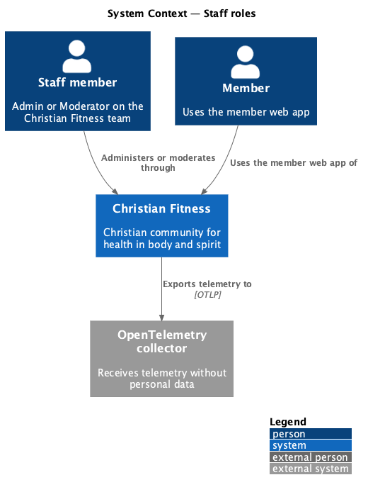
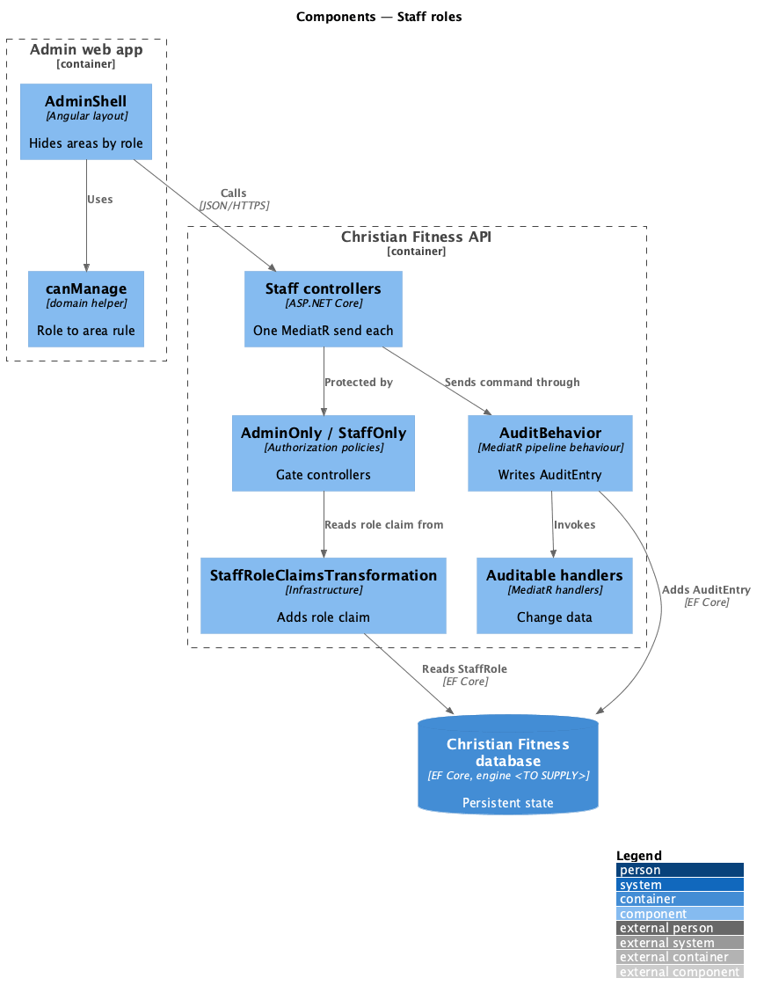

# Staff roles

## Overview

The Admin web app serves two kinds of staff with different duties. This feature defines those
roles, enforces them on every admin endpoint, and records an audit entry for each staff change.

- **Admin** — staff role allowed every admin action
- **Moderator** — staff role allowed to moderate members and refused event and service management
- **audit entry** — stored record of who changed which record, what changed and when

Enforcement happens on the server: the Admin web app hides controls a Moderator cannot use, but
the API decides. Audit entries live in the database; telemetry carries only the action name and
outcome, never personal data.

## Description

- **`StaffRole`** — domain entity linking a `Member` to `StaffRoleName` (`Admin`, `Moderator`).
  Assignment is seeded by the CLI; a screen to assign roles is `<TO SUPPLY>`.
- **Authorization policies** — `StaffOnly` (any staff role) and `AdminOnly` (role Admin). Event and service
  controllers use `AdminOnly`; member moderation and dashboard controllers use `StaffOnly`. A refused request returns HTTP 403 ProblemDetails with code
  `forbidden_role` `<TO SUPPLY: code not named in the spec>`.
- **`StaffRoleClaimsTransformation`** — Infrastructure component that adds the role claim from
  `StaffRole` at each request, so a role change applies without a new sign-in.
- **`IAuditableCommand`** — marker interface on each data-changing staff command, exposing
  `AuditAction` and `RecordType`.
- **`AuditBehavior`** — MediatR pipeline behaviour. After a successful auditable command it adds
  an `AuditEntry` in the same unit of work.
- **`AuditEntry`** — entity: `ActorMemberId`, `Action`, `RecordType`, `RecordId`, `OccurredAt`
  (from `TimeProvider`). Retention is `<TO SUPPLY>`.
- **`StaffSessionDto.Role`** and **`canManage(role, area)`** — the `domain` library helper the
  admin navigation uses to hide Events and Services for a Moderator. The forbidden screen
  (`docs/mocks/pages/admin-forbidden/`) shows when a Moderator opens such a route directly.

## Requirements

| L2 ID | Refines (L1) | Requirement |
|-------|--------------|-------------|
| `L2-019` | `L1-008` | Given staff roles Admin and Moderator, when a Moderator uses the admin app, then they can moderate members but cannot manage events or services (HTTP 403). Given an Admin, when they use the admin app, then every admin action is allowed. Given any staff action that changes data, when it succeeds, then an audit entry records who, what, which record and when, without personal data in telemetry. |

## Diagrams

### System context

Admins and Moderators both use Christian Fitness; telemetry leaves the system without personal
data.

### Containers

The API enforces roles and writes audit entries to the database; the Admin web app only adapts
what it shows.

### Components

Policies gate controllers; the audit behaviour wraps each auditable handler.

### Class structure

`StaffRole` gives a `Member` a `StaffRoleName`; `AuditBehavior` writes an `AuditEntry` for each
`IAuditableCommand`.

### Behaviour — role check and audit

A Moderator is refused on an event endpoint; an Admin succeeds and the change is audited in the
same commit (`L2-019` AC1–AC3).

