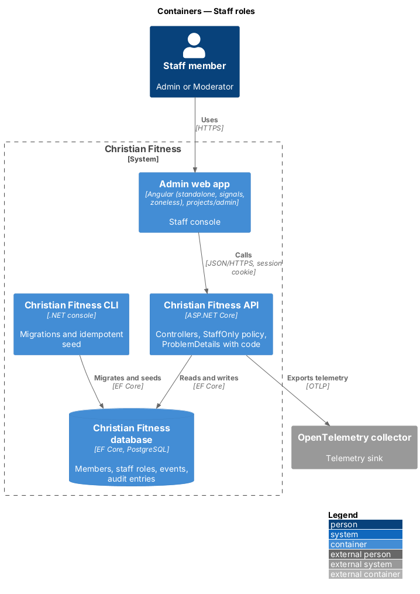
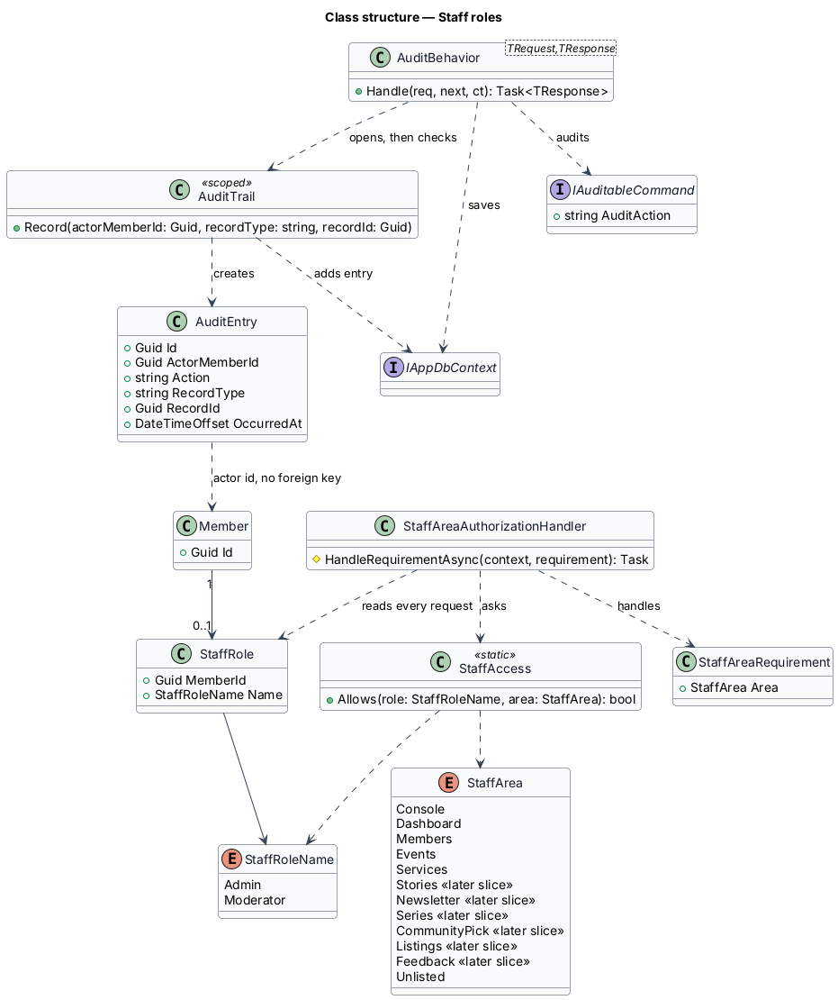
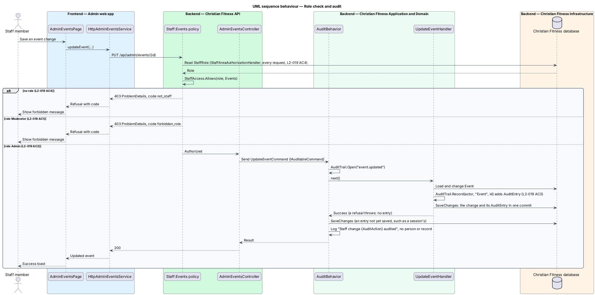
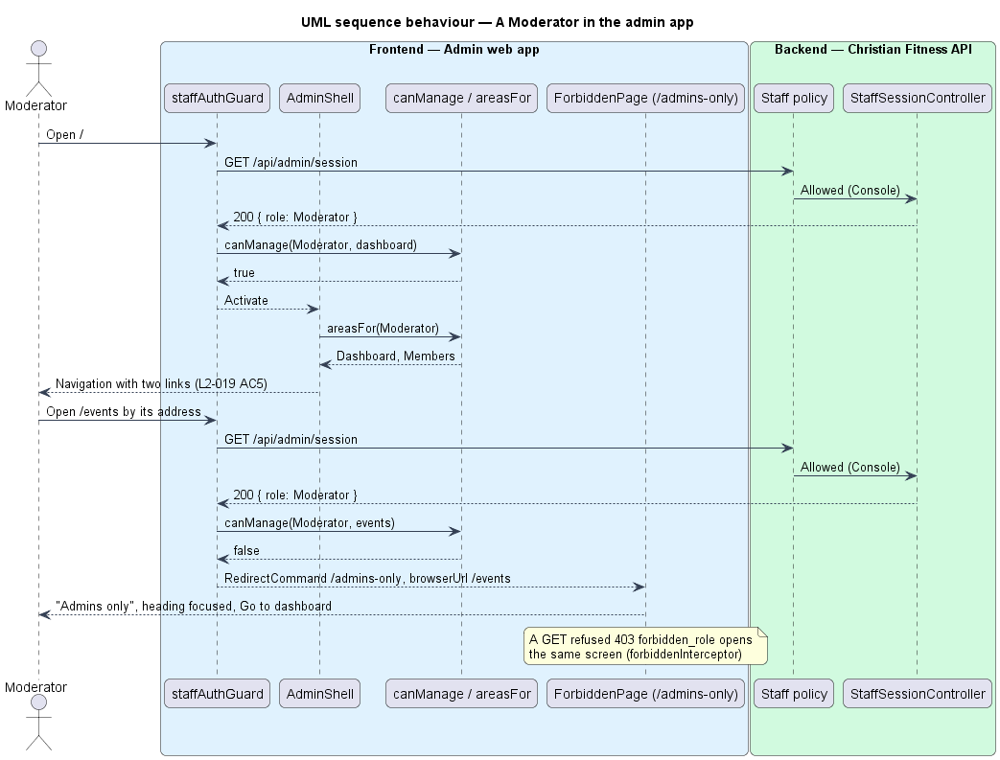

# Staff roles

## Overview

The Admin web app serves two kinds of staff with different duties. This feature defines those
roles, enforces them on every admin endpoint, and records an audit entry for each staff change.

- **Admin** — staff role allowed every admin action
- **Moderator** — staff role allowed the staff session, the Dashboard, Members, Newsletter, Event
  series, Community Pick, Listings and Feedback, and refused Stories, Events and Services
  ([ADR 0064](../../../adr/0064-moderator-areas.md), amending ADR 0020)
- **staff area** — part of the admin console an endpoint belongs to, named by the first segment
  of its route under `api/admin`: the console itself (the session), Dashboard, Members, Events,
  Services, each area a later slice names (Stories, Newsletter, Event series, Community Pick,
  Listings, Feedback), or none yet (unlisted)
- **audit entry** — stored record of who changed which record, what changed and when

Enforcement happens on the server: the Admin web app hides what a Moderator cannot use, but the
API decides, and it reads the role from the database on every admin request, so a role changed or
taken away applies at the next request without a new sign-in. Audit entries live in the database;
telemetry carries only the action name and outcome, never personal data.

## Description

Slice 29.1 builds the roles and their enforcement (`L2-019` AC1, AC2, AC4, AC5;
[ADR 0020](../../../adr/0020-staff-roles-by-area.md)); slice 29.2 builds the audit (AC3;
[ADR 0023](../../../adr/0023-audit-staff-changes.md)).

- **`StaffRole`** — domain entity linking a `Member` to `StaffRoleName` (`Admin`, `Moderator`),
  one per member. `cf seed` grants the first account Admin; a screen to grant or change roles is
  not in scope (open question 1).
- **`StaffArea`** and **`StaffAccess.Allows(role, area)`** — the Domain rule, one table: an Admin
  may use every area; a Moderator may use `Console`, `Dashboard`, `Members`, `Newsletter`, `Series`,
  `CommunityPick`, `Directory` (Listings) and `Feedback`, so `Publishing` (Stories), `Events`, `Services` and
  `Unlisted` are closed to them (`L2-019` AC1 holds the table, ADR 0064). The same table, without `Console` and
  `Unlisted`, is the `domain` library's `canManage` (below), and both suites hold its rows.
- **`StaffAreaConvention`** (Api) — replaces slice 9.1's staff area convention: every controller
  routed under `api/admin` gets the policy of its area, read from the segment after the prefix
  (`session` → `Console`, `dashboard`, `members`, `events`, `services`; any other segment →
  `Unlisted`, so a new area is closed to Moderators until its slice names it). No controller
  names a policy, so slice 10.1's `api/admin/events` and every later admin endpoint are covered
  without a change. `[AllowAnonymous]` (starting Google sign-in and its return,
  [sign in with Google](../../member-access/sign-in-with-google/README.md)) still opts out.
- **New areas** — the grouped navigation of `L2-021` AC1 adds six areas: Stories, Newsletter,
  Event series, Community Pick, Listings and Feedback
  ([navigate the admin app](../navigate-admin-app/README.md)). ADR 0064 settles them: Stories is
  Admins only; the other five are open to a Moderator too, which matches the mocks
  (`docs/mocks/pages/admin-dashboard/moderator.html` and the `moderator` state of each area).
  Until a slice adds its `StaffArea` value and route segment, its endpoints are `Unlisted` and
  closed to Moderators. Each slice adds one `StaffArea` value, one row to `StaffAccess` and to
  `canManage` as the table says, and one case to both suites' tables.
- **Area policies** — one per `StaffArea`, `Staff` for `Console` (the name slice 9.1 gave the
  staff policy) and `Staff:{Area}` for the others: the staff cookie scheme, an authenticated user
  and a `StaffAreaRequirement(area)`. The `StaffOnly` and `AdminOnly` of other designs are these
  policies: `Staff:Dashboard`, `Staff:Members`, `Staff:Newsletter`, `Staff:Series`,
  `Staff:CommunityPick`, `Staff:Directory` and `Staff:Feedback` admit both roles, `Staff:Publishing` (Stories),
  `Staff:Events` and `Staff:Services` only Admins.
- **`StaffAreaAuthorizationHandler`** (Infrastructure) — reads the member id from the session and
  that member's `StaffRole` through `IAppDbContext`, once per request, and asks
  `StaffAccess.Allows`. No role fails with the reason `not_staff`; a role the area refuses fails
  with `forbidden_role`. The role claim the staff cookie carries from sign-in is no longer read
  for access.
- **`StaffRefusalResultHandler`** (Api) — the `IAuthorizationMiddlewareResultHandler`: when a staff
  policy forbids, it puts the failure's code on the request (`ProblemCodes.Override`), and the
  default handler's 403 becomes ProblemDetails with that `code` and nothing else (`L2-032`). No
  log, metric or span records the role or the member.
- **`canManage(role, area)`** (`domain`, `admin-areas.ts`) — the frontend half of the table, for
  every `AdminAreaKey`: four today, ten once the grouped navigation lands. `areasFor(role)` lists
  `ADMIN_AREAS` that role may open; the navigation drops the group names for a Moderator
  (`L2-021` AC1).
- **`AdminShell`** — builds the navigation from `areasFor(staff.role)` once the session has
  loaded, and shows no link before that, so a Moderator never sees Stories, Events or Services
  (`L2-019` AC5, `L2-021` AC1).
- **`staffAuthGuard`** — besides the session, checks `canManage` for the area of the URL the
  navigation is going to; a refused area redirects (`RedirectCommand`) to `/admins-only` with
  `browserUrl` set to that URL, so the address bar keeps `/events` and a reload asks again.
- **`forbiddenInterceptor`** — a 403 to a GET whose code is `forbidden_role` opens `/admins-only`
  instead of `/forbidden`, with the same `browserUrl` rule (ADR 0016). Every other 403 still opens
  "Staff only".
- **`ForbiddenPage`** at `/admins-only` — the same lazy screen with the route data
  `{ reason: 'role' }` and the title "Admins only · Christian Fitness Admin": the heading "Admins
  only", which takes focus, "Only Admins can open this area. As a moderator, you can open the
  areas in your navigation, starting from the Dashboard." (general, so no area is named), a "Go to
  dashboard" link (`Button` with `href`, a whole-document load, as the error screens do) and the
  note "Need to manage this area? Ask a community director to make you an admin." (mock
  `docs/mocks/pages/admin-forbidden/role.html`). A Moderator's session is valid, so there is no
  Sign out here; the shell has one.
- **`IAuditableCommand`** (Application) — the marker every data-changing staff command carries,
  with `AuditAction`, a stable name `{record}.{past tense}` implemented explicitly so it is never
  bound from a request body. The command that completes a staff Google sign-in is
  `staff_session.started` (its name is `<TO SUPPLY>` by
  [sign in with Google](../../member-access/sign-in-with-google/README.md); `VerifyTwoStepCommand`
  carried the action until `L2-046` was withdrawn) and `StaffSignOutCommand`
  `staff_session.ended`; `CreateEventCommand` (slice 10.1) is `event.created`, and every later
  staff command adds the marker and one `Record` call, nothing else. The new requirements that ask
  for an audit entry "as `L2-019` AC3 states" (stories, the newsletter, series dates, listing
  suggestions and feedback replies) use this marker unchanged. The handler does not
  save: the behaviour's one `SaveChangesAsync` commits the change and its entry together.
- **`AuditTrail`** (Application, scoped) — the request's pending entry. The behaviour opens it with
  the command's action; the handler calls `Record(actorMemberId, recordType, recordId)` once, when
  the change is going ahead and before it saves, which adds the `AuditEntry` to `IAppDbContext`, so
  a change saved there is committed with its entry. Only the handler knows the actor for certain
  (the sign-in return is anonymous until it succeeds, and sign-out reads the member before the
  session ends) and the record (a created record's id). `Record` outside an auditable command, or
  twice, throws.
- **`AuditBehavior<TRequest, TResponse>`** (Application) — the MediatR pipeline behaviour after
  validation: it passes every other request straight through; for an `IAuditableCommand` it opens
  the trail, runs the handler and, on success, saves (the entry of a change saved outside the
  context, such as a session the ticket store keeps) and logs `Staff change {AuditAction} audited`
  with the action as the only attribute. A refusal or failure throws before that, so the entry is
  never saved; a handler that names no record fails the request (HTTP 500), so a forgotten `Record`
  is caught by its slice's first test.
- **`AuditEntry`** (Domain) — `Id` (version 7), `ActorMemberId`, `Action`, `RecordType`, `RecordId`
  and `OccurredAt` from `TimeProvider`; no name, email, field value or request text. The
  `AuditEntries` table has no foreign key, so an entry outlives the member and the record it names,
  and indexes by record and by actor, each with time. A staff session's record is the staff
  member's own id (its key is a secret). Entries are kept with no automatic deletion; a retention
  period, if one is set, comes with the screen that reads them (open question 2).

## Requirements

| L2 ID | Refines (L1) | Requirement |
|-------|--------------|-------------|
| `L2-019` | `L1-008` | Given staff roles Admin and Moderator, when a Moderator uses the admin app, then they can moderate members and run Newsletter, Event series, Community Pick, Listings and Feedback but cannot manage stories, events or services (HTTP 403, code `forbidden_role`; the table is in `L2-019` AC1, ADR 0064). Given an Admin, when they use the admin app, then every admin action is allowed. Given any staff action that changes data, when it succeeds, then an audit entry records who, what, which record and when, without personal data in telemetry; a refused or failed one records none. Given a role changed or taken away, the next request applies it (`not_staff` when taken away). Given a Moderator, the navigation lists only the areas the table opens to them, and Stories, Events or Services by address shows "Admins only". |
| `L2-021` | `L1-009` | Given viewport LG or wider, a Moderator's side navigation shall show only the areas the role opens, without group names, with `aria-current="page"` on the current one (acceptance criterion 1). |
| `L2-047` | `L1-008`, `L1-015` | A 403 to a read shall show "Staff only", except `forbidden_role`, which shall show "Admins only"; a 403 to a change shall be handled by the screen that sent it, as Staff sign in does for `not_staff` (acceptance criteria 1 and 3). |

## Diagrams

### System context

Admins and Moderators both use Christian Fitness; telemetry leaves the system without personal
data.

### Containers

The API enforces roles and writes audit entries to the database; the Admin web app only adapts
what it shows.

### Components

The convention gives each admin controller its area's policy; the area handler reads the role
from the database and asks the domain rule; the audit behaviour wraps each auditable handler.

### Class structure

`StaffRole` gives a `Member` a `StaffRoleName`; `StaffAccess` decides each `StaffArea`;
`AuditBehavior` writes an `AuditEntry` for each `IAuditableCommand`.

### Behaviour — role check and audit

A Moderator is refused on an event endpoint with `forbidden_role`; an Admin succeeds and the
change is audited in the same commit (`L2-019` AC1–AC4).

### Behaviour — a Moderator in the admin app

The navigation lists Dashboard and Members; Events by its address shows "Admins only" with the
address kept (`L2-019` AC5).

## Open questions

1. **Known gap: no screen grants roles.** Granting, changing and taking away roles has no screen:
   `cf seed` grants the first Admin, and anything else is a change in the database until a later
   slice adds one. The API already applies such a change at the next request.
2. **Known gap: nothing reads or prunes the audit trail.** No endpoint or screen lists entries, and
   no job deletes them. Slice 29.2 keeps every entry (ADR 0023); the slice that adds an audit view
   decides who may read it and whether entries older than a period are deleted.
3. ~~Which of the six new areas a Moderator opens.~~ Settled by ADR 0064 and `L2-019` AC1: Stories
   is Admins only; Newsletter, Event series, Community Pick, Listings and Feedback are open to a
   Moderator.
4. ~~The "Admins only" screen's words.~~ Settled by ADR 0064: they are general ("Only Admins can
   open this area."), and `L2-019` AC5 no longer names Events and Services.
5. With staff signing in through Google Workspace (`L2-018`), a staff role still hangs on a
   `Member`. A Workspace account maps to that member by Google subject: a verified email in the
   team's domain is matched to the pre-created staff member on first sign-in and the subject is bound
   ([ADR 0062](../../../adr/0062-first-google-sign-in-slice.md)); an Admin creates later staff;
   this feature reads the role by member id either way.
