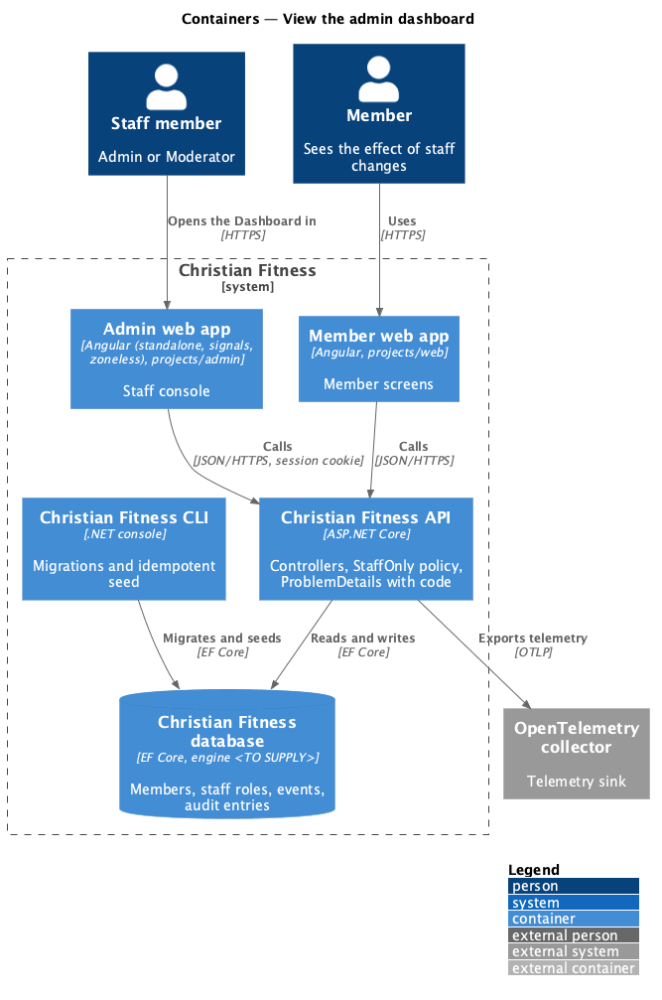
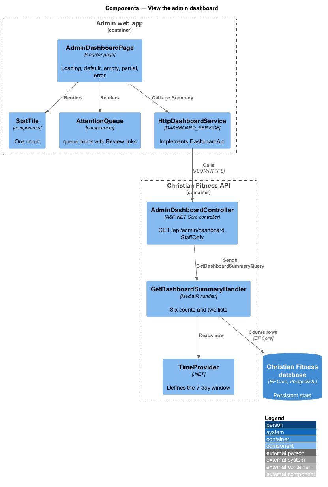
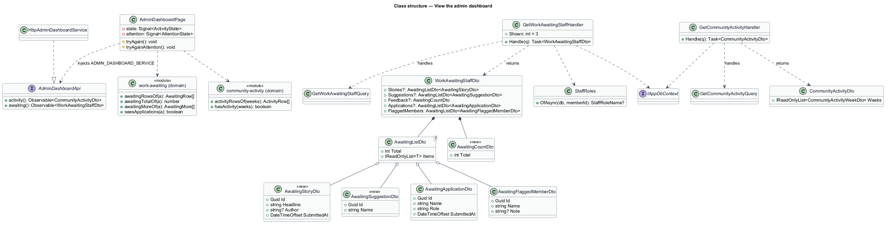
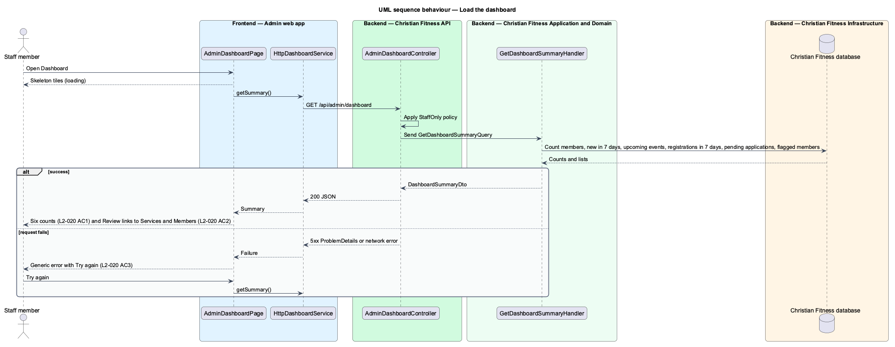

# View the admin dashboard

## Overview

The Dashboard is the first screen a staff member sees after sign-in. It summarises community
activity and the work waiting for staff, and links each waiting item to the screen that resolves
it. Admins and Moderators both see it.

- **pending application** — professional's application to list services that no staff member has approved or declined yet
- **flagged member** — member whose `MemberStatus` is `Flagged`
- **upcoming event** — published event whose start is later than now
- **7-day window** — interval from 7 days before the request time to the request time, read from `TimeProvider`

## Description

- **`AdminDashboardPage`** — routed page in `projects/admin`, loaded with `loadComponent`, matching
  `docs/mocks/pages/admin-dashboard/` in the states `loading`, `default`, `empty`, `partial` and
  `error`. It holds the summary in a signal and renders sections "Needs attention", "Community"
  and "Upcoming events". The upcoming list sits below the fold inside `@defer (on viewport)`.
- **`StatTile`** — presentation component in `components` for one labelled count.
- **`AttentionQueue`** — presentation component for block `queue` (`queue__title`, `queue__meta`,
  `queue__body`). Each row carries a Review link: pending applications link to Services, flagged
  members to Members filtered to Flagged.
- **`DashboardApi` / `DASHBOARD_SERVICE`** — contract and token in the `api` library with
  `getSummary(): Promise<DashboardSummaryDto>`; `HttpDashboardService` implements it and is bound
  in the admin `app.config.ts`. The page provides nothing in `root`.
- **`AdminDashboardController`** — `GET /api/admin/dashboard` under `StaffOnly`; one MediatR send.
- **`GetDashboardSummaryQuery`** / **`GetDashboardSummaryHandler`** — reads six counts with
  no-tracking queries through `IAppDbContext`: total members, members created in the 7-day window,
  upcoming events, registrations created in the 7-day window, pending applications and flagged
  members. It also returns the first pending items and the next upcoming events; the list sizes
  are `<TO SUPPLY>`.
- **`DashboardSummaryDto`** — numeric fields only (`TotalMembers`, `NewMembers7d`,
  `UpcomingEvents`, `Registrations7d`, `PendingApplications`, `FlaggedMembers`) plus the two lists.

### Community activity (slice 28.1, ADR 0058)

- **`GET /api/admin/dashboard/activity`** — in `AdminDashboardController` under the Dashboard area, so
  Admins and Moderators both read it; one MediatR send of `GetCommunityActivityQuery`.
- **`GetCommunityActivityHandler`** — reads `TimeProvider` and counts, for each of the last eight
  weeks, members by `JoinedAt`, registrations by `CreatedAt` and chat plus direct messages by `SentAt`
  through `IAppDbContext`; it loads no row, so no name, address or message text is read.
- **Weeks** — Monday 00:00 UTC to the next Monday; the eighth is the current week, to now. The answer
  is `{ weeks: [{ start, newMembers, registrations, messages }] }`, oldest first.
- **Screen** — `AdminDashboardPage` heads the page "Dashboard" and shows "Community activity" as the
  library `table` (Week of, New members, Registrations, Messages), newest week first, the current one
  "(this week)". States: loading (skeleton rows), empty ("No activity yet"), error ("Activity didn't
  load", Try again; the mock's `partial` state). `activityRowsOf` and `hasActivity` in `domain` shape
  the rows. The rest of the mock's sections are slice 28.2's.

A failed request shows the generic error with Try again, which repeats `getSummary()`. The mock
labels "+86 joined in April", "Registrations, April" and shows "Live listings"; `L2-020` asks for
7-day counts and no listing count, so the mock copy is to be aligned `<TO SUPPLY>`.

## Requirements

| L2 ID | Refines (L1) | Requirement |
|-------|--------------|-------------|
| `L2-020` | `L1-009` | AC4 to AC6 (slice 28.1): the weekly community activity, its empty state and its error. Given staff on the Dashboard, when it loads, then it shows total members, new members in the last 7 days, upcoming events, registrations in the last 7 days, pending applications and flagged members. Given pending applications or flagged members, when the Dashboard loads, then each shows a link to the screen that resolves it. Given the dashboard request fails, when it loads, then a generic error with Try again is shown. |

## Diagrams

### System context

Staff members read community activity in Christian Fitness; members generate that activity.

### Containers

The Admin web app reads one summary from the Christian Fitness API, which counts rows in the
database.

### Components

The page renders presentation components from one `DASHBOARD_SERVICE` call; the handler counts
through `IAppDbContext`.

### Class structure

`GetDashboardSummaryHandler` reads `Member`, `Event`, `Registration` and
`ProfessionalApplication` and returns `DashboardSummaryDto`.

### Behaviour — load the dashboard

The page shows skeletons, then the six counts and links, or the generic error with Try again
(`L2-020` AC1–AC3).

