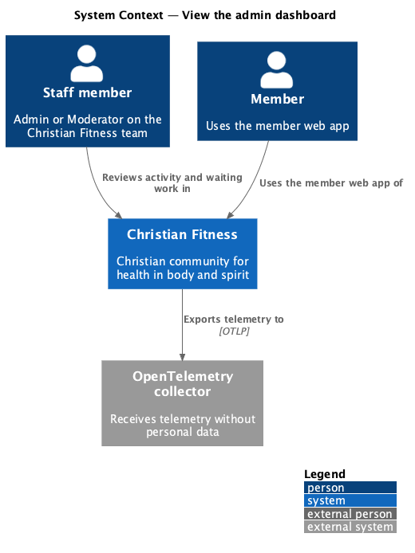
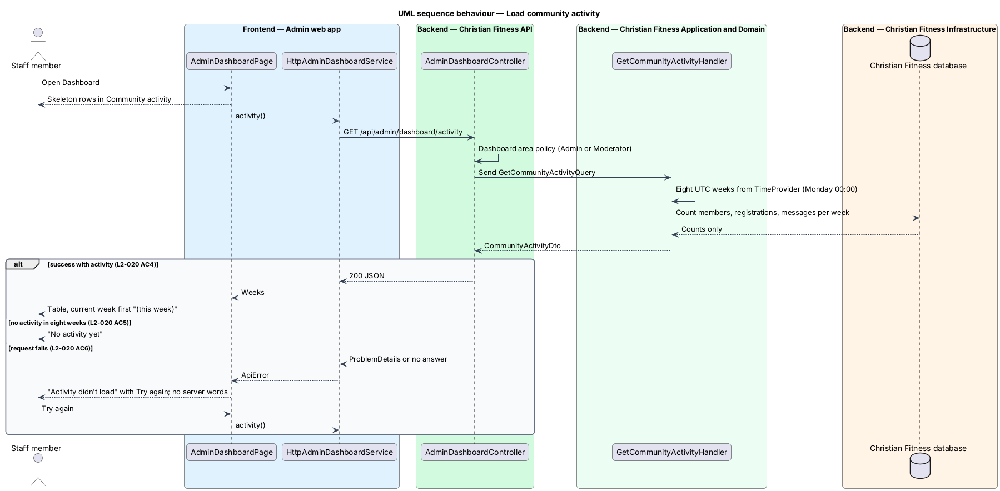
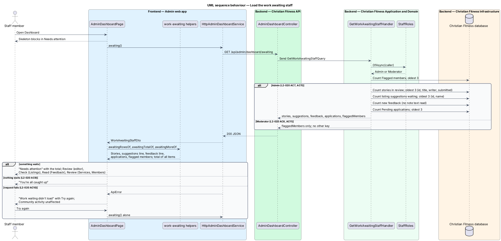

# View the admin dashboard

## Overview

The Dashboard is the first screen a staff member sees after sign-in. It summarises community
activity and the work waiting for staff, and links each waiting item to the screen that resolves
it. Admins and Moderators both see it.

- **pending application** — professional's application to list services that no staff member has
  approved or declined yet
- **flagged member** — member whose `MemberStatus` is `Flagged`
- **story in review** — story a writer has submitted for review and no Admin has published or sent
  back yet ([manage stories](../../publishing/manage-stories/README.md))
- **listing suggestion** — listing a member has suggested for the directory that staff have not
  approved or declined yet ([review listing suggestions](../../admin-directory/review-listing-suggestions/README.md))
- **new feedback** — note a member has sent that no staff member has opened or answered yet
  ([read the feedback inbox](../../feedback/read-feedback-inbox/README.md))
- **Needs attention** — the Dashboard's queue of work waiting, with the count of all that waits
- **upcoming event** — published event whose start is later than now
- **7-day window** — interval from 7 days before the request time to the request time, read from
  `TimeProvider`

For an Admin, "Needs attention" lists the stories in review first, then one line for the listing
suggestions waiting, one line for new feedback, then the pending applications and the flagged
members (`L2-020` AC7, AC11; mock `docs/mocks/pages/admin-dashboard/default.html`). A Moderator's
queue holds the listing suggestions and new feedback lines and the flagged members, not the stories or
applications (`L2-020` AC8, AC11; ADR 0064; mock `moderator.html`).

## Description

The Dashboard reads two answers that load, empty and fail apart from each other: the community
activity (slice 28.1, [ADR 0059](../../../adr/0059-community-activity.md)) and the work awaiting
staff (slice 28.2, [ADR 0060](../../../adr/0060-work-awaiting-staff.md)). ADR 0060 superseded the
earlier single `GetDashboardSummaryQuery`; the six totals of `L2-020` AC1 are not built (see Open
questions).

### Screen and contract

- **`AdminDashboardPage`** — routed page in `projects/admin`
  (`pages/dashboard/dashboard-page.ts`), loaded with `loadComponent`. It binds
  `ADMIN_DASHBOARD_SERVICE` to `HttpAdminDashboardService` on its own `providers` and holds one
  state signal per section. It heads the page "Dashboard" and renders "Needs attention" above
  "Community activity", matching `docs/mocks/pages/admin-dashboard/` in the states `loading`,
  `default`, `empty`, `partial`, `attention-error`, `error` and `moderator`.
- **`AdminDashboardApi` / `ADMIN_DASHBOARD_SERVICE`** — contract and token in
  `api/src/admin/admin-dashboard.ts`: `activity()` answers `CommunityActivityDto` and `awaiting()`
  answers `WorkAwaitingStaffDto`. A failure errors with an `ApiError`.
- **`activityRowsOf`, `hasActivity`** — pure helpers in `domain/src/dashboard/community-activity.ts`
  that shape the weeks, newest first, the current one "(this week)".
- **`awaitingRowsOf`, `awaitingTotalOf`, `awaitingMoreOf`, `seesApplications`** — pure helpers in
  `domain/src/dashboard/work-awaiting.ts` that shape the queue. The design extends each:
  - `awaitingRowsOf` puts stories in review first, then the suggestions line, then the feedback
    line, then applications and flagged members (`L2-020` AC11);
  - `awaitingTotalOf` sums every total in the answer, the three new ones included, so the count is
    of all that wait;
  - `awaitingMoreOf` adds "All N stories in review" when more stories wait than are named.

  Each rule gets unit tests, one case per row of the order and the sum.
- **Queue rows** — the page composes the queue from library parts (`List` card, `Button` link,
  `Link`), with the page's own BEM block `attention`, as ADR 0060 records. Each row's action names
  its row for assistive technology. The new rows:

  | Row | Title | Line | Action |
  |-----|-------|------|--------|
  | Story in review | "“<title>” is ready for review" | "<writer> · Submitted <date>" | Review → the story's editor |
  | Suggestions | "<n> listings suggested by members" | the names, comma-separated | Check → Listings |
  | Feedback | "<n> new pieces of feedback" | `<TO SUPPLY>` | Read → Feedback |

  The suggestions and feedback lines show only when their total is above zero. The story title,
  the writer and each suggested name are rendered as text, never as HTML.

### Community activity (slice 28.1, ADR 0059)

- **`GET /api/admin/dashboard/activity`** — in `AdminDashboardController` under the Dashboard area,
  so Admins and Moderators both read it; one MediatR send of `GetCommunityActivityQuery`.
- **`GetCommunityActivityHandler`** — reads `TimeProvider` and counts, for each of the last eight
  weeks, members by `JoinedAt`, registrations by `CreatedAt` and chat plus direct messages by
  `SentAt` through `IAppDbContext`; it loads no row, so no name, address or message text is read.
- **Weeks** — Monday 00:00 UTC to the next Monday; the eighth is the current week, to now. The
  answer is `{ weeks: [{ start, newMembers, registrations, messages }] }`, oldest first.
- **Section** — the library `table` (Week of, New members, Registrations, Messages). States: loading
  (skeleton rows), empty ("No activity yet"), error ("Activity didn't load", Try again; the mock's
  `partial` state).

### Work awaiting staff (slice 28.2, ADR 0060, extended by `L2-020` AC11)

- **`GET /api/admin/dashboard/awaiting`** — in `AdminDashboardController` under the Dashboard area;
  one MediatR send of `GetWorkAwaitingStaffQuery`. The controller checks nothing.
- **`GetWorkAwaitingStaffHandler`** — reads the caller's staff role through `StaffRoles`. For every
  caller it counts Flagged members and names the oldest three (`Shown` = 3). For an Admin it also:
  - counts Pending applications and names the oldest three by `SubmittedAt`;
  - counts stories in review and names the oldest `Shown` by submitted time, with id, title, writer
    and submitted time;
  - counts listing suggestions waiting and names the oldest `Shown`, with id and name;
  - counts new feedback notes, and reads no note's text.

  For a Moderator it reads the suggestions and feedback counts but not the stories or applications, and the answer has no key for those two (`L2-020` AC8,
  AC11; ADR 0064). Each count is a `CountAsync` through `IAppDbContext` with `AsNoTracking`.
- **`WorkAwaitingStaffDto`** — gains three keys; `stories` is omitted for a Moderator as
  `Applications` is, while `suggestions` and `feedback` are sent to both roles:
  - `stories: AwaitingListDto<AwaitingStoryDto>` — `{ id, title, writer, submittedAt }`;
  - `suggestions: AwaitingListDto<AwaitingSuggestionDto>` — `{ id, name }`;
  - `feedback: AwaitingCountDto` — `{ total }` only.

  `AwaitingListDto<T>` (`{ total, items }`) is reused as it is. Nothing else is sent: no email, no
  suggester, no note text and no story body.
- **Entities** — the handler reads the story, listing-suggestion and feedback entities that the
  publishing, admin-directory and feedback designs introduce. Their names and the status values
  that mean "in review", "waiting" and "new" are `<TO SUPPLY>` by those designs.
- **Section** — "Needs attention" with the sum of all totals, the rows above, "All N" links, and
  its own loading (skeleton), empty ("You're all caught up") and error ("Work waiting didn't load",
  Try again) states, apart from the activity section's. Its Try again asks for this answer alone
  (`L2-020` AC10).
- **Navigation counts** — the admin side navigation reads the same totals for its waiting counts
  ([navigate the admin app](../../admin-access/navigate-admin-app/README.md); `L2-021` AC3).

### Telemetry

The handler logs nothing. A span records the route template only; no span, metric or log carries a
story title, a suggested name, a member's name or a note (`L2-033` AC2).

### Open questions

- **The six totals and the Community tiles.** `L2-020` AC1–AC3 ask for six totals and a generic
  error; the mock draws a "Community" block with Members, "+86 joined in April", "Registrations,
  April" and "Live listings", which match neither the 7-day windows of AC1 nor its list. ADR 0060
  left them unbuilt. Aligning the mock or the requirement, and the slice that builds the tiles, is
  `<TO SUPPLY>`. The mock's "Upcoming events" list with its own error state ("Upcoming events
  didn't load.") has no acceptance criterion.
- **Queue count.** `L2-020` AC11 says the count is of all that wait. The mock shows 7 for one
  story, three suggestions, two notes, three applications and one flagged member, which is 10
  items or 7 rows. The design counts items, as AC11 states; the mock's number should change.
- **How many stories.** AC11 lists "each story in review"; the design names the oldest three and
  adds "All N stories in review", the bound ADR 0060 sets for the other lists. A new ADR, or an
  amendment of ADR 0060, should record this.
- **Feedback line.** The mock's feedback line adds "Including a broken “Add to calendar” on
  iPhone", a phrase from a member's note. AC11 asks only for how many, and a note's words are
  personal data that the Dashboard otherwise never reads. The design shows no excerpt; the line
  under the title is `<TO SUPPLY>`.
- **Relative times.** The mock's story row reads "Submitted 1 hour ago"; ADR 0060 shows absolute
  UTC dates so the page needs no clock and does not go stale. The design keeps the absolute date.
- **Code behind the requirement.** `WorkAwaitingStaffDto`, `GetWorkAwaitingStaffHandler` and the
  `work-awaiting` helpers know only applications and flagged members today. Each extension is work
  for the slice that lands stories, suggestions or feedback, and cannot be built before those
  entities exist.

## Requirements

| L2 ID | Refines (L1) | Requirement |
|-------|--------------|-------------|
| `L2-020` | `L1-009` | Given staff on the Dashboard, it shall show total members, new members in the last 7 days, upcoming events, registrations in the last 7 days, pending applications and flagged members, each waiting kind with a link to the screen that resolves it, and a generic error with Try again when the request fails (AC1–AC3). "Community activity" shall show the last eight UTC weeks, the current week first and named "(this week)", with new members, registrations and messages as counts; "No activity yet" when none; "Activity didn't load" with Try again on failure, with no word of the server's (AC4–AC6). For an Admin, "Needs attention" shall show how many wait in all and the oldest three applications (name, role, date) then flagged members (name, staff's note), each with Review, and "All N …" when more wait; a Moderator's shall show flagged members only, the answer carrying no application, count or key; "You're all caught up" when nothing waits; "Work waiting didn't load" with Try again that asks again alone, the activity section loading and failing on its own (AC7–AC10). For an Admin, ahead of the applications and flagged members, it shall list each story in review (title, writer, when submitted, with Review opening the editor), one line for listing suggestions waiting (how many and their names, with Check opening Listings) and one line for new feedback (how many, with Read opening Feedback), the count being of all that wait; a Moderator's shall show none of the three (AC11). |
| `L2-019` | `L1-008` | Given a Moderator, the staff session, the Dashboard, Members, Newsletter, Event series, Community Pick, Listings and Feedback shall answer them, and every Stories, Events and Services endpoint, and any admin endpoint in no area yet, shall refuse them with HTTP 403 and code `forbidden_role`; an Admin shall be allowed every admin action (acceptance criteria 1–2). The Dashboard's waiting-work answer applies this by role in the handler (ADR 0060). |

## Diagrams

### System context

Staff members read community activity and the work waiting for them in Christian Fitness; members
generate that activity and send the suggestions and feedback.

### Containers

The Admin web app reads two answers from the Christian Fitness API, which counts rows in the
database.

### Components

`AdminDashboardPage` calls `ADMIN_DASHBOARD_SERVICE` twice; `AdminDashboardController` sends
`GetCommunityActivityQuery` and `GetWorkAwaitingStaffQuery`, whose handlers count through
`IAppDbContext`.

### Class structure

`WorkAwaitingStaffDto` reuses `AwaitingListDto<T>` for every queue and gains the stories,
suggestions and feedback keys; the `domain` helpers shape it into rows and a total.

### Behaviour — load community activity

The page asks for the weeks and shows the table, "No activity yet" or "Activity didn't load" with
Try again (`L2-020` AC4–AC6).

### Behaviour — load the work awaiting staff

The handler reads the caller's role. An Admin's answer carries stories, suggestions, feedback,
applications and flagged members; a Moderator's carries suggestions, feedback and flagged members, and no stories or applications (`L2-020` AC7–AC11).

