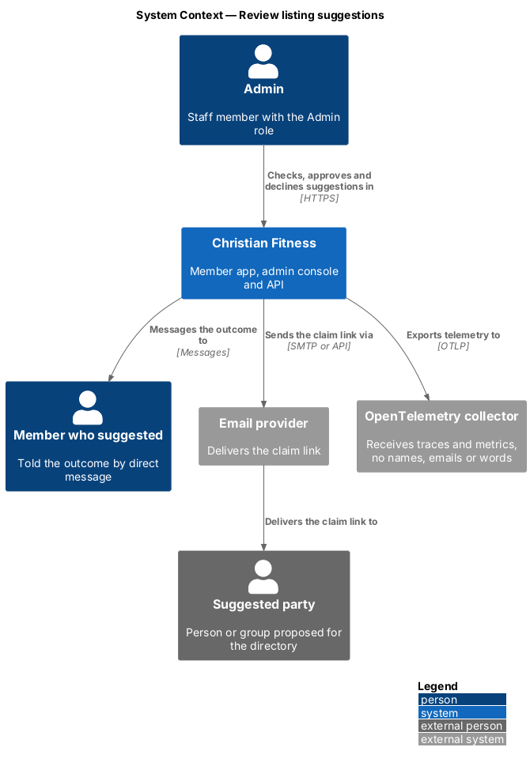
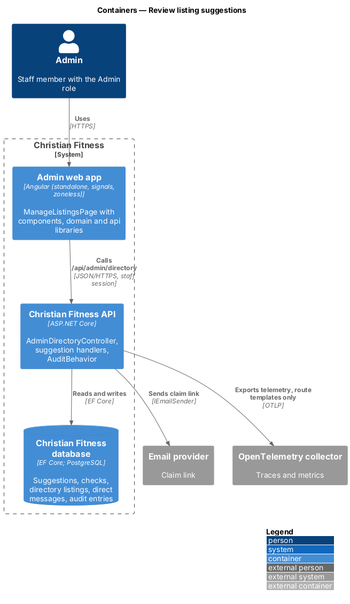
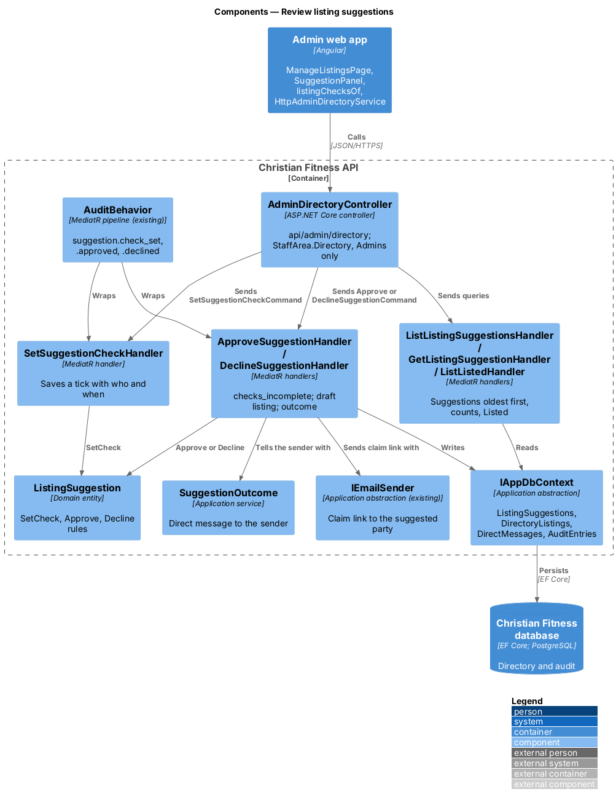
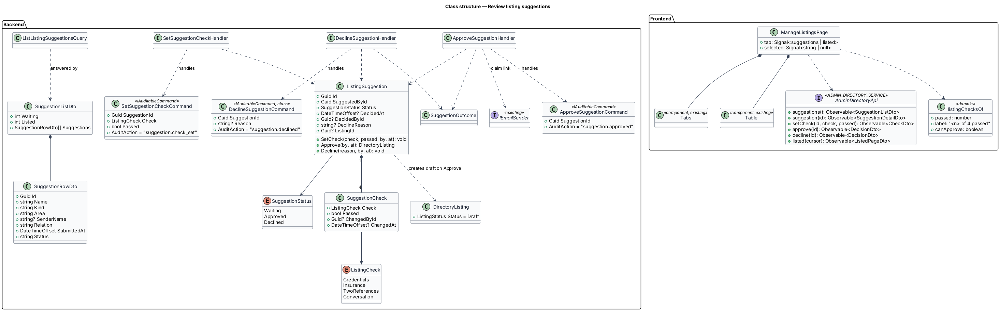
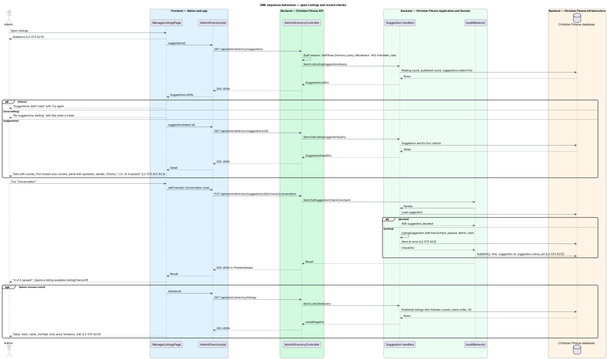
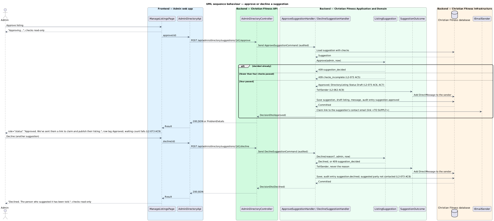

# Review listing suggestions

## Overview

Christian Fitness is a Christian community for health in body and spirit in the Greater Toronto Area, with a member web app and an admin web app for staff. Members suggest organizations, people, instructors, ambassadors, companies and church ministries for the community's directory (`L1-017`, `docs/detailed-designs/directory/suggest-listing/`). Staff review each suggestion, record the four checks every listing passes before approval, approve or decline it, and see what is listed (`L1-023`).

- **listing suggestion** — member's proposal that a party be listed in the directory (`ListingSuggestion`)
- **waiting suggestion** — suggestion that staff have neither approved nor declined
- **listing check** — one of the four checks a listing passes before approval: Credentials, Insurance, Two references and Conversation (`ListingCheck`)
- **draft listing** — directory listing made from an approved suggestion, not in the directory until the listed party says yes (`DirectoryListing` with `Status` `Draft`)
- **Listed** — every published directory listing, as staff see it

This review is not the Services application review. Staff approve professionals' applications for Services under Services (`L2-025`, `docs/detailed-designs/admin-services/review-applications/`), where an approval publishes a `ServiceListing` at once. A suggestion's approval makes only a draft `DirectoryListing`, and only after four recorded checks. The console keeps both areas side by side under Community: Listings and Services (`L2-021` AC1). One professional passes both reviews: they are two records with two reviews, and staff may link a listing to the professional record (ADR 0061).

This feature covers the Listings screen of the admin web app (mock `docs/mocks/pages/admin-listings/`, states `default`, `unchecked`, `ready`, `approving`, `approved`, `declined`, `listed`, `loading`, `empty` and `error`). The navigation's waiting count on Listings belongs to the admin navigation design and the Dashboard's line for suggestions (`L2-020` AC11) to the dashboard design; both read the waiting count this feature defines.

## Description

The feature is a vertical slice from the Listings screen to the database. No part of it exists in the codebase yet; every name below is introduced by this design unless it names existing code.

### Admin web app (`projects/admin`) and libraries

- **`ManageListingsPage`** — routed page component at `/listings`, loaded with `loadComponent` as a child of the admin shell. It renders the `page-head` ("Listings", "Nothing goes in the directory until it passes all four checks.") and the `tabs` "Suggestions <waiting>" and "Listed <published>". Suggestions is `/listings`; the address of Listed is `<TO SUPPLY>`, with `/listings?tab=listed` proposed as `adminEventTabs` does for Events. Its `providers` bind `ADMIN_DIRECTORY_SERVICE` to `HttpAdminDirectoryService`.
- **Suggestions tab** — a `split split--picker` layout. The left side is a `nav` "Suggestions" of `pick-card` links, oldest first: name, "<kind> · <area>", "From <member>" or "Self-submitted", and how long ago; a decided one carries `pick-card__tag` "Approved" or "Declined"; the chosen one has `aria-current="page"` (`L2-073` AC2, AC9). The first is chosen on load; the chosen id is kept in the address as `?selected=<id>` (proposed).
- **`SuggestionPanel`** — the `suggestion` card for the chosen suggestion: kind eyebrow, name, area and website (an `https` address opening in a new tab with `rel="noopener noreferrer"` and "(opens in a new tab)"), the member's words as a `blockquote`, and who sent it with how they know the party ("Submitted by the listing themselves", "Jordan Reid · knows them") (`L2-073` AC3). The `fieldset` "Checks" lists four `check-row` tick boxes, each a real `input type="checkbox"` with its label and what passing means, and "<n> of 4 passed" (`docs/mocks/README.md`, decision "Listing checks").
- **Approve and Decline** — "Approve listing" is `disabled` with `aria-describedby` pointing to "Approve unlocks when all four checks pass." while fewer than four pass (`L2-073` AC5). Pressing it reads "Approving…" and makes the checks read-only. On success the foot shows `suggestion__result` with `role="status"`: "Approved. We've sent them a link to claim and publish their listing." or, after Decline, "Declined. The person who suggested it has been told." (`L2-073` AC6, AC8). A decided suggestion's checks are `disabled` (`L2-073` AC9).
- **Listed tab** — the existing `Table` component with the visually hidden caption "Listed": Listing (small `ListingMark`, name, `VerifiedMark`), Kind, Area, Followers and an "Edit <name>" `row-link` (`L2-073` AC10). Below LG the table becomes stacked cards (`L2-021` AC2). Edit has nothing behind it yet (open questions).
- **States** — skeleton tiles and a skeleton card while loading; "No suggestions waiting" with "See what is listed" when none wait; "Suggestions didn't load" with Try again on failure (`L2-073` AC11).
- **`listingChecksOf`** — pure helper in `projects/domain/src/directory/`. It answers the passed count, "<n> of 4 passed" and whether Approve is available, from the four check states.
- **`suggestionSenderOf`** — pure helper that words the sender for the card ("Self-submitted", "From <name>") and for the panel, from the relation and the sender's name.
- **`AdminDirectoryApi` / `ADMIN_DIRECTORY_SERVICE`** — contract and token in `projects/api/src/admin/admin-directory.ts`: `suggestions()`, `suggestion(id)`, `setCheck(id, check, passed)`, `approve(id)`, `decline(id)` and `listed(cursor)`. A refusal errors with an `ApiError` carrying status and `code`.
- **`HttpAdminDirectoryService`** — HTTP implementation in `projects/admin/src/app/services/`.
- **Areas** — `ADMIN_AREAS` in `projects/domain/src/admin/admin-areas.ts` gains the Listings area, opened by an Admin or a Moderator (`canManage`, ADR 0064), so a Moderator sees Listings and its suggestion count in the navigation and uses the screen as an Admin does (`L2-073` AC11, `L2-019` AC1; mock `admin-listings/moderator.html`).

### Christian Fitness API

- **`AdminDirectoryController`** — controller at `api/admin/directory`; each action sends one MediatR request and checks nothing. The name avoids the existing `AdminListingsController`, which serves Services listings at `api/admin/services/listings`.
  - `GET /api/admin/directory/suggestions` — `ListListingSuggestionsQuery`: the waiting count, the published count and the suggestions, oldest first, at most 50.
  - `GET /api/admin/directory/suggestions/{id}` — `GetListingSuggestionQuery`: the panel's fields and the four checks.
  - `PUT /api/admin/directory/suggestions/{id}/checks/{check}` with `{ passed }` — `SetSuggestionCheckCommand`.
  - `POST /api/admin/directory/suggestions/{id}/approve` — `ApproveSuggestionCommand`.
  - `POST /api/admin/directory/suggestions/{id}/decline` — `DeclineSuggestionCommand`, a class with an optional reason so no generated `ToString` prints it.
  - `GET /api/admin/directory/listings?cursor=` — `ListListedQuery`: published listings in name order, 50 a page, each with mark, name, verified, kind, area and follower count.
- **Authorization** — `AuthenticationSetup`'s area table gains the segment `directory` for a new `StaffArea.Directory`, which `StaffAccess` opens to Admins and Moderators (`L2-019` AC1, ADR 0064). An unlisted segment would refuse Moderators, so naming the area is what opens it to them.
- **`SetSuggestionCheckHandler`** — loads the suggestion; an unknown one is 404 `suggestion_not_found` and a decided one 409 `suggestion_decided` (both proposed codes, after `application_not_found` and `application_decided`). It sets the check's `Passed`, `ChangedById` (from `ICurrentMember`) and `ChangedAt` (from `TimeProvider`) and saves at once, so the tick survives leaving the screen (`L2-073` AC4). Setting a check to its current value saves nothing new.
- **`ApproveSuggestionHandler`** — refuses a decided suggestion with `suggestion_decided` and one with fewer than four passed checks with 409 `checks_incomplete` (`L2-073` AC5). Otherwise, in one unit of work, it marks the suggestion `Approved` with who and when, creates a `DirectoryListing` with `Status` `Draft` from the suggestion's kind, name, area and website, and asks `SuggestionOutcome` to message the sender (`L2-062` AC9). It then sends the suggested party a claim link through `IEmailSender` to the suggestion's contact email (`L2-073` AC6); the link, its lifetime and its screen are in `docs/detailed-designs/directory/claim-listing/` (`ClaimLinkSender`). A draft is never listed, so nothing is published without the party (`L2-073` AC7).
- **`DeclineSuggestionHandler`** — refuses a decided suggestion with `suggestion_decided`; otherwise marks it `Declined` with who, when and the optional reason, and asks `SuggestionOutcome` to message the sender. The suggested party is not contacted (`L2-073` AC8).
- **`ListingSuggestion`** — the entity of the suggest-listing design, with domain methods `SetCheck(check, passed, by, at)`, `Approve(by, at)` and `Decline(reason, by, at)` that hold the rules above, so the handlers stay thin and a direct test covers each case.
- **`SuggestionCheck`** — new domain entity owned by `ListingSuggestion`: `Check` (`ListingCheck`: `Credentials`, `Insurance`, `TwoReferences`, `Conversation`), `Passed`, `ChangedById` and `ChangedAt`. A new suggestion has all four, unpassed.
- **Audit** — the three commands implement `IAuditableCommand`, so `AuditBehavior` records who, which suggestion and what when the handler succeeds: `suggestion.check_set`, `suggestion.approved` and `suggestion.declined` (`L2-073` AC12, `L2-019` AC3). The audit entry names the suggestion by id only; no span, metric or log carries the suggested party's name, email or the member's words.

User-supplied names, areas, websites and the member's words are rendered as text, never as HTML.

### Open questions

- **Decided suggestions in the list.** `L2-073` AC1 counts only waiting suggestions on the tab, while AC2 and AC9 keep decided ones in the list with their outcome. How long a decided suggestion stays listed, and how the list pages past 50, is `<TO SUPPLY>`.
- **Decline reason.** The mock declines at once with no reason, while `L2-062` AC9 words the message "only where staff wrote a reason" and declining an application asks for one (`docs/mocks/README.md` open question 11). The command accepts an optional reason; no field asks for it until the mock does.
- **Claim link.** Specified by `L2-078` and `docs/detailed-designs/directory/claim-listing/`: single-use, 14 days, the claim screen at `/claim/{token}`, and `ListingStatus.Declined` when the party says "This isn't me". With no email, a self-submission's link goes to the sender by direct message; otherwise the listing is staff-managed with no owner. Staff resend an expired link; that action has no admin mock yet.
- **Listed's Edit.** The owner's Edit is specified by `L2-079` and `docs/detailed-designs/directory/edit-listing/`. Staff's Edit in Listed still has no screen; `L2-079` AC8 says what it changes.
- **Failure of a tick.** `L2-073` AC4 saves a tick at once but no mock state shows a failed save. Putting the box back with a toast, as Follow does, is proposed; `<TO SUPPLY>` in the mock.
- **"Admins only" copy and Moderators.** Settled by ADR 0064: the sentence is general (`L2-019` AC5) and a Moderator opens Listings.
- **Navigation count.** `L2-021` AC3 puts the waiting count on Listings, with "3 suggestions to check" for assistive technology in the mock. Which endpoint serves the navigation's counts belongs to the admin navigation design.
- **Design-system pages.** `pick-card`, `check-row`, `suggestion` and `row-link` have no page in `docs/design-system/components/`; they need one before they are built, or the panel is composed from existing library components.

## Requirements

The feature realizes the following level-2 (L2) requirements. Each L2 requirement refines a level-1 (L1) requirement, cited by identifier. The L2 specification states its requirements as acceptance criteria; the text below condenses those criteria faithfully.

| L2 ID    | Refines (L1) | Requirement |
| -------- | ------------ | ----------- |
| `L2-073` | `L1-023`     | Listings shall show two tabs with counts: Suggestions (not yet decided) and Listed (every published listing); the navigation's Listings shall carry the number waiting, in words for assistive technology. Suggestions shall list each, oldest first, with name, kind, area, sender ("Self-submitted" or the member's name) and when; the first shall be chosen and choosing another shall show it and mark it current. The chosen suggestion shall show kind, name, area, website where given (new tab), the member's words as a quotation, who sent it and how they know them, and "Checks": Credentials, Insurance, Two references and Conversation, each a labelled tick box with what passing means, and "<n> of 4 passed". A tick or untick shall be saved at once with who and when and survive leaving the screen. With fewer than four passed, "Approve listing" shall not be available and the text beside it shall say "Approve unlocks when all four checks pass."; an approval that arrives anyway shall be refused with `checks_incomplete`. With four passed, "Approve listing" shall read "Approving…", the suggestion shall become Approved, a draft listing shall be made, the suggested party shall be sent a link to claim and publish it, the sender shall be told, and it shall read "Approved. We've sent them a link to claim and publish their listing." An approved listing shall not be in the directory until the listed party says yes. Decline shall make it Declined, tell the sender and read "Declined. The person who suggested it has been told."; the suggested party shall not be contacted. A decided suggestion shall leave the waiting count, its row shall say Approved or Declined, and its checks shall be read-only. Listed shall show each listing's mark, name, Verified mark where verified, kind, area and followers, with Edit. Loading shall show skeletons; none waiting shall show an empty state pointing to Listed; a failure shall offer Try again; a Moderator shall use it as an Admin does (ADR 0064). Each check, approval or decline shall record an audit entry of who, which suggestion and what, and no span, metric or log shall carry the suggested party's name, email or the member's words. |
| `L2-062` | `L1-017`     | When a suggestion is approved or declined, its sender shall get a direct message from the Christian Fitness system account (ADR 0065) saying which, with the reason only where staff wrote one. |
| `L2-019` | `L1-008`     | A Moderator shall be refused every endpoint outside the areas `L2-019` AC1 opens to them (Listings is one) with HTTP 403 `forbidden_role`; every staff action that changes data shall record an audit entry of who, what, which record and when. |

## Diagrams

### System context

An Admin reviews listing suggestions in Christian Fitness; the member who suggested is told the outcome, and the suggested party receives a claim link by email.

### Containers

The admin web app calls the Christian Fitness API under the staff session; the API reads and writes suggestions, checks, draft listings, messages and audit entries, and sends the claim email through the email provider.

### Components

`AdminDirectoryController` sends one request per action. The check, approve and decline handlers apply `ListingSuggestion`'s rules; `AuditBehavior` records each change; `SuggestionOutcome` messages the sender.

### Class structure

`ListingSuggestion` owns four `SuggestionCheck` rows and, on approval, makes a draft `DirectoryListing`. `ManageListingsPage` depends on `AdminDirectoryApi` and uses `listingChecksOf` to decide whether Approve is available.

### Behaviour — open Listings and record checks

The page loads the suggestions with their counts and chooses the oldest. Each tick is saved at once with who and when and audited; "<n> of 4 passed" and Approve follow the saved state. Listed shows the published listings.

### Behaviour — approve or decline

Approval is refused with `checks_incomplete` unless four checks pass; otherwise the suggestion is approved, a draft listing is made, the sender is messaged and the party is emailed a claim link. Decline tells the sender only.

