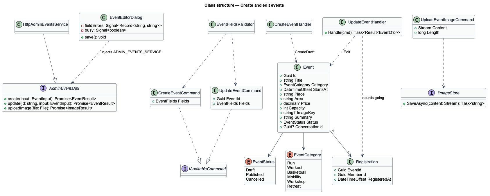
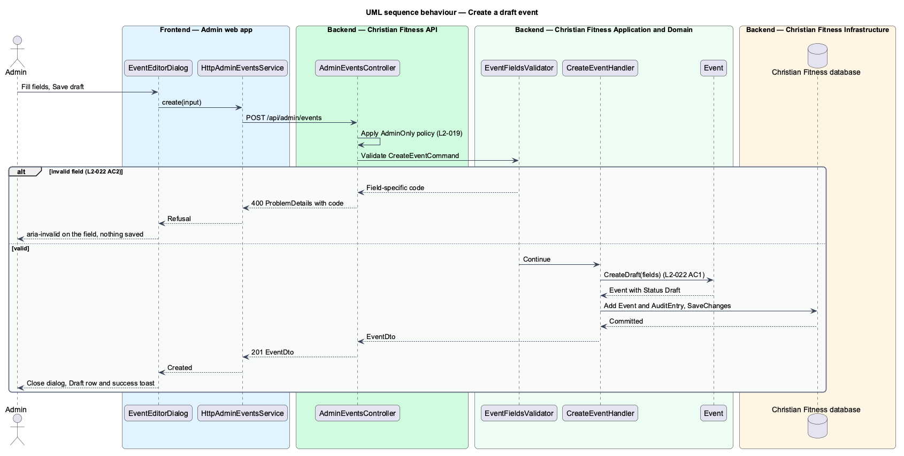
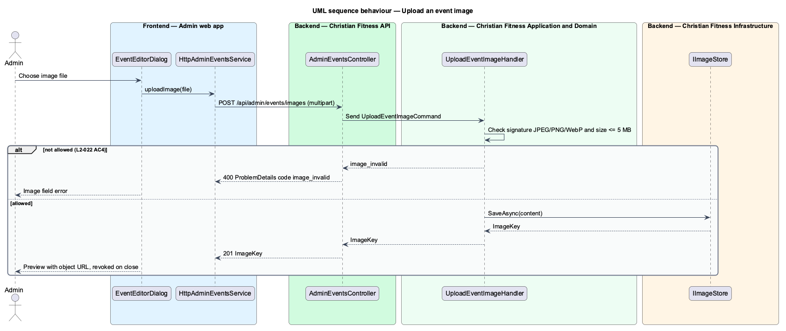

# Create and edit events

## Overview

Events are the gatherings members register for: runs, workouts, basketball, mobility, workshops
and retreats. An Admin creates each event in the Admin web app and edits it later. A new event is
saved as a *draft*, invisible to members until published (see `publish-and-cancel-events`).

- **draft** — event with `EventStatus.Draft`, stored but hidden from members
- **going** — count of members currently registered for an event
- **event image** — picture shown on the event card, uploaded as JPEG, PNG or WebP up to 5 MB

The server validates every field and refuses invalid input with a field-specific `code`, saving
nothing. Only Admins may create or edit events (`L2-019`).

## Description

- **`AdminEventsPage`** — routed page in `projects/admin` (`docs/mocks/pages/admin-events/`): tabs
  All, Published and Draft, a `table` of events with Registered `going / capacity`, and
  New event and Edit actions.
- **`EventEditorDialog`** — CDK Dialog opened from the page (`docs/mocks/dialogs/event-editor/`,
  states `default`, `edit`, `invalid`, `busy`, `failed`). It slides in from the right over 260 ms,
  fades under reduced motion, and is full width on phones. It maps each refusal `code` to its field
  with `aria-invalid` and shows a generic message for any other code.
- **`AdminEventsApi` / `ADMIN_EVENTS_SERVICE`** — contract and token in the `api` library:
  `list`, `get`, `create`, `update`, `uploadImage`; `HttpAdminEventsService` implements it.
- **`eventEditorRules`** — pure helpers in the `domain` library that mirror the server limits for
  instant hints; the server remains the authority.
- **`AdminEventsController`** — `POST /api/admin/events`, `PUT /api/admin/events/{id}`,
  `POST /api/admin/events/images`; policy `AdminOnly`. Each action sends one MediatR request.
- **`CreateEventCommand`**, **`UpdateEventCommand`** with **`EventFieldsValidator`** — required
  fields: title, category, start date and time, place, area, price, capacity, image and summary.
  Capacity is 1 to 10,000; the start is after now (`TimeProvider`); the summary is at most 1,000
  characters. Field code names are `<TO SUPPLY>`; the proposal is `<field>_required`,
  `capacity_out_of_range`, `start_in_past`, `summary_too_long`.
- **`UpdateEventHandler`** — counts `Registration` rows that are going and refuses a lower capacity
  with `capacity_below_going`.
- **`UploadEventImageCommand`** / handler — checks the content signature (JPEG, PNG, WebP) and
  size up to 5 MB, else `image_invalid`; stores it through **`IImageStore`** (storage service
  `<TO SUPPLY>`) and returns an `ImageKey`.
- **`Event`** — domain entity; `Event.CreateDraft(...)` and `Event.Edit(...)`. Each command is an
  `IAuditableCommand`, so `staff-roles` records an audit entry.

Gaps against the mock: the editor shows Location but no separate area, no image field, and
"Description" for the summary; it also offers "Create a group chat for people who register",
which `L2-022` does not mention. These are `<TO SUPPLY>` mock or requirement updates.

## Requirements

| L2 ID | Refines (L1) | Requirement |
|-------|--------------|-------------|
| `L2-022` | `L1-010` | Given an Admin, when they create an event with title, category, start date and time, place, area, price, capacity, image and summary, then it is saved as a draft. Given a missing required field, capacity below 1 or above 10,000, a start in the past or a summary over 1,000 characters, when saved, then the server refuses with a field-specific `code` and saves nothing. Given an event with registrations, when an Admin lowers capacity below the number going, then it is refused with code `capacity_below_going`. Given an uploaded image, when it is not JPEG, PNG or WebP or exceeds 5 MB, then it is refused with code `image_invalid`. |

## Diagrams

### System context

Admins maintain events in Christian Fitness; members later see the published ones.

### Containers

The Admin web app sends event fields and images to the Christian Fitness API, which validates
and stores them.

### Components

The editor dialog calls `ADMIN_EVENTS_SERVICE`; the controller sends commands whose validator and
handler enforce the limits.

### Class structure

Commands carry the event fields; handlers create or edit the `Event` entity and count its
`Registration` rows.

### Behaviour — create a draft

The validator refuses invalid fields with codes; a valid request saves a draft (`L2-022` AC1–AC2).

### Behaviour — edit an event

Lowering capacity below going is refused with `capacity_below_going` (`L2-022` AC3).

### Behaviour — upload an image

An image of the wrong type or over 5 MB is refused with `image_invalid` (`L2-022` AC4).

