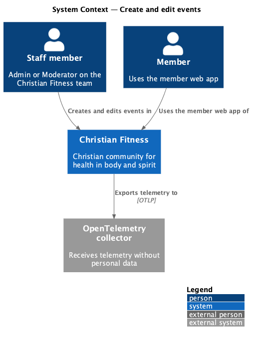
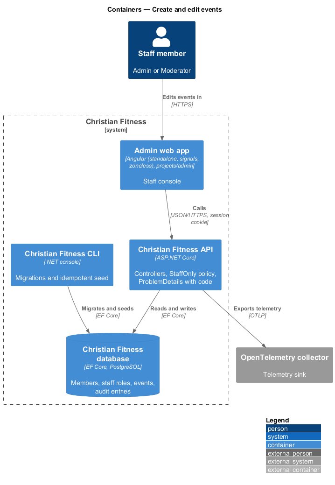
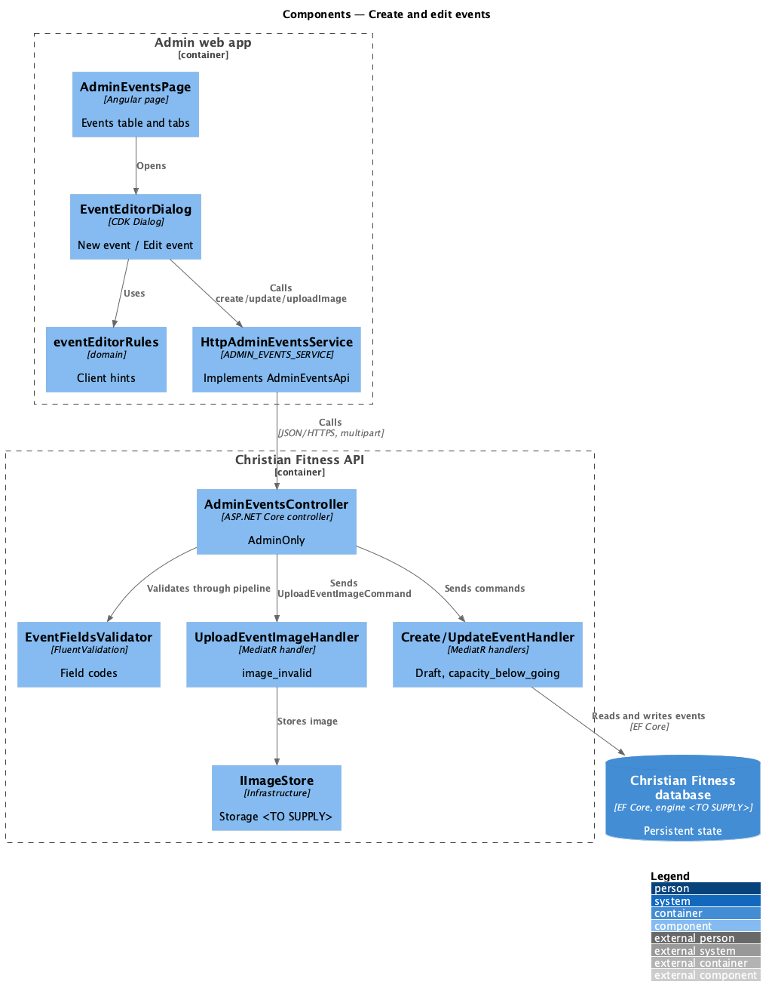
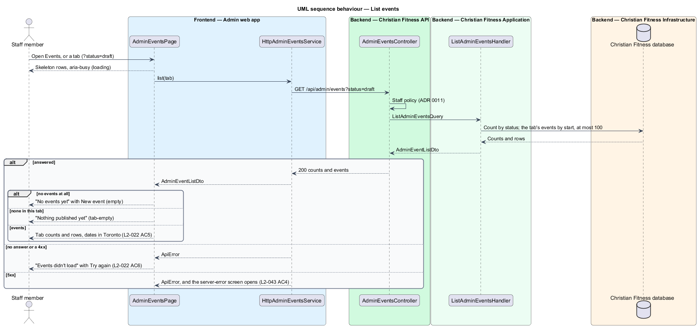
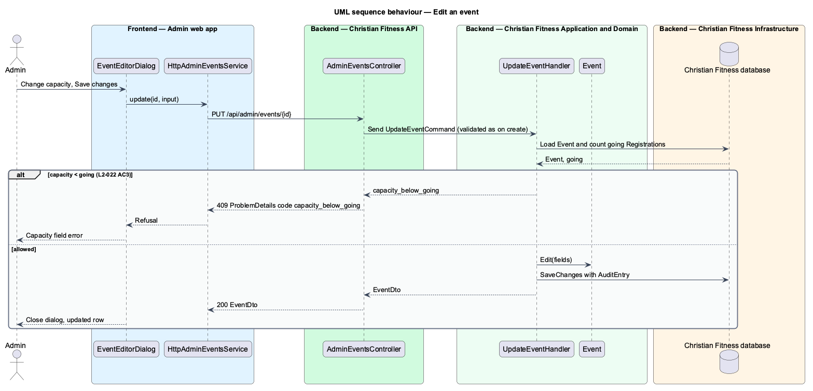

# Create and edit events

## Overview

Events are the gatherings members register for: runs, workouts, basketball, mobility, workshops
and retreats. An Admin creates each event in the Admin web app and edits it later. A new event is
saved as a *draft*, invisible to members until published (see `publish-and-cancel-events`).

- **draft** — event with `EventStatus.Draft`, stored but hidden from members
- **going** — count of members currently registered for an event
- **event image** — picture shown on the event card, uploaded as JPEG, PNG or WebP up to 5 MB

The server validates every field and refuses invalid input with a field-specific `code`, saving
nothing. Only staff reach these endpoints (ADR 0011); Admin-only access comes with `staff-roles`
(`L2-019`).

## Description

- **`AdminEventsPage`** — routed page at `/events` in `projects/admin`
  (`docs/mocks/pages/admin-events/`, states `default`, `published`, `draft`, `loading`, `empty`,
  `tab-empty`, `error`): tabs All, Published and Draft as links (`?status=published`,
  `?status=draft`) with each count, a `table` of events with the date and time in Toronto and
  Registered `going / capacity`, and New event. Each tab asks the API for its events; a tab with
  none says so (`tab-empty`), no events at all shows the empty state with New event, and a
  request that got no answer or a 4xx shows the error state with Try again, which asks again
  (a 5xx opens the server-error screen, L2-043 AC4). Its services are on the routed component's
  `providers`.
- **`EventEditorDialog`** — CDK Dialog opened from the page (`docs/mocks/dialogs/event-editor/`,
  states `default`, `saving`, `edit`, `invalid`, `busy`, `failed`), loaded with a dynamic
  `import()` on the first New event. It renders the `Drawer` component (block `drawer`) with
  `TextField`, `SelectField` and `TextareaField`: title, category, date, start time, place, area,
  price ("Leave blank for free"), capacity and summary. Save draft turns to "Saving…" with every
  field read-only (`saving`); a created draft closes the dialog by its ref with the event, and
  the page shows the `admin-toast/draft-saved` toast ("Draft saved", leaving after about 6
  seconds) and loads the list again. The overlay places the drawer at the right edge, full height,
  up to 32 rem wide and full width on phones; it slides in over 260 ms and fades under reduced
  motion; the scrim, Close and Escape dismiss it and focus returns to New event. Slice 10.2 adds
  `edit`, `invalid` (each `fieldCodes` entry on its field with `aria-invalid`) and `failed`;
  slice 11.1 adds Publish and `busy`.
- **`ToastsApi` / `TOASTS_SERVICE`, `ToastStore`, `ToastRegion`** — the page's toasts: the
  contract and token in `api`, the store in `domain` (a toast leaves after 6 seconds, Dismiss
  removes it at once, at most three show, its timers end with the page) bound on the page's
  `providers`, and the always-present `toast-region` in `components`.
- **`AdminEventsApi` / `ADMIN_EVENTS_SERVICE`** — contract and token in the `api` library: `list`
  and `create` (10.1), `get`, `update` and `uploadImage` (10.2); `HttpAdminEventsService`
  implements it and errors with an `ApiError`.
- **`eventDraftOf`, `priceCentsOf`, `capacityOf`, `eventWhen`** — pure helpers in the `domain`
  library: the editor's typed values to a `CreateEventRequestDto` (blank price is free, a price or
  capacity that is not a number is sent as `null` for the server to refuse) and an instant to
  "May 22 · 4:00 PM" in `America/Toronto`. The server remains the authority on every limit.
- **`AdminEventsController`** — under `api/admin`, so the `Staff` policy convention applies
  (ADR 0011): `GET /api/admin/events?status=all|published|draft` and `POST /api/admin/events`
  (10.1), `GET` and `PUT /api/admin/events/{id}` and `POST /api/admin/events/images` (10.2). Each
  action sends one MediatR request. Admin-only access is slice 29.1's (`staff-roles`), which
  applies to these commands unchanged.
- **`ListAdminEventsQuery`** / handler — the counts of all, published and draft events and, for
  the tab asked, at most 100 events soonest first as `AdminEventDto` (`id`, `title`, `category`,
  `startsAt` in UTC, `place`, `area`, `priceCents`, `capacity`, `going`, `status`).
- **`CreateEventCommand`** with **`CreateEventValidator`** — title (up to 120 characters),
  category (one of the six), date and start time (Toronto, after now by `TimeProvider`), place
  (up to 200), area (up to 100), price in cents (0 to 1,000,000), capacity (1 to 10,000) and
  summary (up to 1,000), all required. A refusal is 400 `validation_failed` with a `fieldCodes`
  extension naming each field's code: `title_required`, `title_too_long`, `category_required`,
  `date_required`, `start_time_required`, `start_in_past`, `place_required`, `place_too_long`,
  `area_required`, `area_too_long`, `price_invalid`, `capacity_required`,
  `capacity_out_of_range`, `summary_required`, `summary_too_long` (ADR 0017).
- **`UpdateEventCommand`** / **`UpdateEventHandler`** (10.2) — counts `Registration` rows that are
  going and refuses a lower capacity with `capacity_below_going`.
- **`UploadEventImageCommand`** / handler (10.2) — checks the content signature (JPEG, PNG, WebP)
  and size up to 5 MB, else `image_invalid`; stores it through **`IImageStore`** (storage chosen
  in 10.2) and returns an `ImageKey`; `image_required` joins the create rules then.
- **`Event`** — domain entity; `Event.CreateDraft(...)` (10.1) and `Event.Edit(...)` (10.2).
  **`EventSchedule`** turns a Toronto date and time into the UTC instant (`America/Toronto`; a time
  inside the spring-forward gap takes the standard offset).

The mock gaps are settled (ADR 0017): the editor has Place and Area, Summary for the summary and
no group chat checkbox (every event has a group chat members join by registering, L2-011); the
image field arrives with slice 10.2.

## Requirements

| L2 ID | Refines (L1) | Requirement |
|-------|--------------|-------------|
| `L2-022` | `L1-010` | Given an Admin, when they create an event with title, category, start date and time, place, area, price, capacity, image and summary, then it is saved as a draft. Given a missing required field, capacity below 1 or above 10,000, a start in the past, a summary over 1,000 characters, a title over 120, a place over 200 or an area over 100 characters, or a price below $0 or above $10,000, when saved, then the server refuses with 400 `validation_failed`, names each field's own code in `fieldCodes` and saves nothing. Given an event with registrations, when an Admin lowers capacity below the number going, then it is refused with code `capacity_below_going`. Given an uploaded image, when it is not JPEG, PNG or WebP or exceeds 5 MB, then it is refused with code `image_invalid`. Given events, when staff open Events, then they are listed soonest first with title, place, date and time in Toronto, going / capacity and status, under All, Published and Draft tabs that show each count; a tab with no events says so, and no events at all shows an empty state with New event. Given the events cannot be loaded, when Events opens, then an error state offers Try again. |

## Diagrams

### System context

Admins maintain events in Christian Fitness; members later see the published ones.

### Containers

The Admin web app sends event fields and images to the Christian Fitness API, which validates
and stores them.

### Components

The editor dialog calls `ADMIN_EVENTS_SERVICE`; the controller sends commands whose validator and
handler enforce the limits.

### Class structure

Commands carry the event fields; handlers create or edit the `Event` entity and count its
`Registration` rows.

### Behaviour — list events

Each tab asks for its events and the three counts; a request with no answer shows the error state
with Try again (`L2-022` AC5–AC6).

### Behaviour — create a draft

The validator refuses invalid fields with codes; a valid request saves a draft (`L2-022` AC1–AC2).

### Behaviour — edit an event

Lowering capacity below going is refused with `capacity_below_going` (`L2-022` AC3).

### Behaviour — upload an image

An image of the wrong type or over 5 MB is refused with `image_invalid` (`L2-022` AC4).

