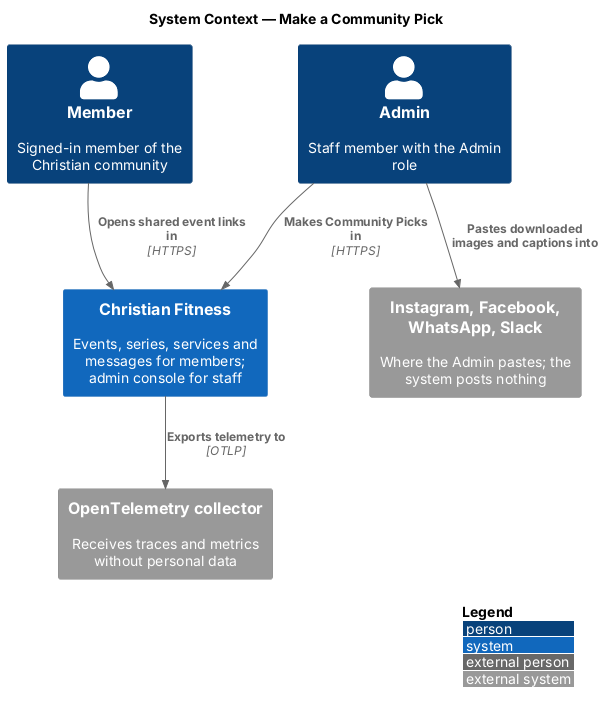
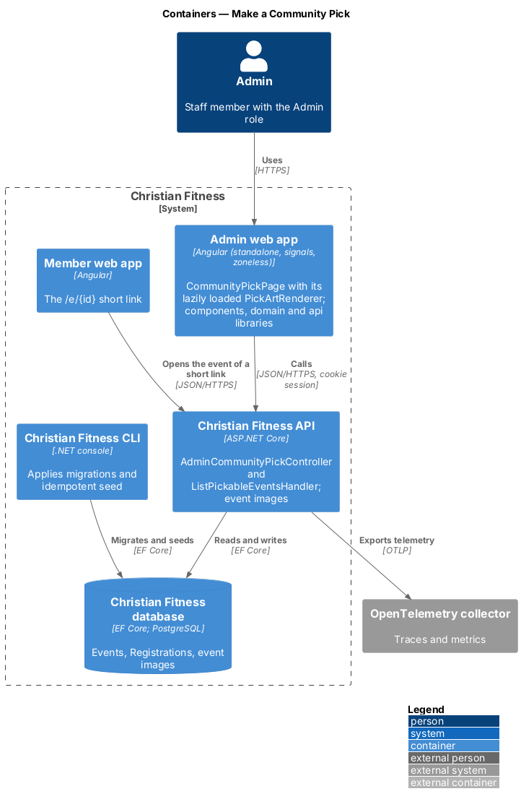
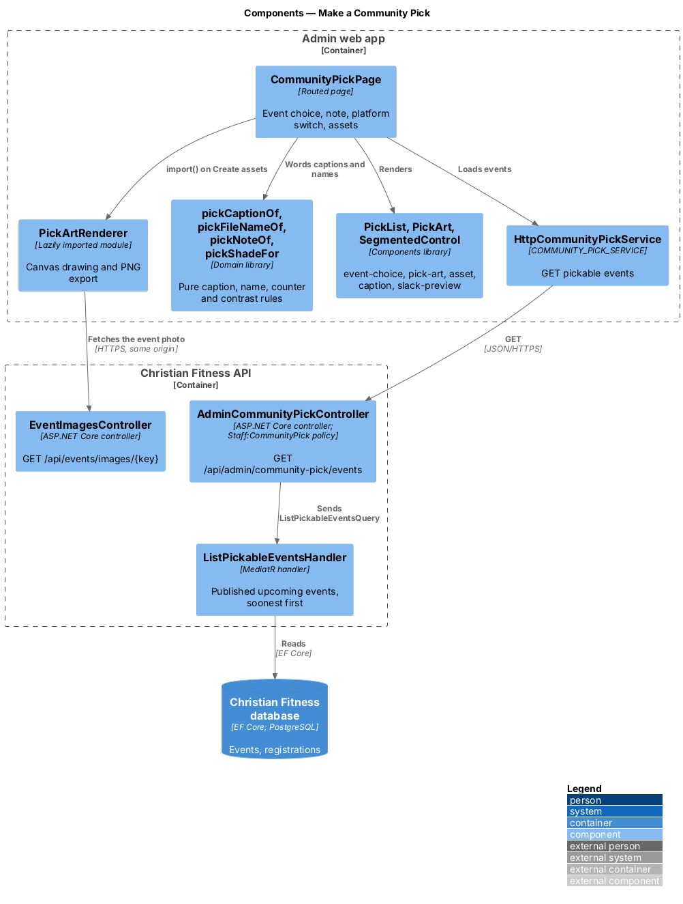
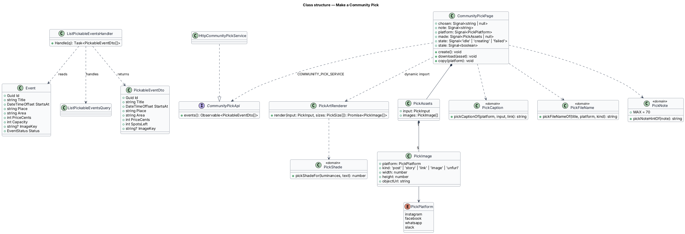
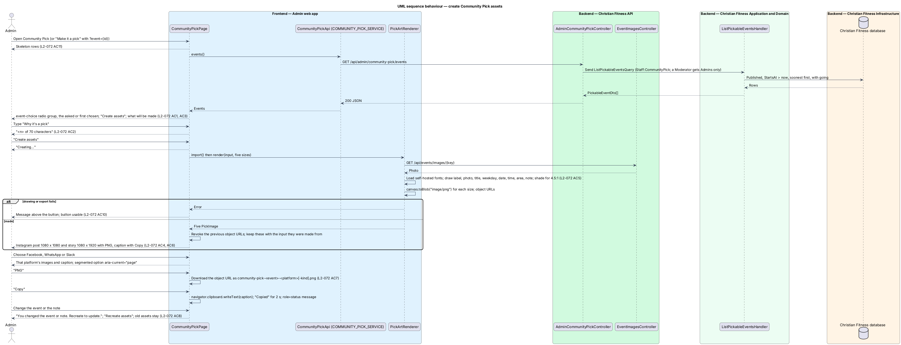
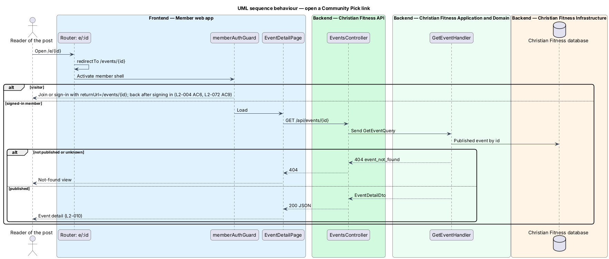

# Make a Community Pick

## Overview

Christian Fitness is a Christian community for health in body and spirit in the Greater Toronto Area. Staff run the community from the Admin web app; Admins publish and promote events there (`L1-010`).

- **Community Pick** — one published event an Admin promotes on social platforms, with a one-line note on why
- **pick note** — text of at most 70 characters that says why the event is a pick, shown on every graphic and caption
- **asset** — one PNG graphic of a pick at one platform's size, with its file name
- **caption** — text of a pick in one platform's formatting, ready to paste
- **short link** — address `/e/<id>` that opens an event in the Member web app

This feature covers the Community Pick screen of the Admin web app (mocks `docs/mocks/pages/admin-community-pick/` in states `default`, `pick`, `creating`, `facebook`, `whatsapp`, `slack`, `failed`, `loading`, `empty` and `error`) and the short link in the Member web app. The Admin chooses a published upcoming event, types the note and creates five graphics and four captions for Instagram, Facebook, WhatsApp and Slack. The system posts nothing: the Admin downloads each PNG and copies each caption. The graphics are drawn in the browser from the event's own photo, and the code that draws them loads only with this screen.

**How a pick relates to existing types.** A pick reads an ordinary published `Event` (`backend/src/ChristianFitness.Domain/Events/Event.cs`) and its going count from its `Registration` rows; it stores nothing. The event's photo is the image the event editor stored (`Event.ImageKey`, served by `EventImagesController` at `api/events/images/{key}`, `L2-022` AC10). A session of a series is an `Event` too (see `events/browse-event-series`), so it may be picked like any other event.

## Description

The feature is a vertical slice from the Community Pick screen to the database, plus a client-side drawing module.

- **`CommunityPickPage`** — new routed page in `projects/admin/src/app/pages/community-pick/`, at route `community-pick` with `loadComponent`, the title "Community Pick" and `COMMUNITY_PICK_SERVICE` bound to `HttpCommunityPickService` on its own `providers`. It holds the events, the chosen event id (from `?event=<id>` when present, else the first), the note, the platform, the assets last made and the input they were made from, and a `'idle' | 'creating' | 'failed'` state as signals. It shows skeleton rows, the empty state "No events to pick yet" with "Go to Events", and "Events didn't load" with Try again (`L2-072` AC11). A read refused with `forbidden_role` shows the existing Admins only screen.
- **Before and after creating** — until assets exist the right side shows a preview with "Five files, four platforms, one click" (`pick` mock). "Create assets" reads "Creating…" and is disabled while the images are made (`L2-072` AC3). When the chosen event or the note differs from the input the shown assets were made from, the page says "You changed the event or note. Recreate to update." and the button reads "Recreate assets"; the shown assets stay those last made (`L2-072` AC8). A failure shows "We couldn't create the assets. Try again in a moment." (`role="alert"`) above a usable button (`L2-072` AC10).
- **`PickList`** — presentation component of design-system page `pick-list`; this screen uses its `event-choice` form: one radio group with legend "Event", each choice with image, date, title and area, soonest first (`L2-072` AC1).
- **`Textarea` / `FormField`** — existing components for "Why it's a pick" with `maxlength="70"` and the hint "One line. It goes on the graphics and in every caption. <n> of 70 characters." (`L2-072` AC2).
- **`SegmentedControl`** — new presentation component (block `segmented`, modifier `segmented--flush`), shared with the member Events screen; each platform option is a link to `?platform=<name>` with `aria-current="page"` on the current one, as the mock draws it (`L2-072` AC4).
- **`PickArt`** — presentation component of design-system page `pick-art`. It renders `pick-art` previews (`--square`, `--story`, `--link`), each `asset` with its label ("Post · 1080 × 1080") and a "PNG" button whose visually hidden text names the file, the `caption` block with "Copy" and its hint, and the `slack-preview` of the post as a channel shows it. The previews draw the PNG's object URL in an `img`; caption text is rendered as text in a `pre`.
- **`PickArtRenderer`** — module in the page's folder, loaded with a dynamic `import()` on the first "Create assets", so neither the canvas code nor the pick fonts join the initial bundle (`L2-035` AC1, AC2; `L2-072` AC12). It fetches the event photo from the same origin, waits for the self-hosted brand fonts with `document.fonts.load`, and draws each size on a canvas: the label "Community Pick", the photo, the title, weekday, date, time and area, and the note, in the brand's colours and type (`L2-072` AC5). It measures the photo's luminance under each text box and darkens the shade with `pickShadeFor` until the text meets 4.5:1. It exports each canvas with `toBlob('image/png')` and returns an object URL per image. The frame's artwork (`components/PickArt.tsx` in the Magic Patterns prototype) is the reference (`docs/mocks/README.md`).
- **Sizes** — Instagram a 1080 × 1080 post and a 1080 × 1920 story; Facebook a 1200 × 630 link image; WhatsApp a 1080 × 1080 image; Slack a 1200 × 630 image (`L2-072` AC4). Five images in all, made once per Create.
- **Release** — the page revokes the previous object URLs when new assets replace them and all of them when it is destroyed, and the canvases are dropped after export (AGENTS.md, Lazy loading and memory; `L2-037`).
- **`pickCaptionOf(platform, input, link)`** — pure helper in `domain/src/community-pick/pick-caption.ts`. Each caption holds the title, the note, the day, date and time in Toronto, the place, the price and the link, in the platform's own form: hashtags and "link in bio" for Instagram, spots left for Facebook, `*bold*` and `_italic_` for WhatsApp, and a titled link `<url|title>` for Slack (`L2-072` AC6). It has one test per platform, with the expected text worked from the fixture's event.
- **`pickFileNameOf(title, platform, kind)`** — pure helper giving `community-pick-<event>-<platform>[-<kind>].png`, the event part a lower-case hyphenated form of the title (`L2-072` AC7).
- **`pickNoteHintOf(note)`** and **`pickShadeFor(luminances, text)`** — pure helpers for the counter and the contrast rule, each with a case table.
- **Download and copy** — "PNG" downloads the object URL with `pickFileNameOf`'s name. "Copy" writes the caption with `navigator.clipboard.writeText`; the button reads "Copied" for 2 seconds and a visually hidden `role="status"` message says so. The timer is cleared when the page is destroyed (`L2-072` AC7).
- **"Make it a pick"** — on the admin Events screen (`pages/events/events-page.html`) each published upcoming row gains the link "Make it a pick" to `/community-pick?event=<id>` with a visually hidden ": <title>" (`L2-072` AC1).
- **Navigation** — `ADMIN_AREAS` gains `community-pick` ("Community Pick", `/community-pick`) under Gather; `canManage` opens it to a Moderator too (ADR 0062).
- **`CommunityPickApi / COMMUNITY_PICK_SERVICE`** — new contract and token in `api/src/admin/community-pick.ts`: `events()` returns `PickableEventDto[]` with id, title, start, place, area, price in cents, spots left and image key.
- **`HttpCommunityPickService`** — calls `GET /api/admin/community-pick/events`.
- **`AdminCommunityPickController`** — new controller at `api/admin/community-pick`. `AuthenticationSetup.AreaSegments` maps `community-pick` to a new `StaffArea.CommunityPick`, open to Admins and Moderators in `StaffAccess` (`L2-019` AC1, ADR 0062). It sends one `ListPickableEventsQuery`.
- **`ListPickableEventsQuery / ListPickableEventsHandler`** — the published events with `StartsAt > now` (from `TimeProvider`), soonest first, at most 100, with going counted in one query through `IRegistrationReader.GoingForAsync`.
- **Short link `/e/:id`** — new route in `projects/web/src/app/app.routes.ts` that redirects to `/events/:id`. The member shell's `memberAuthGuard` sends a visitor to sign in with the return address and back after signing in (`L2-004` AC6); a signed-in member lands on the event; an event that is not published shows the existing not-found view (`L2-072` AC9).
- **Link origin** — captions need an absolute link. The public origin of the Member web app is the Admin web app setting `publicSiteOrigin`, with production value `https://www.christian.fitness` (see `docs/operations/settings.md`).

### Open questions

- The mocks' links read `/e/sunrise-5k`, a slug, while `L2-072` AC6 and AC9 state `/e/<id>`. Events have no slug; the design follows the requirement.
- `L2-072` AC9 says a visitor is taken to Join; the existing guard and `L2-004` AC6 take them to sign in. Which one applies is `<TO SUPPLY>`.
- `L2-072` AC6 puts the price in every caption; the Slack caption in `docs/mocks/pages/admin-community-pick/slack.html` has none, and the Instagram caption carries "link in bio" in place of the address. The Slack mock needs the price.
- The `default`, `facebook`, `whatsapp` and `slack` mocks show "Recreate assets" with no change made, while `L2-072` AC8 gives that label only after a change. No mock draws the "You changed the event or note" state. A mock state is needed before implementation.
- The event image is optional (`L2-022` AC9), but `L2-072` AC5 draws the event's own photo. The graphic for an event with no image is `<TO SUPPLY>`.
- The admin Events mocks show "Make it a pick" on four rows and do not list the Couch to 5K session that Community Pick offers; whether session events appear in admin Events is `<TO SUPPLY>` (see `events/browse-event-series`).
- Creating fails only in the browser (the photo or a font does not load, or export fails); no API call is made, so "failed" never comes from the server.
- Nothing is recorded about a pick. Whether picks should be kept or audited is not stated.

## Requirements

The feature realizes the following level-2 (L2) requirements. Each L2 requirement refines a level-1 (L1) requirement, cited by identifier. The L2 specification states its requirements as acceptance criteria; the text below condenses those criteria faithfully.

| L2 ID    | Refines (L1) | Requirement |
| -------- | ------------ | ----------- |
| `L2-072` | `L1-010`     | Community Pick shall list the published upcoming events as one radio group, soonest first, with image, date, title and area, the first chosen; "Make it a pick" on a published event in Events shall open it with that event chosen. "Why it's a pick" shall take at most 70 characters and say how many are used. "Create assets" shall read "Creating…" and then show the assets for that event and note; until then the right side says what will be made. Choosing a platform (Instagram, Facebook, WhatsApp, Slack; the current one marked) shall show its images, each with its size in pixels and a PNG download, and its caption with Copy: Instagram 1080 × 1080 and 1080 × 1920, Facebook 1200 × 630, WhatsApp 1080 × 1080, Slack 1200 × 630 and a channel preview. Each image shall show "Community Pick", the event's photo, title, weekday, date, time, area and the note, in the brand's colours and type, at exactly the size named, with text at 4.5:1 contrast. Each caption shall hold the title, the note, day, date and time, place, price and `/e/<id>`, in the platform's formatting. PNG shall download a file named for the pick, event and platform; Copy shall put the caption on the clipboard and read "Copied" for about 2 seconds with a `status` message. A change after assets were made shall say "You changed the event or note. Recreate to update." and read "Recreate assets", keeping the last assets. `/e/<id>` shall land a member on the event and take a visitor to Join and back; an unpublished event shows not-found. A failure shall show a message above a usable button. Loading shall show skeleton rows; no event shall show an empty state pointing to Events; a load failure shall offer Try again; a Moderator shall use it as an Admin does (ADR 0062). Images shall be made in the browser from the event's photo by code that loads only with this screen. |
| `L2-035` | `L1-014`     | Every route shall be lazy-loaded and kept out of the initial chunk, and each app's initial JavaScript shall stay within 250 kB. The drawing module is imported only on Create assets. |
| `L2-019` | `L1-008`     | A Moderator shall be refused every Admins-only endpoint (Stories, Events, Services; not this area) with HTTP 403 and `forbidden_role`. |

## Diagrams

### System context

An Admin makes a Community Pick in Christian Fitness and pastes the files and captions into the social platforms; the system posts nothing. Members open the shared short link.

### Containers

The Admin web app reads pickable events from the Christian Fitness API and draws the graphics itself; the Member web app serves the short link.

### Components

`CommunityPickPage` loads events through `HttpCommunityPickService`, imports `PickArtRenderer` on demand, which fetches the photo from `EventImagesController`, and words captions with the domain helpers.

### Class structure

`CommunityPickPage` owns the `PickAssets` last made, five `PickImage` items with object URLs, and depends on `CommunityPickApi`, `PickArtRenderer` and the pure helpers. `ListPickableEventsHandler` reads `Event` rows into `PickableEventDto` items.

### Behaviour — create the assets

The page lists events, the Admin types the note and presses Create assets; the renderer draws and exports five PNGs, and the page offers each platform's downloads and caption.

### Behaviour — open a short link

`/e/<id>` redirects to the event; the member shell's guard sends a visitor to sign in and back, and an unpublished event shows not-found.

