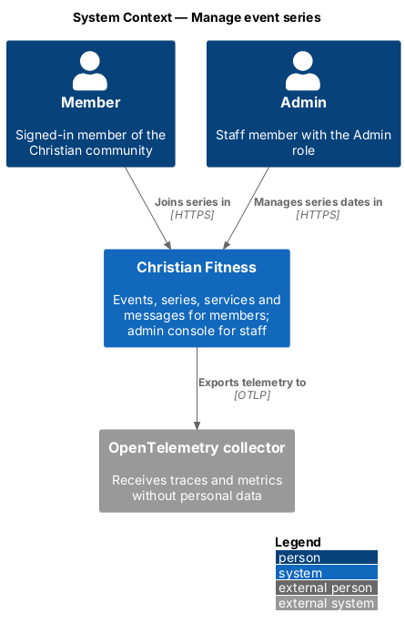
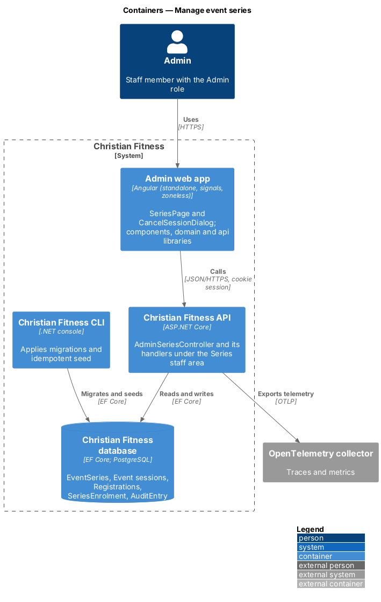
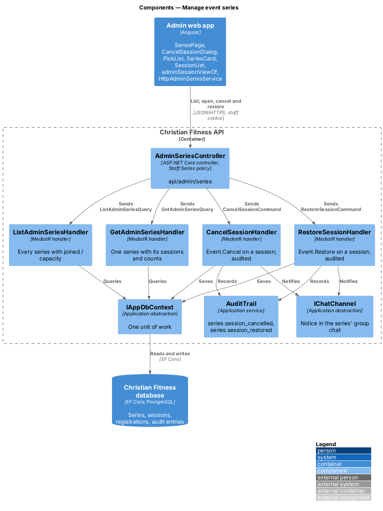
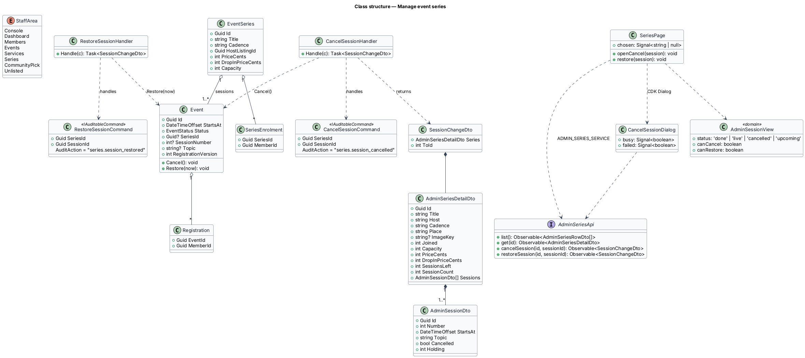
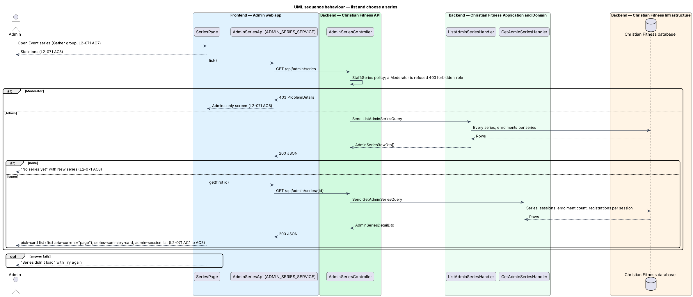
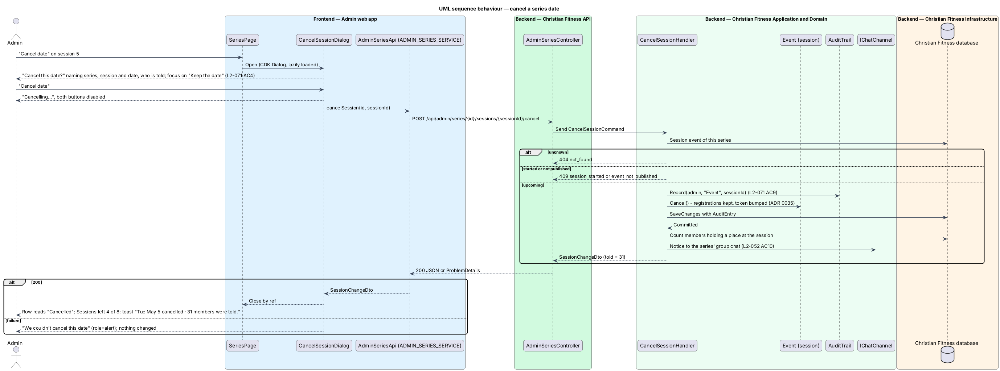
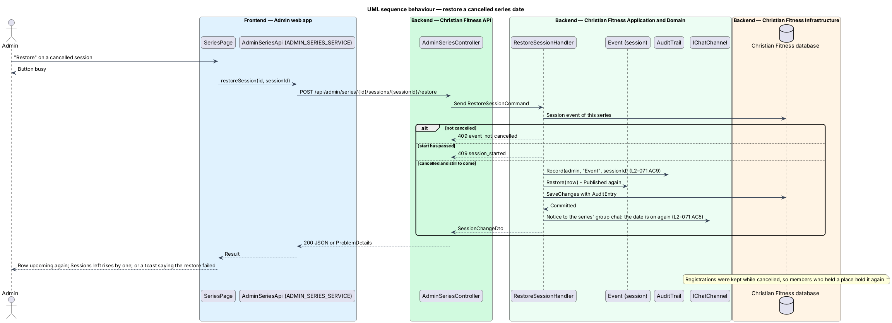

# Manage event series

## Overview

Christian Fitness is a Christian community for health in body and spirit in the Greater Toronto Area. Staff run the community from the Admin web app; Admins publish and manage events and series there (`L1-010`).

- **event series** — program of dated sessions with one host, one place, one capacity and one group chat, such as eight Tuesdays of Couch to 5K
- **session** — one dated meeting of a series, stored as an `Event` that carries the series' id, its number and its topic
- **joined** — count of a series' enrolments, shown against its capacity
- **sessions left** — count of a series' sessions that have neither started nor been cancelled
- **cancel a date** — transition of one session from published to cancelled, made only after the Admin confirms
- **restore a date** — transition of a cancelled session back to published before its start

This feature covers the Event series screen of the Admin web app (mocks `docs/mocks/pages/admin-series/` in states `default`, `selected`, `date-cancelled`, `loading`, `empty` and `error`) and the "Cancel a series date" dialog (`docs/mocks/dialogs/cancel-session/` in states `default`, `busy` and `failed`). An Admin chooses a series from a list, reads its summary and sessions, cancels a date with confirmation and restores a cancelled one. A Moderator sees "Admins only".

**How a session relates to `Event`.** A session is an ordinary `Event` with `SeriesId`, `SessionNumber` and `Topic` set (see `events/browse-event-series`). Cancelling a date calls the existing `Event.Cancel()`, as cancelling an event does (ADR 0035): the status becomes `Cancelled`, the `RegistrationVersion` token is bumped, and the registrations are kept. A cancelled session drops out of the member Events list, since `ListEventsHandler` lists only published events, so the By-date list follows the series with no extra work (`L2-071` AC6). Because the registrations are kept, restoring the date gives every member who held a place their place again (`L2-071` AC5).

## Description

The feature is a vertical slice from the Event series screen to the database.

The series editor has a required searchable Host picker (`L2-071` AC10–11): an Admin chooses a Listed directory listing, defaulting on creation to the Christian Fitness team listing and retaining the saved host on edit. No matches are explained; a missing or no-longer-Listed host is refused with `validation_failed`, a field error and an error summary without losing the other values. The `series-editor` mock shows these states. `EventSeries.HostListingId` is non-null and older series are backfilled as in ADR 0067.

- **`SeriesPage`** — new routed page in `projects/admin/src/app/pages/series/`, at route `series` with `loadComponent`, the title "Event series" and `ADMIN_SERIES_SERVICE` bound to `HttpAdminSeriesService` on its own `providers`. It loads the list, chooses the first series, and loads the chosen one. Choosing another `pick-card` is a link to `/series?id=<id>` with `aria-current="page"` on the current one (`L2-071` AC1). It shows skeletons, the "No series yet" empty state with New series, and "Series didn't load" with Try again (`L2-071` AC8). A read refused with `forbidden_role` shows the existing Admins only screen (`/admins-only`, `L2-019` AC5).
- **`PickList`** — presentation component of design-system page `pick-list`; this screen uses its `pick-card` form: title, cadence and time, "<joined> / <capacity> joined".
- **`SeriesCard`** — its summary form renders `series-summary-card`: image, title, "Hosted by <host>", cadence, time, date range and place, the stats "Joined <n> of <capacity>" with a `meter` ("78% full"), the price and the drop-in price, and "Sessions left <left> of <total>" (`L2-071` AC2).
- **`SessionList`** — its admin form renders the `admin-sessions` ordered list of `admin-session` rows: number, date and topic. A past session reads "Done", the next one "Live", a cancelled one "Cancelled" with its topic struck through (`L2-071` AC3). Each upcoming row offers "Cancel date" with a visually hidden ": session <n>, <date>"; each cancelled row still to come offers "Restore".
- **`adminSessionViewOf`** — pure helper in `domain/src/events/admin-session-view.ts`: the status word, `canCancel` (not started, not cancelled) and `canRestore` (cancelled, not started), from the session and the current time. It has a case table with one test per row.
- **`CancelSessionDialog`** — new CDK Dialog in `projects/admin/src/app/dialogs/cancel-session/`, loaded with a dynamic `import()` on the first "Cancel date", with `ADMIN_SERIES_SERVICE` passed from the page's injector. From `cancelSessionTextOf` it reads "Cancel this date?", "<series> · Session <n> · <weekday> <date>, <time>" and who is told. Focus starts on "Keep the date". While it waits it reads "Cancelling…" with both buttons disabled. A failure shows "We couldn't cancel this date" with "Nothing was changed and nobody was told." in an `alert`. Success closes it by its ref (`L2-071` AC4).
- **Toast** — after a cancel the page shows the existing admin toast: "<weekday> <date> cancelled" and "<n> members were told." (`date-cancelled` mock).
- **Navigation** — `ADMIN_AREAS` (`domain/src/admin/admin-areas.ts`) gains `series` ("Event series", `/series`) under the Gather group with Events and Community Pick; `canManage` opens it to a Moderator too (`L2-071` AC8, ADR 0064). The grouping belongs to the amended `L2-021`.
- **`AdminSeriesApi / ADMIN_SERIES_SERVICE`** — new contract and token in `api/src/admin/admin-series.ts`: `list()`, `get(id)`, `cancelSession(id, sessionId)` and `restoreSession(id, sessionId)`.
- **`HttpAdminSeriesService`** — calls `GET /api/admin/series`, `GET /api/admin/series/{id}`, `POST /api/admin/series/{id}/sessions/{sessionId}/cancel` and `POST …/restore`.
- **`AdminSeriesController`** — new controller at `api/admin/series`. `AuthenticationSetup.AreaSegments` maps `series` to a new `StaffArea.Series`, and `StaffAccess` opens it to Admins and Moderators (`L2-019` AC1, ADR 0064). Each action sends one request.
- **`ListAdminSeriesQuery / Handler`** — every series, in an order that is `<TO SUPPLY>`, with title, cadence, time of its first session and joined/capacity.
- **`GetAdminSeriesQuery / Handler`** — one series with host, facts, joined, prices, sessions left and total, and each session's id, number, start, topic, `Cancelled` and `Holding` (members holding a place). An unknown id is 404 `not_found`.
- **`CancelSessionCommand / CancelSessionHandler`** — an `IAuditableCommand` with action `series.session_cancelled`. It loads the session event of the series (404 `not_found` otherwise), refuses a started session with 409 `session_started` (new code) and a session that is not published with 409 `event_not_published`. It records the audit entry as `Record(admin, "Event", sessionId)`: the session's `SeriesId` names the series, so one entry gives who, which series and which session (`L2-071` AC9). It calls `Event.Cancel()` and saves; a concurrency conflict reloads and decides again, as `CancelEventHandler` does. After the save it counts the distinct members holding a place at the session and posts a cancellation notice to the series' group chat through `IChatChannel` (`L2-052` AC10). It answers `SessionChangeDto` with the series and that count.
- **`RestoreSessionCommand / RestoreSessionHandler`** — an `IAuditableCommand` with action `series.session_restored`. It refuses a session that is not cancelled with 409 `event_not_cancelled` (new code) and one whose start has passed with 409 `session_started`. It calls a new `Event.Restore(now)` (Cancelled → Published, only before `StartsAt`; it bumps the token), saves with the audit entry and posts a notice to the series chat (`L2-071` AC5).
- **`Event.Restore(now)`** — new domain method. Only a session (`SeriesId` set) is restored; the handler refuses any other event, so `L2-023` keeps events' cancellation final.

The audit entry and telemetry carry ids only; no member name or contact detail is logged (`L2-019` AC3).

### Open questions

- Resolved (#89): there is no online payment (`L2-011` AC5), so the dialog says "Everyone going to this date will be told. If anyone paid for it, the host will sort out refunds with them directly." and the system refunds nothing.
- Resolved (#89): members are told in the series group chat and by an in-app notification (ADR for the notification channel, #76).
- Resolved (#89): the dialog counts drop-ins too, "12 people are going to this date (9 joined, 3 dropped in)."; the mock reads "34 people ... (31 joined, 3 dropped in)".
- The series editor mock specifies the Host picker only; the other New series, Edit details and Add a date rules remain open (`docs/mocks/README.md` open question 10). Until those requirements exist, series and sessions come from the CLI's idempotent seed; `L2-071` AC6 for changed and added dates holds by construction once they exist, since sessions are events.
- The mocks draw no state for a failed Restore or a busy Restore; the design shows a toast saying the restore failed, which needs a mock state.
- The list's order is not stated (`L2-071` AC1); the mock lists by first session date. `<TO SUPPLY>`.
- The `loading` mock draws a table skeleton beside the cards, unlike the loaded list; the skeleton should mirror the `admin-sessions` list.
- `docs/detailed-designs/admin-events/publish-and-cancel-events` described a `Conversation` entity and an `AdminOnly` policy that the code does not have; it now follows the code (`IChatChannel`, `AuthenticationSetup.StaffPolicy`), as does this design.

## Requirements

The feature realizes the following level-2 (L2) requirements. Each L2 requirement refines a level-1 (L1) requirement, cited by identifier. The L2 specification states its requirements as acceptance criteria; the text below condenses those criteria faithfully.

| L2 ID    | Refines (L1) | Requirement |
| -------- | ------------ | ----------- |
| `L2-071` | `L1-010`     | Event series shall list every series with title, cadence and time and joined of capacity, choose the first, and mark a chosen one current. The chosen series shall show image, title, host, cadence, time, date range and place, joined of capacity with a meter, the series and drop-in prices, and sessions left of total. Sessions shall be an ordered list with number, date and topic; past reads "Done", the next "Live", a cancelled one "Cancelled" in words with its topic struck through. "Cancel date" on a session not started, confirmed in a dialog naming the series, session and date and saying who is told and what is refunded, shall cancel it, tell every member who joined the series or dropped in on that date, lower "Sessions left" by one and show a toast with how many were told; focus starts on "Keep the date", and a failure says so in the dialog and changes nothing. Restore on a cancelled session not yet passed shall make it upcoming again, and members who held a place shall hold it again and be told. Events listed for sessions shall follow date changes, additions and cancellations, and "Session <n> of <total>" shall count all sessions, cancelled included. Event series shall sit under Gather with Events and Community Pick. Loading shall show skeletons; none shall show an empty state that says what a series is with New series; a failure shall offer Try again; a Moderator shall use it as an Admin does (ADR 0064). A cancel or restore shall record who, which series and which session in the audit trail. |
| `L2-019` | `L1-008`     | A Moderator shall be refused every Admins-only endpoint (Stories, Events, Services; not this area) with HTTP 403 and `forbidden_role`; a staff action that changes data shall record who, what, which record and when, without personal data in telemetry. |
| `L2-052` | `L1-005`     | When a session of a joined series is cancelled, the member's place at it shall end, it shall read "Cancelled" and their other places shall stay (AC10). |

## Diagrams

### System context

An Admin manages series dates in Christian Fitness; members who joined or dropped in are told in the series' group chat.

### Containers

The Admin web app calls the Christian Fitness API under the Series staff area; the API changes the session event and records the audit entry in the database.

### Components

`AdminSeriesController` sends one request per action. `CancelSessionHandler` and `RestoreSessionHandler` record through `AuditTrail` and notify through `IChatChannel`.

### Class structure

`CancelSessionHandler` calls `Event.Cancel()` and `RestoreSessionHandler` calls `Event.Restore(now)` on a session of an `EventSeries`; both answer a `SessionChangeDto`. `StaffArea` gains `Series` and `CommunityPick`.

### Behaviour — list and choose a series

The page loads the list under the staff area policy, chooses the first series and loads it; a Moderator does the same (ADR 0064).

### Behaviour — cancel a date

The Admin confirms in `CancelSessionDialog`; the handler cancels the session event, records the audit entry, tells the series chat and answers how many were told.

### Behaviour — restore a date

The handler restores a cancelled session that has not started; the kept registrations make every place held again.

