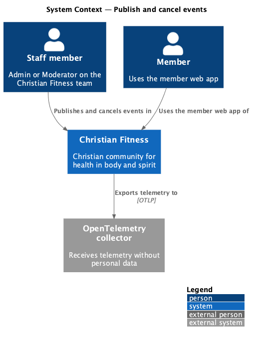
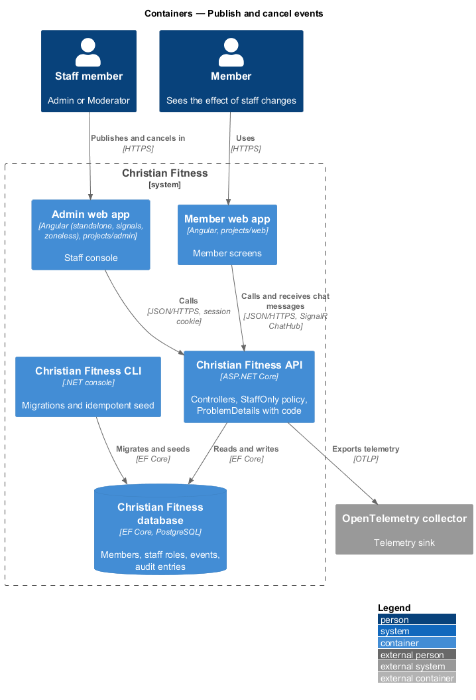
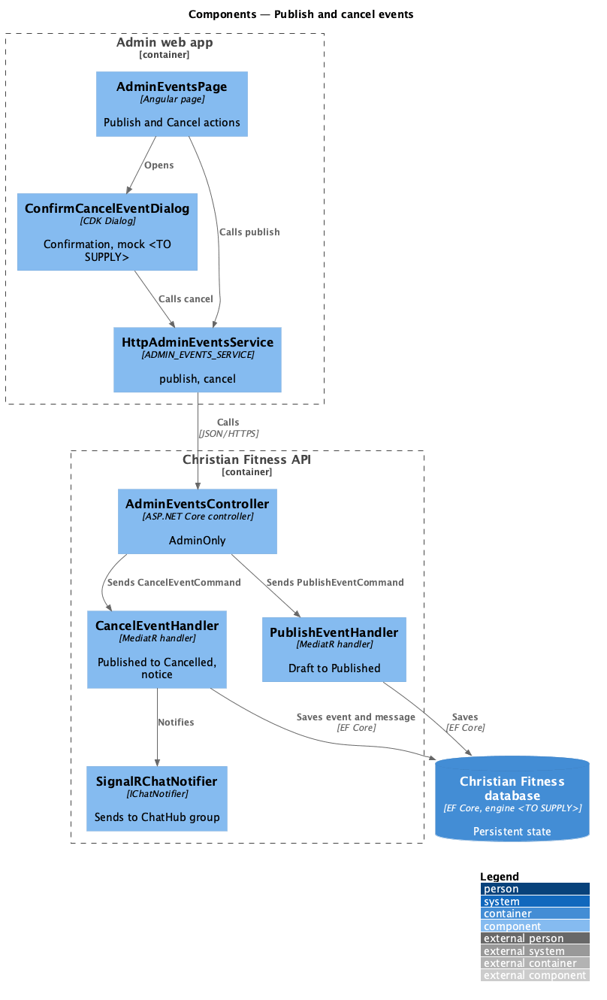
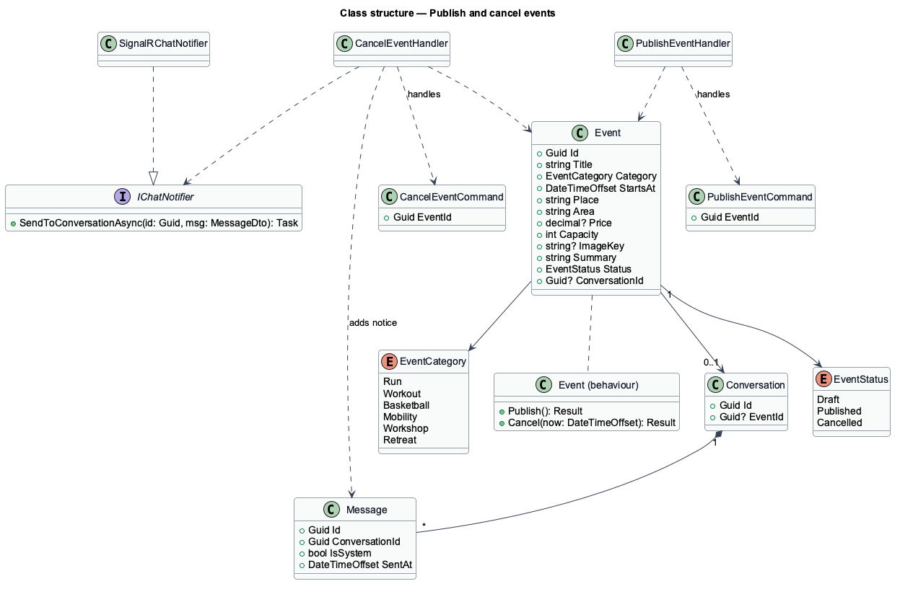
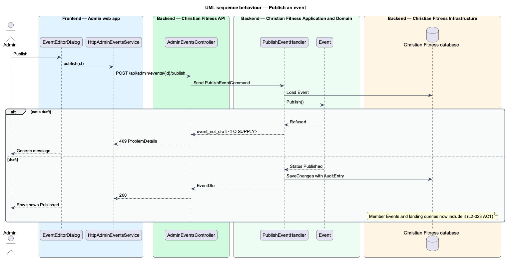
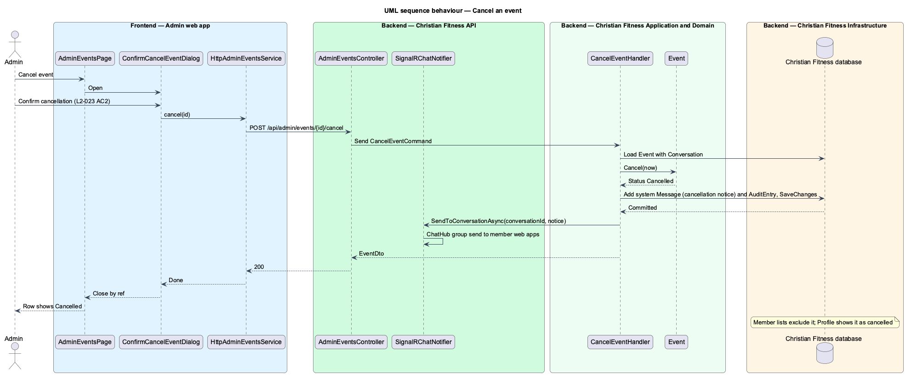

# Publish and cancel events

## Overview

An event moves through three states. A _draft_ is hidden from members. _Publishing_ makes it
visible on the member Events screen and the landing page. _Cancelling_ a published event removes
it from member lists, keeps it on registered members' Profile marked as cancelled, and posts a
cancellation notice in its group chat.

- **publish** — transition from `Draft` to `Published`
- **cancel** — transition from `Published` to `Cancelled`, made only after the Admin confirms
- **event group chat** — `Conversation` whose participants are the event's registered members
- **cancellation notice** — system `Message` in the event group chat stating that the event is cancelled

## Description

- **`AdminEventsPage`** and **`EventEditorDialog`** — host the Publish action (dialog footer in
  `docs/mocks/dialogs/event-editor/default.html`) and the Cancel event action.
- **`ConfirmCancelEventDialog`** — CDK Dialog asking the Admin to confirm (slice 11.2). No mock
  exists for it; the mock is `<TO SUPPLY>` before implementation.
- **`AdminEventsApi.publish(id)` / `cancel(id)`** — contract methods on `ADMIN_EVENTS_SERVICE`.
- **`AdminEventsController`** — `POST /api/admin/events/{id}/publish` and
  `POST /api/admin/events/{id}/cancel` under `AdminOnly`; one MediatR send each.
- **`PublishEventHandler`** (slice 11.1, ADR 0026) — calls `Event.Publish()`, which refuses any
  state but `Draft` (409 `event_not_draft`); a draft whose start has passed is refused with 400
  `validation_failed` and `fieldCodes.date` = `start_in_past`; audited as `event.published`. In
  the editor, Publish (new event or draft) saves the fields, then publishes; the editor keeps the
  saved id, so a failed publish shows the alert `publish-failed` and a retry updates the same
  draft (`edit-draft`, `publish-failed`, `busy`).
- **`CancelEventHandler`** — calls `Event.Cancel()`, which refuses any state but `Published`
  (code `event_not_published` `<TO SUPPLY>`), adds a system `Message` to the event's
  `Conversation`, saves both in one unit of work, then calls **`IChatNotifier`**.
- **`SignalRChatNotifier`** — Api implementation of `IChatNotifier`; sends the notice to the
  conversation group on `ChatHub`. Member clients receive it through `CHAT_CONNECTION`.
- **Member queries** — the member events list and landing queries return only `Published`
  events with a future start; the Profile registrations query returns cancelled events with
  status `Cancelled`. These belong to the member subsystems and change no code here.

The edit mock's "Move to drafts" on a published event was dropped (ADR 0025): no L2 requirement
defines unpublishing.

## Requirements

| L2 ID    | Refines (L1) | Requirement                                                                                                                                                                                                                                                                                                       |
| -------- | ------------ | ----------------------------------------------------------------------------------------------------------------------------------------------------------------------------------------------------------------------------------------------------------------------------------------------------------------- |
| `L2-023` | `L1-010`     | Given a draft event, when an Admin publishes it, then members see it on Events and the landing page. Given a published event, when an Admin cancels it with confirmation, then it disappears from member lists, registered members see it as cancelled in Profile and its group chat shows a cancellation notice. |

## Diagrams

### System context

Admins change an event's state; members see the result in the member web app.

### Containers

The API changes the event and pushes the cancellation notice to member web apps over SignalR.

### Components

The controller sends `PublishEventCommand` or `CancelEventCommand`; the cancel handler adds the
notice and calls `IChatNotifier`.

### Class structure

`Event` owns its state transitions and links to its `Conversation`, which holds the notice
`Message`.

### Behaviour — publish

A draft becomes published and appears in member lists (`L2-023` AC1).

### Behaviour — cancel

After confirmation the event is cancelled and the notice reaches the group chat (`L2-023` AC2).

