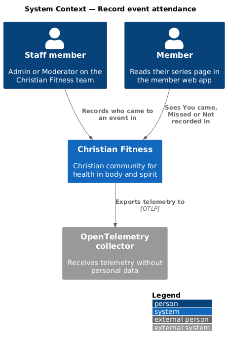
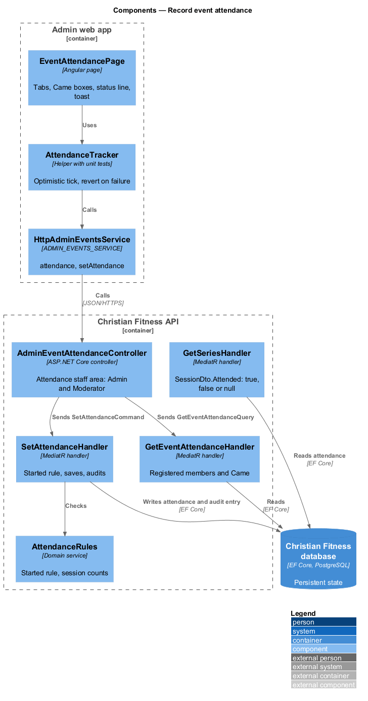
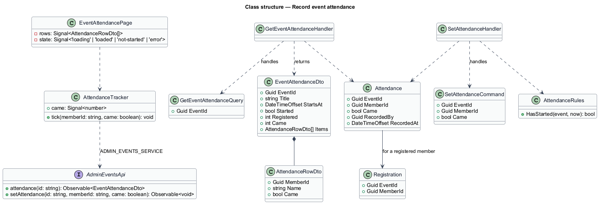

# Record event attendance

## Overview

Members see "You came", "Missed" and "Came to n of m" on their series page (`L2-051` AC3, `L2-052` AC3 and AC9). Those words need a record of who came. Staff make that record in the Admin console; members do not check themselves in (self check-in is deferred).

- **attendance** — record that a registered member came, or did not come, to one event, with who recorded it and when
- **recorded** — a session has attendance recorded once staff have saved at least one tick for it, ticked or cleared
- **Not recorded** — what a member's series page reads for a past session with no attendance recorded; it is never "Missed"

Until attendance is recorded the series page reads "Not recorded", and "Came to <attended> of <recorded>" counts only sessions with attendance recorded.

## Description

The feature is a vertical slice from the Attendance tab of an Admin event to the database, and a read on the member's series page.

- **`EventAttendancePage`** — routed page of the events area (`/admin/events/:id/attendance`), loaded with `loadComponent`, with the title "Event attendance". Mocks: `docs/mocks/pages/admin-event-attendance/` (`default`, `saving`, `failed`, `empty`, `not-started`, `loading`, `error`). It shows the event title, the `tabs` component with Registrations and Attendance (the current one marked), a status line ("Came: <n> of <registered>", a polite live region) and a `table` of names with one `checkbox` ("Came") each. It binds `ADMIN_EVENTS_SERVICE`, `TOASTS_SERVICE` and `AttendanceTracker` on its own `providers`. The Registrations page shows the same two tabs.
- **`AttendanceTracker`** — store in the domain library with unit tests, one case per row of the rule table: a tick sets the box at once and marks it busy; when the save fails the box goes back to the last saved value and the danger toast `We couldn't save <name>` ("Their box is back as it was. Try again.") shows; other boxes stay usable. It keeps one request per member in flight: a tick on a busy box is shown and sent when the first answers, so the last tick wins (ADR 0106). Its requests end when the page is destroyed. The count is computed from the rows.
- **Components used** — design-system `tabs`, `table`, `checkbox`, `toast`, `empty-state`, `error-state` and `skeleton`, from the components library. No new component is needed; the `checkbox` gains a busy state and a name by `aria-label` (ADR 0106).
- **`AdminEventsApi.attendance(id)`** and **`setAttendance(id, memberId, came)`** — contract methods on `ADMIN_EVENTS_SERVICE`; a refusal carries a `code`, and the page shows a generic message.
- **`AdminEventAttendanceController`** — `GET /api/admin/events/{id}/attendance` and `PUT /api/admin/events/{id}/attendance/{memberId}` with `{ came }` (204). Its route is the staff area `Attendance`, which admits Admin and Moderator (`L2-019` AC1 and AC5 as amended); every other Events endpoint stays Admins only (ADR 0106).
- **`GetEventAttendanceQuery`** / handler — returns `EventAttendanceDto` (`EventId`, `Title`, `StartsAt`, `Started`, `Registered`, `Came`, `Items` of `MemberId`, `Name`, `Came`) for the registered members, ordered by name, at most 500; before the start `Items` is empty. An unknown event is refused with `event_not_found`.
- **`SetAttendanceCommand`** / handler — refuses an event that has not started with `event_not_started` (409) and a member with no registration at the event with `not_registered` (404); otherwise it upserts an `Attendance` row (`EventId`, `MemberId`, `Came`, `RecordedBy`, `RecordedAt`) and writes an audit entry `event.attendance_recorded` of who and which event, one per saved change, so the entries count how many members were marked (`L2-019` AC3; ADR 0106); saving the value already recorded records nothing. The rule "started" is `AttendanceRules.HasStarted(event, now)` over `TimeProvider`.
- **Registration is the roster** — whoever holds a `Registration` at the event is listed, whether they joined the series or dropped in. Enrolment and going counts do not change when attendance does (`L2-080` AC8).
- **`GetSeriesHandler`** — adds `SessionDto.Attended` as `true`, `false` or `null`. `null` means no `Attendance` row for that member at that session.
- **`sessionRowViewOf`** — for a past session where the member held a place, gives "You came" for `true`, "Missed" for `false` and "Not recorded" for `null`; "Done" where they held none (`view-event-series`).
- **"Came to <attended> of <recorded>"** — `seriesProgressOf` counts `Attended === true` over past sessions where `Attended !== null`; when none is recorded the panel reads "Attendance not recorded yet" (`join-and-leave-series`).
- A member's session is refused like nobody's (401, ADR 0011); a staff member whose role was taken away, 403 `not_staff` (`L2-080` AC9 as amended).
- Telemetry records the route template only; no name, member id or contact detail reaches a log, metric or span.

### Open questions

- Moderators may use the attendance endpoints, but the Moderator navigation lists only Dashboard and Members (`L2-019` AC5) and the Events list stays Admins only. How a Moderator reaches an event's Attendance tab (a link from the Dashboard, or the address) needs a decision and a mock. Until then Moderators reach it by its address.
- Whether a member should be told when attendance is recorded for them is not specified; the Members table's "events attended" column (`L2-028` AC1) does not yet read this record.
- The page size when an event has many registrations is `<TO SUPPLY>`; the list is windowed like Registrations (`view-event-registrations`).

## Requirements

| L2 ID    | Refines (L1) | Requirement |
| -------- | ------------ | ----------- |
| `L2-080` | `L1-010`     | Staff (Admin or Moderator) shall record attendance on an event that has started, from its Attendance tab: everyone registered is listed with a "Came" checkbox, a change saves at once with "Saving <name>…", and a failed tick is put back with a toast. An event that has not started shall show "Attendance opens when the event starts" and refuse a change with `event_not_started`; an empty list, loading and error states shall be shown. A past session with no attendance recorded shall read "Not recorded" on the member's series page, never "Missed". |
| `L2-051` | `L1-005`     | A past session shall read "You came" or "Missed" where staff recorded attendance and "Not recorded" where none is recorded (AC3). |
| `L2-052` | `L1-005`     | "Came to <attended> of <recorded>" shall count only past sessions with attendance recorded; sessions recorded as attended stay in the history after leaving (AC3, AC9). |
| `L2-019` | `L1-014`     | A Moderator may use the attendance endpoints and no other Events endpoint (AC1, AC5). |

## Diagrams

### System context

Staff record attendance in Christian Fitness; members read the result.

### Containers

The Admin web app writes attendance through the API; the Member web app reads it with the series.

### Components

One command saves a tick under the started rule and audits it; the series query reads the same rows.

### Class structure

`Attendance` is kept per registered member and event, with who recorded it.

### Behaviour — tick Came

A tick saves at once, or is put back with a toast when refused or failed (`L2-080` AC2, AC3, AC5).

### Behaviour — member reads attendance

A past session reads "You came", "Missed" or "Not recorded" (`L2-080` AC7).

