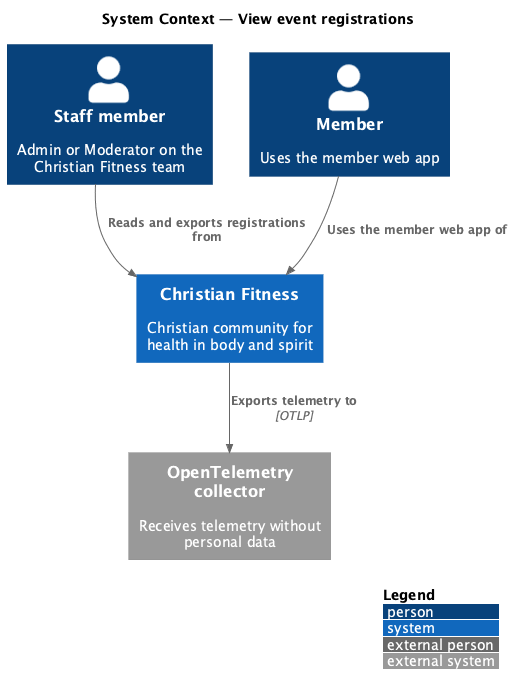
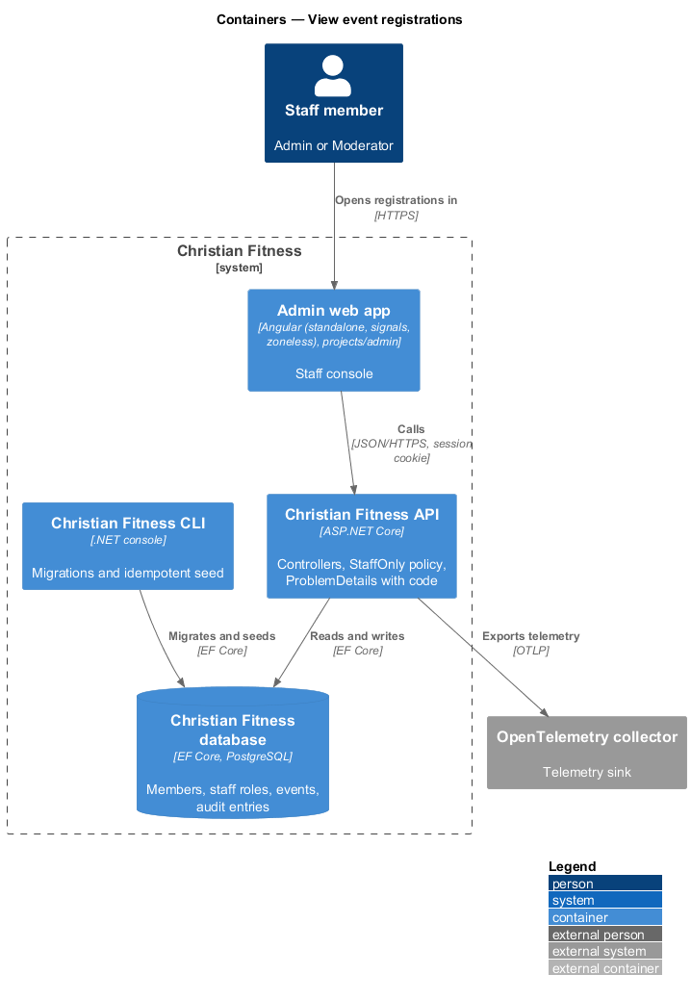
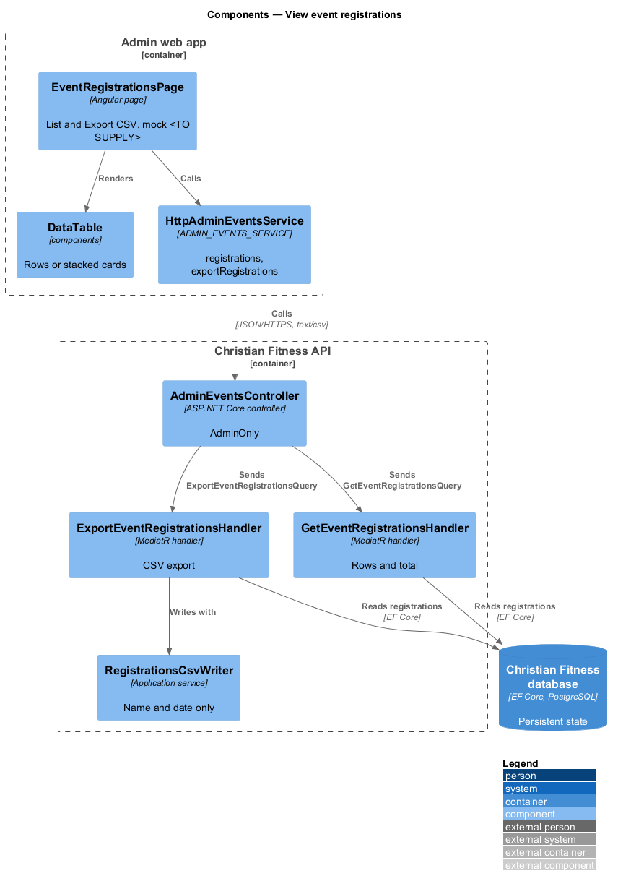
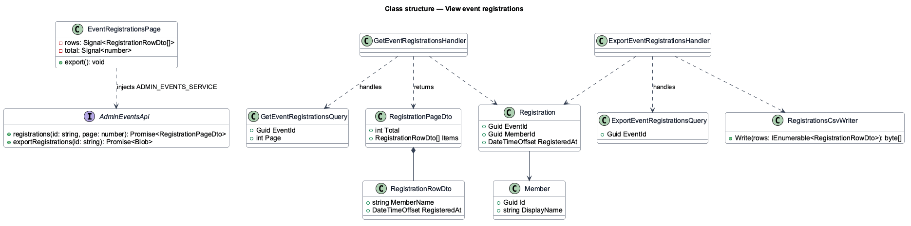
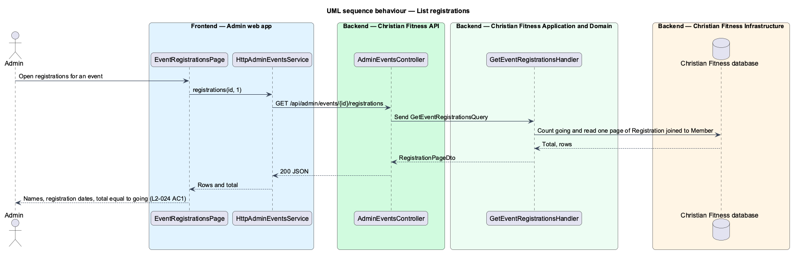
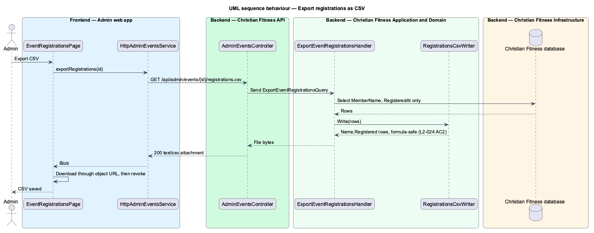

# View event registrations

## Overview

Admins need to know who is coming to an event. This feature lists an event's registered members
with their registration date and exports the same list as a CSV file. The list total equals the
event's going count shown in the events table.

- **registration** — record that a member is going to an event, with the date it was made
- **registrations export** — CSV file with one row per registration and exactly two columns: name and registration date

The export carries no contact details or faith details, so staff can share it with event leaders
without exposing personal data beyond names.

## Description

- **`EventRegistrationsPage`** — routed child page of the events area (`/events/:id/registrations`),
  loaded with `loadComponent`. It shows the event title, the total going and a `table` of name and
  registration date, which becomes stacked cards below LG (`L2-021`). No mock exists for this
  screen; it is `<TO SUPPLY>` before implementation.
- **`AdminEventsApi.registrations(id, page)`** and **`exportRegistrations(id)`** — contract methods
  on `ADMIN_EVENTS_SERVICE`. The export returns a `Blob`; the page downloads it through an object
  URL and revokes the URL at once.
- **Windowed list** — the page holds one page of rows at a time; the page size is `<TO SUPPLY>`.
- **`AdminEventsController`** — `GET /api/admin/events/{id}/registrations` and
  `GET /api/admin/events/{id}/registrations.csv` under `AdminOnly`.
- **`GetEventRegistrationsQuery`** / handler — returns `RegistrationRowDto` items (`MemberName`,
  `RegisteredAt`) ordered by date, with `Total` counted by the same rule as going; unknown event
  returns `event_not_found` `<TO SUPPLY: code not in spec>`.
- **`ExportEventRegistrationsQuery`** / handler — builds the CSV through **`RegistrationsCsvWriter`**:
  header `Name,Registered`, ISO 8601 dates, RFC 4180 quoting, and a leading `'` on any value that
  starts with `=`, `+`, `-` or `@` to block formula injection. File name `<TO SUPPLY>`.
- Telemetry records the route template and row count only; names never reach logs.

## Requirements

| L2 ID    | Refines (L1) | Requirement                                                                                                                                                                                                                                                                     |
| -------- | ------------ | ------------------------------------------------------------------------------------------------------------------------------------------------------------------------------------------------------------------------------------------------------------------------------- |
| `L2-024` | `L1-010`     | Given an event, when an Admin opens its registrations, then registered members are listed with name and registration date, and the total matches going. Given an Admin exports registrations, when the export is produced, then it is a CSV of name and registration date only. |

## Diagrams

### System context

Admins read and export registrations from Christian Fitness; members create them.

### Containers

The Admin web app reads the list and the CSV from the Christian Fitness API.

### Components

Two queries share one going rule; the CSV writer limits the export to two columns.

### Class structure

The queries read `Registration` joined to `Member` and return name and date only.

### Behaviour — list registrations

The page shows names, dates and a total equal to going (`L2-024` AC1).

### Behaviour — export CSV

The export holds name and registration date only (`L2-024` AC2).

