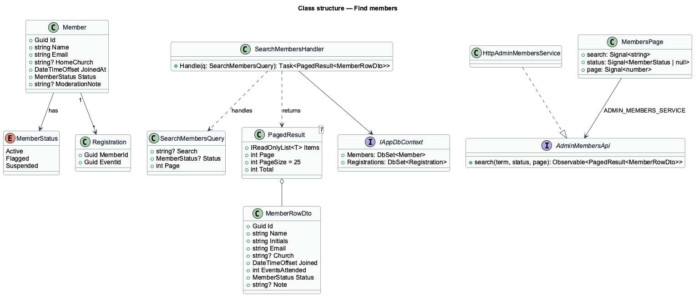
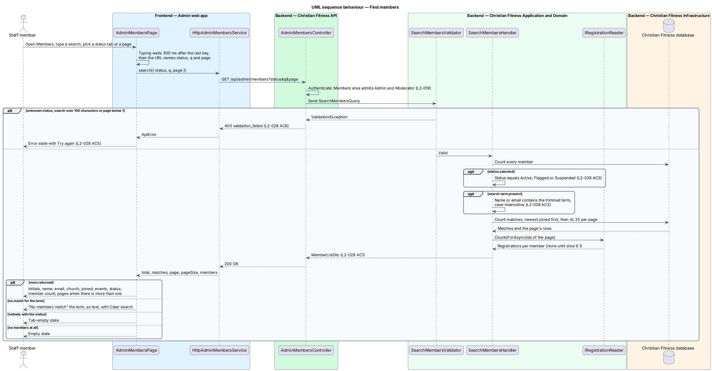

# Find members

## Overview

Staff moderate the Christian Fitness community from the Members screen of the Admin web app. Before staff can act on a member, they find that member.

- **member status** — moderation state of a member: `Active`, `Flagged` or `Suspended`
- **status filter** — tab that limits the list to one member status
- **events attended** — count of events the member has registered for

This feature lists members 25 per page, newest joined first, searches by name or email, and filters by status. Both staff roles use it: L2-019 lets a Moderator moderate members, and an Admin may perform every action. The feature belongs to the admin-moderation subsystem and supplies the rows that flag, suspend and reinstate act on (L2-029).

## Description

The screen follows `docs/mocks/pages/admin-members/` (states `default`, `active`, `flagged`, `suspended`, `no-results`, `tab-empty`, `loading`, `empty`, `error`). ADR 0022 records the decisions.

- **`MembersPage`** — routed, lazily loaded page in `projects/admin`. The URL is its state: `/members?status=flagged&q=grace&page=2` names the status filter, the search term and the page. The page reads the query, asks the contract once for it and shows skeleton rows, the table, an empty state or the error state with Try again. Typing in the search waits 300 ms after the last key, then replaces the URL and returns to page 1. The subtitle is the number of members in the community.
- **Library components** — the page composes `cf-search-field`, `cf-tabs` ("All", "Active", "Flagged", "Suspended", links whose current one is `aria-current="page"`), `cf-table`, `cf-status`, `cf-pagination`, `cf-skeleton-region` and `cf-empty-state`. `cf-table` (BEM block `table`) gains a `person` cell (`table__person`: `avatar` initials, name and email) and a column's `empty` words, shown as an em dash with visually hidden text when a member gave no home church. The `status` badge's text names the status, so colour is not the only carrier. There is no separate member table component.
- **`memberListQueryOf`, `memberListHref`, `memberTabs`, `memberCountLabel`, `joinedOn`, `memberRangeLabel`, `noMembersMessage`** — pure helpers in `domain` with unit tests: the query a URL names, the URL of a query, the tabs, the subtitle, the join date in Toronto, the pagination summary and the empty state's words.
- **`AdminMembersApi`** — contract behind `ADMIN_MEMBERS_SERVICE`. `HttpAdminMembersService` implements it and is bound on `MembersPage` providers.
- **`AdminMembersController`** — `GET /api/admin/members?status=&q=&page=`, in the Members staff area, which admits Admin and Moderator (ADR 0020). It sends one `SearchMembersQuery`.
- **`SearchMembersValidator`** — refuses a search longer than 100 characters, a status other than `all`, `active`, `flagged` or `suspended`, and a page below 1 with 400 `validation_failed`.
- **`SearchMembersHandler`** — applies a trimmed, case-insensitive contains match on name or email, an optional status filter, newest joined first then by id, and a page size of 25; a page past the last answers the last page. It answers `MemberListDto` (`total`, `matches`, `page`, `pageSize`, `members`) of `MemberRowDto`, with `EventsAttended` counted from registrations by `IRegistrationReader.CountsForAsync`, which answers none until slice 6.1.
- **`Member`** and **`MemberStatus`** — domain types from ChristianFitness.Domain.

Home church is optional, sensitive personal data. The handler returns it for display only, and no log, metric or span carries it, the search term or the email (L2-033). The query string is not recorded in telemetry.

The report banner, the moderation note and the row actions in the mock belong to slices 25.1 and 27.1.

## Requirements

| L2 ID | Refines (L1) | Requirement |
|-------|--------------|-------------|
| `L2-028` | `L1-012` | Find members. Given staff on Members, when it loads, then members are listed with name, initials, email, church, joined date, events attended and status, 25 per page, newest joined first, with the member count and links to the other pages. Given a search term, when entered, then the list shows members whose name or email contains it, case-insensitively. Given a status filter (Active, Flagged, Suspended), when selected, then only members with that status show. Given nobody matches, then the screen says so and a search offers Clear search. Given the members cannot be loaded, then an error state offers Try again. Given a search over 100 characters, an unknown status or a page below 1, then the API refuses with `validation_failed`. |

## Diagrams

### System context

A staff member finds members in Christian Fitness. Telemetry carries no personal data.

### Containers

The Admin web app queries the Christian Fitness API, which reads the Christian Fitness database.

### Components

`MembersPage` calls the `ADMIN_MEMBERS_SERVICE` contract and renders the library's table. `AdminMembersController` sends `SearchMembersQuery` to its handler, which asks `IRegistrationReader` for the events attended.

### Class structure

`SearchMembersHandler` returns a `MemberListDto` of `MemberRowDto` with a page size of 25. `Member` holds a `MemberStatus`.

### Behaviour — find members

The handler applies the search term and status filter when present, then pages the result, and the page shows the rows or says that nobody matches (L2-028 AC1 to AC4).

