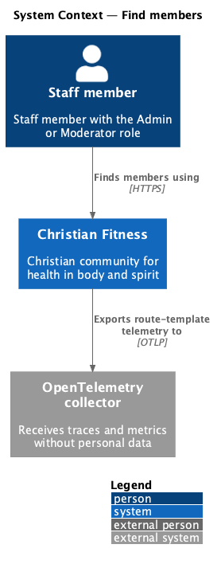
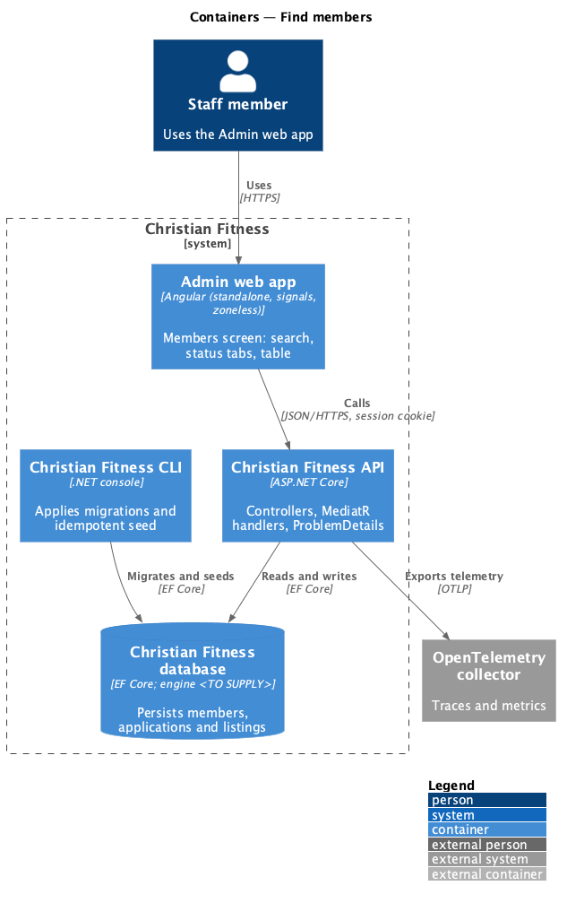
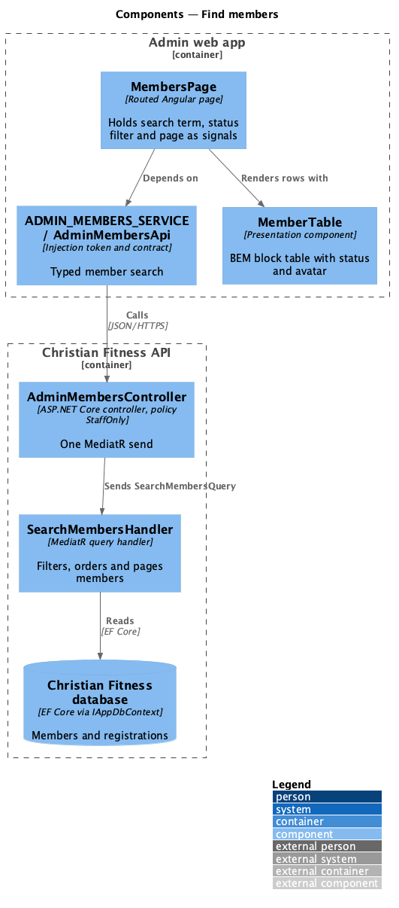

# Find members

## Overview

Staff moderate the Christian Fitness community from the Members screen of the Admin web app. Before staff can act on a member, they find that member.

- **member status** — moderation state of a member: `Active`, `Flagged` or `Suspended`
- **status filter** — tab that limits the list to one member status
- **events attended** — count of events the member has registered for

This feature lists members 25 per page, searches by name or email, and filters by status. Both staff roles use it: L2-019 lets a Moderator moderate members, and an Admin may perform every action. The feature belongs to the admin-moderation subsystem and supplies the rows that flag, suspend and reinstate act on (L2-029).

## Description

The screen follows `docs/mocks/pages/admin-members/` (states `default`, `active`, `flagged`, `suspended`, `no-results`, `loading`, `empty`, `error`).

- **`MembersPage`** — routed, lazily loaded page in `projects/admin`. It holds the search term, status filter and page number as signals and calls the contract. It renders the `search` block (`search__input`), the `tabs` block ("All", "Active", "Flagged", "Suspended", each `tabs__tab` with `aria-selected`) and the members table. Search input is debounced; the delay is `<TO SUPPLY>`.
- **`MemberTable`** — presentation component in the `components` library, BEM block `table`. It shows `avatar` initials, name, email, church, joined date, events and a `status` badge whose text names the status, so colour is not the only carrier.
- **`AdminMembersApi`** — contract behind `ADMIN_MEMBERS_SERVICE`. `HttpAdminMembersService` implements it and is bound on `MembersPage` providers.
- **`AdminMembersController`** — controller under policy `StaffOnly`, which admits Admin and Moderator. It sends one `SearchMembersQuery`.
- **`SearchMembersHandler`** — applies a case-insensitive contains match on name or email, an optional status filter, a stable order and a page size of 25. It projects `MemberRowDto` with `EventsAttended` counted from `Registration` rows. The sort order is `<TO SUPPLY>`. Whether "events attended" counts registrations or confirmed attendance is `<TO SUPPLY>`.
- **`Member`** and **`MemberStatus`** — domain types from ChristianFitness.Domain.

Home church is optional, sensitive personal data. The handler returns it for display only, and no log, metric or span carries it, the search term or the email (L2-033). The query string is not recorded in telemetry. The mocks show no pagination control; its form is `<TO SUPPLY>`.

## Requirements

| L2 ID | Refines (L1) | Requirement |
|-------|--------------|-------------|
| `L2-028` | `L1-012` | Find members. Given staff on Members, when it loads, then members are listed with name, initials, email, church, joined date, events attended and status, 25 per page. Given a search term, when entered, then the list shows members whose name or email contains it, case-insensitively. Given a status filter (Active, Flagged, Suspended), when selected, then only members with that status show. |

## Diagrams

### System context

A staff member finds members in Christian Fitness. Telemetry carries no personal data.

### Containers

The Admin web app queries the Christian Fitness API, which reads the Christian Fitness database.

### Components

`MembersPage` calls the `ADMIN_MEMBERS_SERVICE` contract. `AdminMembersController` sends `SearchMembersQuery` to its handler.

### Class structure

`SearchMembersHandler` returns a `PagedResult` of `MemberRowDto` with a page size of 25. `Member` holds a `MemberStatus`.

### Behaviour — find members

The handler applies the search term and status filter when present, then pages the result (L2-028 AC1 to AC3).

