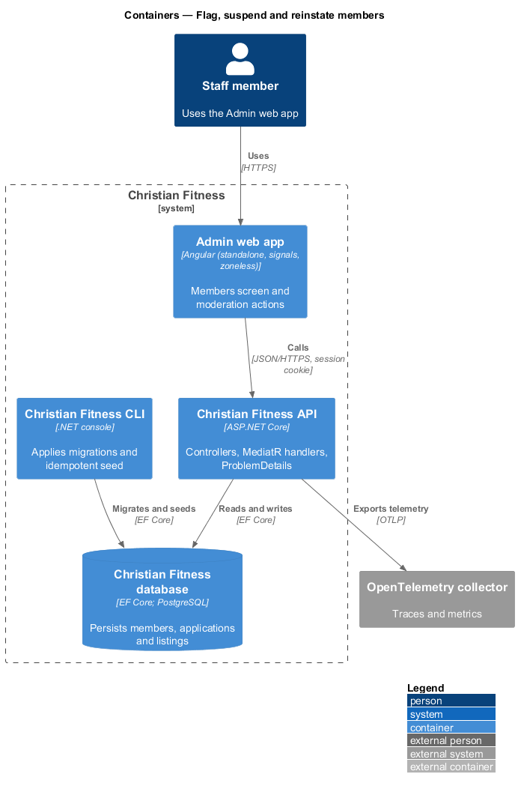
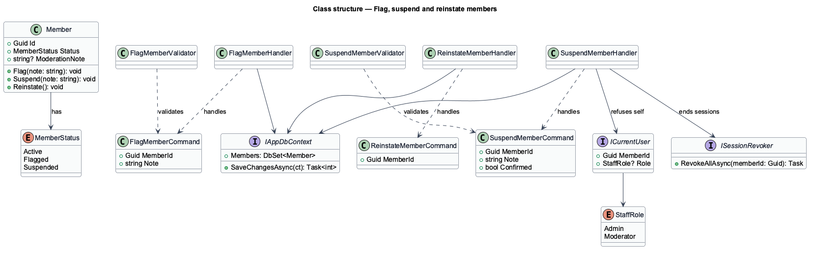
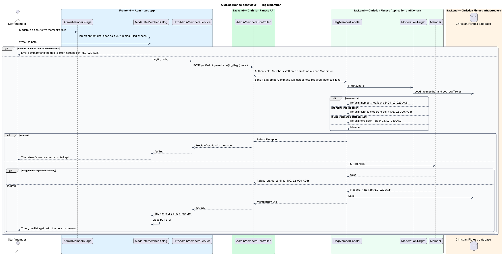
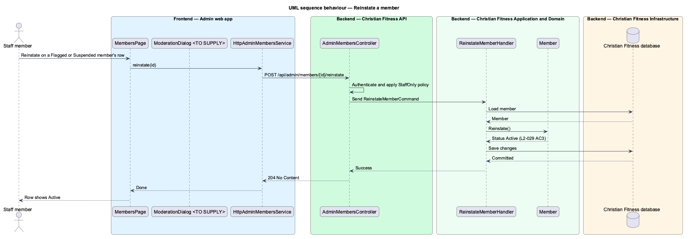

# Flag, suspend and reinstate members

## Overview

Staff keep the Christian Fitness community safe by changing a member's *member status* from the Members screen of the Admin web app.

- **member status** — moderation state of a member: `Active`, `Flagged` or `Suspended`
- **flag** — transition from `Active` to `Flagged` with a staff note, marking a member for attention without restricting them
- **suspend** — transition from `Active` or `Flagged` to `Suspended` with a note and confirmation, ending the member's sessions
- **reinstate** — transition from `Flagged` or `Suspended` back to `Active`
- **moderation note** — staff text explaining a flag or suspension

A suspended member cannot sign in (L2-004 AC4) or register for events (L2-011 AC6); both refuse with code `account_suspended`. Staff cannot suspend their own account. Both staff roles may moderate (L2-019). The feature belongs to the admin-moderation subsystem and acts on rows found through find-members (L2-028).

## Description

The screen follows `docs/mocks/pages/admin-members/` (rows with a note under the status and a "Moderate" action) and `docs/mocks/dialogs/moderate-member/` (states `default`, `suspend`, `flagged`, `invalid`, `busy`, `failed`, `refused`), with the toasts `admin-toast/member-flagged` and `member-suspended`. ADR 0023 records the decisions. Slice 27.1 builds flag and suspend; reinstate is slice 27.2.

- **`AdminMembersPage`** — routed page in `projects/admin`. Each Active or Flagged row has one action, "Moderate", whose accessible name includes the member's name; a Suspended row has none until 27.2. The action imports and opens the moderation dialog; when it closes with a changed member the page shows a toast and loads the list again.
- **`ModerateMemberDialog`** — CDK Dialog rendering the library's `cf-dialog`, loaded on first use. For an Active member it offers Flag or Suspend as radios; for a Flagged member only suspension. It collects the note and, for suspend, the confirmation; it names what is missing in an error summary before sending, holds still while the answer is on its way, and closes by its ref.
- **`moderationOf`, `moderationProblems`, `moderationRefusalOf`** — pure helpers in `domain` with unit tests: what a status allows, what is missing from the form, and what the dialog says for each refusal code.
- **`AdminMembersApi`** — contract behind `ADMIN_MEMBERS_SERVICE`, extended with `flag` and `suspend`.
- **`AdminMembersController`** — in the Members staff area. `POST {id}/flag` and `POST {id}/suspend` each send one command.
- **`FlagMemberCommand`** and **`SuspendMemberCommand`** with **`ModerateMemberValidator`** rules — require a note of at most 500 characters; suspend also requires `confirmed`. Failures carry `note_required`, `note_too_long` and `confirmation_required`, named in the refusal's `fieldCodes`.
- **`ModerateMemberHandler`** rules, shared by both handlers — refuse `member_not_found` (404) for an unknown id, `cannot_moderate_self` (403) when the target is the caller from `ICurrentMember`, `forbidden_role` (403) when a Moderator targets a staff account, and `status_conflict` (409) when the transition is not in the table. The suspend handler also calls `ISessionRevocation.EndAllAsync` and removes the member's pending admin sign-in, all in one save.
- **`Member`** — domain entity owning the transition table below (`TryFlag`, `TrySuspend`) and the `ModerationNote`.

| From | Flag | Suspend | Reinstate (27.2) |
|------|------|---------|-----------|
| `Active` | `Flagged` | `Suspended` | refused |
| `Flagged` | refused | `Suspended` | `Active` |
| `Suspended` | refused | refused | `Active` |

The note is shown on the member's row as text, never as HTML (L2-032), and no log, metric or span carries it. Sessions are rows of `Sessions` (ADR 0009); removing them ends every session, member app and admin app alike. A suspended account is refused at member sign-in (L2-004 AC4) and at staff sign-in with `account_suspended`. Refusing registration (L2-011 AC6) arrives with slice 6.1, and closing live connections with 12.1. Whether reinstatement clears the note is slice 27.2's decision.

## Requirements

| L2 ID | Refines (L1) | Requirement |
|-------|--------------|-------------|
| `L2-029` | `L1-012` | Flag, suspend and reinstate members. Given an Active member, when staff flag them with a note, then their status becomes Flagged and the note is shown on their row. Given an Active or Flagged member, when staff suspend them with a note and confirmation, then their status becomes Suspended, their sessions end and L2-004 AC4 and L2-011 AC6 apply. Given a Flagged or Suspended member, when staff reinstate them, then their status becomes Active. Given staff try to flag or suspend their own account, then it is refused with code `cannot_moderate_self`. A missing or long note or an unconfirmed suspension is refused with `validation_failed` and field codes; a status that does not allow the change with `status_conflict`; an unknown member with `member_not_found`; a Moderator moderating staff with `forbidden_role`; a suspended staff account at admin sign-in with `account_suspended`. Moderate on a row opens a dialog for the action and the note. |

## Diagrams

### System context

A staff member moderates members in Christian Fitness. The moderated member's later sign-in and registration attempts reflect the new status.

### Containers

The Admin web app sends moderation commands to the Christian Fitness API, which updates the Christian Fitness database.

### Components

`AdminMembersController` sends one command per action. The suspend handler also revokes sessions through the session store.

### Class structure

`Member` owns the three transitions. `SuspendMemberHandler` depends on `ICurrentUser` to refuse self-suspension and on `ISessionRevoker` to end sessions.

### Behaviour — flag a member

The handler flags an Active member and stores the note shown on the row (L2-029 AC1).

### Behaviour — suspend a member

The handler refuses self-suspension with `cannot_moderate_self` (L2-029 AC4). Otherwise it suspends the member and ends every session (L2-029 AC2).

### Behaviour — reinstate a member

The handler returns a Flagged or Suspended member to Active (L2-029 AC3).

