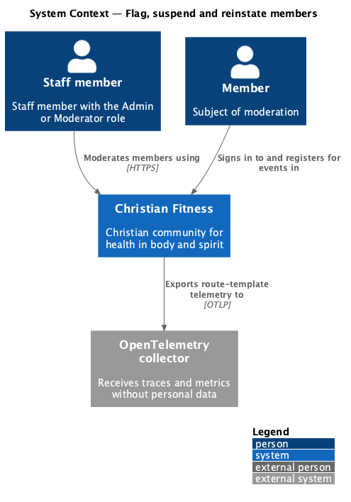
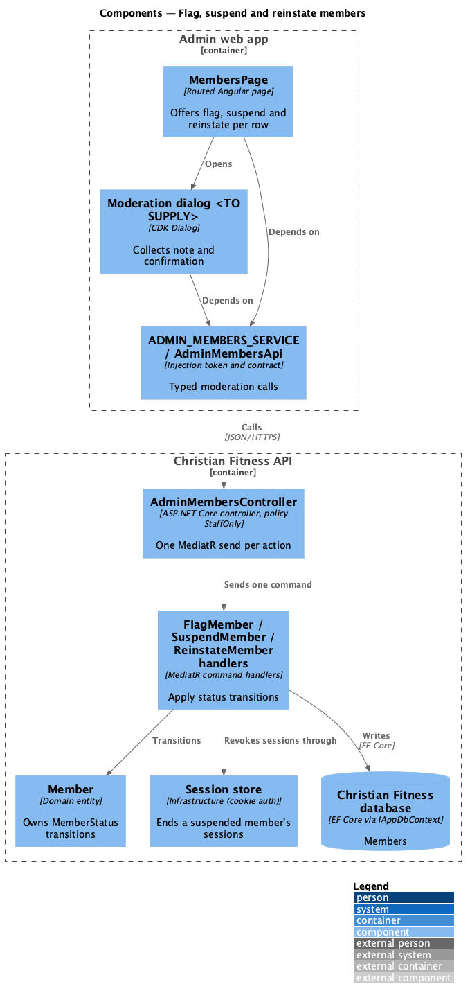
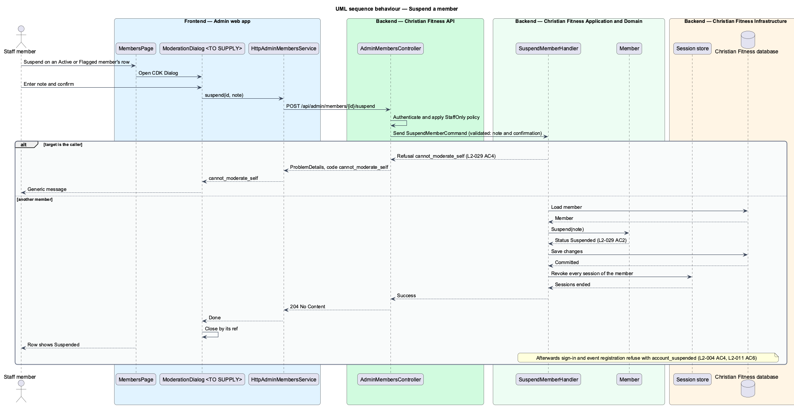

# Flag, suspend and reinstate members

## Overview

Staff keep the Christian Fitness community safe by changing a member's *member status* from the Members screen of the Admin web app.

- **member status** — moderation state of a member: `Active`, `Flagged` or `Suspended`
- **flag** — transition from `Active` to `Flagged` with a staff note, marking a member for attention without restricting them
- **suspend** — transition from `Active` or `Flagged` to `Suspended` with a note and confirmation, ending the member's sessions
- **reinstate** — transition from `Flagged` or `Suspended` back to `Active`
- **moderation note** — staff text explaining a flag or suspension

A suspended member cannot sign in (L2-004 AC4) or register for events (L2-011 AC6); both refuse with code `account_suspended`. Staff cannot suspend their own account. Both staff roles may moderate (L2-019). The feature belongs to the admin-moderation subsystem and acts on rows found through find-members (L2-028).

## Description

The screen follows `docs/mocks/pages/admin-members/` (states `active`, `flagged`, `suspended`). The mock's `report` block ("Reported by 4 members", with "Dismiss" and "Suspend") is one entry point for suspension.

- **`MembersPage`** — routed page in `projects/admin`. Each row offers the actions its status allows, with accessible names that include the member's name.
- **Moderation dialog** — CDK Dialog that collects the note for flag and the note plus confirmation for suspend. The mocks contain no flag, suspend-note or reinstate control, so its name and states are `<TO SUPPLY>` and need a mock state or ADR stand-in. It closes by its ref.
- **`AdminMembersApi`** — contract behind `ADMIN_MEMBERS_SERVICE`, extended with `flag`, `suspend` and `reinstate`.
- **`AdminMembersController`** — controller under policy `StaffOnly`. Each action sends one command.
- **`FlagMemberCommand`**, **`FlagMemberValidator`** and **`FlagMemberHandler`** — require a note and call `Member.Flag`.
- **`SuspendMemberCommand`**, **`SuspendMemberValidator`** and **`SuspendMemberHandler`** — require a note and confirmation. The handler refuses with code `cannot_moderate_self` when the target is the caller from `ICurrentUser`. Otherwise it calls `Member.Suspend`, saves, and calls `ISessionRevoker.RevokeAllAsync` to end every session.
- **`ReinstateMemberCommand`** and **`ReinstateMemberHandler`** — call `Member.Reinstate`.
- **`Member`** — domain entity owning the transition table below. An illegal transition returns a refusal whose `code` is `<TO SUPPLY>`.

| From | Flag | Suspend | Reinstate |
|------|------|---------|-----------|
| `Active` | `Flagged` | `Suspended` | refused |
| `Flagged` | refused | `Suspended` | `Active` |
| `Suspended` | refused | refused | `Active` |

The note is shown on the member's row as text, never as HTML (L2-032), and no log, metric or span carries it. How sessions are stored and revoked depends on cookie auth in ChristianFitness.Infrastructure; the mechanism (for example a security stamp check) is `<TO SUPPLY>`. Whether a suspended member's open SignalR connections close at once is `<TO SUPPLY>`. Whether reinstatement clears the moderation note, and whether staff may flag or reinstate themselves, are `<TO SUPPLY>`; L2-029 AC4 names only suspension. Whether a Moderator may suspend an Admin is `<TO SUPPLY>`.

## Requirements

| L2 ID | Refines (L1) | Requirement |
|-------|--------------|-------------|
| `L2-029` | `L1-012` | Flag, suspend and reinstate members. Given an Active member, when staff flag them with a note, then their status becomes Flagged and the note is shown on their row. Given an Active or Flagged member, when staff suspend them with a note and confirmation, then their status becomes Suspended, their sessions end and L2-004 AC4 and L2-011 AC6 apply. Given a Flagged or Suspended member, when staff reinstate them, then their status becomes Active. Given staff try to suspend their own account, when submitted, then it is refused with code `cannot_moderate_self`. |

## Diagrams

### System context

A staff member moderates members in Christian Fitness. The moderated member's later sign-in and registration attempts reflect the new status.

### Containers

The Admin web app sends moderation commands to the Christian Fitness API, which updates the Christian Fitness database.

### Components

`AdminMembersController` sends one command per action. The suspend handler also revokes sessions through the session store.

### Class structure

`Member` owns the three transitions. `SuspendMemberHandler` depends on `ICurrentUser` to refuse self-suspension and on `ISessionRevoker` to end sessions.

### Behaviour — flag a member

The handler flags an Active member and stores the note shown on the row (L2-029 AC1).

### Behaviour — suspend a member

The handler refuses self-suspension with `cannot_moderate_self` (L2-029 AC4). Otherwise it suspends the member and ends every session (L2-029 AC2).

### Behaviour — reinstate a member

The handler returns a Flagged or Suspended member to Active (L2-029 AC3).

