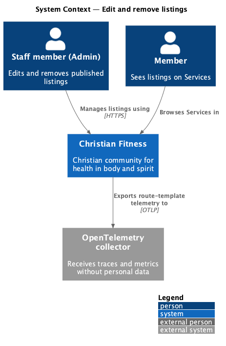
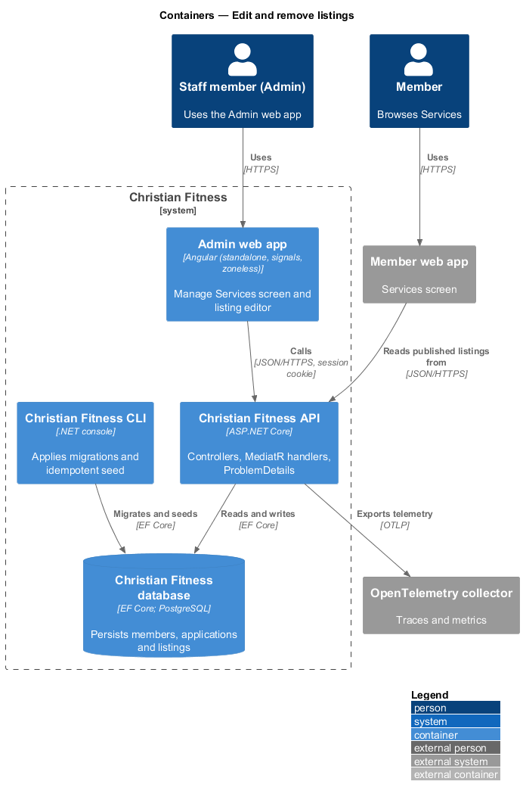
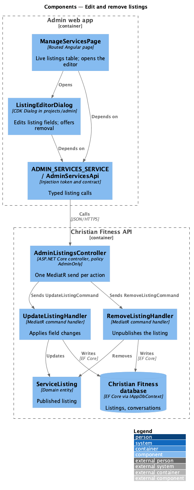
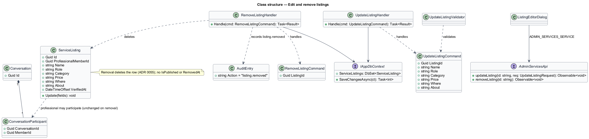
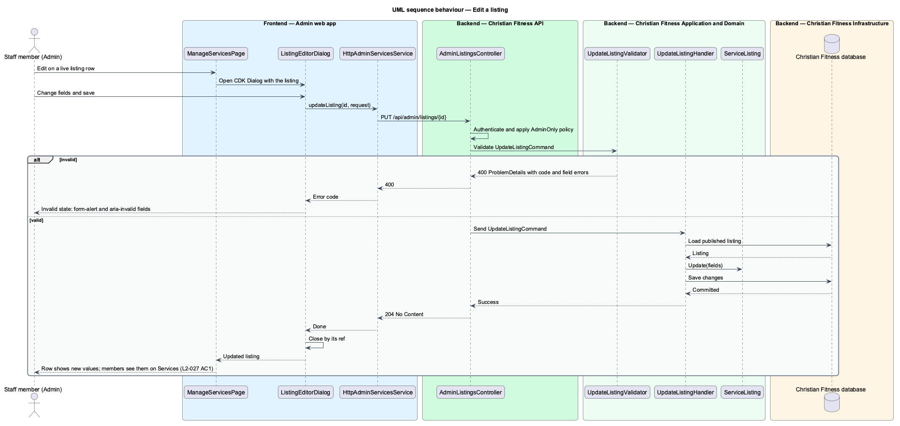
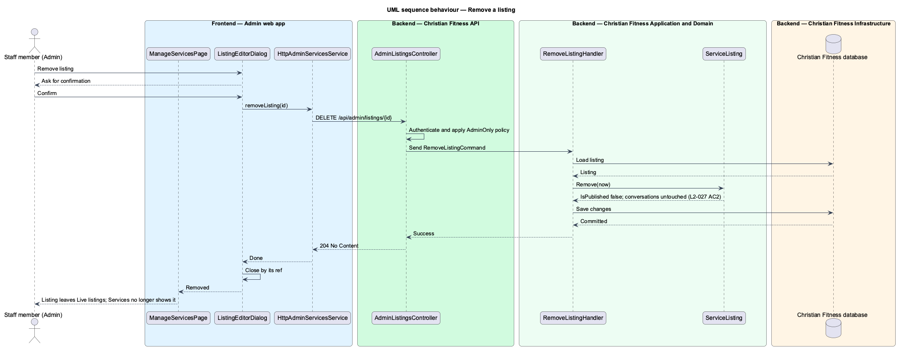

# Edit and remove listings

## Overview

A *listing* is a published `ServiceListing` that members see on the Services screen of the Member web app. Listings come from approved professional applications (L2-025).

- **live listing** — listing that is published and visible on Services
- **removal** — unpublishing of a listing so that Services no longer shows it

This feature lets an Admin keep listings correct. The Admin edits a listing's fields, and members see the change on Services. The Admin may also remove a listing after confirming. Removal does not delete conversations a member already holds with the professional. The feature belongs to the admin-services subsystem. Moderators receive HTTP 403 on these endpoints (L2-019).

## Description

The editor follows the mock `docs/mocks/dialogs/listing-editor/` (states `default`, `invalid`, `busy`, `failed`), opened from the "Live listings" table of `docs/mocks/pages/admin-services/`.

- **`ManageServicesPage`** — routed page in `projects/admin`. Each live listing row offers "Edit" with an accessible name that includes the professional's name.
- **`ListingEditorDialog`** — CDK Dialog in `projects/admin`, BEM block `drawer` with `field`, `field-grid`, `input`, `select`, `textarea` and `form-alert`. It saves through `AdminServicesApi` and closes by its ref. Its form component may live in the `components` library with inputs and outputs only.
- **`AdminServicesApi`** — contract behind `ADMIN_SERVICES_SERVICE`, extended with `updateListing` and `removeListing`. The dialog's providers bind the token where the dialog is created.
- **`AdminListingsController`** — controller under policy `AdminOnly`. Each action sends one MediatR request.
- **`UpdateListingCommand`**, **`UpdateListingValidator`** and **`UpdateListingHandler`** — validate and apply field changes to `ServiceListing`. Field rules (slice 23.1, ADR 0054): name, role, category, where, price, credentials and about are required and length-limited, and the contact link is optional and an http or https address; each refusal is 400 `validation_failed` with a `fieldCodes` entry.
- **`RemoveListingCommand`** and **`RemoveListingHandler`** — call `ServiceListing.Remove`, which sets `IsPublished` to false and records `RemovedAt`. The handler does not touch `Conversation` or `ConversationParticipant` rows.
- **`ServiceListing`** — domain entity. The Services query for members returns only published listings.

The mocks show no removal control or confirmation state, so the confirmation's form is `<TO SUPPLY>` and needs a mock state or ADR stand-in. Whether removal is a soft delete (as designed here) or a hard delete is `<TO SUPPLY>`. Editing a missing listing is refused with 404 `service_not_found` (ADR 0054). The editing half of this feature is slice 23.1: `GET /api/admin/services/listings` feeds the Live listings table, `PUT /api/admin/services/listings/{id}` saves, and the mock states `edit` and `edit-invalid` were added for it; removal is slice 23.2.

## Requirements

| L2 ID | Refines (L1) | Requirement |
|-------|--------------|-------------|
| `L2-027` | `L1-011` | Edit and remove listings. Given a published listing, when an Admin edits its fields, then members see the change on Services. Given a published listing, when an Admin removes it with confirmation, then it no longer appears on Services and existing conversations with the professional remain. |

## Diagrams

### System context

An Admin manages listings in Christian Fitness, and members see the result on Services.

### Containers

The Admin web app writes listing changes through the API. The Member web app reads published listings from the same API.

### Components

`ListingEditorDialog` calls the contract. `AdminListingsController` dispatches `UpdateListingCommand` and `RemoveListingCommand`.

### Class structure

`ServiceListing` owns `Update` and `Remove`. Conversations and their participants stay independent of the listing.

### Behaviour — edit a listing

The validator checks the fields, and the handler saves them. The dialog closes by its ref before the page refreshes the row (L2-027 AC1).

### Behaviour — remove a listing

After confirmation, the handler unpublishes the listing and leaves conversations in place (L2-027 AC2).

