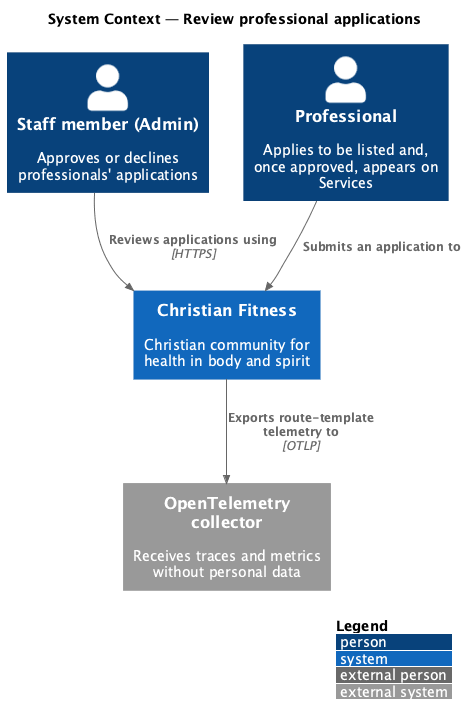
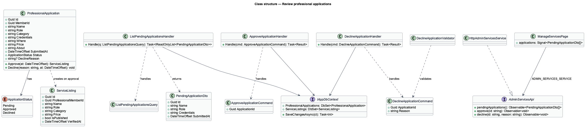
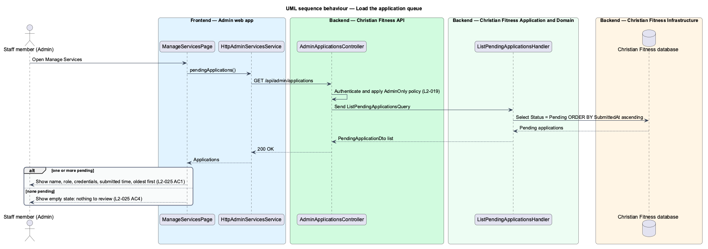
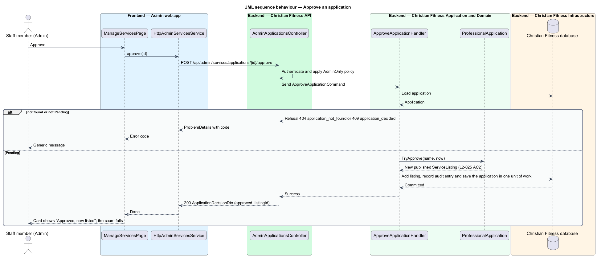
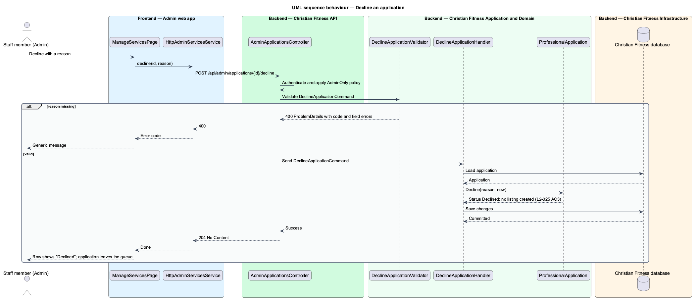

# Review professional applications

## Overview

Christian Fitness lists Christian professionals the team has vetted: trainers, dietitians, physios and counsellors. Members find them on the Services screen of the Member web app. A professional reaches that screen only after staff approve an application.

- **professional application** — request from a member to be listed as a professional, holding role, category, credentials, where, price and about
- **application queue** — list of applications in the `Pending` state, shown on the Manage Services screen
- **listing** — published `ServiceListing` that members see on Services

This feature covers the staff side of that gate. An Admin opens Manage Services in the Admin web app, reads each pending application, and approves or declines it. Approval publishes a listing. Decline records a reason and publishes nothing. Either decision removes the application from the queue. The feature belongs to the admin-services subsystem, next to taking in applications (L2-026) and editing and removing listings (L2-027).

Staff roles come from L2-019: a Moderator receives HTTP 403 on every services endpoint, and an Admin may perform every action.

## Description

The slice runs from the Manage Services screen to the database. The screen follows the mock `docs/mocks/pages/admin-services/` (states `default`, `decided`, `no-applications`, `loading`, `empty`, `error`).

- **`ManageServicesPage`** — routed, lazily loaded page in `projects/admin`. It holds the queue as a signal, calls the contract, and branches on error `code` values. It renders the `applications` list and the "Live listings" table.
- **`ApplicationCard`** — presentation component in the `components` library, BEM block `application` (`application__head`, `application__role`, `application__creds`). It shows avatar, name, submitted time, role and credentials, and emits `approve` and `decline` outputs. Its buttons carry accessible names such as "Approve Lena Park, RD".
- **`AdminServicesApi`** — contract in the `api` library, provided through the `ADMIN_SERVICES_SERVICE` token. `HttpAdminServicesService` implements it and `app.config.ts` binds it.
- **`AdminApplicationsController`** — ASP.NET Core controller under policy `AdminOnly`. Each action sends one MediatR request and checks nothing itself.
- **`ListPendingApplicationsQuery`** and **`ListPendingApplicationsHandler`** — return `PendingApplicationDto` items with name, role, credentials and submitted time, ordered by `SubmittedAt` ascending. The queue holds at most 50 applications, and the answer carries `total`, the number waiting in all (ADR 0048).
- **`ApproveApplicationCommand`** and **`ApproveApplicationHandler`** — load the application, call `ProfessionalApplication.Approve`, add the returned `ServiceListing`, and save both in one unit of work.
- **`DeclineApplicationCommand`**, **`DeclineApplicationValidator`** and **`DeclineApplicationHandler`** — require a non-empty reason and call `ProfessionalApplication.Decline`. No listing is created. The maximum reason length is `<TO SUPPLY>`.
- **`ProfessionalApplication`** — domain entity owning the transitions `Pending → Approved` and `Pending → Declined`. A decided application accepts no further transition.
- **`ServiceListing`** — domain entity for a published listing.

The refusal code for deciding an application that is missing or already decided is `<TO SUPPLY>`; the spec names none. The mocks show no decline-reason input; the dialog that collects the reason is `<TO SUPPLY>` and needs a mock state or an ADR stand-in before implementation. Whether the applicant is notified of the decision is `<TO SUPPLY>`.

## Requirements

| L2 ID | Refines (L1) | Requirement |
|-------|--------------|-------------|
| `L2-025` | `L1-011` | Review professional applications. Given pending applications, when an Admin opens Manage Services, then each shows name, role, credentials and submitted time, oldest first. Given an application, when an Admin approves it, then a published listing is created and the application leaves the queue. Given an application, when an Admin declines it with a reason, then no listing is created and the application leaves the queue. Given no pending applications, when the queue loads, then an empty state says there is nothing to review. |

## Diagrams

### System context

A professional submits an application to Christian Fitness, and an Admin decides it. Telemetry leaves the system without personal data.

### Containers

The Admin web app calls the Christian Fitness API, which reads and writes the Christian Fitness database. The CLI owns migrations.

### Components

`ManageServicesPage` depends on the `ADMIN_SERVICES_SERVICE` contract. `AdminApplicationsController` dispatches one query and two commands to their handlers.

### Class structure

`ProfessionalApplication` holds an `ApplicationStatus` and creates a `ServiceListing` on approval. Each handler depends on `IAppDbContext`.

### Behaviour — load the queue

The handler returns pending applications oldest first (L2-025 AC1). An empty result shows the empty state (L2-025 AC4).

### Behaviour — approve an application

Approval creates a published listing and saves it with the application in one unit of work (L2-025 AC2).

### Behaviour — decline an application

The validator requires a reason. The handler declines the application and creates no listing (L2-025 AC3).

