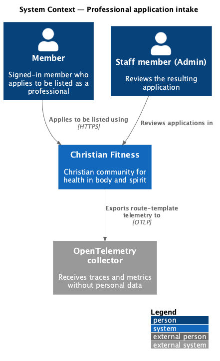
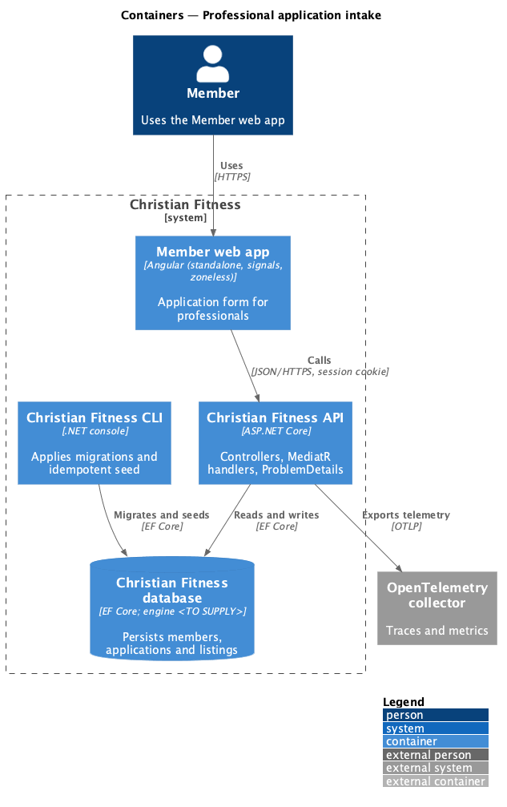
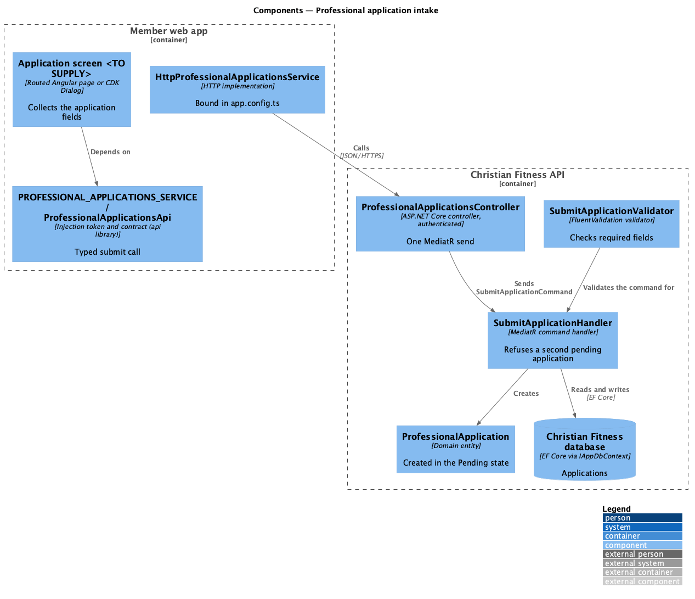
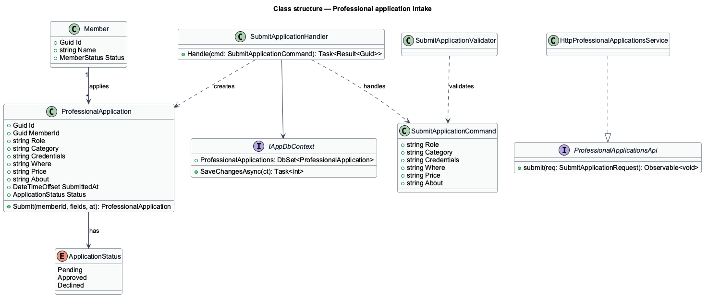
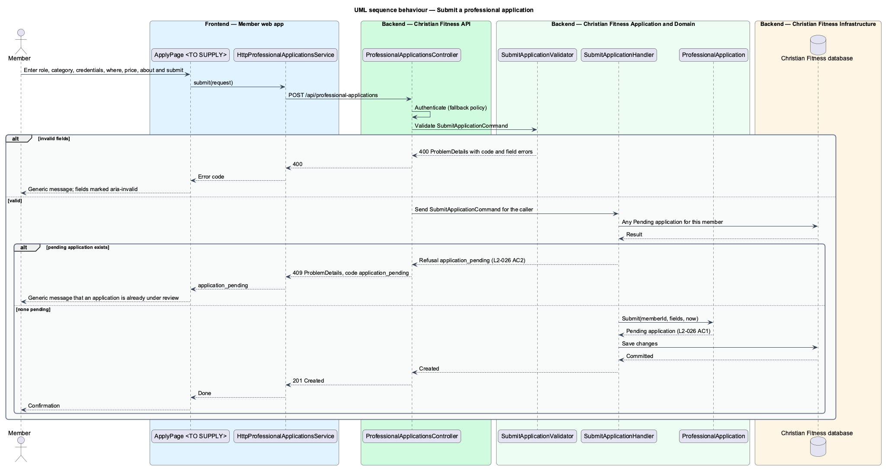

# Professional application intake

## Overview

Christian Fitness lists vetted Christian professionals on the Services screen. Every listing starts as a *professional application*.

- **professional application** — request from a signed-in member to be listed, holding role, category, credentials, where, price and about
- **pending application** — professional application that staff have not yet decided

This feature covers how an application enters the system. A signed-in member fills in the application in the Member web app and submits it. The API creates a pending application, which then appears in the Admin's queue (L2-025). A member who already has a pending application cannot submit a second one. The feature belongs to the admin-services subsystem because its output feeds staff review.

## Description

- **Application screen** — the Member web app screen or CDK Dialog that collects the fields. The mocks under `docs/mocks/` contain no member-facing application form, so its host screen, entry point and component names are `<TO SUPPLY>`. A mock state or an ADR stand-in shall exist before implementation.
- **`ProfessionalApplicationsApi`** — contract in the `api` library behind the `PROFESSIONAL_APPLICATIONS_SERVICE` token. `HttpProfessionalApplicationsService` implements it and `app.config.ts` in `projects/web` binds it. The screen branches on the error `code` and shows a generic message.
- **`ProfessionalApplicationsController`** — authenticated by the fallback policy. It sends one `SubmitApplicationCommand` for the caller and checks nothing itself.
- **`SubmitApplicationValidator`** — FluentValidation rules for the six fields. Field lengths, the category list and the price format are `<TO SUPPLY>`.
- **`SubmitApplicationHandler`** — refuses with code `application_pending` when the caller already has a `Pending` application. Otherwise it creates the application through `ProfessionalApplication.Submit` and saves it. The HTTP status for the refusal is `<TO SUPPLY>`; the sequence shows 409.
- **`ProfessionalApplication`** — domain entity created in the `Pending` state with `SubmittedAt` from the injected `TimeProvider`.

Whether a member with a declined application may apply again, and whether a suspended member may apply, are `<TO SUPPLY>`. Credentials are rendered as text, never as HTML (L2-032).

## Requirements

| L2 ID | Refines (L1) | Requirement |
|-------|--------------|-------------|
| `L2-026` | `L1-011` | Professional application intake. Given a signed-in member, when they apply to be listed with role, category, credentials, where, price and about, then a pending application is created. Given a member with a pending application, when they apply again, then it is refused with code `application_pending`. |

## Diagrams

### System context

A member applies through Christian Fitness, and an Admin later reviews the application.

### Containers

The Member web app sends the application to the Christian Fitness API, which stores it in the Christian Fitness database.

### Components

The controller sends `SubmitApplicationCommand`. The validator checks it, and the handler creates the `ProfessionalApplication`.

### Class structure

A `Member` may hold many `ProfessionalApplication` records, at most one of them `Pending`.

### Behaviour — submit an application

Validation runs first. The handler then refuses a second pending application with `application_pending` (L2-026 AC2) or creates a pending one (L2-026 AC1).

