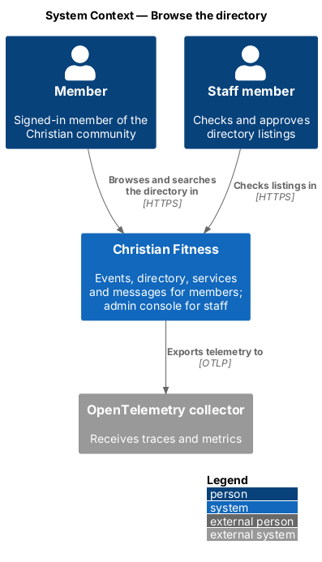
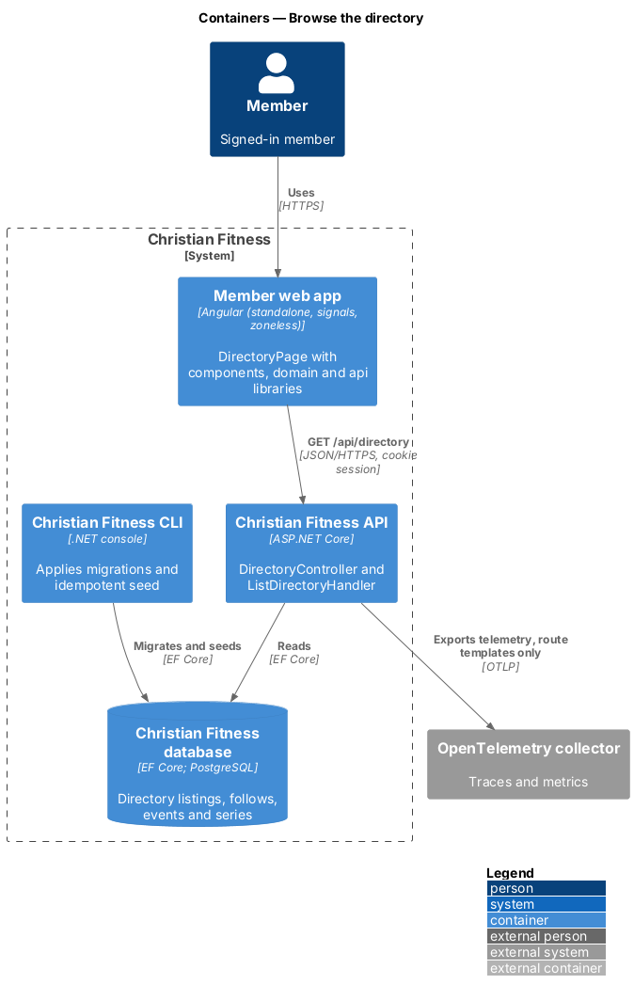
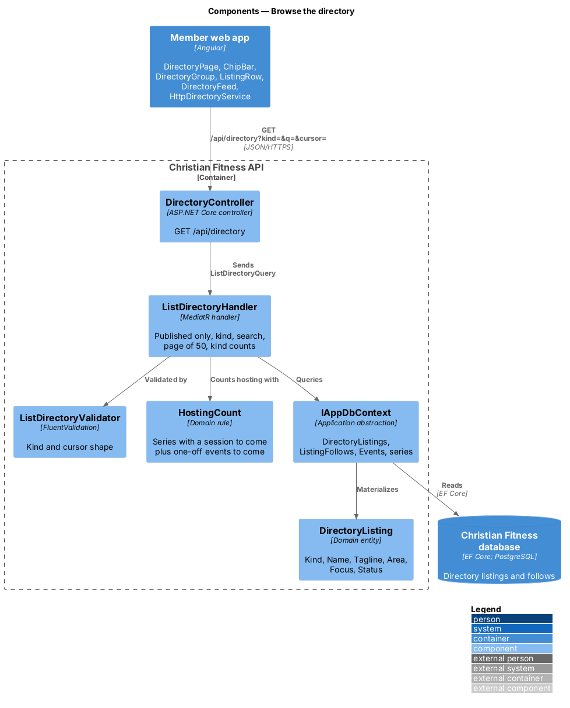
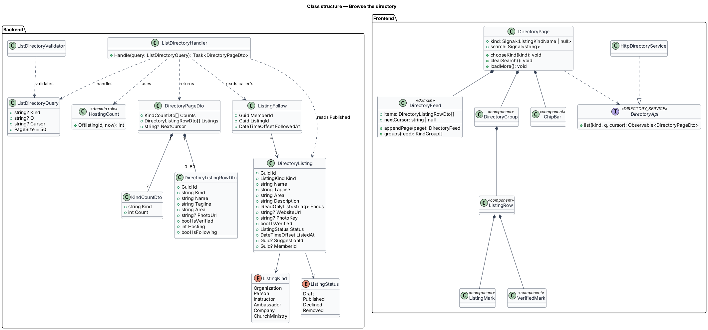
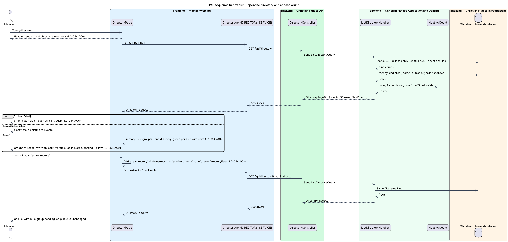
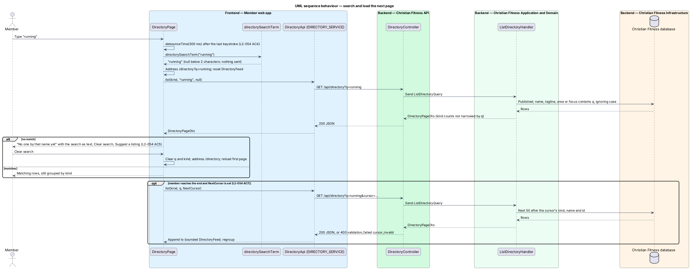

# Browse the directory

## Overview

Christian Fitness is a Christian community for health in body and spirit in the Greater Toronto Area. The directory subsystem gives members a directory of the organizations, people, instructors, ambassadors, companies and church ministries behind the community's events. Each entry has a profile of what it hosts and whom it is connected to; members follow entries and suggest new ones (`L1-017`).

- **directory listing** — staff-checked, published entry in the directory for one organization, person, instructor, ambassador, company or church ministry (`DirectoryListing`)
- **listing kind** — one of Organization, Person, Instructor, Ambassador, Company or Church Ministry, in that order
- **host listing** — directory listing that runs an event or an event series (`L2-010` AC4, `L2-051` AC1)
- **hosting count** — number of event series with a session still to come plus one-off events still to come that a listing hosts

A directory listing is not a Services listing. A Services listing (`ServiceListing`, design `docs/detailed-designs/services/browse-services/`) is a vetted professional whom members book, created when staff approve a professional's application (`L1-006`, `L1-011`). A directory listing is any party behind the community's events, created from a member's suggestion that staff check (`L1-017`, `L1-023`). The two can describe the same person: the mock cast lists Danielle Okafor, Tasha Grant and Rev. James Whitfield in both. The specification does not say whether that is one record or two; this design keeps two records and lists the question under Open questions.

This feature covers the Directory screen of the Member web app (mock `docs/mocks/pages/directory/`, states `default`, `filtered`, `search`, `no-results`, `loading`, `empty` and `error`). The screen lists published listings grouped by kind, narrows them by kind and by a search, and loads further listings in pages of 50. The Follow button on each row belongs to the follow-listing feature (`docs/detailed-designs/directory/follow-listing/`). The row leads to the listing's profile (`docs/detailed-designs/directory/view-listing-profile/`). The "Suggest a listing" links lead to `docs/detailed-designs/directory/suggest-listing/`.

- **kind chip** — filter chip for All or one kind, with the number of published listings of that kind
- **listing mark** — round or squared badge of a listing: its photo where it has one, its initials where not

## Description

The feature is a vertical slice from the Directory screen to the database. No part of it exists in the codebase yet; every name below is introduced by this design.

### Member web app (`projects/web`) and libraries

- **`DirectoryPage`** — routed page component at `/directory`, loaded with `loadComponent` as a child of the member shell. It renders the `page-head` with the heading, the subtitle, the "Know someone who belongs here? Suggest a listing" link to `/directory/suggest` and the `search` form; the `chip-bar` of kind chips; and the `directory-groups` list. It holds the chosen kind, the search text and the loaded rows as signals and reflects kind and search in the address as `/directory?kind=<name>&q=<text>`. Its `providers` bind `DIRECTORY_SERVICE` to `HttpDirectoryService` and provide the screen's `ListingFollowStore` and `ToastStore`, so they end with the visit.
- **`ChipBar`** — existing presentation component (blocks `chip-bar`, `chip`). Each kind chip is a link to `/directory?kind=<name>`, carries a `chip__count`, and the current one has `aria-current="page"`, as on Events (ADR 0030). The modifier `chip-bar--scroll` scrolls the chips sideways within the bar at XS (`L2-054` AC9).
- **`DirectoryGroup`** — new presentation component (block `directory-group`, elements `__head` and `__blurb`). It takes a kind's plural name, its one-line description and its rows, and renders an `h2` heading with the blurb above a `card card--list`. With `headless` set it renders the rows only, which the page uses when one kind is chosen (`L2-054` AC3).
- **`ListingRow`** — new presentation component (block `listing-row`). It takes a `DirectoryListingRowDto` and the follow state and renders a `listing-row__link` to `/directory/<id>` with the listing mark, name, verified mark, tagline, area (`listing-row__area--inline` under the tagline at XS, `--col` from SM) and `listing-row__hosting` ("<n> hosting" with `--some`, or "No events yet"). Beside the link it renders the `follow` button and emits `followToggled`.
- **`ListingMark`** — new presentation component (block `listing-mark`, modifiers `--person`, `--sm`, `--xl`). It renders an `img` with an empty `alt` when the listing has a photo and the initials when not; the mark is decorative (`aria-hidden="true"`) because the name follows it.
- **`VerifiedMark`** — new presentation component (block `verified-mark`) with `role="img"` and `aria-label="Verified"`, so the state never rests on the icon alone.
- **`Follow`** — new presentation component (block `follow`) described in the follow-listing design.
- **`SearchField`** — existing presentation component (block `search`, in `projects/components/src/text-field/`) with the visually hidden label "Search the directory" and the placeholder "Search names, areas, sports"; the mock's `search--wide` modifier is added to it if missing.
- **`EmptyState`, `Skeleton`, `ErrorPage` parts** — existing components for the `empty-state` (no listings, no results), the `skeleton` rows and the `error-state` with Try again and its reference.
- **`DirectoryApi` / `DIRECTORY_SERVICE`** — new contract and injection token in `projects/api/src/directory/`. `list(kind, q, cursor)` returns a `DirectoryPageDto`. A refusal errors with an `ApiError` carrying the `code`.
- **`HttpDirectoryService`** — HTTP implementation in `projects/web/src/app/services/`. It calls `GET /api/directory?kind=<kind>&q=<text>&cursor=<cursor>`.
- **`DirectoryFeed`** — pure helper in `projects/domain/src/directory/`, shaped like `EventFeed`. It appends pages, de-duplicates by id, keeps the next cursor and stops asking at a cap, so a long session does not grow without bound (`L2-037`). Its `groups(feed)` function groups rows by kind in kind order and omits a kind with no row (`L2-054` AC1).
- **`directorySearchTerm`** — pure helper in the same folder. It trims the typed text and answers `null` below 2 characters, so a shorter search sends nothing (`L2-054` AC4). The page debounces the input by 300 ms with `debounceTime` and `takeUntilDestroyed`.
- **`listingMarkOf`** — pure helper. It answers the mark's shape (round for Person, Instructor and Ambassador, squared for the others), its photo and its initials, reusing `initialsOf` from `projects/domain/src/admin/initials.ts` (`L2-054` AC2).
- **`LISTING_KINDS`** — table in the domain library of each kind's address name, plural heading and blurb, taken from the mock: Organizations ("Clubs and groups that run events"), People ("Speakers, pastors and community voices"), Instructors ("Certified coaches who lead sessions"), Ambassadors ("Members who welcome newcomers"), Companies ("Sponsors and local businesses"), Church Ministries ("Fitness and health ministries of local churches").

### Christian Fitness API

- **`DirectoryController`** — ASP.NET Core controller at `api/directory`. `GET /api/directory` sends one `ListDirectoryQuery` and returns its result. It checks nothing. The fallback policy requires a member session, so a visitor is refused 401.
- **`ListDirectoryQuery` / `ListDirectoryHandler`** — MediatR query and handler in `ChristianFitness.Application/Directory/`. The handler reads only listings whose `Status` is `Published` (`L2-054` AC8). It applies the optional kind and, for a search, a case-insensitive "contains" over name, tagline, area and each focus tag (`L2-054` AC4). It orders by kind order, then name, then id, and returns at most 50 rows plus a next cursor (`L2-054` AC7, `L2-036` AC2). Each row carries the listing's hosting count, computed with `TimeProvider` as now, and whether the caller follows it. The answer also carries the number of published listings of each kind, unaffected by the search, for the chips (`L2-054` AC3).
- **`ListDirectoryValidator`** — FluentValidation validator. It refuses an unknown kind with 400 `validation_failed` and `fieldCodes.kind` = `kind_invalid`, and a malformed cursor with `fieldCodes.cursor` = `cursor_invalid`, as the events list does (ADR 0027, ADR 0030). The code for a search of fewer than 2 characters, or longer than a limit, is `<TO SUPPLY>`.
- **`DirectoryCursor`** — opaque cursor over the last row's kind, name and id, in the manner of `EventCursor`.
- **`HostingCount`** — rule in `ChristianFitness.Domain/Directory/`. For one listing it counts the event series it hosts that have a published session still to come, plus the published events it hosts that belong to no series and have not started; a series' sessions never count as events.
- **`DirectoryListing`** — new domain entity in `ChristianFitness.Domain/Directory/`, with `Id`, `Kind`, `Name`, `Tagline`, `Area`, `Description`, `Focus` (tags), `WebsiteUrl`, `PhotoKey`, `IsVerified`, `Status`, `ListedAt`, `SuggestionId` (the suggestion it came from, when one did) and an optional `MemberId` (the member account that answers its messages, open question below).
- **`ListingKind`** — enum `Organization`, `Person`, `Instructor`, `Ambassador`, `Company`, `ChurchMinistry`, declared in the order the directory groups them.
- **`ListingStatus`** — enum `Draft`, `Published`, `Declined`, `Removed`. Only `Published` is ever listed.
- **`IAppDbContext`** — gains `DirectoryListings`, `ListingFollows` and `ListingConnections` sets.

Nothing on the screen reaches a person beyond what the listing publishes: rows carry no email, telephone or member id (`L2-054` AC8). Every name, tagline and area is rendered as text, never as HTML. The search reaches the API only as the `q` query parameter; telemetry records the route template, never the query string (`L2-040`, `L2-033` AC2).

### Open questions

- **Services listings and directory listings.** The specification and `docs/mocks/README.md` (open question 5) leave open whether a professional who is both on Services and in the directory is one record or two, and whether staff review them once or twice. This design keeps `DirectoryListing` separate from `ServiceListing`, with no foreign key between them, and reuses no Services type. Linking or merging them needs a decision and an ADR.
- **Event hosts.** `L2-010` AC4 gives every event a host listing, and `L2-051` AC1 every series. The design assumes a `HostListingId` on `Event` and on the event series entity of the event series designs (`L2-050` to `L2-053`, `L2-071`). No requirement says who sets an event's host, what host the existing events get, or whether an event may have none. The event editor (`L2-022`) has no host field. These need a decision, recorded in an ADR, before the hosting count and the profile's Hosting section can be built.
- **Seed and source of listings.** Listings come from approved suggestions that the listed party claims (`L2-073` AC6, AC7). The claim screen is not drawn (`docs/mocks/README.md` open question 9), and Listed's Edit has nothing behind it (open question 10). How the first listings, their photos, focus tags, verified marks and connections are entered is `<TO SUPPLY>`; an idempotent seed is the stand-in.
- **Kind names in the address.** [ADR 0061](../../../adr/0061-addresses-and-slugs.md) uses the singular kind's slug, for example `/directory?kind=church-ministry`. An unknown kind shows All, as Events does (`L2-009` AC9).
- **Paging states.** `L2-054` AC7 applies `L2-009` AC5 and AC7 to the directory, including the 200-item cap and the "didn't load" message for a next page. The directory mock has no `loading-more`, `more-error` or `capped` state, so their copy is `<TO SUPPLY>`; the states belong in the mock first.
- **Search behaviour.** The minimum of 2 characters is a client rule in `L2-054` AC4. Whether the API refuses a shorter `q`, the maximum length of `q`, and the database collation and index for a case-insensitive search on PostgreSQL are `<TO SUPPLY>`.
- **Design-system pages.** The blocks `listing-row`, `listing-mark`, `verified-mark`, `follow` and `directory-group` are styled in `docs/design-system/assets/components.css` but have no page in `docs/design-system/components/`. `AGENTS.md` requires each component built from its design-system page; the pages need extracting before the components are built.

## Requirements

The feature realizes the following level-2 (L2) requirements. Each L2 requirement refines a level-1 (L1) requirement, cited by identifier. The L2 specification states its requirements as acceptance criteria; the text below condenses those criteria faithfully.

| L2 ID    | Refines (L1) | Requirement |
| -------- | ------------ | ----------- |
| `L2-054` | `L1-017`     | Published listings at `/directory` shall be grouped by kind in the order Organization, Person, Instructor, Ambassador, Company, Church Ministry, under the plural name and a one-line description, each group in name order; a kind with no listing shall show no group. Each row shall show its mark (round for a Person, Instructor or Ambassador, squared for the others; a photo or initials), name, a Verified mark where verified, tagline, area, "<n> hosting" or "No events yet", and a Follow button, and shall lead to the profile. The kind chips shall show All and each kind with its count of published listings; choosing one shall set `/directory?kind=<name>`, mark the chip current and show that kind as one list without a heading. A search of 2 or more characters shall, within 300 ms of the last keystroke, show listings whose name, tagline, area or focus contain it, ignoring case, grouped by kind, combined with the kind, and carried in the address as `q`. With no match the list shall read "No one by that name yet" with the search as text, "Clear search" (clearing search and kind) and "Suggest a listing". Loading shall show skeleton rows with the heading, search and chips present; no published listing shall show an empty state pointing to Events; a load failure shall show an error state with Try again. With more than 50 matches, reaching the end shall load the next 50 as `L2-009` AC5 and AC7 state. Draft, removed and declined listings shall not be listed, and nothing shall reach a person beyond what their listing publishes. At XS the chips shall scroll sideways without page scroll, each Follow button shall stay at 44 × 44 px or more, and the area shall move under the tagline. |
| `L2-036` | `L1-014`     | List endpoints shall be paged and never return more than 50 items per page. |
| `L2-037` | `L1-014`     | After 50 screen changes the heap shall return to within 10% of its level after the first visit; a destroyed screen shall release its subscriptions, timers, listeners and real-time handlers. |

## Diagrams

### System context

A member browses the directory in Christian Fitness; staff check the listings that appear there. The system exports telemetry to an OpenTelemetry collector without personal data.

### Containers

The Member web app calls the Christian Fitness API, which reads published directory listings, their hosted events and the caller's follows from the Christian Fitness database. The CLI migrates and seeds the database.

### Components

Inside the API, `DirectoryController` sends `ListDirectoryQuery`; `ListDirectoryHandler` filters, searches and pages published listings through `IAppDbContext` and uses `HostingCount` for each row.

### Class structure

`ListDirectoryHandler` projects `DirectoryListing` into `DirectoryListingRowDto` items of a `DirectoryPageDto` with per-kind counts. `DirectoryPage` depends on the `DirectoryApi` contract, owns a `DirectoryFeed`, and composes `DirectoryGroup`, `ListingRow`, `ListingMark` and `VerifiedMark`.

### Behaviour — open the directory and choose a kind

The page shows its heading, search and chips at once and skeleton rows while the first page loads. The handler returns published listings in kind order with the chip counts. Choosing a kind chip updates the address and shows that kind as one list without a heading.

### Behaviour — search and load the next page

A search of 2 or more characters waits 300 ms after the last keystroke, then reloads the first page with `q`; no match shows the no-results state. Reaching the end of the list asks for the next 50 with the cursor.

