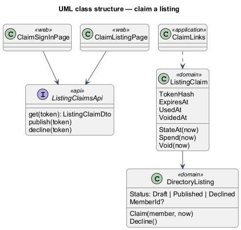

# Claim a listing

## Overview

Christian Fitness is a Christian community for health in body and spirit in the Greater Toronto Area. When staff approve a listing suggestion (`L2-073`), nothing is published until the listed party says yes (`L1-017`, `L1-023`). This feature is how they say it: a claim link, a claim screen, and the rules for who receives the link.

- **claim link** — single-use address `/claim/{token}` that lasts 14 days; only a hash of the token is stored (`ListingClaim`)
- **claimer** — the signed-in member who opens the link and answers it
- **staff-managed listing** — a listing published by staff with no owner, because nobody can be reached to claim it
- **self-submission** — a suggestion with the relation Myself (`docs/detailed-designs/directory/suggest-listing/`)

This feature covers the Claim a listing screen of the Member web app at `/claim/:token` (mock `docs/mocks/pages/claim-listing/`, states `default`, `signed-out`, `signed-out-expired`, `signed-out-claimed`, `loading`, `busy`, `published`, `declined`, `expired`, `claimed` and `error`), requirement `L2-078`, the sending of the link when staff approve (`docs/detailed-designs/admin-directory/review-listing-suggestions/`), and Send a new link on an approved suggestion (mock `admin-listings`, states `approved`, `resending`, `link-resent`, `resend-failed` and `claim-declined`). Editing afterwards is `docs/detailed-designs/directory/edit-listing/`. ADR 0091 records the decisions below.

## Description

The feature is a vertical slice from the link to the database. Journey 18 built the claim itself (`ListingClaim`) and its sending on approval (ADR 0090); journey 19 builds the rest.

### Member web app (`projects/web`) and libraries

- **Two routes at `/claim/:token`** — before the member shell, `signedOutGuard` (`canMatch`) matches only when `GET /api/session` is 401 and loads **`ClaimSignInPage`** in the auth layout, as the app's Sign in screen is; otherwise the member shell's child loads **`ClaimListingPage`**. Both are loaded with `loadComponent` and provide `LISTING_CLAIMS_SERVICE` (`HttpListingClaimsService`) themselves. The page's phases are `checking`, `ready`, `publishing`, `declining` and the outcomes `published`, `declined`, `expired`, `claimed` and `not-found`, held as a signal, with a `failed` signal naming the answer that did not go through; `claimOutcomeOf` in `@cf/domain` maps a refusal's code to its outcome. A check that fails with a 5xx is the app's server-error screen (`serverErrorInterceptor`), so the page stays on `checking`.
- **Signed out** — names the listing and offers Sign in and Join; both carry `returnUrl=/claim/{token}`, and Join now follows it as Sign in does, so the visitor lands back on the claim screen (`L2-078` AC4). An expired or used link shows its sentence in the same layout (mocks `signed-out-expired`, `signed-out-claimed`).
- **Ready** — the listing as it will appear, built from `listing-head` (its name a paragraph under the page's `h1`), `tag-list`, `description-list` and `form-page` without an aside, with "Publish my listing" and "This isn't me", and "Signed in as {name}. Publishing makes you the owner, so you can edit it later. This link works once and expires on {date}." with the date in Toronto. What a draft has not got yet (tagline, about, focus tags) is left out.
- **Busy** — "Publishing…", both answers `disabled`, `aria-busy="true"` (`L2-078` AC6).
- **Outcomes** — the existing `done` panel, focused: "Your listing is live", "Thanks for letting us know" and "This listing has already been claimed" (`role="status"`), and "This link has expired" (`role="alert"`, a clock), which reads "This link has expired. Ask us for a new one." An unknown token shows the app's 404 (mock `not-found`).
- **Failed** — an `Alert` above the listing; nothing was published and both answers stay available. A failed decline says "We couldn't send your answer" (ADR 0091).
- **`ListingClaimsApi` / `LISTING_CLAIMS_SERVICE`** — contract and token in `projects/api/src/directory/`: `get(token)`, `publish(token)`, `decline(token)`. Errors carry the codes below and the screen branches on them; the user sees the sentences above, never the code.
- **Admin: Send a new link** — the Suggestions panel of an approved suggestion whose `claim` is `sent` or `expired` offers it ("Sending…" while it waits, then a toast "New link sent", "The old link no longer works."); one whose claim was declined reads "Approved. They said this listing isn't them, so it wasn't published."

### Christian Fitness API

- **`ListingClaimsController`** — `api/claims/{token}`: `GET` (anonymous, public-reads limit) sends `GetListingClaimQuery` and answers `{ name, expiresAt, listing }`, the preview only for a signed-in caller; `POST .../publish` and `POST .../decline` need a session and send one command each. The token is a route parameter recorded as its template, never as its value.
- **`ListingClaim`** — domain entity: `ListingId`, `TokenHash`, `IssuedAt`, `ExpiresAt` (14 days after issue, from `TimeProvider`), `UsedAt`, `VoidedAt`. `StateAt(now)` is `Open`, `Used` or `Expired` (past 14 days, or voided by a resend); `Spend(now)` uses an open claim once. An unknown token is 404 `claim_not_found`, a used one (or one whose listing is no longer a draft) 409 `claim_link_used`, an expired or voided one 410 `claim_link_expired`, with no hint whether a listing exists.
- **`DirectoryListing`** — its owner is the existing `MemberId`, and a staff-managed listing is a published one with none (ADR 0090); `Published` is what the console calls Listed. `Claim(member, now)` makes a draft `Published` with that owner; because a self-submission is claimed by its sender, the listing is then linked to the sender's account. `Decline` sets `Declined`, publishes nothing and contacts no one.
- **`PublishListingClaimHandler`, `DeclineListingClaimHandler`** — in one unit of work they apply the domain method, spend the claim and write the audit entry (`listing.claimed`, `listing.claim_declined`) naming the claimer and the listing. Staff are told of a decline on the approved suggestion's panel, whose `GET` answers `claim` (ADR 0091). Both require an authenticated member (the fallback policy); only `GET` is `[AllowAnonymous]`.
- **`ClaimLinks`** — used by `ApproveSuggestionHandler` and the resend with a fresh token (cryptographically random, 32 bytes, stored as SHA-256 hash). If the suggestion has an email it goes through `IEmailSender`. If not and the relation is Myself, it writes a `DirectMessage` from the Christian Fitness account to the sender (ADR 0065) containing the link. Otherwise it creates no claim and the handler publishes the listing as staff-managed (`L2-078` AC1 to AC3).
- **Resend** — `POST /api/admin/directory/suggestions/{id}/claim-link` (`ResendClaimLinkCommand`, the Directory area of both roles) voids every open claim of the listing and issues a new one, then sends it as above; audited `listing.claim_link_resent`. A suggestion that is not approved, or whose listing is no longer a draft, is 409 `claim_closed`.
- **Audit and telemetry** — no span, metric or log carries the token, the email or the listing's words (`L2-078` AC11).

### Open questions

- **Staff-managed listings and messaging.** They cannot be messaged; how the Message button reads for them is decided with issue #74.

## Requirements

| Requirement | Traces to | Summary |
|---|---|---|
| `L2-078` | `L1-017`, `L1-023` | Claim link, claim screen, who receives the link, publish or decline |
| `L2-073` | `L1-023` | Approval makes the draft and sends the link |
| `L2-062` | `L1-017` | Self-submission and the outcome message |

## Diagrams

### Behaviour — send the claim link

On approval the handler stores a hashed, 14-day claim and sends the link by email, by direct message to a self-submitter, or not at all (a staff-managed listing). Staff can resend, which voids the old link.

### Behaviour — claim a listing

One anonymous read names the listing to a visitor and shows a signed-in member the preview. Publish makes it Listed and owned, This isn't me declines it; unknown, used and expired links are refused with their codes.

### Class structure

`ClaimListingPage` depends on `ListingClaimsApi`; `ListingClaim` publishes or declines its `DirectoryListing`; `ClaimLinkSender` creates the claim and chooses the channel.

