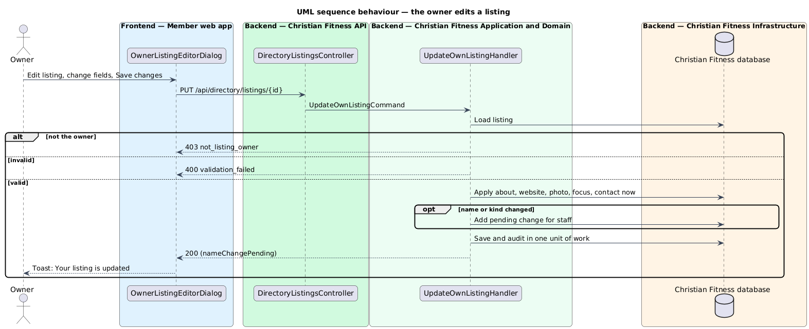

# Edit my listing

## Overview

Christian Fitness is a Christian community for health in body and spirit in the Greater Toronto Area. Once a listing is claimed (`docs/detailed-designs/directory/claim-listing/`), its owner keeps it accurate without asking staff (`L1-017`). Listed's Edit button in the admin app had nothing behind it; the owner's side is drawn here.

- **owner** — the member linked to a listing when they claimed it (`DirectoryListing.OwnerId`)
- **change request** — a new name or kind waiting for staff to approve (`ListingChangeRequest`)

This feature covers the Edit listing button on the owner's listing page and the dialog it opens, at `/directory/:id` (mocks `docs/mocks/pages/listing-profile/owner.html` and `docs/mocks/dialogs/owner-listing-editor/`, states `default`, `invalid`, `busy`, `failed`, `review` and `saved`), and requirement `L2-079`.

## Description

The feature is a vertical slice from the dialog to the database. No part of it exists in the codebase yet.

### Member web app (`projects/web`) and libraries

- **`ListingProfilePage`** — shows "Edit listing" in place of Follow and Message when the listing's `isOwner` is true. The button opens the dialog through the CDK Dialog service; there is no inline form.
- **`OwnerListingEditorDialog`** — CDK Dialog with `form-field`, `text-field`, `textarea` and `file-field` from the components library: name, about, website (optional), photo (optional), focus tags, contact email (optional). Focus starts on the name. "Save changes" reads "Saving…" with `disabled` and `aria-busy="true"` while saving; Cancel returns to the page.
- **Invalid** — an error summary (`role="alert"`, focused) and the field marked `aria-invalid="true"`; nothing is sent. A website must be a web address (`L2-079` AC3).
- **Failed** — an `Alert` above the fields; everything typed is kept (`L2-079` AC6).
- **Review** — when the name or kind changed, the response's `nameChangePending` makes the dialog show an `Alert` of kind info saying staff will check the new name while the other changes are live; closing it shows the toast "Your listing is updated" (`L2-079` AC4, AC5).
- **`DirectoryListingsApi`** — contract in `projects/api/src/directory/` gains `updateOwn(id, dto)` returning `{ nameChangePending }`. The dialog's service is bound where the dialog is created.
- **`listingEditOf`** — pure helper in `projects/domain/src/directory/` that decides which fields changed and whether the name or kind did, with unit tests.

### Christian Fitness API

- **`DirectoryListingsController`** — `PUT api/directory/listings/{id}` sends one `UpdateOwnListingCommand` (a class, so no generated `ToString` prints the values).
- **`UpdateOwnListingHandler`** — refuses a caller who is not the owner with 403 `not_listing_owner`; validates the fields (400 `validation_failed` with the field code); applies about, website, photo, focus tags and contact at once; when the name or kind differs it stores a `ListingChangeRequest` and leaves the live values alone. It saves and audits in one unit of work (`listing.edited`).
- **Staff** — Listed's Edit for an Admin uses the same fields through the admin API; a staff change of name or kind applies at once (`L2-079` AC8). Staff approve or reject a change request from Listings; that screen is `<TO SUPPLY>`.
- **Privacy** — the contact email is shown only to members who message the listing; no span, metric or log carries it, the about or the website (`L2-079` AC7).

### Open questions

- **Reviewing a name change.** No admin mock shows a waiting change request.
- **Photo storage.** The photo upload follows the event image's rules; its limits are the ones the mock states (JPEG, PNG or WebP, 5 MB).

## Requirements

| Requirement | Traces to | Summary |
|---|---|---|
| `L2-079` | `L1-017` | The owner edits their listing; a name or kind change goes back to staff |
| `L2-078` | `L1-017`, `L1-023` | Claiming makes the member the owner |

## Diagrams

### Behaviour — the owner edits a listing

A non-owner is refused with `not_listing_owner`; invalid input with `validation_failed`; valid changes go live at once, and a changed name or kind also becomes a pending change for staff.

### Class structure

`OwnerListingEditorDialog` depends on `DirectoryListingsApi`; `UpdateOwnListingHandler` applies the edit to `DirectoryListing`, which may hold one `ListingChangeRequest`.

