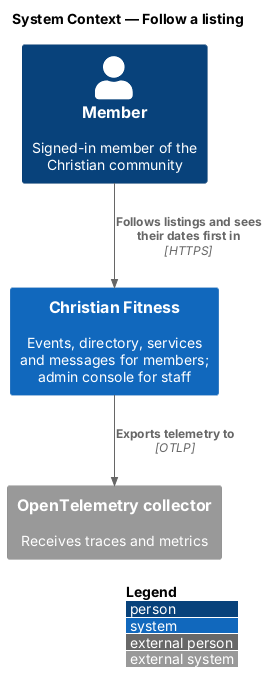
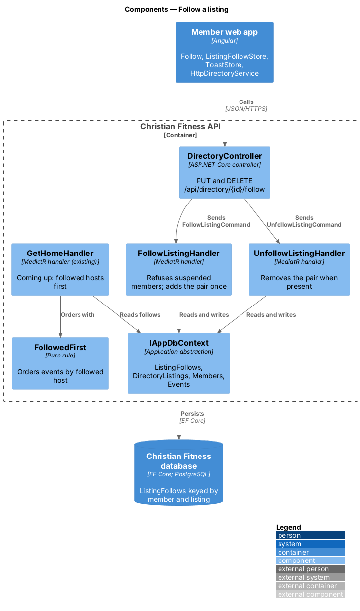
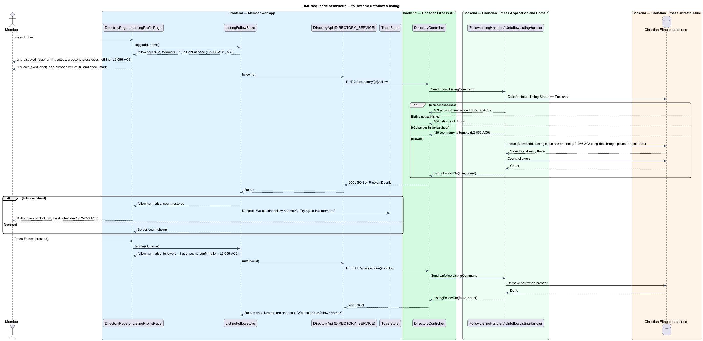

# Follow a listing

## Overview

Christian Fitness is a Christian community for health in body and spirit in the Greater Toronto Area. Its directory lists the organizations, people, instructors, ambassadors, companies and church ministries behind the community's events (`L1-017`); `docs/detailed-designs/directory/browse-directory/` defines the directory listing.

- **follow** — member's standing choice to hear first from one directory listing (`ListingFollow`)
- **follower count** — number of members who follow a listing; the only fact about followers anyone but staff receives
- **optimistic change** — button state changed at the press, before the server answers, and put back if the request fails

A member follows or stops following a listing from its row in the directory (`docs/mocks/pages/directory/`) or from its profile (`docs/mocks/pages/listing-profile/`). Following is instant both ways, with no confirmation (`docs/mocks/README.md`, decision "Follow"). A failed request puts the button back and shows a toast (mock state `directory/follow-failed`). A followed listing's new events and series rank ahead of others, after the area, in the member's Home suggestions (`L2-056` AC7; ADR 0076). Preferences' switch "New dates from listings you follow" (`L2-064` AC4) belongs to the preferences design and is not part of this feature.

## Description

The feature is a vertical slice from the Follow button to the database, plus one change to Home's ordering. No part of it exists in the codebase yet; every name below is introduced by this design unless it names existing code.

### Member web app (`projects/web`) and libraries

- **`FollowButton`** — new presentation component (`components/src/follow-button/`, the design system's follow button: block `follow`, modifier `follow--lg` on the profile). It is a `button type="button"` with `aria-pressed`. Its label is always "Follow" and never changes while toggling (WAI-ARIA toggle-button practice); pressed adds a filled style and a check icon, so the state never rests on colour (`L2-056` AC1). A visually hidden listing name completes its accessible name ("Follow Faith & Footwork"). It takes `following`, `name`, `large` and `busy` and emits `toggled`; while `busy` it carries `aria-disabled="true"` and emits nothing (`L2-056` AC8). Under a coarse pointer its target extends to 44 × 44 px (`L2-054` AC9).
- **`ListingFollowStore`** — new service in `projects/domain/src/directory/`, with the contract `ListingFollowsApi` and the token `LISTING_FOLLOWS` in the api library. It holds the follow state, follower count and in-flight flag of the listings the screen shows, as one signal keyed by listing id; `track(listings)` takes each loaded row or profile's `following` (and the profile's `followers`) without overwriting a listing whose request is in flight. `toggle(id, name)` ignores a listing in flight (`L2-056` AC8); otherwise it flips the state at once (`L2-056` AC3), changes the shown count by one and marks the listing in flight, then calls `DIRECTORY_SERVICE`. On failure it puts both back and pushes a danger toast to the screen's `ToastStore`: "We couldn't follow <name>" or "We couldn't unfollow <name>", with "Try again in a moment." On success it takes the server's count. It is provided on `DirectoryPage` and `ListingProfilePage`, so it ends with the visit, and it cancels a request in flight when destroyed (`L2-037` AC2).
- **`ToastStore` / `ToastRegion`** — existing toast store (`projects/domain/src/notifications/toast-store.ts`) and region (`projects/components/src/toast/`). A danger toast is a `role="alert"` sibling in the `toast-region`, with Dismiss.
- **`DirectoryApi`** — gains `follow(id)` and `unfollow(id)`, each returning `{ following, followers }`.
- **`HttpDirectoryService`** — calls `PUT /api/directory/{id}/follow` and `DELETE /api/directory/{id}/follow`.
- **`ListingRow`, `ListingHead`** — the browse and profile components. `ListingRow` renders `FollowButton` after its link and re-emits its `toggled` as `followToggled`; the profile projects a large `FollowButton` into `ListingHead`'s actions before Message. The page calls `ListingFollowStore.toggle`.
- **`DirectoryListingRowDto`, `ListingProfileDto`** — gain `following`, whether the signed-in caller follows the listing (`false` for an anonymous caller); the profile's `followers` is the real count (ADR 0088).

### Christian Fitness API

- **`DirectoryController`** — gains `PUT /api/directory/{id}/follow`, which sends one `FollowListingCommand`, and `DELETE /api/directory/{id}/follow`, which sends one `UnfollowListingCommand`. Both answer `ListingFollowDto { Following, Followers }`. PUT and DELETE are idempotent methods, which matches `L2-056` AC4.
- **`FollowListingCommand` / `FollowListingHandler`** — loads the caller through `ICurrentMember`; a suspended member is refused 403 `account_suspended` (`L2-056` AC5). A listing that is not `Published` is refused 404 `listing_not_found`. When 60 changes lie within the last hour it is refused 429 `too_many_attempts` (`L2-056` AC9). When the pair already exists no follow is written; otherwise it adds a `ListingFollow` with the time from `TimeProvider`. Either way it logs the change and answers the new count.
- **`ListingFollowChange`** — new domain record (`MemberId`, `ChangedAt`): one row per accepted follow or unfollow, counted against `AttemptWindow(60, 1 hour)`; each accepted change deletes the member's rows older than an hour (ADR 0088).
- **`UnfollowListingCommand` / `UnfollowListingHandler`** — removes the caller's `ListingFollow` when there is one and otherwise removes nothing (`L2-056` AC4); the same 404 and hourly limit apply, and the change is logged. A suspended member may unfollow; only following is refused (ADR 0088).
- **`ListingFollow`** — new domain entity with `MemberId`, `ListingId` and `FollowedAt`, keyed by the pair, so a follow twice cannot create two rows. A second concurrent insert of the same pair is a unique-key conflict the handler treats as success; EF Core InMemory raises no `DbUpdateException`, so the test injects it through `IAppDbContext` (`AGENTS.md`, backend tests).
- **Follower privacy** — no member endpoint lists who follows a listing; the profile and the follow answer carry the count only (`L2-056` AC6). The console's Listed tab shows the count too (`L2-073` AC10). No staff endpoint naming followers is specified.
- **`GetHomeHandler`** (existing, `ChristianFitness.Application/Events/GetHomeQuery.cs`) — Home's suggested events order events whose host listing the member follows ahead of the others within the member's area or GTA-wide events, then by interest match and date (`L2-056` AC7, `L2-065` AC7; ADR 0076). The rule is a pure function, `FollowedFirst`, tested with one case per row of a table.

Telemetry records the route template `/api/directory/{id}/follow`, never the member or listing name (`L2-040`, `L2-033` AC2).

### Open questions

- **Home "Coming up".** Resolved by ADR 0076: "Coming up" is the member's next three registrations (`L2-007` AC6) and the follow ranks Home's suggested events. A followed host's new events are those published after the follow and not yet seen. This depends on events and series having a host listing (browse-directory design, Open questions).
- **Presses while a request is in flight.** Decided (`L2-056` AC8): the button is `aria-disabled` while a request is in flight, so a second press does nothing.
- **Rate limit.** Decided (`L2-056` AC9; ADR 0088): 60 follows and unfollows in a rolling hour per member, counted in `ListingFollowChanges`, refused with `too_many_attempts` (429).
- **Ranking on Home.** Deferred to journey 34 (`L2-056` AC7); journey 8 builds the follow itself.
- **Notifications.** Telling followers about new dates (`L2-064` AC4) is notified through the in-app inbox, a "New dates from listings you follow" notification kind with its own Preferences switch (ADR 0068; mocks `notifications`).

## Requirements

The feature realizes the following level-2 (L2) requirements. Each L2 requirement refines a level-1 (L1) requirement, cited by identifier. The L2 specification states its requirements as acceptance criteria; the text below condenses those criteria faithfully.

| L2 ID    | Refines (L1) | Requirement |
| -------- | ------------ | ----------- |
| `L2-056` | `L1-017`     | Pressing Follow on a listing the member does not follow, in the directory or on the profile, shall follow it; the button shall keep the label "Follow" with `aria-pressed="true"`, a fill and a check mark, and the profile's follower count shall rise by one. Pressing the pressed Follow shall stop following at once, with no confirmation, and the count shall fall by one. The button shall change at once; if the request fails it shall go back and a toast shall say "We couldn't follow <name>" (or "unfollow") and to try again. Following twice, or unfollowing a listing not followed, shall succeed and change nothing. A suspended member's follow shall be refused with code `account_suspended`. Anyone but staff shall be given only the count of followers, never the members. A followed listing's new event or series shall rank ahead of events from listings not followed in the member's Home suggestions. While a request is in flight the button shall be `aria-disabled="true"` and a second press shall do nothing. More than 60 follows and unfollows in an hour shall be refused with `too_many_attempts` (429) and the button shall go back. |
| `L2-054` | `L1-017`     | At XS each directory row shall keep its Follow button at 44 × 44 px or more. |
| `L2-031` | `L1-013`     | A member shall change only their own follows. |

## Diagrams

### System context

A member follows listings in Christian Fitness; the follow orders what Home suggests to them.

### Containers

The Member web app sends follow and unfollow requests to the Christian Fitness API, which stores follows in the Christian Fitness database and reads them for Home.

### Components

`DirectoryController` sends `FollowListingCommand` or `UnfollowListingCommand`; their handlers check the member and the listing and write `ListingFollow` through `IAppDbContext`. `GetHomeHandler` reads the member's follows to order "Coming up".

### Class structure

`ListingFollowStore` depends on `DirectoryApi` and `ToastStore`; `FollowListingHandler` and `UnfollowListingHandler` change `ListingFollow` rows and answer `ListingFollowDto`.

### Behaviour — follow and unfollow

The button changes at the press; the API adds or removes the follow idempotently and answers the count. A failure puts the button back and shows the toast; a suspended member is refused.

### Behaviour — followed hosts first on Home

Home's handler reads the member's follows and places upcoming events of followed hosts first in "Coming up".

