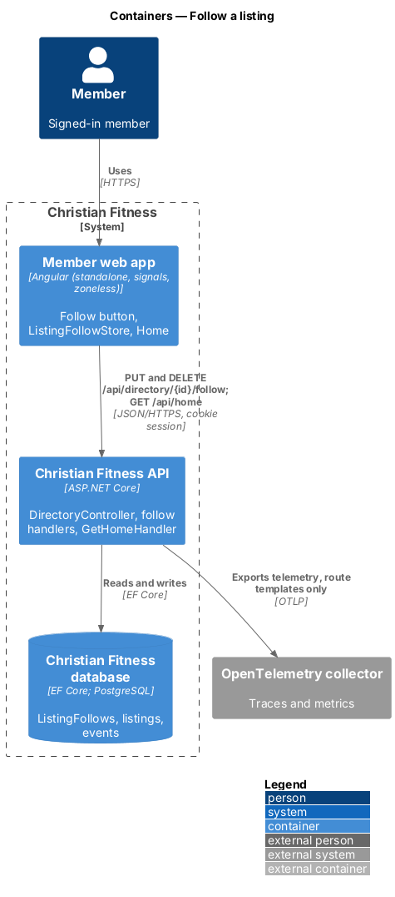
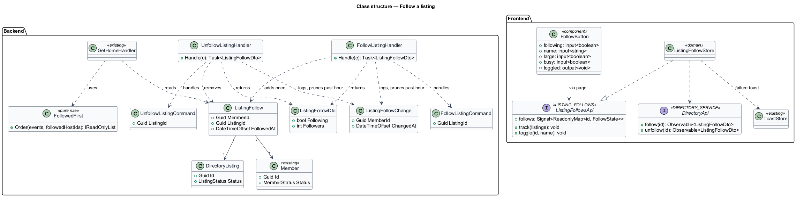
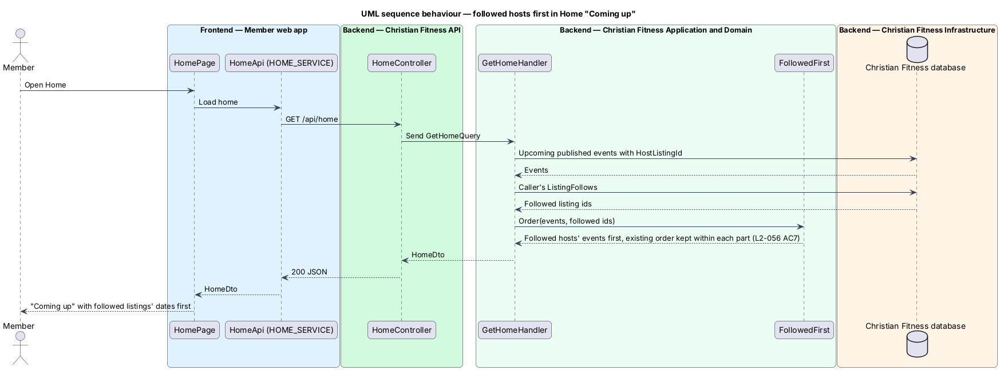

# Follow a listing

## Overview

Christian Fitness is a Christian community for health in body and spirit in the Greater Toronto Area. Its directory lists the organizations, people, instructors, ambassadors, companies and church ministries behind the community's events (`L1-017`); `docs/detailed-designs/directory/browse-directory/` defines the directory listing.

- **follow** — member's standing choice to hear first from one directory listing (`ListingFollow`)
- **follower count** — number of members who follow a listing; the only fact about followers anyone but staff receives
- **optimistic change** — button state changed at the press, before the server answers, and put back if the request fails

A member follows or stops following a listing from its row in the directory (`docs/mocks/pages/directory/`) or from its profile (`docs/mocks/pages/listing-profile/`). Following is instant both ways, with no confirmation (`docs/mocks/README.md`, decision "Follow"). A failed request puts the button back and shows a toast (mock state `directory/follow-failed`). A followed listing's new events and series come first in the member's Home "Coming up" (`L2-056` AC7). Preferences' switch "New dates from listings you follow" (`L2-064` AC4) belongs to the preferences design and is not part of this feature.

## Description

The feature is a vertical slice from the Follow button to the database, plus one change to Home's ordering. No part of it exists in the codebase yet; every name below is introduced by this design unless it names existing code.

### Member web app (`projects/web`) and libraries

- **`Follow`** — new presentation component (block `follow`, modifier `follow--lg` on the profile). It is a `button type="button"` with `aria-pressed`. Unpressed it reads "Follow"; pressed it reads "Following" with a check icon, so the state never rests on colour (`L2-056` AC1). A visually hidden listing name completes its accessible name ("Follow Faith & Footwork"). It takes `following` and `name` and emits `toggled`; its touch target is at least 44 × 44 px (`L2-054` AC9).
- **`ListingFollowStore`** — new service in `projects/domain/src/directory/`, with the contract `ListingFollowsApi` and the token `LISTING_FOLLOWS` in the api library. It holds the follow state and follower count of the listings the screen shows, as signals keyed by listing id. `toggle(id, name)` flips the state at once (`L2-056` AC3) and changes the shown count by one, then calls `DIRECTORY_SERVICE`. On failure it puts both back and pushes a danger toast to the screen's `ToastStore`: "We couldn't follow <name>" or "We couldn't unfollow <name>", with "Try again in a moment." On success it takes the server's count. It is provided on `DirectoryPage` and `ListingProfilePage`, so it ends with the visit, and it cancels a request in flight when destroyed (`L2-037` AC2).
- **`ToastStore` / `ToastRegion`** — existing toast store (`projects/domain/src/notifications/toast-store.ts`) and region (`projects/components/src/toast/`). A danger toast is a `role="alert"` sibling in the `toast-region`, with Dismiss.
- **`DirectoryApi`** — gains `follow(id)` and `unfollow(id)`, each returning `{ following, followers }`.
- **`HttpDirectoryService`** — calls `PUT /api/directory/{id}/follow` and `DELETE /api/directory/{id}/follow`.
- **`ListingRow`, `ListingHead`** — the browse and profile components. Each renders `Follow` and passes its `toggled` to the page, which calls `ListingFollowStore.toggle`.

### Christian Fitness API

- **`DirectoryController`** — gains `PUT /api/directory/{id}/follow`, which sends one `FollowListingCommand`, and `DELETE /api/directory/{id}/follow`, which sends one `UnfollowListingCommand`. Both answer `ListingFollowDto { Following, Followers }`. PUT and DELETE are idempotent methods, which matches `L2-056` AC4.
- **`FollowListingCommand` / `FollowListingHandler`** — loads the caller through `ICurrentMember`; a suspended member is refused 403 `account_suspended` (`L2-056` AC5). A listing that is not `Published` is refused 404 `listing_not_found` (the code proposed in the profile design). When the pair already exists nothing is written; otherwise it adds a `ListingFollow` with the time from `TimeProvider`. It answers the new count.
- **`UnfollowListingCommand` / `UnfollowListingHandler`** — removes the caller's `ListingFollow` when there is one and otherwise writes nothing (`L2-056` AC4). Whether a suspended member may unfollow is not stated; the design refuses only following.
- **`ListingFollow`** — new domain entity with `MemberId`, `ListingId` and `FollowedAt`, keyed by the pair, so a follow twice cannot create two rows. A second concurrent insert of the same pair is a unique-key conflict the handler treats as success; EF Core InMemory raises no `DbUpdateException`, so the test injects it through `IAppDbContext` (`AGENTS.md`, backend tests).
- **Follower privacy** — no member endpoint lists who follows a listing; the profile and the follow answer carry the count only (`L2-056` AC6). The console's Listed tab shows the count too (`L2-073` AC10). No staff endpoint naming followers is specified.
- **`GetHomeHandler`** (existing, `ChristianFitness.Application/Events/GetHomeQuery.cs`) — Home's "Coming up" orders events whose host listing the member follows ahead of the others, then keeps its existing order within each part (`L2-056` AC7). The rule is a pure function, `FollowedFirst`, tested with one case per row of a table.

Telemetry records the route template `/api/directory/{id}/follow`, never the member or listing name (`L2-040`, `L2-033` AC2).

### Open questions

- **Home "Coming up".** `L2-007` names the next registered event and up to three suggested events; `L2-056` AC7 names a "Coming up" list that the Home mock draws. The design applies the order to whichever list Home serves as "Coming up"; the Home design owns that list. "Publishes a new event or series" does not say which events count as new; the design orders all upcoming events of followed hosts first. Both depend on events and series having a host listing (browse-directory design, Open questions).
- **Presses while a request is in flight.** Decided (`L2-056` AC8): the button is `aria-disabled` while a request is in flight, so a second press does nothing.
- **Rate limit.** Decided (`L2-056` AC9): 60 follows and unfollows an hour per member, refused with `too_many_attempts` (429).
- **Notifications.** Telling followers about new dates (`L2-064` AC4) needs a notification channel the mocks do not draw (`docs/mocks/README.md` open question 1).

## Requirements

The feature realizes the following level-2 (L2) requirements. Each L2 requirement refines a level-1 (L1) requirement, cited by identifier. The L2 specification states its requirements as acceptance criteria; the text below condenses those criteria faithfully.

| L2 ID    | Refines (L1) | Requirement |
| -------- | ------------ | ----------- |
| `L2-056` | `L1-017`     | Pressing Follow on a listing the member does not follow, in the directory or on the profile, shall follow it; the button shall read "Following" with `aria-pressed="true"` and a check mark, and the profile's follower count shall rise by one. Pressing Following shall stop following at once, with no confirmation, and the count shall fall by one. The button shall change at once; if the request fails it shall go back and a toast shall say "We couldn't follow <name>" (or "unfollow") and to try again. Following twice, or unfollowing a listing not followed, shall succeed and change nothing. A suspended member's follow shall be refused with code `account_suspended`. Anyone but staff shall be given only the count of followers, never the members. A followed listing's new event or series shall come ahead of events from listings not followed in the member's Home "Coming up". |
| `L2-054` | `L1-017`     | At XS each directory row shall keep its Follow button at 44 × 44 px or more. |
| `L2-031` | `L1-013`     | A member shall change only their own follows. |

## Diagrams

### System context

A member follows listings in Christian Fitness; the follow orders what Home shows them.

### Containers

The Member web app sends follow and unfollow requests to the Christian Fitness API, which stores follows in the Christian Fitness database and reads them for Home.

### Components

`DirectoryController` sends `FollowListingCommand` or `UnfollowListingCommand`; their handlers check the member and the listing and write `ListingFollow` through `IAppDbContext`. `GetHomeHandler` reads the member's follows to order "Coming up".

### Class structure

`ListingFollowStore` depends on `DirectoryApi` and `ToastStore`; `FollowListingHandler` and `UnfollowListingHandler` change `ListingFollow` rows and answer `ListingFollowDto`.

### Behaviour — follow and unfollow

The button changes at the press; the API adds or removes the follow idempotently and answers the count. A failure puts the button back and shows the toast; a suspended member is refused.

### Behaviour — followed hosts first on Home

Home's handler reads the member's follows and places upcoming events of followed hosts first in "Coming up".

