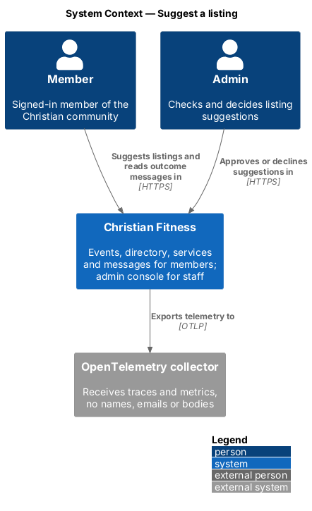
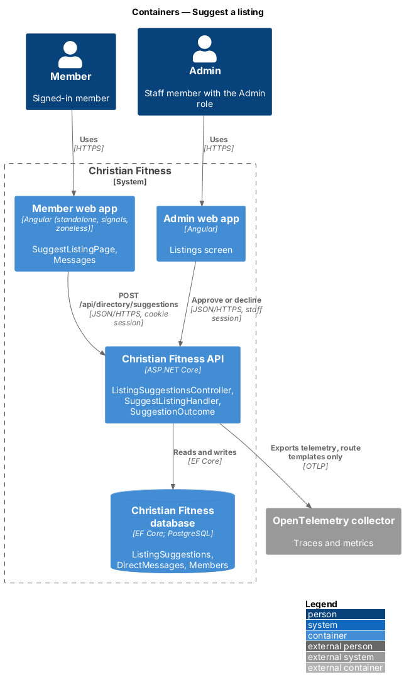
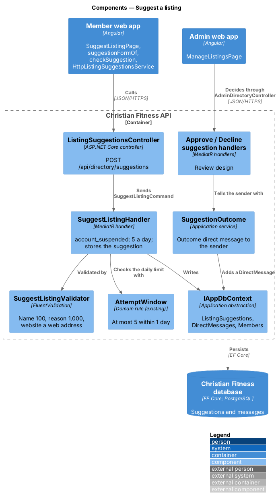
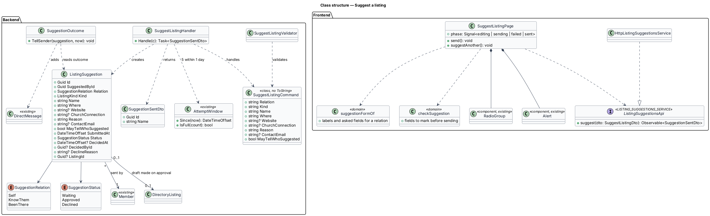
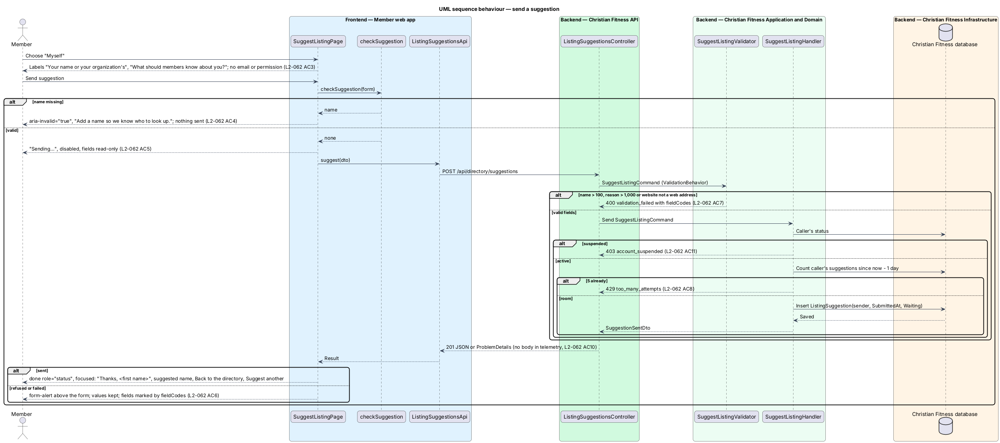
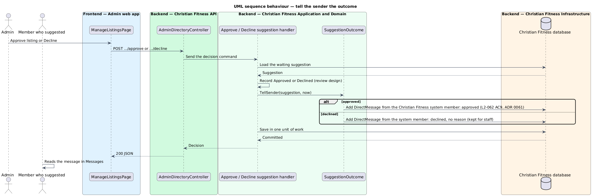

# Suggest a listing

## Overview

Christian Fitness is a Christian community for health in body and spirit in the Greater Toronto Area. Its directory lists the organizations, people, instructors, ambassadors, companies and church ministries behind the community's events, and members suggest new ones (`L1-017`). Staff check each suggestion before anything is listed (`L1-023`). `docs/detailed-designs/directory/browse-directory/` defines the directory listing and how it differs from a Services listing.

- **listing suggestion** — member's proposal that a person or group be listed in the directory, stored for staff to check (`ListingSuggestion`)
- **relation** — how the sender knows the suggested party: Myself, Someone I know, or Somewhere I've been (`SuggestionRelation`)
- **self-submission** — suggestion with the relation Myself, sent by the party who would be listed
- **outcome message** — direct message from Christian Fitness telling the sender that staff approved or declined their suggestion

A suggestion is not a professional application. A professional application (`ProfessionalApplication`, `L2-026`) asks for a Services listing and is reviewed under Services (`L2-025`). A suggestion asks for a directory listing and is reviewed under Listings (`L2-073`, `docs/detailed-designs/admin-directory/review-listing-suggestions/`). Whether one person needs both is the open question raised in the browse-directory design.

This feature covers the Suggest a listing screen of the Member web app at `/directory/suggest` (mock `docs/mocks/pages/suggest-listing/`, states `default`, `self`, `invalid`, `submitting`, `success` and `error`). The directory's "Know someone who belongs here? Suggest a listing" link and its no-results "Suggest a listing" action open it (`docs/mocks/pages/directory/default.html`, `no-results.html`). The feature also covers the outcome message staff decisions send (`L2-062` AC9).

## Description

The feature is a vertical slice from the form to the database. No part of it exists in the codebase yet; every name below is introduced by this design unless it names existing code.

### Member web app (`projects/web`) and libraries

- **`SuggestListingPage`** — routed page component at `/directory/suggest`, loaded with `loadComponent` under the member shell and declared before `/directory/:id`. It renders the `back-link` to the directory and a `form-page` with the form in `form-page__main` and "What happens next" in `form-page__aside`. Its `providers` bind `LISTING_SUGGESTIONS_SERVICE` to `HttpListingSuggestionsService`. It holds the form as a signal-based model and its phase (`editing`, `sending`, `failed`, `sent`) as a signal.
- **Form fields** — the "Who are you suggesting?" radio cards use the existing `RadioGroup` (`choice choice-card`, `docs/mocks/README.md` decision "Radio cards"). "What kind of listing?" is a radio group drawn as `chip chip--choice` chips with the six kinds and one chosen. The name, "Where they meet or work", "Website or social" (optional), "Church connection" (optional, hint "For example: meets at Danforth Baptist"), the reason, "Their email" (optional, hint "So we can reach them directly") and "It's fine to tell them you suggested them" (ticked by default) use the existing `FormField`, `TextField`, `Textarea` and `Checkbox` components. Below the form, "Send suggestion" and "Sent as <member's name>".
- **`SuggestionSteps`** — the `steps` list of the aside: "We read it within 3 days", "We run four checks", "They approve their listing", "You hear back", each with its line from the mock. "How we vet every listing" opens `/news/how-we-vet-every-listing`; show the link only when that story is published. The `steps` and `done` blocks have no page in `docs/design-system/components/`; they need one before they are built.
- **Vetting story** — `cf seed` creates the story with the fixed slug `how-we-vet-every-listing`
  idempotently, without overwriting an existing story. The API exposes whether it is published;
  when it is missing, unpublished or its availability cannot be established, the link is hidden.
- **`suggestionFormOf`** — pure helper in `projects/domain/src/directory/`. For Myself it answers the name label "Your name or your organization's", the reason label "What should members know about you?", and that the email and the permission are not asked; for the other relations, "Their name", "Why should they be listed?" and both asked (`L2-062` AC3). The page drops the hidden fields' values from what it sends.
- **`checkSuggestion`** — pure helper that answers the fields to mark before sending. A blank name gives `aria-invalid="true"` and "Add a name so we know who to look up." and nothing is sent (`L2-062` AC4). Focus moves to the first marked field.
- **Sending** — "Send suggestion" reads "Sending…" with `disabled` and `aria-busy="true"`, and the fields are disabled (`L2-062` AC5; mock `submitting`).
- **Sent** — the form is replaced by the `done` section with `role="status"`, which takes focus: "Thanks, <first name>", the suggested name as text, "Back to the directory" and "Suggest another" (which resets the form). The first name comes from the signed-in member's name, worded as Home's greeting "Welcome, {first name}" words it (`HomePage`); that rule moves into one pure helper in the domain library rather than being repeated.
- **Failed** — an `Alert` (`form-alert`, `role="alert"`) above the form says "We couldn't send your suggestion" and that everything typed is kept; the values stay (`L2-062` AC6). A 400 marks the fields its `fieldCodes` name; a 429 `too_many_attempts` or 403 `account_suspended` shows a generic message chosen by `code` (`<TO SUPPLY>` copy, not drawn).
- **`ListingSuggestionsApi` / `LISTING_SUGGESTIONS_SERVICE`** — contract and token in `projects/api/src/directory/`. `suggest(dto)` returns `{ id, name }`.
- **`HttpListingSuggestionsService`** — calls `POST /api/directory/suggestions`.

### Christian Fitness API

- **`ListingSuggestionsController`** — controller at `api/directory/suggestions`. `POST` sends one `SuggestListingCommand` built from a `SuggestListingBody` and answers 201. The body is a class, not a record, so no generated `ToString` can print the values, as `UpdateListingBody` does.
- **`SuggestListingCommand`** — class with `Relation`, `Kind`, `Name`, `Where`, `Website`, `ChurchConnection`, `Reason`, `ContactEmail` and `MayTellWhoSuggested`.
- **`SuggestListingValidator`** — FluentValidation validator. It refuses with 400 `validation_failed` and one `fieldCodes` entry per field (`L2-062` AC7): a name over 100 characters or a reason over 1,000 with `field_too_long` (the existing code), and a website that is not a web address with `website_invalid` (proposed). A website is a web address when it is an absolute `http` or `https` address with a host and no credentials, or becomes one with `https://` put in front, since the mock's example is `instagram.com/eastsideladieslift`; the rule reuses `ServiceListing.TryNormalizeContactUrl` after that step. Codes for a missing name, an unknown kind or relation, a malformed email, and the limits of the other fields are `<TO SUPPLY>`.
- **`SuggestListingHandler`** — loads the caller through `ICurrentMember`. A suspended member is refused 403 `account_suspended` (`L2-062` AC11). It counts the caller's suggestions since `AttemptWindow(5, 1 day).Since(now)` with now from `TimeProvider`, and refuses the sixth with 429 `too_many_attempts` (`L2-062` AC8). Otherwise it stores a `ListingSuggestion` with the sender and the time and answers its id and name (`L2-062` AC5). For Myself it stores no contact email and no permission.
- **`ListingSuggestion`** — new domain entity in `ChristianFitness.Domain/Directory/`, with `Id`, `SuggestedById`, `Relation`, `Kind` (`ListingKind`), `Name`, `Where`, `Website`, `ChurchConnection`, `Reason`, `ContactEmail`, `MayTellWhoSuggested`, `SubmittedAt`, `Status` (`Waiting`, `Approved`, `Declined`), `DecidedAt`, `DecidedById`, `DeclineReason` and `ListingId` (the draft made on approval). Its checks belong to the review design.
- **`SuggestionOutcome`** — application service called by the approve and decline handlers of the review design. In the same unit of work it stores a `DirectMessage` to the sender saying the suggestion was approved, or declined with staff's reason only where one was written (`L2-062` AC9). The sender identity "Christian Fitness" and the message text are open questions.

The suggested party's email is used only to contact them about the listing (`L2-062` AC10). No span, metric or log carries the email, the name, the reason or the church connection: the route is recorded as its template and no body is recorded (`L2-033` AC2, `L2-040`). The church connection is an optional faith detail and is never required (`L2-033` AC1). Every value is rendered as text, never as HTML.

### Open questions

- **Sender of the outcome message.** A `DirectMessage` is between two members (ADR 0043). Christian Fitness as a sender needs a system account or a new kind of message; `<TO SUPPLY>` in an ADR. The message text is not drawn.
- **Required fields.** `L2-062` AC4 names only the missing name. Whether the place and the reason are required, and the limits of place, website, church connection and email, are `<TO SUPPLY>`.
- **The day of the limit.** "More than 5 suggestions from one member in a day" does not say whether the day is the last 24 hours or a calendar day in Toronto. The design proposes the last 24 hours, as `AttemptWindow` counts.
- **Self-submission and the listing's owner.** For Myself the mock still says "Sent as Grace Thompson" while naming "Coach Marcus Delaney", and the console shows "Self-submitted". Whether a self-submitted listing becomes linked to the sender's account (and so receives its messages) is not specified; it bears on the profile's Message (view-listing-profile design).
- **Who gets the claim link.** Approval sends the suggested party a link (`L2-073` AC6), but their email is optional and not asked for Myself. Resolved by `L2-075` (`docs/detailed-designs/directory/claim-listing/`): a self-submission's link goes to the sender as a direct message from Christian Fitness, and a suggestion with no other email becomes a staff-managed listing.
- **Retention.** How long a suggestion, and the email in it, is kept after it is decided is `<TO SUPPLY>`; `L2-033` AC3 erases a member's data on deletion but does not name suggestions.

## Requirements

The feature realizes the following level-2 (L2) requirements. Each L2 requirement refines a level-1 (L1) requirement, cited by identifier. The L2 specification states its requirements as acceptance criteria; the text below condenses those criteria faithfully.

| L2 ID    | Refines (L1) | Requirement |
| -------- | ------------ | ----------- |
| `L2-062` | `L1-017`     | "Know someone who belongs here? Suggest a listing" under the directory's heading, and "Suggest a listing" in its no-results state, shall open `/directory/suggest`. The form shall ask who is suggested (Myself; Someone I know; Somewhere I've been) as one radio group, the kind (the six kinds, one chosen), the name, where they meet or work, an optional website or social address, an optional church connection, why they should be listed, an optional email for them and whether it is fine to tell them who suggested them (ticked by default); beside it "What happens next" shall list the four steps in order. With Myself the name shall read "Your name or your organization's", the reason "What should members know about you?", and their email and the permission shall not be asked. A missing name shall send nothing and mark the field `aria-invalid="true"` with "Add a name so we know who to look up." Valid details shall make the button read "Sending…" and be disabled, store the suggestion with its sender and time, and replace the form with "Thanks, <first name>" (`role="status"`, focused) naming who was suggested, with "Back to the directory" and "Suggest another". A server failure shall show a message above the form and keep everything typed. A name over 100 characters, a reason over 1,000 or a website that is not a web address shall be refused with 400 `validation_failed` and the field's code. More than 5 suggestions from one member in a day shall be refused with `too_many_attempts` and HTTP 429. When staff approve or decline a suggestion, its sender shall get a direct message from Christian Fitness saying which, with the reason only where staff wrote one. The suggested person's email shall be used only to contact them about the listing, and no span, metric or log shall carry it, the name or the reason. A suspended member's suggestion shall be refused with `account_suspended`. |
| `L2-032` | `L1-013`     | A body that fails validation shall be refused with 400 `validation_failed` and the code of each field. |
| `L2-033` | `L1-013`     | Faith details shall be optional, and no log, metric or span shall contain an email, name, home church, message text, token, query string or body. |

## Diagrams

### System context

A member suggests a listing in Christian Fitness; staff later check it, and the member hears the outcome in Messages.

### Containers

The Member web app posts the suggestion to the Christian Fitness API, which stores it in the Christian Fitness database; the admin web app's decisions store the outcome message there.

### Components

`ListingSuggestionsController` sends `SuggestListingCommand`; `SuggestListingValidator` checks the fields and `SuggestListingHandler` checks the member and the daily limit before storing a `ListingSuggestion`. `SuggestionOutcome` writes the outcome message when staff decide.

### Class structure

`SuggestListingPage` depends on `ListingSuggestionsApi` and the pure helpers `suggestionFormOf` and `checkSuggestion`; `SuggestListingHandler` creates `ListingSuggestion`, which refers to its sender and, once approved, to its draft `DirectoryListing`.

### Behaviour — send a suggestion

A blank name is marked on the client and nothing is sent. A valid form shows "Sending…"; the API validates, checks the member and the daily limit, and stores the suggestion. Success shows the thanks; a failure keeps the values with a message above the form.

### Behaviour — tell the sender the outcome

When an Admin approves or declines a suggestion, the decision's handler asks `SuggestionOutcome` to store a direct message to the sender, with the reason only where one was written.

