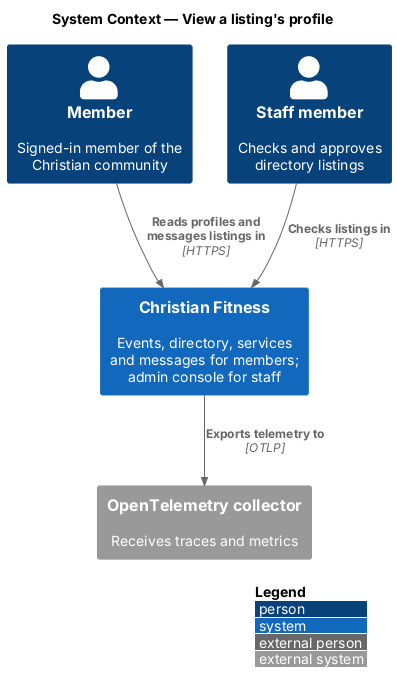
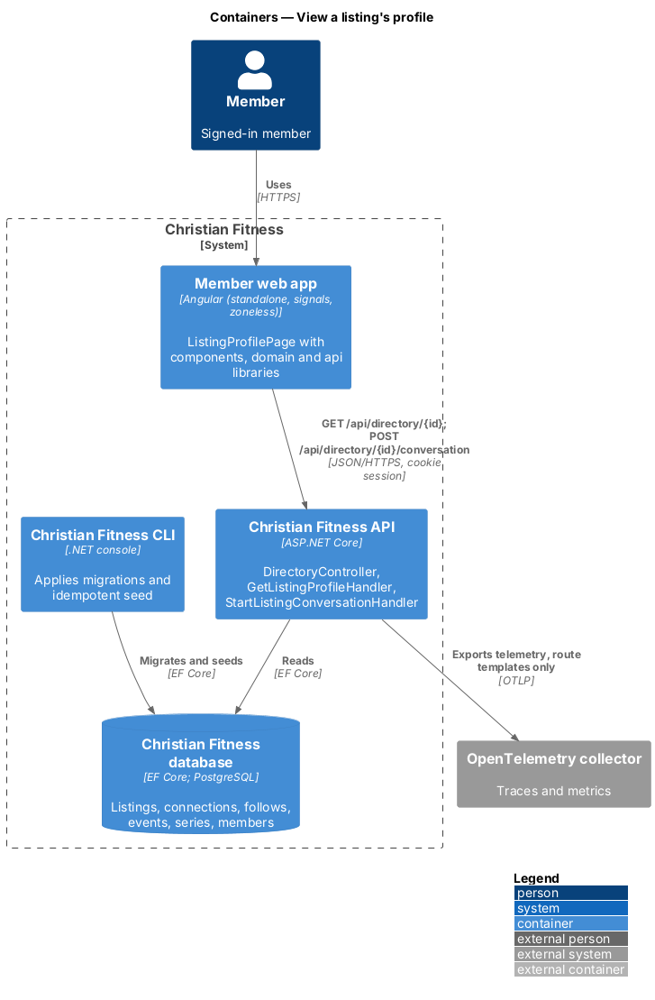
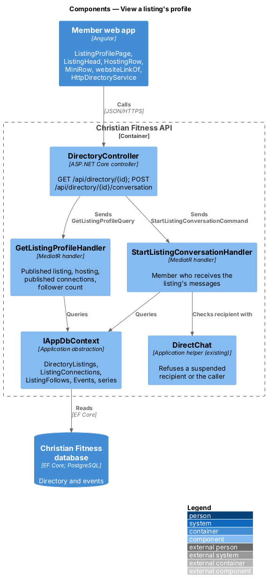
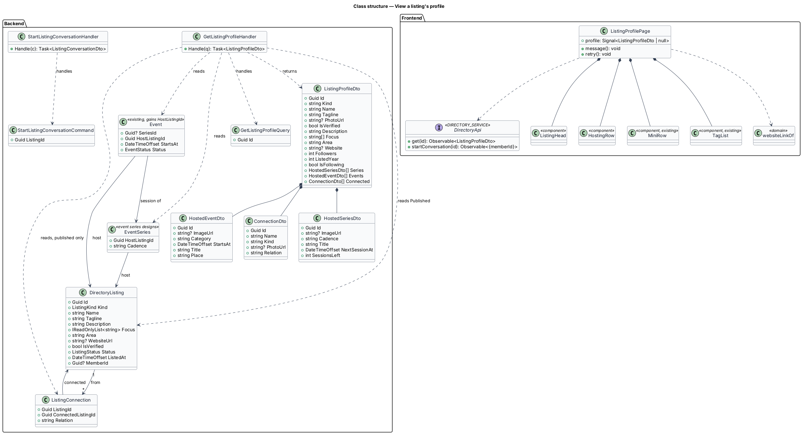
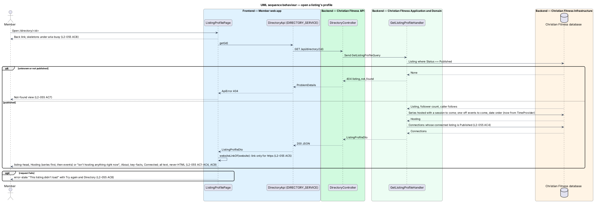
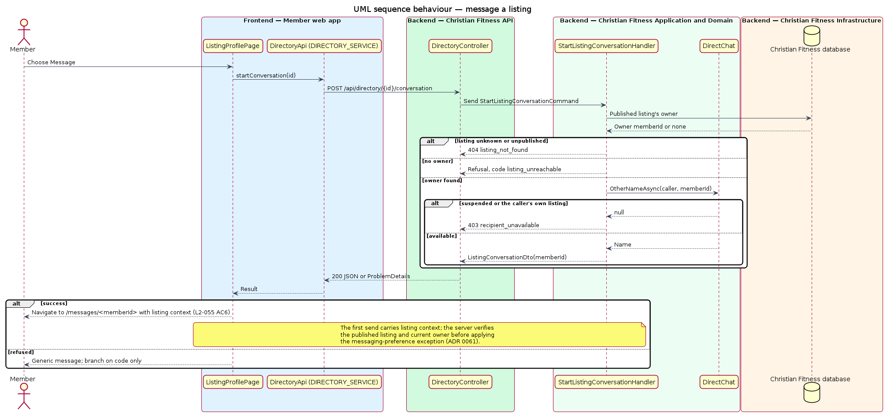

# View a listing's profile

## Overview

Christian Fitness is a Christian community for health in body and spirit in the Greater Toronto Area. Its directory lists the organizations, people, instructors, ambassadors, companies and church ministries behind the community's events (`L1-017`). The directory itself is described in `docs/detailed-designs/directory/browse-directory/`, which also defines the directory listing and how it differs from a Services listing.

- **directory listing** — staff-checked, published entry in the directory (`DirectoryListing`)
- **listing profile** — page of one directory listing: who it is, what it hosts, what it is about and whom it is connected to
- **hosting** — event series with a session still to come and one-off events still to come whose host is the listing
- **connection** — published relation from one listing to another, worded from the first listing's side, such as "Run leader" (`ListingConnection`)

This feature covers the Listing profile screen of the Member web app at `/directory/<id>` (mock `docs/mocks/pages/listing-profile/`, states `default`, `person`, `one-off`, `unverified`, `loading` and `error`). The profile shows the listing's head with Follow and Message, its Hosting, About, key facts and Connected listings. Following belongs to `docs/detailed-designs/directory/follow-listing/`. Hosting rows lead to a series (`L2-051`) or an event (`L2-010`), whose own designs cover those screens. The event detail's "Hosted by" card (`L2-010` AC4) and the series page's host card (`L2-051` AC1) lead here.

## Description

The feature is a vertical slice from the Listing profile screen to the database. No part of it exists in the codebase yet; every name below is introduced by this design unless it names existing code.

### Member web app (`projects/web`) and libraries

- **`ListingProfilePage`** — routed page component at `/directory/:id`, loaded with `loadComponent` under the member shell. The route `directory/suggest` is declared before it, so "suggest" is never read as an id. It loads the profile through `DIRECTORY_SERVICE` and renders the `back-link` to the directory, the `listing-head`, a `split split--detail` layout with Hosting and About on one side and the `key-facts` and Connected list in a sticky `aside` on the other. Its `providers` bind `DIRECTORY_SERVICE` (journey 8 adds the screen's `ListingFollowStore` and its `ToastStore`). At LG or wider the aside sits beside the main column; below LG it follows it (`L2-039`).
- **`ListingHead`** — new presentation component (block `listing-head`, elements `__who`, `__body`, `__kind`, `__verified`, `__name`, `__actions`). It shows the `ListingMark` at `--xl`, the kind as an eyebrow, "· Verified" in words where the listing is verified, the name as the `h1`, the tagline, the `Follow` button at `follow--lg`, and Message as a secondary button. It emits `followToggled` and `message`.
- **`HostingRow`** — new presentation component (block `hosting-row` in a `hosting` list). A series row shows the image, "Series · <cadence>", the title and "Next: <date>, <time> · <n> sessions left" and links to `/events/series/<id>`. An event row shows the image, "<category> · <date>", the title and "<time> · <place>" and links to `/events/<id>`. With no hosting the section shows `hosting__empty`: "<name> isn't hosting anything right now. Follow to hear when they post a date." and the heading has no count (`L2-055` AC3).
- **`MiniRow`** — existing presentation component in `projects/components/src/list/`, used in a `mini-list` for each connection: the small listing mark, the name and "<relation> · <kind>", leading to `/directory/<id>` (`L2-055` AC4).
- **`TagList` / `Tag`** — existing components in `projects/components/src/chip/` for the focus tags (`tag tag--outline`).
- **`KeyFacts`** — the key facts of the mock, now the `spec-list` block of the design system's `description-list` page (one-line rows with an optional term icon): Area, Website, Followers and "On Christian Fitness · Since <year>". It is the one `description-list` component, not a second one.
- **`websiteLinkOf`** — pure helper in `projects/domain/src/directory/`. It answers a link (the address, and the host without scheme or `www.` as its text) only for an absolute `https` address with a host, and `null` for anything else (`L2-055` AC5). The link opens in a new tab with `rel="noopener noreferrer"` and a visually hidden "(opens in a new tab)".
- **`hostingOf`** — pure helper that words each hosting row ("Series · Every Tuesday", "Next: Tue Apr 21, 6:30 PM · 5 sessions left", "Run · Sat Apr 18") in Toronto time, in the manner of `event-when.ts`.
- **`DirectoryApi`** — gains `get(id)`, returning a `ListingProfileDto`, and `startConversation(id)`, returning `{ memberId }`. A refusal errors with an `ApiError` carrying status and `code`.
- **`HttpDirectoryService`** — calls `GET /api/directory/{id}` and `POST /api/directory/{id}/conversation`.
- **Message** — the profile shows Message only when the published listing has an owner; otherwise it offers the website or contact where available. The page sends `startConversation(id)` and, on success, navigates to `/messages/<memberId>` (the listing context for the first send arrives with the preference, journey 34; ADR 0087). A refusal or a lost connection shows a generic alert under the head ("We couldn't open this conversation", mock `listing-profile/message-failed`) and the profile stays as it was (`L2-014` AC1, ADR 0066).
- **Not found and failure** — a 404 shows the app's not-found view in place (`L2-055` AC7, `L2-043`). Any other failure shows the `error-state` "This listing didn't load" with Try again and a Directory link; the back link stays (`L2-055` AC8). While loading, the head, Hosting and facts show as `skeleton` blocks under `aria-busy="true"`.

### Christian Fitness API

- **`DirectoryController`** — gains `GET /api/directory/{id}` and `POST /api/directory/{id}/conversation`; each sends one MediatR request and checks nothing.
- **`GetListingProfileQuery` / `GetListingProfileHandler`** — reads the listing when its `Status` is `Published`, else refuses 404 with code `listing_not_found` (ADR 0087). Like the directory list it is `[AllowAnonymous]` under the `public-reads` limit and carries only what the listing publishes. It returns a `ListingProfileDto`: id, kind, name, tagline, photo address, verified, description, focus, area, website, follower count, the year listed (from `ListedAt`), whether the caller follows it, whether it has an owner, the hosting and the connections.
- **Hosting query** — the handler reads the event series whose `HostListingId` is the listing and that have a published session still to come, with cadence, title, image, next session and sessions left; then the published events whose `HostListingId` is the listing, that belong to no series and have not started, in date order (`L2-055` AC2). Now comes from `TimeProvider`. The hosting count is the same rule as `HostingCount` in the browse-directory design. Several series are ordered by next session date. At most 20 hosting rows are served; the count covers all of them (ADR 0087). Series rows join with journey 11; until then only one-off events are served.
- **Connections query** — the handler reads `ListingConnection` rows from the listing whose connected listing is `Published`; a connection to any other status is dropped (`L2-055` AC4). Each carries the other listing's id, name, kind, photo and the relation.
- **`StartListingConversationCommand` / handler** — answers the listing's owner as the member who receives its messages; an organization, company or ministry is represented by the member who claimed it. It reuses `DirectChat.OtherNameAsync` so a suspended member or the caller's own listing is refused 403 `recipient_unavailable`, as `StartProfessionalConversationHandler` does. A listing with no owner is refused with `listing_unreachable`. The server verifies the published listing and current owner; the messaging-preference exception is checked once the preference exists (ADR 0066, ADR 0087).
- **`ListingConnection`** — new domain entity with `ListingId`, `ConnectedListingId` and `Relation` (1 to 60 characters, one per pair; ADR 0087). A relation is stored per direction: the mock words Lakeshore Runners Fellowship's link to Michael Chen as "Run leader" and Christian Fitness's link to him as "Ambassador".
- **`DirectoryListing`** — the entity of the browse-directory design. `WebsiteUrl` is stored as given; only the client decides what becomes a link, and the API never sends HTML.

Every name, tagline, description, focus tag, relation and website is plain text, rendered through interpolation and never through `innerHTML` (`L2-055` AC9). The answer carries no email or telephone, and the follower count is a number only (`L2-056` AC6).

### Open questions

- **Services and directory records (decided, ADR 0061).** Danielle Okafor's profile here (instructor, East York) and her Services listing (trainer, from $70) are two records with their own copy. When the same member owns both, or staff set `ServiceListingId`, the profile shows an "Also offers services" link to the published Services listing (mock `person.html`), and none otherwise. Message opens the same direct conversation from either profile, because conversations are keyed by the two members (ADR 0043).
- **Hosts.** The Hosting section reads the required `HostListingId` on events and series. Admins choose a Listed directory listing; older records receive the Christian Fitness team listing (ADR 0067).
- **Website without https.** Decided (`L2-055` AC5): it is not shown at all.
- **Connections.** Decided (`L2-054` AC10): set by staff in the listing editor and by the owner; until the editors are built, `cf seed` adds the sample connections when `Seed__DirectorySamples` is `true` (ADR 0087).
- **Follow and the owner's view.** Decided (ADR 0087): the Follow button joins the head with journey 8 and the follower count reads 0 until follows exist; the owner's "Edit listing" (mock `owner`) is journey 20's.
- **"Let anyone message me".** Decided (ADR 0087): the setting is journey 34's, so today no check stands in the way of Message; journey 34 adds the listing context to the history, join and first send.
- **Error copy.** A load failure says "We couldn't load this profile. Check your connection and try again."

## Requirements

The feature realizes the following level-2 (L2) requirements. Each L2 requirement refines a level-1 (L1) requirement, cited by identifier. The L2 specification states its requirements as acceptance criteria; the text below condenses those criteria faithfully.

| L2 ID    | Refines (L1) | Requirement |
| -------- | ------------ | ----------- |
| `L2-055` | `L1-017`     | A published listing at `/directory/<id>` shall show the mark, kind, "Verified" in words where verified, name, tagline, Follow (pressed where followed) and, where it has an owner, Message; "Hosting" with a count; "About" with description and focus tags; and area, website where it has one, follower count and the year listed. Hosting shall list series first (image, "Series · <cadence>", title, next session date and time, "<n> sessions left", leading to the series), then one-off events in date order (image, category, date, title, time, place, leading to the event), never repeating a series' sessions as events. With nothing to come, Hosting shall have no count and read "<name> isn't hosting anything right now. Follow to hear when they post a date." "Connected" shall show each published connected listing's mark, name, relation in words and kind, leading to its profile; with none there shall be no Connected section, and a connection to an unpublished listing shall not show. A website shall open in a new tab with `rel="noopener noreferrer"`, say so to assistive technology, and only an `https` address shall be rendered as a link. Message shall open the direct conversation with the owner even when "Let anyone message me" is off. An ownerless listing shall hide Message, offer its website or contact where available, and refuse an API attempt with `listing_unreachable`. An unknown or unpublished id shall show the not-found view. Loading shall show skeletons; a load failure shall show an error state with Try again and a way back to the directory. Name, tagline, description, focus, relation and website shall be rendered as text, never as HTML. |
| `L2-014` | `L1-006`     | Given a published listing with an owner, choosing Message shall open a direct conversation with the owner even when "Let anyone message me" is off. An ownerless listing shall hide Message, offer its website or contact where available, and refuse an API attempt with `listing_unreachable`. |
| `L2-031` | `L1-013`     | A person shall see and change only their own data and the groups they belong to; the profile shall publish only what the listing publishes. |

## Diagrams

### System context

A member reads a listing's profile in Christian Fitness and may message it; staff check the listings shown.

### Containers

The Member web app calls the Christian Fitness API, which reads the listing, its hosted events and series, its connections and its follower count from the Christian Fitness database.

### Components

`DirectoryController` sends `GetListingProfileQuery` or `StartListingConversationCommand`; the profile handler reads only published listings and published connections, and the conversation handler reuses `DirectChat`.

### Class structure

`GetListingProfileHandler` projects `DirectoryListing`, its `ListingConnection` rows and its hosted events and series into a `ListingProfileDto`. `ListingProfilePage` composes `ListingHead`, `HostingRow`, `MiniRow`, `TagList` and the key facts.

### Behaviour — open a profile

The page shows skeletons, then the profile; Hosting lists series before one-off events, and Connected only published listings. An unknown or unpublished id shows the not-found view; a failure shows Try again and Directory.

### Behaviour — message a listing

Message asks the API for the member who receives the listing's messages and opens that conversation in Messages; a refusal shows a generic message.

