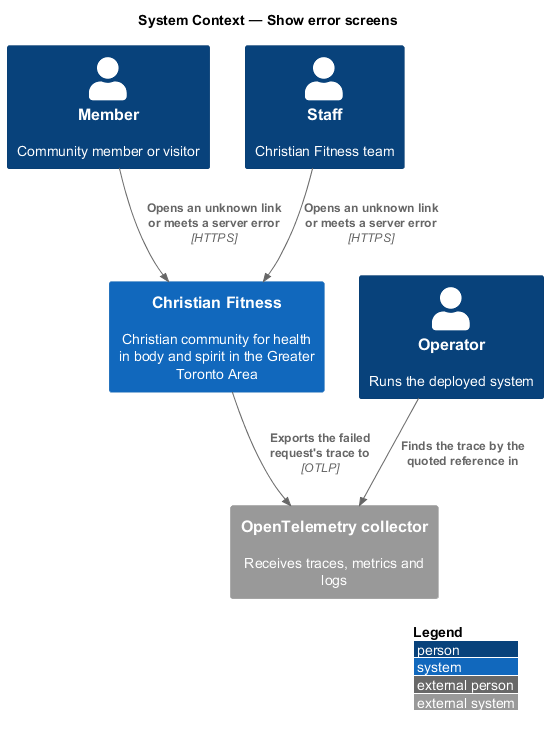
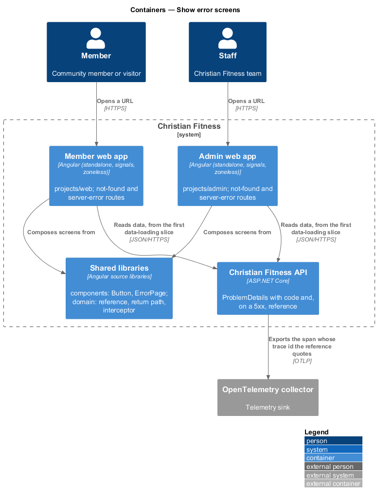
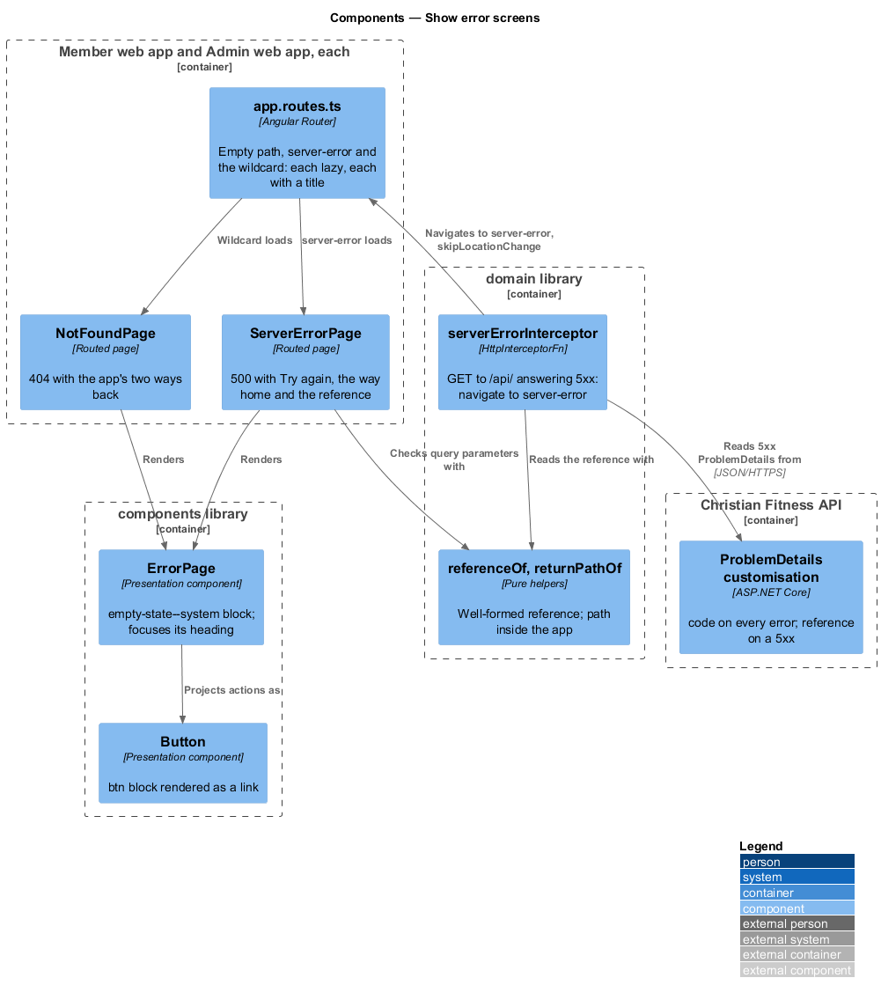
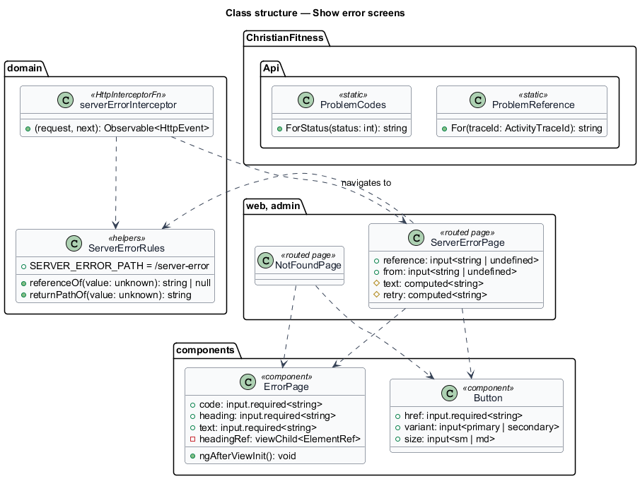
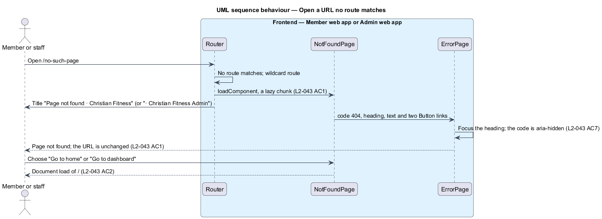
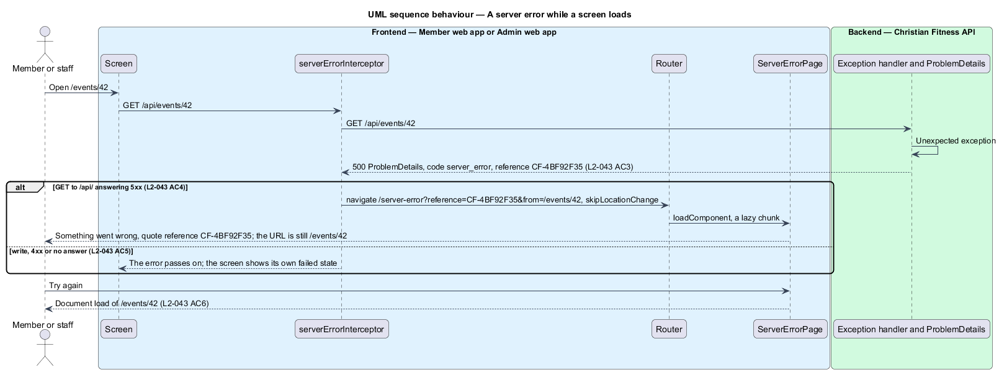

# Show error screens

## Overview

Both apps answer two failures with a full screen in plain words and a way back. A URL that no
route matches shows the not-found screen; a server failure while a screen loads its data shows
the server-error screen. This feature belongs to the errors subsystem and is shared by the member
web app and the admin web app (mocks `docs/mocks/pages/not-found/`, `pages/server-error/`,
`pages/admin-not-found/` and `pages/admin-server-error/`; design-system component
`error-page.html`).

- **not-found screen** — the screen for a URL no route matches, with the code 404 and two links
- **server-error screen** — the screen for an unrecoverable server error, with the code 500,
  "Try again", the way home and, when the API gave one, a reference
- **unrecoverable server error** — a 5xx answer from the API to a request that reads data (GET);
  a failed write is recoverable, and the screen that sent it shows its own failed state
- **reference** — `CF-` and the first eight hexadecimal digits of the failed request's W3C trace
  id in upper case (`CF-4BF92F35`), which a member quotes and an operator finds in the trace
- **return path** — the URL the member was on when the failure happened, a path inside the app

The screens keep the URL the person opened, so a reload retries it. Their actions are plain links
that load a document from the server, so recovery also picks up a new deployment and drops any
state that failed ([ADR 0006](../../../adr/0006-error-screens.md)).

## Description

- **Routes** — each app's `app.routes.ts` ends with `{ path: '**', loadComponent }` for
  `NotFoundPage` and has `{ path: 'server-error', loadComponent }` for `ServerErrorPage`; both are
  lazy chunks. Every route carries a `title` ("Christian Fitness", "Page not found · Christian
  Fitness", "Something went wrong · Christian Fitness"; the admin app ends each with "Christian
  Fitness Admin"), so the router's default title strategy sets the document title on every
  navigation (`L2-043` AC1, AC4; `L2-038` AC6).
- **`ErrorPage`** — presentation component in `components` (`cf-error-page`). It renders the
  design system's error-page block with the mock's classes: `empty-state empty-state--system`,
  `system__code` (`aria-hidden="true"`), `system__title` (the page's only `h1`, `tabindex="-1"`),
  `empty-state__text` and `empty-state__actions`. Inputs: `code`, `heading`, `text`; the actions
  are projected through `[slot=actions]`. After its view renders it finds the heading in its own
  host element (`ElementRef`) and focuses it, with no view query, which would add about 8 kB to
  the initial bundle (`L2-043` AC7, ADR 0006). The text is an input rendered by interpolation, never as HTML (`L2-032` AC3).
- **`Button`** — presentation component in `components` (`cf-button`) that renders the
  design system's `btn` block as a link: inputs `href`, `variant` (`primary`, `secondary`) and
  `size` (`sm`, `md`), content projected once. One `[attr.class]` binding to a `classes()`
  method sets `btn btn--{variant}` and `btn--sm`, rather than class bindings, which cost about
  4.6 kB of the initial bundle. On a coarse pointer a `btn--sm` target extends to
  44 × 44 px (`L2-043` AC2, `L2-038` AC4). Slice 2.1 added a `<button>` branch (see
  `member-access/create-account`).
- **`NotFoundPage`** — routed page in each app. It puts `ErrorPage` in the page's one
  `<main id="main">` with code `404`, heading "Page not found" and the text "That link may be
  old, or the page has moved. Everything else is right where you left it." The member app's
  links are "Go to home" (`/`) and "Browse events" (`/events`); the admin app's are "Go to
  dashboard" (`/`) and "Manage events" (`/events`) (`L2-043` AC1, AC2).
- **`ServerErrorPage`** — routed page in each app. Its query parameters `reference` and `from`
  are read once from the `ActivatedRoute` snapshot, since every arrival creates the page anew;
  component input binding would add 2.4 kB to the initial bundle (ADR 0006). It shows code `500`, heading
  "Something went wrong" and "That's on us, not you, and we've been notified. Try again in a
  moment.", followed by "If it keeps happening, quote reference CF-…." only when `referenceOf`
  accepts the reference. "Try again" links to `returnPathOf(from)`; "Go to home" (member app)
  or "Go to dashboard" (admin app) links to `/` (`L2-043` AC4, AC6).
- **`referenceOf`, `returnPathOf`, `serverErrorText`** — pure helpers in `domain/src/errors/server-error.ts`, with
  one unit test per row. `referenceOf` returns its argument only when it is a string matching
  `CF-` and eight upper-case hexadecimal digits, else `null`. `returnPathOf` returns its argument
  only when it is a string that starts with one `/` (not `//` or `/\`), has no white space or
  control character and is not `/server-error` itself, else `/`. `serverErrorText` builds the
  screen's sentence, with the reference sentence only when `referenceOf` accepts it.
- **`serverErrorInterceptor`** — `HttpInterceptorFn` in `domain`. When a GET to a URL whose path
  starts with `/api/` answers with a status of 500 or more, it navigates to `server-error` with
  `skipLocationChange` and the query parameters `reference` (read from the ProblemDetails body
  with `referenceOf`) and `from` (the router's current URL), then passes the error on. A write,
  a 4xx, a status of 0 (no answer) or a request outside `/api/` passes on without navigating
  (`L2-043` AC4, AC5). The member app registers it with its `HttpClient` from slice 2.1, whose
  Home stand-in is the first screen to load data; the admin app registers it with its client in
  slice 9.1 ([ADR 0006](../../../adr/0006-error-screens.md),
  [ADR 0007](../../../adr/0007-join-session-and-home-stand-in.md)).
- **ProblemDetails reference** — the API's `CustomizeProblemDetails` adds `reference` to every
  ProblemDetails whose status is 500 or more, computed by `ProblemReference.For` from
  `Activity.Current`'s trace id (or the request's trace identifier when no activity runs). A 4xx
  carries `code` and no `reference` (`L2-043` AC3). The reference is not personal data and the
  trace id is already on the exported span; nothing new is logged.
- **Foundations** — the global utilities add `.icon` (size and stroke of an inline SVG icon) for
  the "Try again" icon; the design system's iconography is a foundation.

The member shell and the admin shell (header, tab bar, sidebar) do not exist yet; when they
arrive, the error screens render inside them, as the mocks show.

## Requirements

The feature realizes the following level-2 (L2) requirements. Each L2
requirement refines a level-1 (L1) requirement, cited by identifier.

| L2 ID | Refines (L1) | Requirement |
|-------|--------------|-------------|
| `L2-043` | `L1-015`, `L1-013` | Either app shall answer a URL it does not know with a not-found screen and an unrecoverable server error with a server-error screen, each in plain words with a way back, and the API shall give every server error a reference a member can quote and an operator can find (acceptance criteria 1–7). |
| `L2-032` | `L1-013` | Given any error response (401, 403, 404, 500), when served, then its body is ProblemDetails with a `code` a client can branch on; user-supplied text is shown as text, never as HTML (acceptance criteria 2–4). |
| `L2-038` | `L1-015` | Given any screen of either app, when it loads, then the document title names the app and the screen's content sits in one `main` landmark; touch targets are at least 44 × 44 px (acceptance criteria 4 and 6). |

## Diagrams

### System context

Members and staff meet the error screens in either app; an operator finds a failed request's
trace from the reference a member quotes.

### Containers

Both apps compose the screens from the shared libraries. The API adds the reference to every
5xx ProblemDetails; the apps read data from it from the first data-loading slice on.

### Components

Each app's routes load the two pages lazily; the pages render `ErrorPage` and `Button` from
`components` and check their query parameters with the `domain` helpers, which the interceptor
also uses.

### Class structure

The class diagram shows the presentation components, the domain helpers and interceptor, the
routed pages and the API's reference.

### Behaviour — open a URL no route matches

The wildcard route loads the not-found screen, which sets the title, moves focus to its heading
and offers two links (`L2-043` AC1, AC2, AC7).

### Behaviour — a server error while a screen loads

A GET that answers 5xx sends the app to the server-error screen without changing the URL; "Try
again" loads that URL again (`L2-043` AC3 to AC6).

