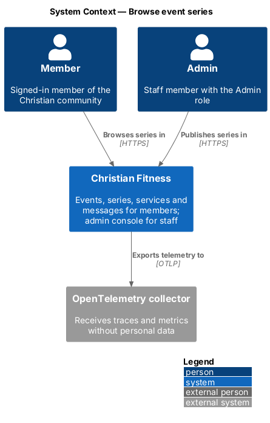
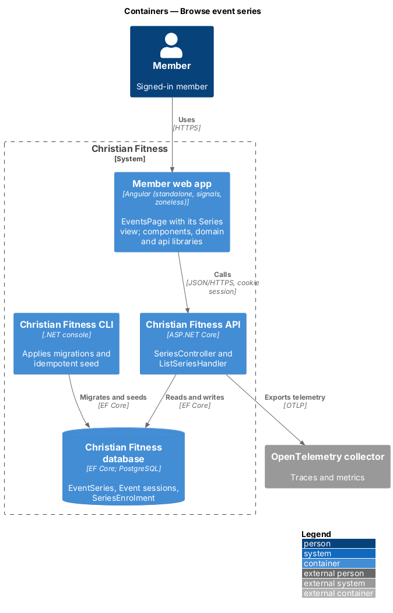
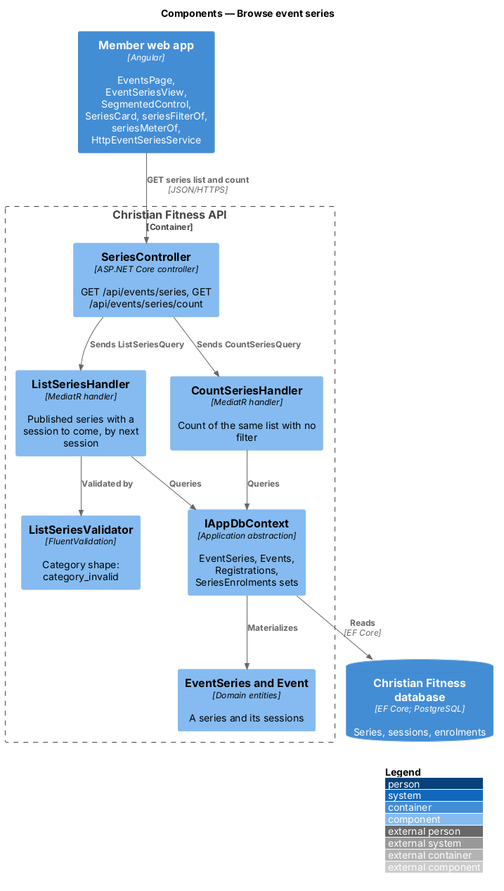
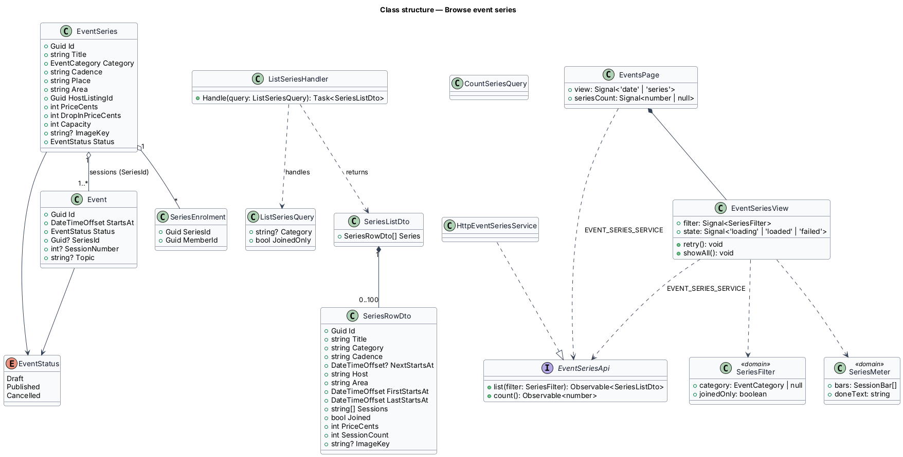
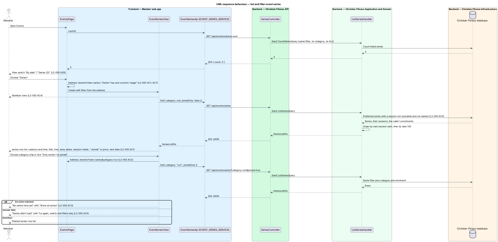

# Browse event series

## Overview

Christian Fitness is a Christian community for health in body and spirit in the Greater Toronto Area. An _event_ is a gathering staff publish for members: a run, workout, basketball game, mobility session, workshop or retreat. The events subsystem lets a member find events and series, read their detail, and take a place within each one's capacity (`L1-005`).

- **event series** — program of dated sessions with one host, one place, one capacity and one group chat, such as eight Tuesdays of Couch to 5K
- **session** — one dated meeting of a series, stored as an `Event` that carries the series' id and its number
- **cadence** — text naming how often a series meets, such as "Every Tuesday" or "6 dates"
- **enrolment** — record that a member joined a series and holds a place at each of its sessions still to come
- **listed series** — published series with at least one session that is neither started nor cancelled

This feature covers the Series view of the Events screen in the Member web app (mocks `docs/mocks/pages/events/series.html`, `series-joined.html`, `series-empty.html`, `series-loading.html` and `series-error.html`). A view switch on Events offers "By date" and "Series (<count>)". The Series view lists the listed series by next session date, narrows them by category and by "Only series I've joined", and leads each row to the series (`L2-051`).

**How a series relates to existing types.** A series is a new `EventSeries` row. Each of its sessions is an ordinary `Event` (`backend/src/ChristianFitness.Domain/Events/Event.cs`) with three new nullable fields: `SeriesId`, `SessionNumber` and `Topic`. A session takes the series' category, place, area and capacity, and the drop-in price as its `PriceCents`. A place at a session is an ordinary `Registration`. The By-date list (`ListEventsHandler`) therefore lists sessions with no change to its query, and the capacity rules of `L2-011` apply to each session unchanged.

## Description

The feature is a vertical slice from the Series view to the database.

- **`EventsPage`** — existing routed page in `projects/web` (`pages/events/events-page.ts`). It gains a `view` signal read from the address (`view=series`, anything else is "By date", `L2-050` AC7) and renders the `SegmentedControl`. On arrival it asks `count()` once for the "Series (<count>)" label (`L2-050` AC6). It binds `EVENT_SERIES_SERVICE` to `HttpEventSeriesService` on its own `providers`, beside `EVENTS_SERVICE`.
- **`EventSeriesView`** — new component in `pages/events/` that reads the address itself, created only while the view is "Series", so the By-date feed and the series list never live at once. It holds the filter and the loaded rows as signals. It shows the skeleton rows, the `series-row` list, the "No series here yet" empty state with "Show all series", and the "Series didn't load" error state with Try again; the switch and filters stay in each state (`L2-050` AC3, AC4).
- **Search** — the shared "Search events" field filters series titles using trimmed, case-insensitive text alongside category and joined-only filters (`L2-075`). Changing it replaces the list; "Show all series" clears the search and both filters (mock `series-search-no-results`).
- **`SegmentedControl`** — new presentation component (`components/src/segmented-control/`, block `segmented`, design-system page `segmented-control`). Each option is a link with `aria-current="page"` on the current one, as the category chips are (ADR 0030); a plain click emits `navigate`, so the page routes in the app. Until the count answers, or when it fails, the option reads "Series" (ADR 0093).
- **`SeriesRow`** — new presentation component (`components/src/series-card/series-row`, design-system page `series-card`). It renders block `series-row`: image, cadence and time, title, host, area and date range, the session meter, "Joined" (`tag`) or the price, and "Next <date>". It takes a view model input and renders every text as text.
- **`SessionMeter`** — new presentation component (`components/src/session-list/session-meter`, block `session-meter`): one bar per session, modified `--done`, `--next` or `--cancelled`, with a visually hidden "<done> of <total> sessions done".
- **`ChipBar`, `Chip`, `Checkbox`, `EmptyState`, `Skeleton`** — existing components, reused for the category filter, the "Only series I've joined" tick, the empty and error states and the skeleton rows.
- **`seriesFilterOf` / `seriesAddressOf`** — pure helpers in `domain/src/events/series-filter.ts`. They read and write `view`, `category` and `joined` in the address; an unknown category falls back to all, as `eventCategoryOf` does (`L2-009` AC9).
- **`seriesRowViewOf` / `seriesMeterOf`** — pure helpers in `domain/src/events/series-row-view.ts`. They word the date range ("Apr 7 – May 26"; months only for a monthly cadence, as "Jan – Jun"), the price ("$64 for all 8", "Free"), "Next Apr 21", and the meter bars and done text, in Toronto time.
- **`EventSeriesApi / EVENT_SERIES_SERVICE`** — new contract and token in `api/src/events/event-series.ts`. `list(filter)` returns a `SeriesListDto`; `count()` returns the number of listed series. Later slices add `get`, `join`, `leave` and `setDropIns` to the same contract.
- **`HttpEventSeriesService`** — new HTTP implementation in `projects/web/src/app/services/`. It calls `GET /api/events/series` with category, joined and search filters, and `GET /api/events/series/count`.
- **`SeriesController`** — new ASP.NET Core controller at `api/events/series`, behind the fallback authentication policy. Each action sends one MediatR request and checks nothing.
- **`ListSeriesQuery / ListSeriesHandler`** — new MediatR query and handler in `Application/Series/`. The handler reads the `EventSeries` with a published session whose `StartsAt > now` (from `TimeProvider`) (`L2-050` AC5; ADR 0093). It applies the optional category, title search and, with `JoinedOnly`, the caller's `SeriesEnrolment`. It orders by the next session's start, then `Id`, and returns at most 100 rows. Each row's `Sessions` holds one state per session, ADR 0091's `done`, `live`, `upcoming` or `cancelled`; the app draws `live` as the next bar.
- **`CountSeriesQuery / CountSeriesHandler`** — counts the same list with no category and no tick (`L2-050` AC6).
- **`ListSeriesValidator`** — refuses an unknown category with 400 `validation_failed` and `fieldCodes.category` = `category_invalid`, as `ListEventsValidator` does (ADR 0030).
- **`EventSeries`** — domain entity journey 9 built (ADR 0091): `Title`, `Category`, `Place`, `Area`, `Summary`, `ImageKey`, `HostListingId`, `PriceCents`, `DropInPriceCents`, `Capacity` and `CreatedAt`, with no status and no stored cadence. This feature adds no migration.
- **`SeriesEnrolment`** — domain entity journey 9 built (`SeriesId`, `MemberId`, `Status`, `CreatedAt`, unique per pair); its rules belong to `join-and-leave-series`. This feature reads it for "Joined" and the tick.

The list holds at most 100 rows and is replaced, never appended, on each filter change, so a long session does not grow it (`L2-037`).

### Decisions

ADR 0093 settles what the design left open:

- By date lists only each series' first session that matches the selection, with "Part of <series>" and "Session <n> of <total> · <cadence>" (`L2-009` AC1, ADR 0080); `EventSummaryDto` gains `series`.
- The meter's text counts held sessions only ("2 of 7 sessions done"); the session number counts every date, cancelled ones included (ADR 0080).
- The list holds at most 100 series with no paging (`L2-050` AC5).
- Cadence is derived from the dates and served as numbers (ADR 0091); the host is the series' required listing (ADR 0091).
- `EventSeries` has no status (ADR 0091): a listed series is one with a published session that is neither started nor cancelled.
- The search is ADR 0081's, applied to series titles; the address is `/events?view=series&category=&q=&joined=true`, and the view switch clears the filters.
- Rows lead to `/events/series/<id>`, the page journey 11 builds.

## Requirements

The feature realizes the following level-2 (L2) requirements. Each L2 requirement refines a level-1 (L1) requirement, cited by identifier. The L2 specification states its requirements as acceptance criteria; the text below condenses those criteria faithfully.

| L2 ID    | Refines (L1) | Requirement |
| -------- | ------------ | ----------- |
| `L2-050` | `L1-005`     | Choosing "Series" on Events shall set the address to `/events?view=series` and list published series with a session still to come by next session date, each with image, cadence and time, title, host, area, date range, one bar per session (done, next, still to come, cancelled) with "<done> of <total> sessions done" for assistive technology, "Joined" or the series price, and the next session's date, each leading to the series. A category shall narrow the list, mark its chip current and appear in the address; "Only series I've joined" shall narrow it to joined series. No match shall read "No series here yet" with "Show all series", which clears the search and both filters. Loading shall show skeleton rows; a failure shall offer Try again while the switch and filters stay. A series that is unpublished or has every session past or cancelled shall not be listed. "Series (<count>)" shall count the unfiltered list. An address with `view=series` shall open the Series view with its filters; any other `view` shall show "By date". |
| `L2-009` | `L1-005`     | (AC1, AC11) The By-date list shall list only the next session of a series, adding "Part of <series>" and "Session <n> of <total> · <cadence>"; a view switch shall offer "By date" and "Series (<count>)" with the current one marked, and the subtitle shall read "From the churches, clubs and coaches in our directory. Free unless marked." |
| `L2-037` | `L1-014`     | When a screen is left and destroyed, its subscriptions, timers, listeners and real-time handlers shall be released; after 50 moves between screens the heap shall return to within 10% of its level after the first visit. The series list is bounded and replaced on each filter change. |
| `L2-075` | `L1-005` | The Events screen shall let a member search the current list by text. |

## Diagrams

### System context

A member browses series in Christian Fitness; staff publish them. The system exports telemetry without personal data.

### Containers

The Member web app calls the Christian Fitness API, which reads series, their session events and the caller's enrolments from the database.

### Components

`SeriesController` sends `ListSeriesQuery` or `CountSeriesQuery`; the handlers read through `IAppDbContext` and validate the category with `ListSeriesValidator`.

### Class structure

An `EventSeries` owns its sessions as `Event` rows linked by `SeriesId`, and its enrolments. `EventsPage` owns `EventSeriesView`, which depends on `EventSeriesApi` and the domain helpers.

### Behaviour — list and filter series

The page asks for the count, then the view asks for the list; a category or the tick replaces the list and updates the address.

