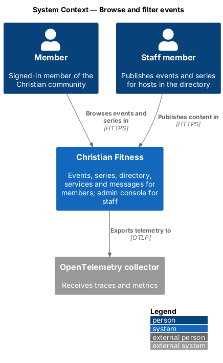
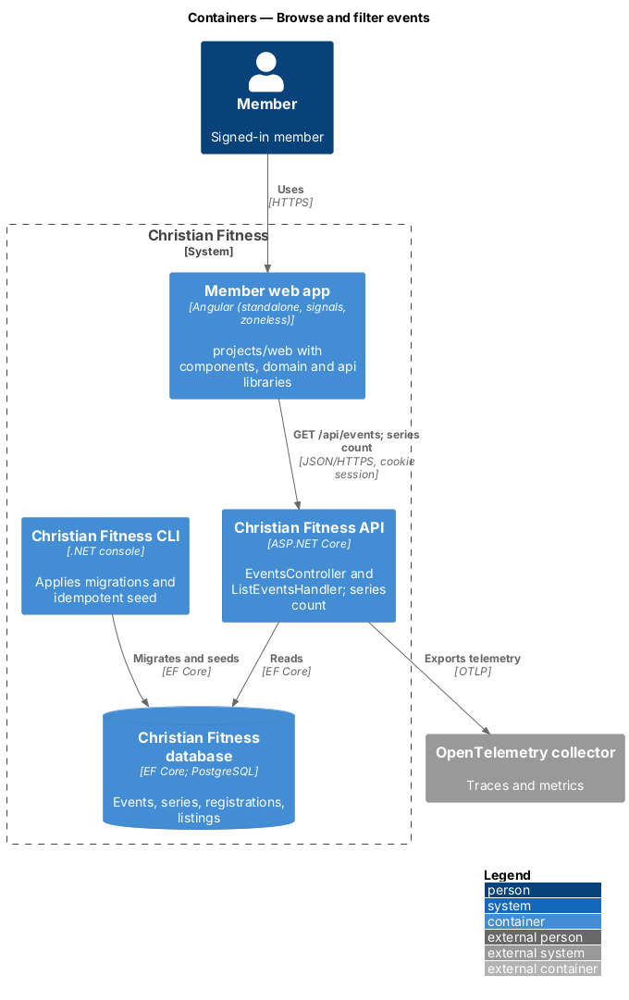
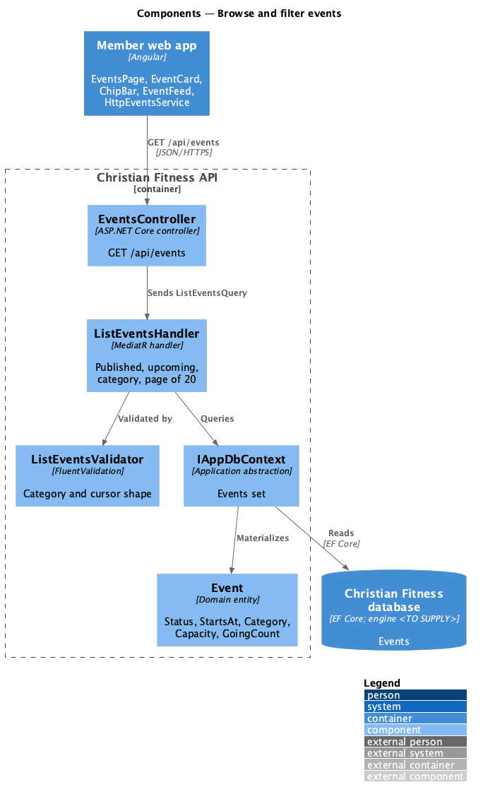
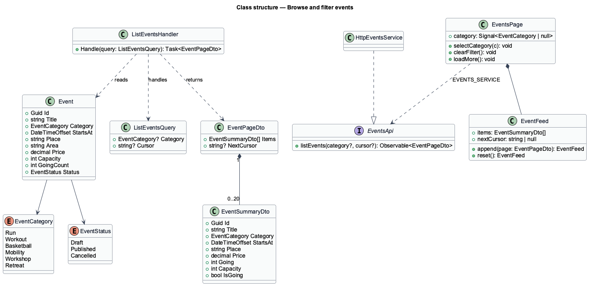
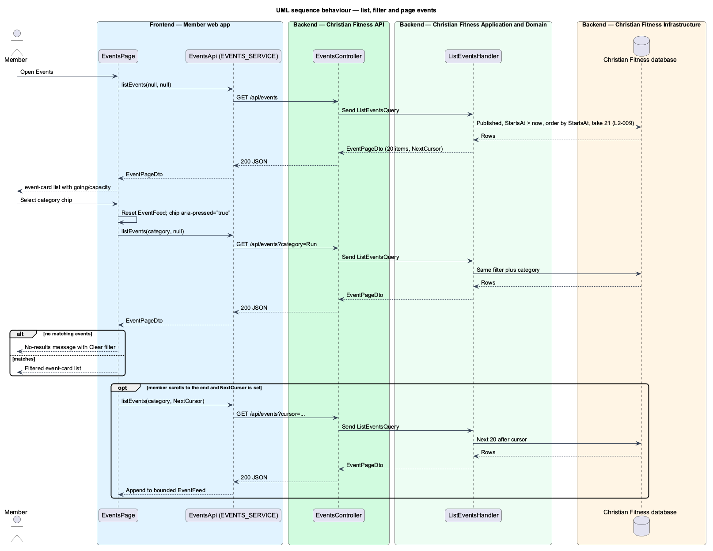

# Browse and filter events

## Overview

Christian Fitness is a Christian community for health in body and spirit in the Greater Toronto Area. An _event_ is a gathering staff publish for members: a run, workout, basketball game, mobility session, workshop or retreat. The events subsystem lets a member find events, read their detail, and register for or cancel a place within each event's capacity (`L1-005`).

- **published event** — event staff have made visible to members, neither draft nor cancelled
- **going** — count of current registrations for an event
- **capacity** — maximum number of registrations an event accepts

This feature covers the Events screen of the Member web app (mock `docs/mocks/pages/events/`). The screen lists upcoming published events in date order, narrows them by category, and loads further events in pages of 20 as the member scrolls. Draft, cancelled and past events never appear.

- **category** — one of Run, Workout, Basketball, Mobility, Workshop, Retreat
- **page** — ordered slice of at most 20 events, addressed by a cursor

## Description

The feature is a vertical slice from the Events screen to the database.

- **`EventsPage`** — routed page component in `projects/web`, loaded with `loadComponent`. It holds the selected category and the loaded events as signals, renders the `page-head`, `chip-bar` and `event-grid` blocks, and shows the `empty-state`, `error-state` and no-results states from the mock. `EventFeed` is provided on its `providers`, not in `root`.
- **`EventCard`** — presentation component in the `components` library (BEM block `event-card`, with `date-badge` and `going-pill`). It takes an `EventSummary` input and renders date, title, time, place, price and going/capacity.
- **`ChipBar`** — presentation component (blocks `chip-bar` and `chip`). Each category chip is a `button` with `aria-pressed`; the selected chip has `aria-pressed="true"` (`L2-009`).
- **`EventFeed`** — pure helper in the `domain` library. It appends pages, de-duplicates by id, keeps the next cursor, and stops asking at 200 events (ADR 0027), so a long session does not grow without limit (`L2-037`).
- **`EventsApi / EVENTS_SERVICE`** — contract and injection token in the `api` library. `listEvents(category?, cursor?)` returns an `EventPageDto`.
- **`HttpEventsService`** — HTTP implementation of `EventsApi`, bound to `EVENTS_SERVICE` in `app.config.ts`. It calls `GET /api/events?category={category}&cursor={cursor}`.
- **`EventsController`** — ASP.NET Core controller. `GET /api/events` sends one `ListEventsQuery` and returns its result; it performs no checks of its own.
- **`ListEventsQuery / ListEventsHandler`** — MediatR query and handler. The handler filters to `Status == Published` and `StartsAt > now` (from `TimeProvider`), applies the optional category, orders by `StartsAt` then `Id`, and returns at most 20 items plus a next cursor.
- **`ListEventsValidator`** — FluentValidation validator. It rejects a malformed cursor with 400 `validation_failed` and `fieldCodes.cursor` = `cursor_invalid` (ADR 0027); an unknown category joins with slice 4.2.
- **`Event`** — domain entity with `Title`, `Category`, `StartsAt`, `Place`, `Area`, `Price`, `Capacity`, `GoingCount` and `Status`.

### Open questions

- Settled in ADR 0027: the window is 200 events, the cursor code is `cursor_invalid`. Slice 4.1 builds the page head, the grid and its states; the chip bar comes with slice 4.2.
- The mock `docs/mocks/pages/events/` includes a `search` block; `L2-009` specifies no search. The search field is out of scope until a requirement states it.

## Requirements

The feature realizes the following level-2 (L2) requirements. Each L2 requirement refines a level-1 (L1) requirement, cited by identifier. The L2 specification states its requirements as acceptance criteria; the text below condenses those criteria faithfully.

| L2 ID    | Refines (L1) | Requirement                                                                                                                                                                                                                                                                                                                                                                                                                                                                                                              |
| -------- | ------------ | ------------------------------------------------------------------------------------------------------------------------------------------------------------------------------------------------------------------------------------------------------------------------------------------------------------------------------------------------------------------------------------------------------------------------------------------------------------------------------------------------------------------------ |
| `L2-009` | `L1-005`     | Published upcoming events shall be listed in date order with date, title, time, place, price and going/capacity. Selecting a category (Run, Workout, Basketball, Mobility, Workshop, Retreat) shall show only that category's events, with `aria-pressed="true"` on the filter button. A filter with no matching events shall show a no-results message with a Clear filter action. Cancelled, draft and past events shall not be listed. With more than 20 events, scrolling to the end shall load the next page of 20. |

## Diagrams

### System context

A member browses events in Christian Fitness; staff publish those events. The system exports telemetry to an OpenTelemetry collector without personal data.

### Containers

The Member web app calls the Christian Fitness API, which reads published events from the Christian Fitness database. The CLI migrates and seeds the database; the API does not migrate on startup.

### Components

Inside the API, `EventsController` sends `ListEventsQuery`; `ListEventsHandler` validates, filters and pages events through `IAppDbContext`.

### Class structure

`EventsPage` depends on the `EventsApi` contract and owns an `EventFeed`; `ListEventsHandler` handles `ListEventsQuery` and returns an `EventPageDto` of `EventSummaryDto` items projected from `Event`.

### Behaviour — list, filter and page events

The page requests the first page; the handler returns only published upcoming events in date order. Selecting a category resets the feed; reaching the end of the list requests the next cursor.

