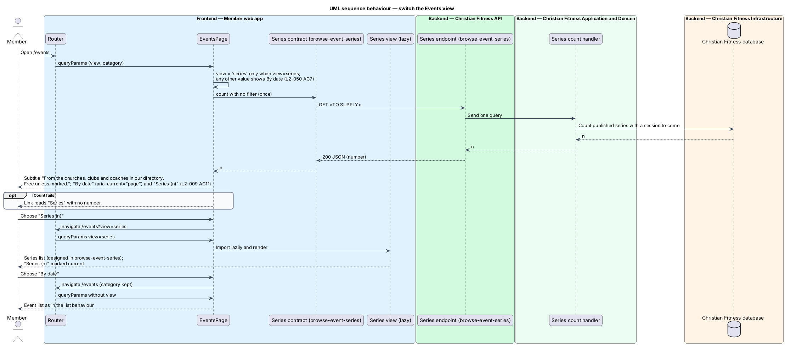

# Browse and filter events

## Overview

Christian Fitness is a Christian community for health in body and spirit in the Greater Toronto Area. An _event_ is a gathering a host runs for members: a run, workout, basketball game, mobility session, workshop or retreat. The events subsystem lets a member find events and series, read their detail, and register for or cancel a place within each event's capacity (`L1-005`).

- **published event** — event staff have made visible to members, neither draft nor cancelled
- **going** — count of current registrations for an event
- **capacity** — maximum number of registrations an event accepts
- **host** — directory listing that runs an event: a church, club, coach, company or ministry ([view a listing profile](../../directory/view-listing-profile/README.md))
- **series** — program of dated sessions with one host, one place and one group chat, such as eight Tuesdays of Couch to 5K (`L2-050`)
- **session** — one dated occurrence of a series; a session that has an event page is also an event
- **cadence** — words that say how often a series meets, such as "Every Tuesday"

This feature covers the Events screen of the Member web app (mock `docs/mocks/pages/events/`). The screen lists upcoming published events in date order, narrows them by category, and loads further events in pages of 20 as the member scrolls. Draft, cancelled and past events never appear. A session of a series is listed like any other event and adds "Session <n> of <total> · <cadence>" (`L2-009` AC1). The subtitle reads "From the churches, clubs and coaches in our directory. Free unless marked." (`L2-009` AC11).

A view switch at the top offers "By date", this feature's list, and "Series (<count>)", the list of series at `/events?view=series`. The Series view is designed in [browse event series](../browse-event-series/README.md); this feature hosts the switch and the count.

- **category** — one of Run, Workout, Basketball, Mobility, Workshop, Retreat
- **page** — ordered slice of at most 20 events, addressed by a cursor
- **view** — which list the Events screen shows: `date` (the default) or `series`

## Description

The feature is a vertical slice from the Events screen to the database.

- **`EventsPage`** — routed page component in `projects/web` (`pages/events/events-page.ts`), loaded with `loadComponent`. It holds the view, the selected category and the loaded events as signals, and renders the `page-head` (title, subtitle), the view switch, the `chip-bar` and the `event-grid`. It shows skeleton cards, the `empty-state`, the `error-state`, the no-results state, "More events didn't load" and the 200-event end note from the mock. `EventFeed` and `EVENTS_SERVICE` are provided on its `providers`, not in `root`.
- **View switch** — the mock's `segmented` block: a `nav` labelled "View" with two links, "By date" (`/events`, keeping the category) and "Series (<count>)" (`/events?view=series`), the current one carrying `aria-current="page"` (`L2-009` AC11). The page reads `view` from the address: `series` shows the Series view, any other value or none shows "By date" (`L2-050` AC7). The Series view's component is imported lazily, so the "By date" view never loads its code.
- **Series count** — the number in "Series (<count>)" is the count of series the Series view lists with no filter (`L2-050` AC6). `EventsPage` asks for it once on entry through the series contract of [browse event series](../browse-event-series/README.md); its endpoint and method name are `<TO SUPPLY>` by that design. Until the count arrives, and if it fails, the link reads "Series" with no number.
- **`EventCard`** — presentation component in the `components` library (BEM block `event-card`, with `date-badge` and `going-pill`). It takes an `EventSummary` input and renders date, title, time, place, price and going/capacity. The design adds the optional `event-card__series` line, "Session <n> of <total> · <cadence>", between the meta line and the title, shown only for a session (`L2-009` AC1).
- **`sessionLineOf(summary)`** — pure helper in the `domain` library that words the series line from `seriesSession` and returns none for an event outside a series, with one unit test per case.
- **`ChipBar`** — presentation component (blocks `chip-bar` and `chip`). Each category chip is a link to `/events?category=<name>` and the current one has `aria-current="page"`; "All" shows every category (`L2-009` AC2; ADR 0030).
- **`EventFeed`** — pure helper in the `domain` library. It appends pages, de-duplicates by id, keeps the next cursor, and stops asking at 200 events (ADR 0027), so a long session does not grow without limit (`L2-037`).
- **`EventsApi / EVENTS_SERVICE`** — contract and injection token in the `api` library. `page(cursor, category?)` returns an `EventPageDto`.
- **`HttpEventsService`** — HTTP implementation of `EventsApi`, bound to `EVENTS_SERVICE` on `EventsPage`. It calls `GET /api/events?category={category}&cursor={cursor}`.
- **`EventsController`** — ASP.NET Core controller. `GET /api/events` sends one `ListEventsQuery` and returns its result; it performs no checks of its own.
- **`ListEventsQuery / ListEventsHandler`** — MediatR query and handler. The handler filters to `Status == Published` and `StartsAt > now` (from `TimeProvider`), applies the optional category, orders by `StartsAt` then `Id`, reads going counts through `IRegistrationReader`, and returns at most 20 items plus a next cursor. For each event that is a session of a series, it adds the session's number, the series' session total and its cadence in the same query, so no request is made per card.
- **`ListEventsValidator`** — FluentValidation validator. It rejects a malformed cursor with 400 `validation_failed` and `fieldCodes.cursor` = `cursor_invalid` (ADR 0027), and an unknown category with `fieldCodes.category` = `category_invalid` (ADR 0030).
- **`EventSummaryDto`** — gains `seriesSession`, null for an event outside a series, otherwise `{ seriesId, number, total, cadence }`. `number` and `total` are numbers, never words; the app words the line. The other fields stay as they are (`id`, `title`, `category`, `startsAt`, `place`, `area`, `priceCents`, `capacity`, `going`, `imageKey`).
- **`Event`** — domain entity with `Title`, `Category`, `StartsAt`, `Place`, `Area`, `PriceCents`, `Capacity`, `Summary`, `ImageKey` and `Status`. The design adds `HostListingId` (the listing that runs it) and an optional `SeriesId` with the session's place in the series. The series entity and its cadence belong to [browse event series](../browse-event-series/README.md), and the listing entity to [browse the directory](../../directory/browse-directory/README.md); this feature reads them and defines neither.

### Open questions

- Settled in ADR 0027 and ADR 0030: the window is 200 events, the cursor code is `cursor_invalid`, the category chips are links with `aria-current="page"` at `/events?category=<name>`, and an unknown category to the API is refused with `category_invalid`.
- The mock `docs/mocks/pages/events/` includes a `search` block; `L2-009` specifies no search. The search field is out of scope until a requirement states it.
- The mock's chip bar ends with "Only events I'm going to" on the "By date" view; `L2-009` has no criterion for it (only `L2-050` AC2 states the series tick). It is out of scope until a requirement states it.
- **Session number.** Whether "Session <n> of <total>" counts cancelled sessions, and whether `number` is stored on the event or derived from date order, is `<TO SUPPLY>` by [browse event series](../browse-event-series/README.md); this feature shows the numbers it is given.
- **Host on the card.** `L2-009` asks for no host on the card and the mock draws none; the host shows on the event's detail ([view event detail](../view-event-detail/README.md)). `Event.HostListingId` is still added here, since every event has a host (`L2-010` AC4). How events published before listings existed get a host (a seeded listing for the team, or a nullable column) is `<TO SUPPLY>` and needs a migration decision.
- **View switch component (resolved).** The `segmented` block is the design-system page `segmented-control`: a navigation of two links that carry `aria-current="page"`, not tab semantics. The component is built from that page.
- **Code behind the requirement.** The page's subtitle still reads "Posted by the Christian Fitness team. Free unless marked.", there is no view switch, `EventSummaryDto` carries no series fields, and `Event` has no host or series. Each is work for the next slices.

## Requirements

The feature realizes the following level-2 (L2) requirements. Each L2 requirement refines a level-1 (L1) requirement, cited by identifier. The L2 specification states its requirements as acceptance criteria; the text below condenses those criteria faithfully.

| L2 ID    | Refines (L1) | Requirement |
| -------- | ------------ | ----------- |
| `L2-009` | `L1-005`     | Published upcoming events shall be listed in date order with date, title, time, place, price and going/capacity; a date that belongs to a series shall be listed like any other event and add "Session <n> of <total> · <cadence>". Selecting a category (Run, Workout, Basketball, Mobility, Workshop, Retreat) shall make the address `/events?category=<name>`, show only that category's events and mark its chip `aria-current="page"`; "All" shall show every category. A filter with no matching events shall show a no-results message with Clear filter, which shows all events. Cancelled, draft and past events shall not be listed. With more than 20 events, scrolling to the end shall load the next page of 20. Loading shall show skeleton cards; none published and upcoming shall show an empty state pointing home; a failure shall show an error state with Try again. A next page that fails shall keep the cards and show "More events didn't load" with Try again; at 200 events no more shall be asked for and the list shall end with a note. A malformed cursor shall be refused with 400 `validation_failed` and `fieldCodes.cursor` = `cursor_invalid`; an unknown category with `fieldCodes.category` = `category_invalid`. An address with a category shall show that category with its chip current, and a category the app does not know shall show all events. A view switch shall offer "By date" and "Series (<count>)" with the current one marked `aria-current="page"`, "By date" by default, and the subtitle shall read "From the churches, clubs and coaches in our directory. Free unless marked." (acceptance criteria 1–11). |
| `L2-050` | `L1-005`     | Given the view switch, "Series (<count>)" shall count the series the Series view lists with no filter; an address with `view=series` shall show the Series view, and any other `view` shall show "By date" (acceptance criteria 6–7; the Series view itself is designed in [browse event series](../browse-event-series/README.md)). |

## Diagrams

### System context

A member browses events and series in Christian Fitness; staff publish them for the hosts listed in the directory. The system exports telemetry to an OpenTelemetry collector without personal data.

### Containers

The Member web app calls the Christian Fitness API, which reads published events, their series and going counts from the Christian Fitness database. The CLI migrates and seeds the database; the API does not migrate on startup.

### Components

Inside the API, `EventsController` sends `ListEventsQuery`; `ListEventsHandler` validates, filters and pages events through `IAppDbContext` and adds each session's series line. In the app, `EventsPage` hosts the view switch and loads the Series view lazily.

### Class structure

`EventsPage` depends on the `EventsApi` contract and owns an `EventFeed`; `ListEventsHandler` handles `ListEventsQuery` and returns an `EventPageDto` of `EventSummaryDto` items projected from `Event`, each with an optional `SeriesSessionDto`.

### Behaviour — list, filter and page events

The page requests the first page; the handler returns only published upcoming events in date order, each session with its series line. Selecting a category resets the feed; reaching the end of the list requests the next cursor.

### Behaviour — switch between By date and Series

The page reads `view` from the address and asks once for the series count. Choosing "Series" changes the address to `/events?view=series` and loads the Series view; any other `view` shows "By date" (`L2-009` AC11; `L2-050` AC6–AC7).

