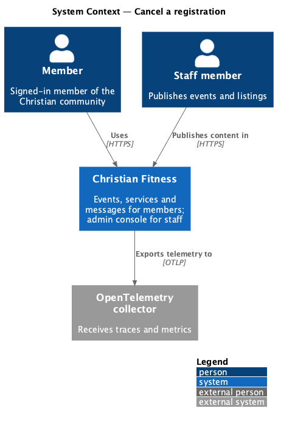
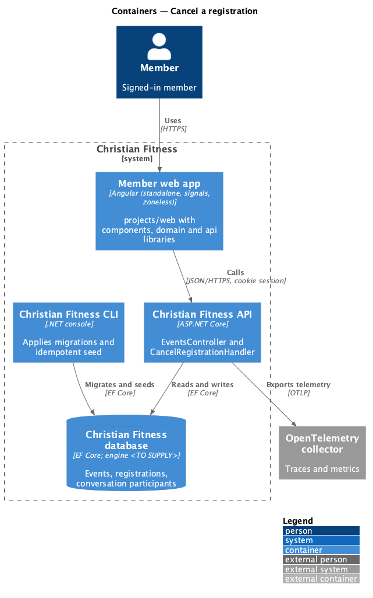
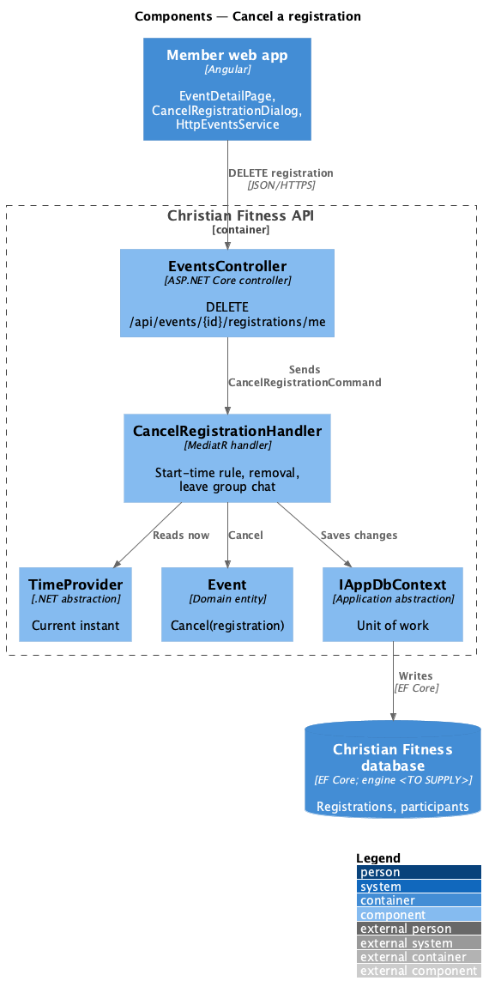
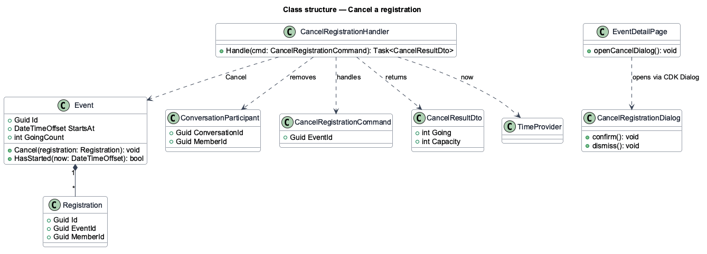
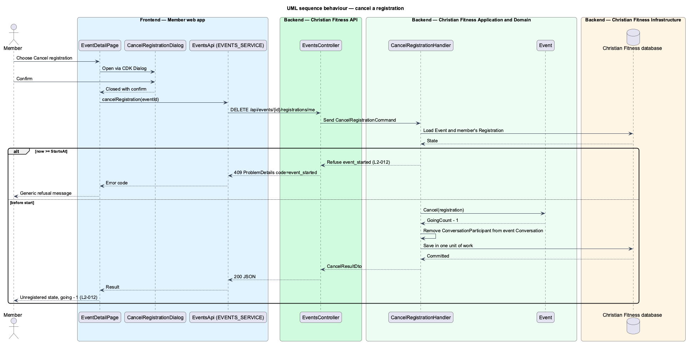

# Cancel a registration

## Overview

Christian Fitness is a Christian community for health in body and spirit in the Greater Toronto Area. An _event_ is a gathering staff publish for members: a run, workout, basketball game, mobility session, workshop or retreat. The events subsystem lets a member find events, read their detail, and register for or cancel a place within each event's capacity (`L1-005`).

- **published event** — event staff have made visible to members, neither draft nor cancelled
- **going** — count of current registrations for an event
- **capacity** — maximum number of registrations an event accepts

This feature lets a registered member give up a place before the event starts. The member confirms Cancel registration in a CDK Dialog; the registration is removed, going decreases by one and the member leaves the event's group chat. After the event has started, cancelling is refused with code `event_started`.

- **event start** — the event's `StartsAt` instant, compared with the server's `TimeProvider`

## Description

The feature is a vertical slice from the cancel action to the database.

- **`EventDetailPage`** — handles the `cancel` output of `EventRegisterPanel`, opens `CancelRegistrationDialog` through the CDK `Dialog` service and, on confirmation, calls `cancelRegistration(eventId)`. On success it shows the unregistered state; on `event_started` it shows a generic message.
- **`CancelRegistrationDialog`** — dialog component in `projects/web` opened with CDK Dialog. It names the event and offers Cancel registration and Keep my place; it closes by its `DialogRef`.
- **`EventsApi / EVENTS_SERVICE`** — `cancelRegistration(eventId)` returns the updated going count.
- **`HttpEventsService`** — calls `DELETE /api/events/{id}/registrations/me`.
- **`EventsController`** — `DELETE /api/events/{id}/registrations/me` sends one `CancelRegistrationCommand`.
- **`CancelRegistrationHandler`** — loads the member's registration and the event. It refuses with `event_started` when `now >= StartsAt`, otherwise calls `Event.Cancel(registration)`, removes the member's `ConversationParticipant` from the event's group conversation, and saves in one unit of work. Cancelling with no registration is a no-op returning the current count.
- **`Event.Cancel`** — domain method. It removes the registration and decrements `GoingCount`.

### Open questions

- No mock exists for the cancel confirmation dialog. The event-detail mock instead offers "Can't make it" leading to an undo toast (`docs/mocks/notifications/toast/with-action.html`), which contradicts the confirmation dialog in `L2-012`. A dialog mock, or an ADR adopting the toast, is needed before implementation.
- The event-detail mock copy asks members to cancel 24 hours ahead; `L2-012` refuses only after the event starts. Whether a 24-hour cut-off applies is `<TO SUPPLY>`.
- Behaviour for a reserved (paid) registration on cancel, such as refunds, is not specified; `<TO SUPPLY>`.

## Requirements

The feature realizes the following level-2 (L2) requirements. Each L2 requirement refines a level-1 (L1) requirement, cited by identifier. The L2 specification states its requirements as acceptance criteria; the text below condenses those criteria faithfully.

| L2 ID    | Refines (L1) | Requirement                                                                                                                                                                                                                                                                             |
| -------- | ------------ | --------------------------------------------------------------------------------------------------------------------------------------------------------------------------------------------------------------------------------------------------------------------------------------- |
| `L2-012` | `L1-005`     | A registered member who confirms Cancel registration in a dialog before the event starts shall have the registration removed, going shall decrease by one and the member shall leave the group chat. Cancelling after the event has started shall be refused with code `event_started`. |

## Diagrams

### System context

A member cancels a registration in Christian Fitness.

### Containers

The Member web app sends the cancellation to the Christian Fitness API, which removes the registration and group chat membership from the database.

### Components

`EventsController` sends `CancelRegistrationCommand`; the handler checks the start time against `TimeProvider` and applies `Event.Cancel`.

### Class structure

`CancelRegistrationHandler` reads `TimeProvider`, calls `Event.Cancel` and removes a `ConversationParticipant`; the page opens `CancelRegistrationDialog`.

### Behaviour — cancel a registration

The member confirms in the dialog; the handler refuses after the event start, otherwise removes the registration and group chat membership in one unit of work.

