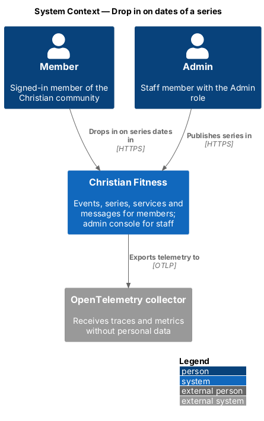
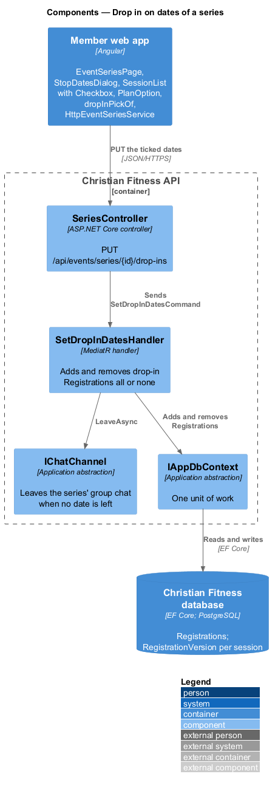
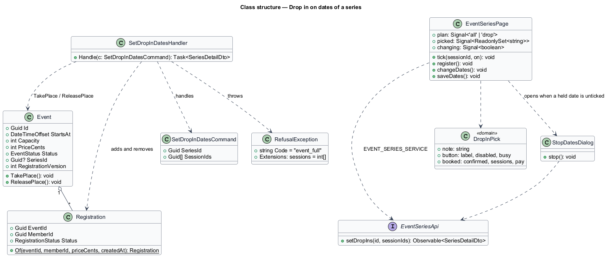
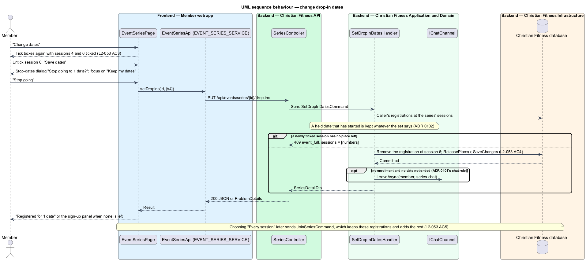

# Drop in on dates of a series

## Overview

Christian Fitness is a Christian community for health in body and spirit in the Greater Toronto Area. An _event_ is a gathering staff publish for members. The events subsystem lets a member find events and series, read their detail, and take a place within each one's capacity (`L1-005`).

- **event series** — program of dated sessions with one host, one place, one capacity and one group chat
- **session** — one dated meeting of a series, stored as an `Event` that carries the series' id and its number
- **drop-in** — registration at one session of a series by a member who did not join the series
- **drop-in price** — price of one session to a member who drops in, stored as the session event's `PriceCents`
- **open session** — session that has neither started nor been cancelled and has a place left

This feature covers the sign-up panel and the session list of the Event series screen when "Pick dates to drop in" is chosen or dates are changed (mocks `docs/mocks/pages/event-series/drop-in-none.html`, `drop-in.html`, `booking.html`, `drop-in-full.html`, `booked.html`, `change-dates.html`, `joined-change.html`, `joined-changed.html` and `full.html`, and `docs/mocks/dialogs/stop-dates/`). Decisions the requirement left open are recorded in ADR 0102. The member ticks dates in the session list and registers for all of them at once, then may change those dates. Each drop-in follows the event rules of `L2-011` and `L2-012`. There is no online payment: a priced drop-in is reserved and the panel says to pay the host in person (`docs/mocks/README.md`, "Series and paid").

**How a drop-in reuses `Event` and `Registration`.** A drop-in is an ordinary `Registration` at the session's `Event`, created with `Registration.Of(sessionId, memberId, session.PriceCents, now)`, so a priced date is `Reserved`. Capacity is the session's own `Capacity`, checked against its count of registrations, and `Event.TakePlace()` / `ReleasePlace()` bump its `RegistrationVersion` token (ADR 0033). A drop-in therefore competes for the same places as an enrolment (`join-and-leave-series`) and as a registration made from the session's Event detail screen.

## Description

The feature is a vertical slice from the session list's tick boxes to the database.

- **`EventSeriesPage`** — holds `plan`, `picked` (a set of session ids) and `changing` as signals. With "Pick dates to drop in" chosen it gives each session to come that is not cancelled a "Drop in" tick box named "Drop in on <weekday>, <date>"; one with no place left (`full`) that the member does not hold reads "Full" with no tick box (`L2-053` AC1, AC7). "Register for <n> date(s)" ("Registering…" while it waits) calls `setDropIns(id, held ∪ picked)`. On success it shows the booked panel; on `event_full` it names the full date(s) in an `alert` above the button and keeps the ticks; on any other failure it shows the generic message above a usable button. "Change dates" shows the tick boxes again with the dates held to come ticked; the button reads "Save dates", disabled until the ticks differ from what is held. A change that unticks a held date opens the stop-dates dialog; one that only adds is saved at once (`L2-053` AC3, AC4, AC6).
- **`StopDatesDialog`** — a CDK Dialog loaded on first use (mock `docs/mocks/dialogs/stop-dates/`): "Stop going to <n> date(s)?", "<title> · Sat Apr 25 and Sat May 9", focus on "Keep my dates"; "Stop going" ("Stopping…") sends the whole set; a failure says so and changes nothing; `event_full` closes it and the page names the date.
- **`SessionList`** — the `session-row` end slot holds the design system's `Checkbox` (block `check`) or the word "Full"; each tick box keeps a 44 × 44 px hit area. Once a joined member holds fewer than every session to come, each session to come reads "· Registered" or "· Not going" after its weekday (`L2-053` AC6).
- **`PlanOption`** — the drop-in option's note reads "Tick dates in the list" or "<n> picked below".
- **`dropInPickOf`** — pure helper in `domain/src/events/drop-in-pick.ts`. It gives the option's note, the button ("Pick a date first", disabled, until one is ticked; then "Register for 1 date" or "Register for <n> dates"; "Save dates" while changing), the booked panel's "Registered for <n> date(s)", "Sessions 4, 6. You can add more dates any time." and the payment line from the drop-in price ("Pay $10 to the host at each session; online payment is not available yet."), and the refusal's words by date. It has a case table with one test per row.
- **`EventSeriesApi.setDropIns(id, sessionIds)`** — `HttpEventSeriesService` calls `PUT /api/events/series/{id}/drop-ins` with `{ sessionIds }` and answers the series as the caller now sees it; a refusal errors with an `ApiError` carrying the `sessions` numbers of `event_full`.
- **`SeriesController.SetDropIns`** — sends one `SetDropInDatesCommand`.
- **`SetDropInDatesCommand / SetDropInDatesHandler`** — the set is every date still to come that the member holds after the change, so one command both adds and removes, all or none (`L2-053` AC2, AC4; ADR 0102). The handler:
  - refuses an unknown or unpublished series with 404 `series_not_found`, and a suspended member who adds a date with 403 `account_suspended`;
  - refuses an id that repeats, is not a session of the series, is cancelled, or has started and is not held with 400 `sessions_invalid`, and so a member who has not joined adding a date to a series with no drop-in price;
  - for each newly ticked session, refuses the whole change if `going >= Capacity`, naming every full session; otherwise it calls `TakePlace()` and adds a `Registration` at the session's price (the series price for a joined member);
  - for each held session to come that is not in the set, calls `ReleasePlace()` and removes the registration, whether a drop-in or an enrolment took it; a held session that has started is kept whatever the set says (`L2-012`);
  - saves once; a `DbUpdateException` detaches or restores the changed rows, reloads and decides again (ADR 0033, ADR 0101);
  - after saving, when the member is no longer in the series chat by ADR 0101's rule (no enrolment, no date not ended), calls `IChatChannel.LeaveAsync` (`L2-053` AC4). A first drop-in puts the member in the series chat by the same rule.
- **Refusal naming full dates** — 409 ProblemDetails with code `event_full`, the code `L2-011` uses, and a `sessions` extension listing the full session numbers. The screen words them by date ("Sat May 9 is full. Untick it and try again."; ADR 0102).
- **Join after drop-ins** — `JoinSeriesHandler` keeps the drop-in registrations and adds the rest, with no second place at any session, since it skips sessions the member already holds and the unique (`EventId`, `MemberId`) index forbids a duplicate (`L2-053` AC5).
- **A joined member's dates** — the joined panel offers "Change dates"; unticking keeps the enrolment and removes only those places. The confirmation reads "You're in for every session" while every session to come is held, otherwise "You're in for <h> of <n> sessions to come" (ADR 0102).

### Open questions

- Resolved (ADR 0102): the refusal's extension is `sessions` (numbers) and its words name the dates; the stop-dates dialog confirms unticking; `event_started` is not needed, since a started date is always kept.
- Resolved (#89, ADR 0102): a joined member may untick single dates after the stop-dates confirmation; dates still held read "Registered" in the list and unticked ones "Not going" (mock states `joined-change`, `joined-changed`).
- Payment copy for a priced drop-in follows the `booked` mock; the instructions themselves are `<TO SUPPLY>`, as for events (`register-for-event`).

## Requirements

The feature realizes the following level-2 (L2) requirements. Each L2 requirement refines a level-1 (L1) requirement, cited by identifier. The L2 specification states its requirements as acceptance criteria; the text below condenses those criteria faithfully.

| L2 ID    | Refines (L1) | Requirement |
| -------- | ------------ | ----------- |
| `L2-053` | `L1-005`     | With "Pick dates to drop in" chosen, every session still to come that is not cancelled and has a place left shall get a "Drop in" tick box named with its date; the option's note shall read "Tick dates in the list" or "<n> picked below"; the button shall read "Pick a date first" and be disabled until a date is ticked, then "Register for <n> date(s)". Pressing it shall register the member for each ticked session as `L2-011` states for an event (capacity, paid as reserved, suspended refused) and add them to the series' group chat; all dates shall be registered or none, and a date that filled meanwhile shall be named in the refusal. A registered member's panel shall read "Registered for <n> date(s)", list the session numbers, say how to pay where the drop-in has a price, and offer "Change dates", which shows the tick boxes with those dates ticked. Unticking a date that has not started and confirming shall cancel that registration as `L2-012` states; unticking every date shall leave the group chat. Choosing "Every session" later shall keep those registrations and add the rest, with no second place. A session with no place left shall read "Full" in words and have no tick box. |
| `L2-011` | `L1-005`     | A full event shall be refused with `event_full`; of two requests for the last place exactly one shall succeed; registering again shall create no second registration; a paid registration shall be reserved; a suspended member shall be refused with `account_suspended`. Each drop-in applies these rules to its session. |
| `L2-012` | `L1-005`     | A registration shall be removable before the event starts, lowering going by one; after the start it shall be refused with `event_started`. Unticking a date applies this rule to its session. |

## Diagrams

### System context

A member drops in on dates of a series in Christian Fitness. No payment provider is involved in this release.

### Containers

The Member web app puts the ticked dates to the Christian Fitness API, which adds and removes the session registrations in the database in one unit of work.

### Components

`SeriesController` sends `SetDropInDatesCommand`; `SetDropInDatesHandler` checks the set and changes the registrations, then leaves the series chat through `IChatChannel` when no date is left.

### Class structure

`SetDropInDatesHandler` adds and removes `Registration` rows at session `Event` rows and throws a refusal naming the full sessions. `EventSeriesPage` words the panel with `dropInPickOf`.

### Behaviour — drop in on picked dates

The member ticks two dates and registers; the handler registers both or, when one has filled, neither and names it.

### Behaviour — change drop-in dates

The member unticks a date and confirms in the stop-dates dialog; the handler removes that registration, keeps a date that has started, and leaves the series chat when nothing keeps the member in it.

