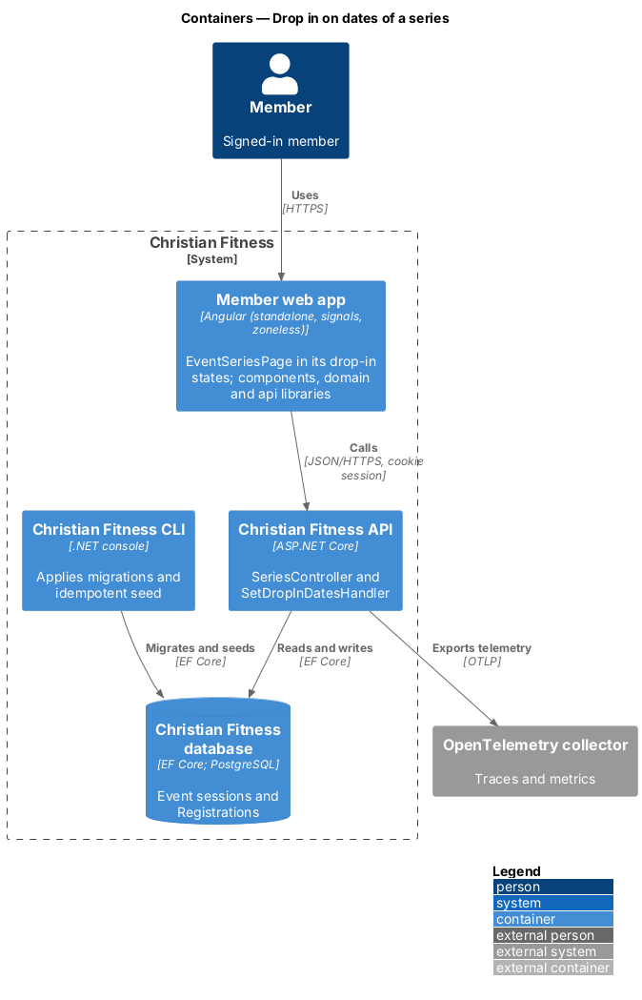
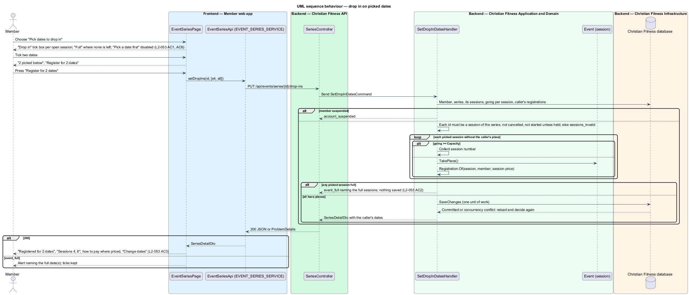

# Drop in on dates of a series

## Overview

Christian Fitness is a Christian community for health in body and spirit in the Greater Toronto Area. An _event_ is a gathering staff publish for members. The events subsystem lets a member find events and series, read their detail, and take a place within each one's capacity (`L1-005`).

- **event series** — program of dated sessions with one host, one place, one capacity and one group chat
- **session** — one dated meeting of a series, stored as an `Event` that carries the series' id and its number
- **drop-in** — registration at one session of a series by a member who did not join the series
- **drop-in price** — price of one session to a member who drops in, stored as the session event's `PriceCents`
- **open session** — session that has neither started nor been cancelled and has a place left

This feature covers the sign-up panel and the session list of the Event series screen when "Pick dates to drop in" is chosen (mocks `docs/mocks/pages/event-series/drop-in-none.html`, `drop-in.html`, `booked.html` and `full.html`). The member ticks dates in the session list and registers for all of them at once, then may change those dates. Each drop-in follows the event rules of `L2-011` and `L2-012`. There is no online payment: a priced drop-in is reserved and the panel says to pay the host in person (`docs/mocks/README.md`, "Series and paid").

**How a drop-in reuses `Event` and `Registration`.** A drop-in is an ordinary `Registration` at the session's `Event`, created with `Registration.Of(sessionId, memberId, session.PriceCents, now)`, so a priced date is `Reserved`. Capacity is the session's own `Capacity`, checked against its count of registrations, and `Event.TakePlace()` / `ReleasePlace()` bump its `RegistrationVersion` token (ADR 0033). A drop-in therefore competes for the same places as an enrolment (`join-and-leave-series`) and as a registration made from the session's Event detail screen.

## Description

The feature is a vertical slice from the session list's tick boxes to the database.

- **`EventSeriesPage`** — holds `picked` (a set of session ids) and `changingDates` as signals. With "Pick dates to drop in" chosen it gives each open session a "Drop in" tick box named "Drop in on <weekday>, <date>", and a session with no place left reads "Full" with no tick box (`L2-053` AC1, AC6). "Register for <n> date(s)" calls `setDropIns(id, picked)`. On success it shows the booked panel; on `event_full` it names the full date(s) in an `alert` and keeps the ticks; on any other failure it shows the generic message above a usable button. "Change dates" shows the tick boxes again with the held dates ticked; the button then sends the new set (`L2-053` AC3, AC4).
- **`SessionList`** — the `session-row` end slot holds the design system's `Checkbox` (block `check`) or the word "Full". Each tick box keeps a 44 × 44 px hit area.
- **`PlanOption`** — the drop-in option's note reads "Tick dates in the list" or "<n> picked below".
- **`dropInPickOf`** — pure helper in `domain/src/events/drop-in-pick.ts`. It gives the option's note, the button text ("Pick a date first", disabled, until one is ticked; then "Register for 1 date" or "Register for <n> dates"), and the booked panel's "Registered for <n> date(s)", "Sessions 4, 6" and the payment line from the drop-in price ("Pay $10 to the host at each session; online payment is not available yet."). It has a case table with one test per row.
- **`EventSeriesApi.setDropIns(id, sessionIds)`** — `HttpEventSeriesService` calls `PUT /api/events/series/{id}/drop-ins` with `{ sessionIds }` and answers the series as the caller now sees it.
- **`SeriesController.SetDropIns`** — sends one `SetDropInDatesCommand`.
- **`SetDropInDatesValidator`** — refuses ids that repeat, or more ids than the series has sessions, with 400 `validation_failed` and `fieldCodes.sessionIds` = `sessions_invalid`.
- **`SetDropInDatesCommand / SetDropInDatesHandler`** — the set is the whole of the member's drop-in dates after the change, so one command both adds and removes, all or none (`L2-053` AC2, AC4). The handler:
  - refuses a suspended member with 403 `account_suspended` and an unknown or unpublished series with 404 `series_not_found`;
  - refuses an id that is not a session of the series, or is cancelled or started, with 400 `validation_failed` and `fieldCodes.sessionIds` = `sessions_invalid`;
  - for each newly ticked session where the member holds no place, refuses the whole change if `going >= Capacity`, naming every full session; otherwise it calls `TakePlace()` and adds a `Registration`;
  - for each unticked session where the member holds a drop-in registration, refuses with 409 `event_started` once it has started (as `L2-012` AC2); otherwise it calls `ReleasePlace()` and removes the registration;
  - leaves untouched the registrations an enrolment holds; a joined member changes dates by leaving the series;
  - saves once; a `DbUpdateConcurrencyException` detaches or restores the changed rows, reloads and decides again (ADR 0033);
  - after saving, when the member holds no registration left at any session of the series, calls `IChatChannel.LeaveAsync` for the series chat (`L2-053` AC4). A first drop-in makes the member a member of the series chat (see `join-and-leave-series` on the chat key).
- **Refusal naming full dates** — the refusal is 409 ProblemDetails with code `event_full`, the code `L2-011` uses, and a `sessions` extension listing the full session numbers. The screen words them ("Session 6 filled up. Untick it and try again."). The extension's name and the copy are `<TO SUPPLY>` in an ADR.
- **Join after drop-ins** — `JoinSeriesHandler` keeps the drop-in registrations and adds the rest, with no second place at any session, since it skips sessions the member already holds and the unique (`EventId`, `MemberId`) index forbids a duplicate (`L2-053` AC5).

### Open questions

- No mock draws the `event_full` refusal of a drop-in naming a date, or the confirmation the member gives when unticking dates (`L2-053` AC4 says "confirms"). The design treats the panel's button as the confirmation; a mock state is needed for both before implementation.
- Resolved (#89): a joined member may untick single dates after the `L2-053` AC4 confirmation; dates still held read "Registered" in the list and unticked ones "Not going". The `booked` mock state needs these marks added.
- Whether a joined member may also untick single dates, rather than leave the whole series, is not stated; the design does not allow it.
- Payment copy for a priced drop-in follows the `booked` mock; the instructions themselves are `<TO SUPPLY>`, as for events (`register-for-event`).

## Requirements

The feature realizes the following level-2 (L2) requirements. Each L2 requirement refines a level-1 (L1) requirement, cited by identifier. The L2 specification states its requirements as acceptance criteria; the text below condenses those criteria faithfully.

| L2 ID    | Refines (L1) | Requirement |
| -------- | ------------ | ----------- |
| `L2-053` | `L1-005`     | With "Pick dates to drop in" chosen, every session still to come that is not cancelled and has a place left shall get a "Drop in" tick box named with its date; the option's note shall read "Tick dates in the list" or "<n> picked below"; the button shall read "Pick a date first" and be disabled until a date is ticked, then "Register for <n> date(s)". Pressing it shall register the member for each ticked session as `L2-011` states for an event (capacity, paid as reserved, suspended refused) and add them to the series' group chat; all dates shall be registered or none, and a date that filled meanwhile shall be named in the refusal. A registered member's panel shall read "Registered for <n> date(s)", list the session numbers, say how to pay where the drop-in has a price, and offer "Change dates", which shows the tick boxes with those dates ticked. Unticking a date that has not started and confirming shall cancel that registration as `L2-012` states; unticking every date shall leave the group chat. Choosing "Every session" later shall keep those registrations and add the rest, with no second place. A session with no place left shall read "Full" in words and have no tick box. |
| `L2-011` | `L1-005`     | A full event shall be refused with `event_full`; of two requests for the last place exactly one shall succeed; registering again shall create no second registration; a paid registration shall be reserved; a suspended member shall be refused with `account_suspended`. Each drop-in applies these rules to its session. |
| `L2-012` | `L1-005`     | A registration shall be removable before the event starts, lowering going by one; after the start it shall be refused with `event_started`. Unticking a date applies this rule to its session. |

## Diagrams

### System context

A member drops in on dates of a series in Christian Fitness. No payment provider is involved in this release.

### Containers

The Member web app puts the ticked dates to the Christian Fitness API, which adds and removes the session registrations in the database in one unit of work.

### Components

`SeriesController` sends `SetDropInDatesCommand`; `SetDropInDatesValidator` checks its shape and `SetDropInDatesHandler` changes the registrations, then leaves the series chat through `IChatChannel` when no date is left.

### Class structure

`SetDropInDatesHandler` adds and removes `Registration` rows at session `Event` rows and throws a refusal naming the full sessions. `EventSeriesPage` words the panel with `dropInPickOf`.

### Behaviour — drop in on picked dates

The member ticks two dates and registers; the handler registers both or, when one has filled, neither and names it.

### Behaviour — change drop-in dates

The member unticks a date; the handler removes that registration, refuses a date that has started, and leaves the series chat when no date is left.

