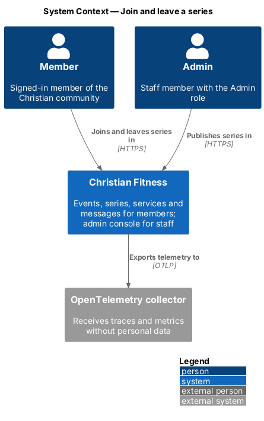
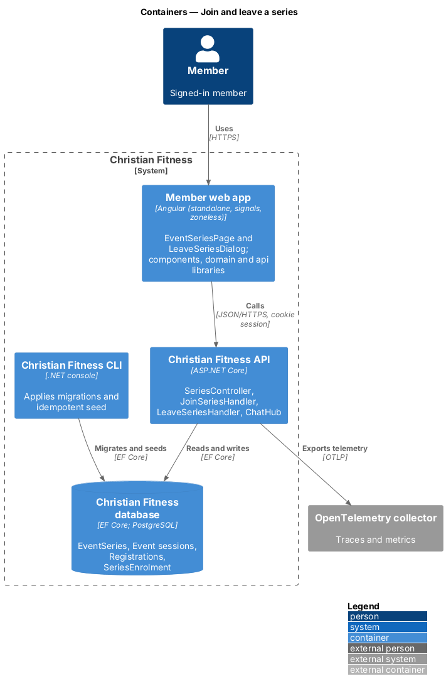
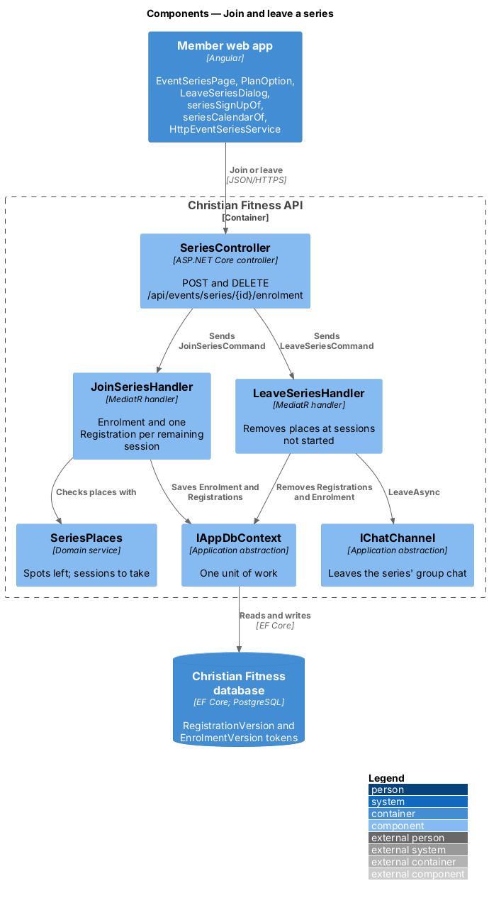
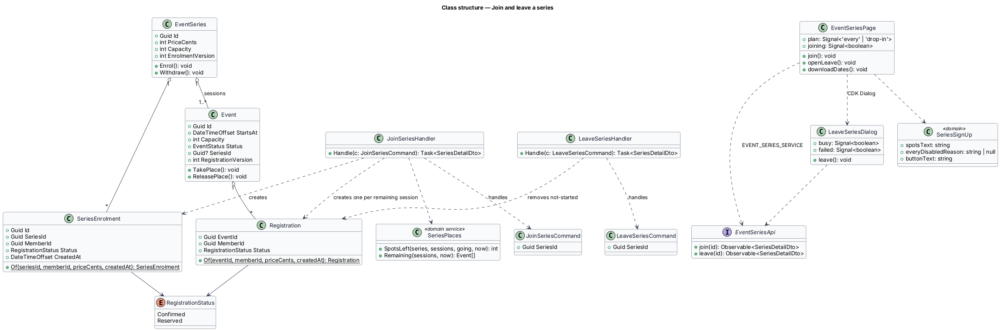
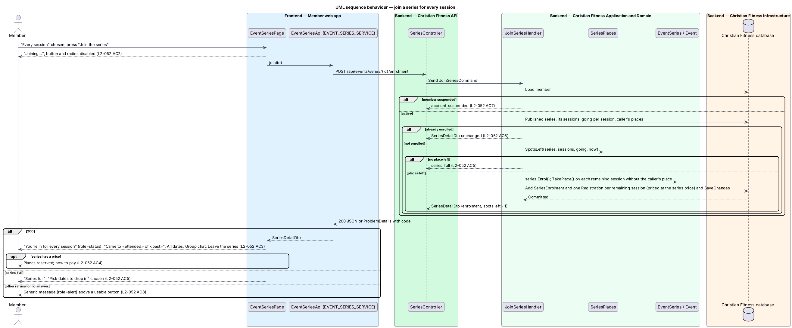
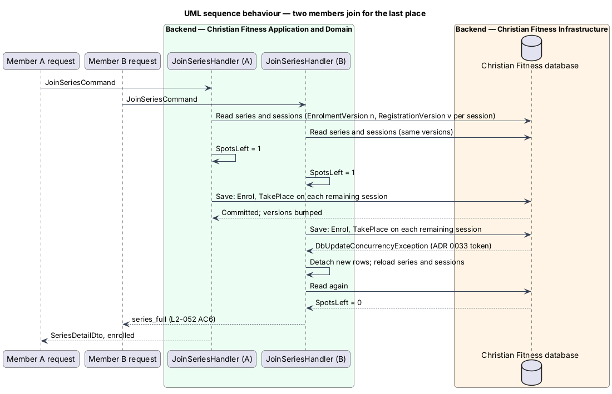
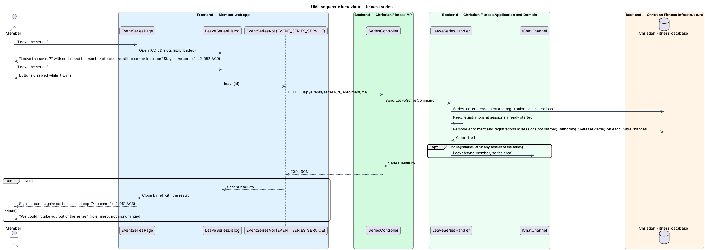

# Join and leave a series

## Overview

Christian Fitness is a Christian community for health in body and spirit in the Greater Toronto Area. An _event_ is a gathering staff publish for members. The events subsystem lets a member find events and series, read their detail, and take a place within each one's capacity (`L1-005`).

- **event series** — program of dated sessions with one host, one place, one capacity and one group chat
- **session** — one dated meeting of a series, stored as an `Event` that carries the series' id and its number
- **remaining session** — session of a series that has neither started nor been cancelled
- **enrolment** — record that a member joined a series and holds a place at each remaining session
- **spots left** — smallest number of places left among the remaining sessions
- **reserved place** — place at a paid series held pending payment made outside the system

This feature covers the sign-up panel of the Event series screen when "Every session" is chosen, and leaving a series (mocks `docs/mocks/pages/event-series/not-joined.html`, `joining.html`, `joined.html`, `default.html`, `failed.html`, `full.html`, and the dialog `docs/mocks/dialogs/leave-series/` in states `default`, `busy` and `failed`). Joining gives the member a place at every remaining session and adds them to the series' one group chat. Leaving gives back the places at sessions not started and keeps the history of sessions already attended. There is no waitlist and no online payment (`docs/mocks/README.md`, decisions "Series, full" and "Series and paid").

**How joining reuses `Event` and `Registration`.** Joining records one `SeriesEnrolment` and creates one ordinary `Registration` at each remaining session the member does not already hold. Each such registration is made with `Registration.Of(sessionId, memberId, series.PriceCents, now)`, so a paid series gives `Reserved` places and a free one `Confirmed` places, as `L2-011` AC5 does for an event. Each session's going count is the count of its registrations, so it rises by one with no counter of its own. Each touched session calls `Event.TakePlace()`, which bumps its `RegistrationVersion` concurrency token (ADR 0033), so a join racing another join or a drop-in for the last place cannot both commit. The unique index on (`EventId`, `MemberId`) keeps a second place from being created.

## Description

The feature is a vertical slice from the sign-up panel to the database.

- **`EventSeriesPage`** — routed page (see `view-event-series`). It holds `plan` (`'every' | 'drop-in'`, "Every session" by default) and `joining` as signals. "Join the series" calls `join(id)`, reads "Joining…" and disables the button and the radios while it waits (`L2-052` AC2). On success it replaces the series with the answer. On `series_full` it shows "Series full" and chooses "Pick dates to drop in"; on any other refusal or no answer it shows the generic message "We couldn't sign you up. Try again in a moment." (`role="alert"`) above a usable button (`L2-052` AC5, AC8). A suspended member's `account_suspended` gets the same generic message.
- **`PlanOption`** — new presentation component (`components/src/plan-option/`, block `plan-option`, design-system page `plan-option`) inside the design system's `radio-group`: a `fieldset` with a visually hidden legend "How would you like to come?" and two radio cards with title, note and price. A disabled option keeps its reason in its note ("Every place in the series is taken").
- **`SeriesCard`** — its panel form renders the joined state: "You're in for every session" (`role="status"`), `series-progress` with "Your progress" and "Came to <attended> of <past>" and a session meter, the buttons "All dates" and "Group chat", and "Leave the series" (`L2-052` AC3). For a paid series it states how to pay (`L2-052` AC4).
- **`seriesSignUpOf`** — pure helper in `domain/src/events/series-sign-up.ts`. From a `SeriesDetailDto` it gives "<left> of <capacity> spots left" or "Series full", "Every session (<remaining> left)" with "$64 for all 8" or "Free", the drop-in price ("$10 each"), the default plan and whether "Every session" is disabled and why (`L2-052` AC1, AC5). It has a case table with one test per row.
- **`seriesCalendarOf`** — pure helper in `domain/src/events/series-calendar.ts` that writes one iCalendar (RFC 5545) text with a `VEVENT` per remaining session, in UTC, with the series title and session topic escaped. "All dates" turns it into a `Blob`, downloads it through an object URL and revokes the URL at once (`L2-052` AC3). No endpoint is needed.
- **`LeaveSeriesDialog`** — new CDK Dialog in `projects/web/src/app/dialogs/leave-series/`, loaded with a dynamic `import()` on the first "Leave the series", with `EVENT_SERIES_SERVICE` passed from the page's injector. It reads "Leave the series?", the series and cadence, and "Your place at the <n> sessions still to come goes back to other members…" from `leaveSeriesTextOf`. Focus starts on "Stay in the series". While it waits both buttons are disabled; a failure shows "We couldn't take you out of the series" in an `alert` and changes nothing; success closes the dialog by its ref with the answer (`L2-052` AC9; ADR 0034 pattern).
- **`EventSeriesApi.join(id)` / `leave(id)`** — `HttpEventSeriesService` calls `POST /api/events/series/{id}/enrolment` and `DELETE /api/events/series/{id}/enrolment/me`; each answers the series as the caller now sees it.
- **`SeriesController.Join` / `Leave`** — each sends one command.
- **`JoinSeriesCommand / JoinSeriesHandler`** — refuses a suspended member with 403 `account_suspended` and an unknown or unpublished series with 404 `series_not_found`. An existing enrolment returns the series unchanged (`L2-052` AC6). Otherwise it asks `SeriesPlaces.SpotsLeft` and refuses 0 with 409 `series_full` (new `RefusalCodes` entry). It calls `EventSeries.Enrol()`, adds the `SeriesEnrolment` and one `Registration` per remaining session the member does not hold, calling `TakePlace()` on each, and saves in one unit of work. A `DbUpdateConcurrencyException` detaches the new rows, reloads, and decides again, as `RegisterForEventHandler` does (ADR 0033). Drop-in registrations the member already holds are kept (`L2-053` AC5).
- **`LeaveSeriesCommand / LeaveSeriesHandler`** — with no enrolment it returns the series unchanged. Otherwise it removes the enrolment and the caller's registrations at sessions not started, calls `ReleasePlace()` on each such session and `Withdraw()` on the series, and saves in one unit of work. Registrations at started sessions stay, so attended sessions remain in the member's history. When the member holds no registration left at any session of the series, it calls `IChatChannel.LeaveAsync` for the series chat.
- **`EventSeries.Enrol()` / `Withdraw()`** — bump `EnrolmentVersion`, a second concurrency token, so two joins race on the series as well as on its sessions.
- **`SeriesEnrolment.Of(seriesId, memberId, priceCents, now)`** — `Reserved` when the series price is above 0, else `Confirmed`.
- **Series group chat** — `L2-052` AC2 gives a series one group chat. Today a chat is keyed by an event id and a registration is the membership (`ChatMembership.SeatAsync`, ADR 0041). The design keys a session's chat by its `SeriesId`: the chat id of an event is `SeriesId ?? Id`, and a member holding any registration at any session of the series is a member of that chat. "Group chat" leads to `/events/series/{id}/chat`, served by the existing event chat page.

Telemetry records the route templates only; no member id, name or price enters a log, metric or span.

### Open questions

- Keying the group chat by `SeriesId` changes `ChatMessage.EventId`, `ChatReadMarker`, `ChatMembership` and `IChatChannel` from an event id to a chat id. This needs an ADR before the slice.
- Resolved (#89): a joined paid series reads "Pay the host at your first session, by cash or e-transfer. You won't be charged online." (mock `event-series/joined`).
- The "spots left" rule (smallest places left among remaining sessions, or capacity minus enrolments) needs an ADR; see `view-event-series`.
- `L2-052` AC9 keeps attended sessions in the history, which needs the attendance record that is `<TO SUPPLY>` (see `view-event-series`). "Came to <attended> of <past>" depends on it too.
- Resolved (#89): a date already dropped in for keeps its drop-in price and the remaining dates are at the series price; the join confirmation says so.
- The mock's "Join the waitlist" is replaced by "Series full" (`docs/mocks/README.md`); `series_full` refuses a join that arrives anyway.

## Requirements

The feature realizes the following level-2 (L2) requirements. Each L2 requirement refines a level-1 (L1) requirement, cited by identifier. The L2 specification states its requirements as acceptance criteria; the text below condenses those criteria faithfully.

| L2 ID    | Refines (L1) | Requirement |
| -------- | ------------ | ----------- |
| `L2-052` | `L1-005`     | For a series not joined with places left, the panel shall show "<left> of <capacity> spots left" and one radio group of "Every session (<remaining> left)" with the series price, chosen by default, and "Pick dates to drop in" with the drop-in price. "Join the series" shall give the member a place at every session still to come that is not cancelled, raise enrolment and each of those sessions' going by one, and add them to the series' one group chat; the button shall read "Joining…" and be disabled while it waits. A joined member's panel shall read "You're in for every session" (`role="status"`), "Your progress" with "Came to <attended> of <past>", "All dates" (one calendar file of every session to come), "Group chat" and "Leave the series". A priced series shall record the places as reserved and state how to pay; online payment is out of scope. A series with no place left shall read "Series full", "Every session" shall be unavailable with its reason and "Pick dates to drop in" chosen; there is no waitlist, and a join that arrives anyway shall be refused with `series_full`. Of two joins for the last place exactly one shall succeed and the other receive `series_full`; joining again shall create no second place. A suspended member shall be refused with `account_suspended`. Any other failure shall show a generic message (`role="alert"`) above a usable button. Leaving, confirmed in a dialog that names the series and how many sessions' places go back, shall remove the places at sessions not started, lower enrolment and those going counts by one and leave the group chat, keeping attended sessions in the history; focus starts on "Stay in the series", and a failure says so and changes nothing. When a session is cancelled, a joined member's place at it ends, it reads "Cancelled" and the other places stay. |
| `L2-011` | `L1-005`     | A paid registration shall be recorded as reserved; of two requests for the last place exactly one shall succeed; registering again shall create no second registration; a suspended member shall be refused with `account_suspended`. Joining applies these rules to each session's `Registration`. |
| `L2-037` | `L1-014`     | When a screen is left and destroyed, its subscriptions, timers, listeners and real-time handlers shall be released. The calendar file's object URL is revoked once the download starts. |

## Diagrams

### System context

A member joins and leaves series in Christian Fitness. No payment provider is involved in this release.

### Containers

The Member web app posts the join or the leave to the Christian Fitness API, which records the enrolment and the session registrations in the database in one unit of work.

### Components

`SeriesController` sends `JoinSeriesCommand` or `LeaveSeriesCommand`. `JoinSeriesHandler` checks places with `SeriesPlaces`; `LeaveSeriesHandler` takes the member out of the series chat through `IChatChannel` when no place is left.

### Class structure

`JoinSeriesHandler` creates one `SeriesEnrolment` and one `Registration` per remaining session `Event`; both carry a `RegistrationStatus`. `EventSeries` and `Event` each carry a concurrency token.

### Behaviour — join a series

The handler refuses a suspended member, returns an existing enrolment unchanged, refuses a full series, and otherwise records the enrolment and every remaining session's registration in one unit of work.

### Behaviour — two members join for the last place

Both requests see one spot left, but only one save commits; the other hits a concurrency token, reloads, finds no spot and returns `series_full`.

### Behaviour — leave a series

The member confirms in `LeaveSeriesDialog`; the handler removes the enrolment and the places at sessions not started, keeps those already started, and leaves the group chat when nothing is left.

