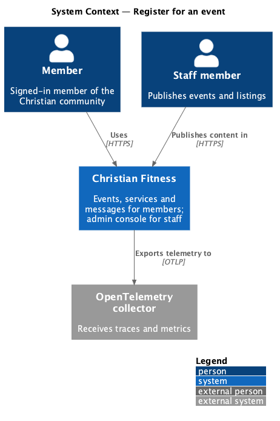
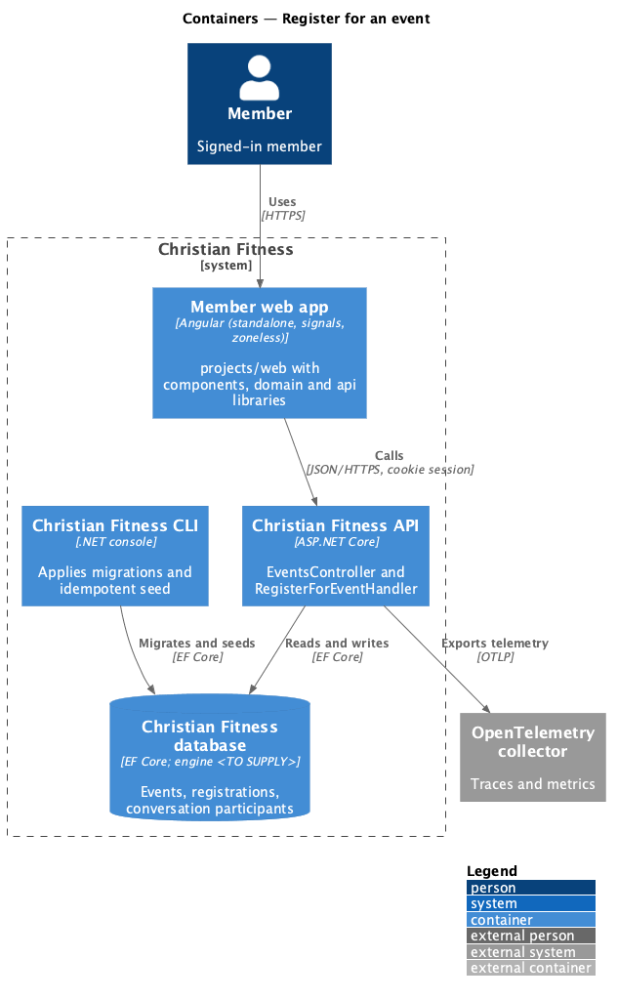
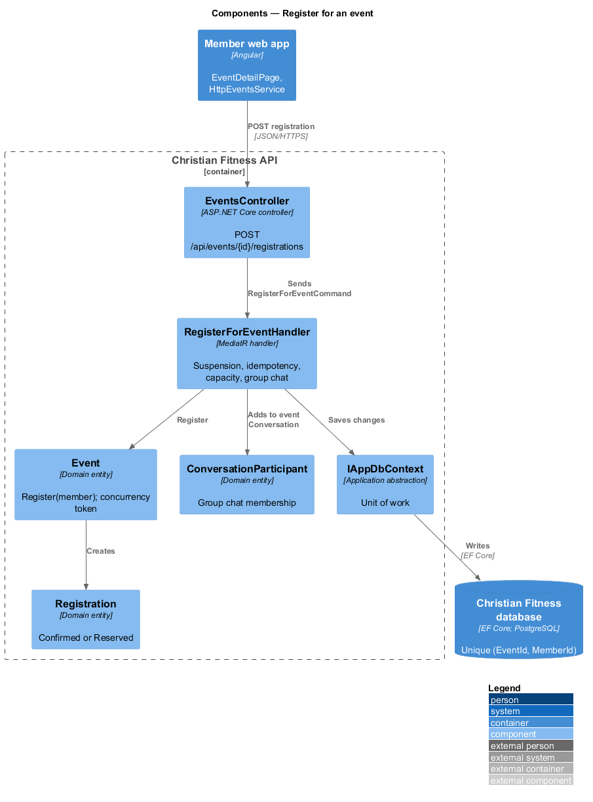
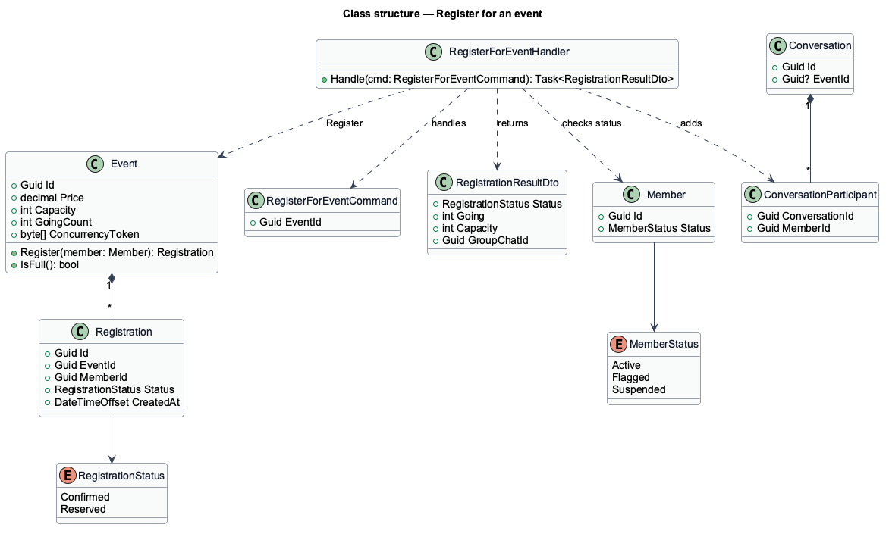
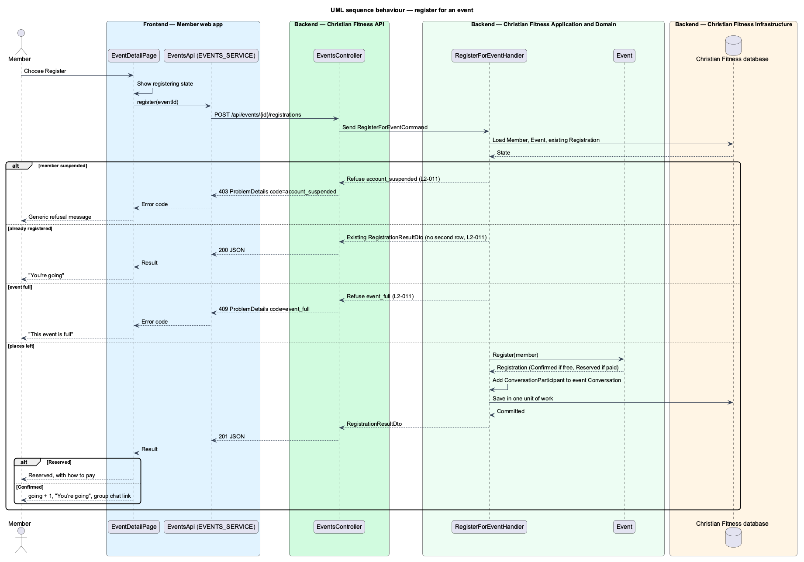
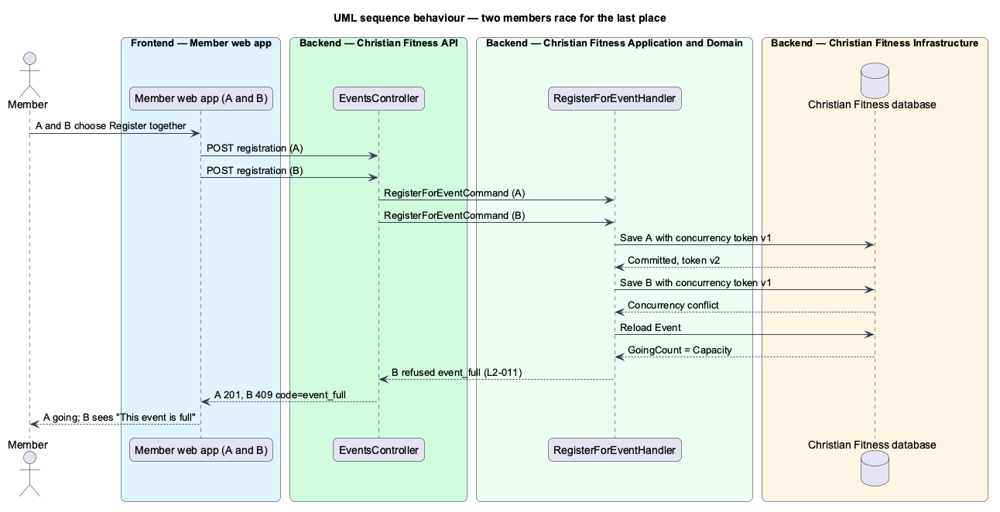

# Register for an event

## Overview

Christian Fitness is a Christian community for health in body and spirit in the Greater Toronto Area. An _event_ is a gathering staff publish for members: a run, workout, basketball game, mobility session, workshop or retreat. The events subsystem lets a member find events, read their detail, and register for or cancel a place within each event's capacity (`L1-005`).

- **published event** — event staff have made visible to members, neither draft nor cancelled
- **going** — count of current registrations for an event
- **capacity** — maximum number of registrations an event accepts

This feature covers registering from the Event detail screen (mock states `unregistered`, `registering`, `full` and `default` in `docs/mocks/pages/event-detail/`). A successful registration increases going by one and adds the member to the event's group chat. Capacity holds under concurrent requests: when two members take the last place at the same moment, exactly one succeeds. A paid event records a reserved registration and states how to pay; online payment is out of scope for this release.

- **registration** — record that one member holds a place at one event
- **reserved registration** — registration for a paid event that holds a place pending payment made outside the system

## Description

The feature is a vertical slice from the register action to the database.

- **`EventDetailPage`** — orchestrates the action: it calls `register(eventId)`, shows the `registering` busy state, then updates going, `isGoing` and the group chat link from the response. On `event_full` it shows "This event is full"; on `account_suspended` it shows a generic message. On a reserved registration it shows the payment instructions.
- **`EventsApi / EVENTS_SERVICE`** — `register(eventId)` returns a `RegistrationResultDto`.
- **`HttpEventsService`** — calls `POST /api/events/{id}/registrations`.
- **`EventsController`** — `POST /api/events/{id}/registrations` sends one `RegisterForEventCommand`.
- **`RegisterForEventHandler`** — loads the member and the event. It refuses a suspended member with `account_suspended`, returns the existing registration when one exists (idempotent), refuses with `event_full` when `GoingCount >= Capacity`, otherwise calls `Event.Register(member)`, adds a `ConversationParticipant` to the event's group `Conversation`, and saves in one unit of work.
- **`Event.Register`** — domain method. It increments `GoingCount` and creates a `Registration` with status `Confirmed` for a free event or `Reserved` for a paid event.
- **`Concurrency control`** — `Event` carries a concurrency token. When two saves race for the last place, the losing save raises a concurrency conflict; the handler reloads, re-checks capacity and returns `event_full`. A unique index on (`EventId`, `MemberId`) prevents a duplicate registration. The token is an integer `RegistrationVersion` bumped by `Event.TakePlace()` (ADR 0033).

### Open questions

- Slice 6.1 (ADR 0032) registers and shows "You're going"; the group chat membership and link wait for slices 12.x, "This event is full" on the page and the last-place race were slice 6.2 (ADR 0033: `Event.RegistrationVersion` is the concurrency token). Mock states `reserved` and `failed` now exist; the payment instructions are placeholder copy until the team supplies them.
- Payment instructions shown for a reserved registration are not specified; `<TO SUPPLY>`.
- The mock `docs/mocks/pages/event-detail/full.html` offers "Join the waitlist"; `L2-011` specifies only "This event is full" and no waitlist. The waitlist action is out of scope until a requirement states it.
- The mocks show no reserved (paid) state; a mock state is needed before implementation.

## Requirements

The feature realizes the following level-2 (L2) requirements. Each L2 requirement refines a level-1 (L1) requirement, cited by identifier. The L2 specification states its requirements as acceptance criteria; the text below condenses those criteria faithfully.

| L2 ID    | Refines (L1) | Requirement                                                                                                                                                                                                                                                                                                                                                                                                                                                                                                                                                                                                                                  |
| -------- | ------------ | -------------------------------------------------------------------------------------------------------------------------------------------------------------------------------------------------------------------------------------------------------------------------------------------------------------------------------------------------------------------------------------------------------------------------------------------------------------------------------------------------------------------------------------------------------------------------------------------------------------------------------------------- |
| `L2-011` | `L1-005`     | A member registering for a free event with places left shall be registered, going shall increase by one, and the member shall join the event's group chat. Registering for a full event shall be refused with code `event_full` and the page shall show "This event is full". When two members register for the last place at the same moment, exactly one shall succeed and the other shall receive `event_full`. Registering again shall not create a second registration. A paid event registration shall be recorded as reserved and the page shall state how to pay. A suspended member shall be refused with code `account_suspended`. |

## Diagrams

### System context

A member registers for an event in Christian Fitness. No payment provider is involved in this release.

### Containers

The Member web app posts the registration to the Christian Fitness API, which records it and the group chat membership in the database in one unit of work.

### Components

`EventsController` sends `RegisterForEventCommand`; the handler applies the rules through the `Event` entity and saves the `Registration` and `ConversationParticipant` together.

### Class structure

`RegisterForEventHandler` uses `Member` to check status, calls `Event.Register`, and adds a `ConversationParticipant`; `Registration` holds a `RegistrationStatus`.

### Behaviour — register for an event

The handler refuses a suspended member, returns an existing registration unchanged, refuses a full event, and otherwise records the registration and group chat membership in one unit of work.

### Behaviour — two members race for the last place

Both requests pass the capacity check, but only one save commits; the other hits the concurrency token, reloads, finds the event full and returns `event_full`.

