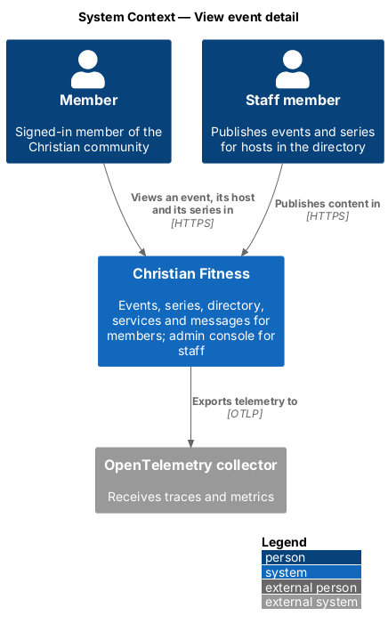
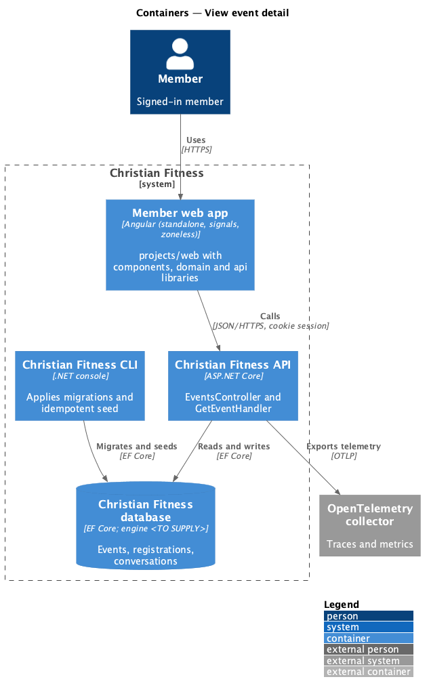
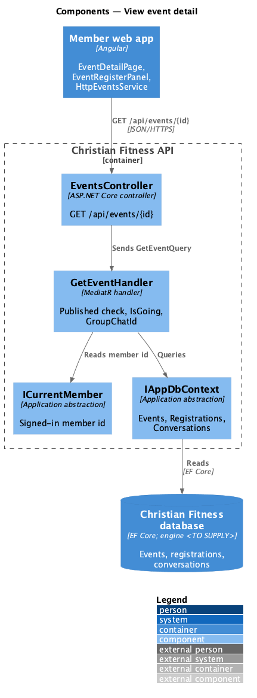
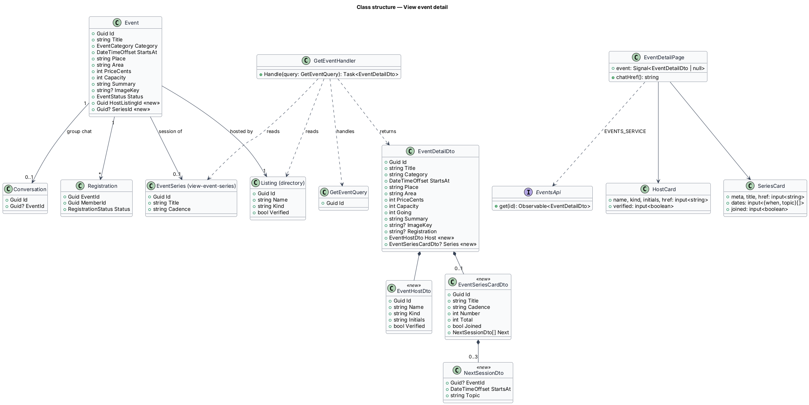

# View event detail

## Overview

Christian Fitness is a Christian community for health in body and spirit in the Greater Toronto Area. An _event_ is a gathering staff publish for members: a run, workout, basketball game, mobility session, workshop or retreat. The events subsystem lets a member find events, read their detail, and register for or cancel a place within each event's capacity (`L1-005`).

- **published event** — event staff have made visible to members, neither draft nor cancelled
- **going** — count of current registrations for an event
- **capacity** — maximum number of registrations an event accepts

This feature covers the Event detail screen (mock `docs/mocks/pages/event-detail/`). It shows one published event in full and the member's registration state. When the member is registered, the screen shows "You're going" and a link to the event's group chat. An unknown or unpublished event id shows the not-found view (mock `docs/mocks/pages/not-found/`).

- **event group chat** — `Conversation` tied to one event whose participants are the event's registered members

## Description

The feature is a vertical slice from the Event detail screen to the database.

- **`EventDetailPage`** — routed page component at `/events/:id`, loaded with `loadComponent`. It renders the `back-link`, `facts`, `prose`, `schedule` and `sticky-aside` blocks, the `register` action, and the loading and error states. On code `event_not_found` it shows the not-found view. The event image loads below the fold with `@defer` where it is not first visible.
- **`EventRegisterPanel`** — presentation component (block `register`). It takes `going`, `capacity`, `price`, `isGoing` and `groupChatId` inputs and emits `register` and `cancel` outputs; when `isGoing` it shows "You're going" and a group chat link.
- **`EventsApi / EVENTS_SERVICE`** — `getEvent(id)` returns an `EventDetailDto`.
- **`HttpEventsService`** — calls `GET /api/events/{id}`.
- **`EventsController`** — `GET /api/events/{id}` sends one `GetEventQuery`.
- **`GetEventQuery / GetEventHandler`** — loads the event where `Status == Published`, computes `IsGoing` and `GroupChatId` for the current member, and returns `EventDetailDto`. A missing or unpublished event yields ProblemDetails 404 with code `event_not_found`.
- **`Event, Registration, Conversation`** — domain entities: the event, the member's registration, and the event's group conversation.

### Open questions

- The error code for a missing or unpublished event is `event_not_found` (ADR 0031).
- A past published event stays viewable (ADR 0031).
- Slice 5.1 builds the read-only screen; the registration action and the "You're going" state arrive with slice 6.1 (ADR 0031).

## Requirements

The feature realizes the following level-2 (L2) requirements. Each L2 requirement refines a level-1 (L1) requirement, cited by identifier. The L2 specification states its requirements as acceptance criteria; the text below condenses those criteria faithfully.

| L2 ID    | Refines (L1) | Requirement                                                                                                                                                                                                                                                                                                                           |
| -------- | ------------ | ------------------------------------------------------------------------------------------------------------------------------------------------------------------------------------------------------------------------------------------------------------------------------------------------------------------------------------- |
| `L2-010` | `L1-005`     | A published event shall show image, title, category, date and time, place and area, price, summary, going/capacity and the registration action. An event id that does not exist or is not published shall show a not-found view. A registered member viewing the event shall see "You're going" and a link to the event's group chat. |

## Diagrams

### System context

A member views an event in Christian Fitness; staff publish the event content.

### Containers

The Member web app loads one event from the Christian Fitness API, which reads it and the member's registration from the database.

### Components

`EventsController` sends `GetEventQuery`; `GetEventHandler` reads the event, the member's `Registration` and the event's `Conversation` through `IAppDbContext`.

### Class structure

`GetEventHandler` returns an `EventDetailDto` built from `Event`, the member's `Registration` and the event's group `Conversation`.

### Behaviour — view an event

The handler returns the event only when published and adds the member's registration state; an unknown or unpublished id returns `event_not_found`, and the page shows the not-found view.

