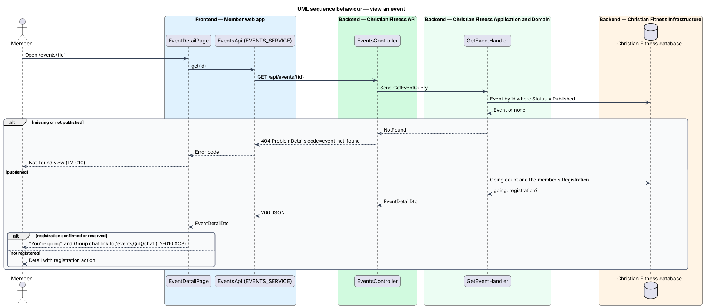
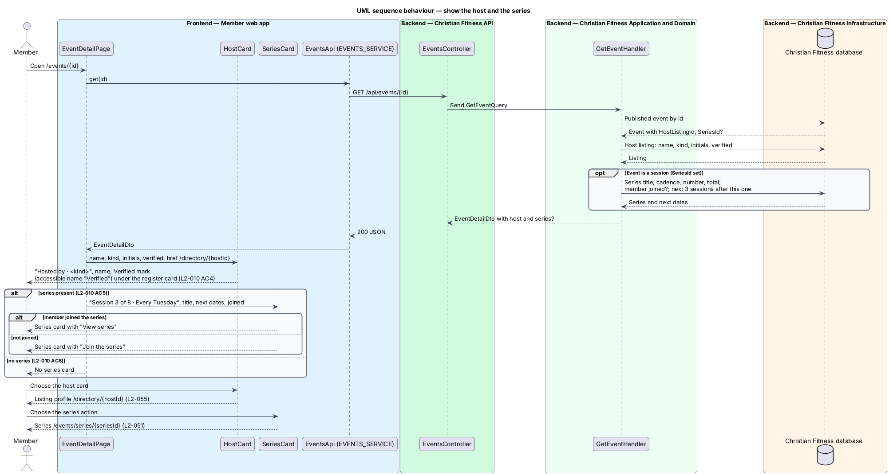

# View event detail

## Overview

Christian Fitness is a Christian community for health in body and spirit in the Greater Toronto Area. An _event_ is a gathering a host runs for members: a run, workout, basketball game, mobility session, workshop or retreat. The events subsystem lets a member find events and series, read their detail, and register for or cancel a place within each event's capacity (`L1-005`).

- **published event** — event staff have made visible to members, neither draft nor cancelled
- **going** — count of current registrations for an event
- **capacity** — maximum number of registrations an event accepts
- **host** — directory listing that runs an event, shown with its mark, kind and name
- **listing mark** — square of a listing's initials that stands for it where no picture is shown
- **verified** — state of a listing the team has checked, shown as a mark with the word "Verified" as its accessible name
- **series** — program of dated sessions with one host, one place and one group chat (`L2-050`)
- **session** — one dated occurrence of a series; a session with an event page is also an event
- **cadence** — words that say how often a series meets, such as "Every Tuesday"

This feature covers the Event detail screen (mock `docs/mocks/pages/event-detail/`). It shows one published event in full and the member's registration state. When the member is registered, the screen shows "You're going" and a link to the event's group chat. An unknown or unpublished event id shows the not-found view (mock `docs/mocks/pages/not-found/`).

Every event shows who hosts it: a "Hosted by" card under the registration panel leads to the host's profile ([view a listing profile](../../directory/view-listing-profile/README.md); `L2-010` AC4). An event that is a session of a series also shows a series card in the main column: "Session <n> of <total> · <cadence>", the series title, up to the next three sessions after this one, and one action to the series ([view an event series](../view-event-series/README.md); `L2-010` AC5; mock `session.html`). An event outside a series shows no series card (`L2-010` AC6).

- **event group chat** — `Conversation` tied to one event whose participants are the event's registered members

## Description

The feature is a vertical slice from the Event detail screen to the database.

- **`EventDetailPage`** — routed page component at `/events/:id` in `projects/web` (`pages/event-detail/event-detail-page.ts`), loaded with `loadComponent`, with `EVENTS_SERVICE` bound to `HttpEventsService` on its `providers`. It renders the `back-link`, the banner image, `facts`, `prose` and `schedule` blocks, and the `sticky-aside` with the registration card (`register` block), and the loading, error and not-found states. On code `event_not_found` it shows the not-found view. The registration state comes from `registration` (`confirmed`, `reserved` or none); "Group chat" links to `/events/:id/chat`. The design adds:
  - the series card between `facts` and "About", only when `series` is present (`L2-010` AC5, AC6);
  - the host card after the registration card inside `sticky-aside` (`L2-010` AC4).
- **`HostCard`** — presentation component in the `components` library for the mock's `host-card` block, a link to the host's profile. Inputs: `name`, `kind`, `initials`, `verified` and `href`; it renders the listing mark, "Hosted by · <kind>", the name as text and, when `verified`, the verified mark (`role="img"`, `aria-label="Verified"`). It has no design-system page; it is a composite of the library's listing mark and verified mark, which [view a listing profile](../../directory/view-listing-profile/README.md) and [browse the directory](../../directory/browse-directory/README.md) also use, so each is built once.
- **`SeriesCard`** — presentation component in the `components` library for the mock's `series-card` block, a `section` labelled by its title. Inputs: `meta` (the worded "Session <n> of <total> · <cadence>"), `title`, `dates` (at most three of `{ when, topic }`), `joined` and `href`. Its one action is the library's secondary `Button` as a link: "View series" when `joined`, "Join the series" when not; both lead to `/events/series/<id>` (`L2-010` AC5). Titles and topics are rendered as text.
- **`sessionLineOf`** — the `domain` helper shared with [browse and filter events](../browse-events/README.md) that words "Session <n> of <total> · <cadence>"; a second helper words each next date ("Tue Apr 28") in Toronto time.
- **`EventsApi / EVENTS_SERVICE`** — `get(id)` returns an `EventDetailDto`.
- **`HttpEventsService`** — calls `GET /api/events/{id}`.
- **`EventsController`** — `GET /api/events/{id}` sends one `GetEventQuery`.
- **`GetEventQuery / GetEventHandler`** — loads the event where `Status == Published`, reads the going count through `IRegistrationReader` and the caller's registration, and returns `EventDetailDto`. A missing or unpublished event yields ProblemDetails 404 with code `event_not_found`. The design extends the handler to read, in the same request:
  - the host listing by `Event.HostListingId`: id, name, kind, initials and whether it is verified;
  - for a session, its series: id, title, cadence, this session's number, the session total, whether the caller has joined the series, and the next three sessions that start after this one, in date order, each with its date and topic.
- **`EventDetailDto`** — today `id`, `title`, `category`, `startsAt`, `place`, `area`, `priceCents`, `capacity`, `going`, `summary`, `imageKey` and `registration`. It gains:
  - `host: { id, name, kind, initials, verified }`, always present (`L2-010` AC4);
  - `series: { id, title, cadence, number, total, joined, next: [{ eventId?, startsAt, topic }] }`, null outside a series (`L2-010` AC5, AC6). `next` holds at most three items; `number` and `total` are numbers. `SeriesSessionDto` of the list is a subset of this shape, so the list and the detail word the line with the same helper.
- **`Event, Registration, Conversation`** — domain entities: the event, the member's registration, and the event's group conversation. `Event` gains `HostListingId` and an optional `SeriesId` ([browse and filter events](../browse-events/README.md)); the listing entity belongs to the directory designs, and the series, its sessions, topics and memberships to [view an event series](../view-event-series/README.md).

### Open questions

- Settled in ADR 0031: the error code for a missing or unpublished event is `event_not_found`, and a past published event stays viewable.
- **Which sessions are "next".** The mock lists Apr 28, May 5 and May 19 after the Apr 21 session, leaving out May 12. The design reads that as cancelled sessions being skipped; `L2-010` AC5 says only "upcoming sessions". Whether a cancelled date is skipped or shown as "Cancelled" is `<TO SUPPLY>` by [view an event series](../view-event-series/README.md).
- **Session with no event page.** `L2-050` says each session that has an event page is also listed as an event. A next date with no event page is shown as text; `eventId` is optional for that reason. Whether such a date links anywhere is `<TO SUPPLY>`.
- **Host of older events.** Every event needs a host for `L2-010` AC4. Events created before the directory existed have none; the migration (a seeded team listing, as the mock's "Christian Fitness" host card suggests) is `<TO SUPPLY>` and shared with [browse and filter events](../browse-events/README.md).
- **Registration wording.** `L2-010` AC3 and the page say "You're going"; the mocks `default.html` and `session.html` now read "You're registered". The requirement or the mock should change so that the two agree.
- **Card components.** Neither `host-card` nor `series-card` has a page in `docs/design-system/components/`. The design builds them as composites of library parts; if the design system later adds them, the components move under those names.
- **Code behind the requirement.** `EventDetailDto` has no host or series, `GetEventHandler` reads neither, and the page renders neither card. Each is work for the next slices, after the directory's listings and the series exist.

## Requirements

The feature realizes the following level-2 (L2) requirements. Each L2 requirement refines a level-1 (L1) requirement, cited by identifier. The L2 specification states its requirements as acceptance criteria; the text below condenses those criteria faithfully.

| L2 ID    | Refines (L1) | Requirement |
| -------- | ------------ | ----------- |
| `L2-010` | `L1-005`     | A published event shall show image, title, category, date and time, place and area, price, summary, going/capacity and the registration action. An event id that does not exist or is not published shall show a not-found view. A registered member viewing the event shall see "You're going" and a link to the event's group chat. Any event shall show, under the registration panel, a "Hosted by" card with the host listing's mark, kind, name and, where it is verified, a Verified mark with that word as its accessible name, leading to the listing's profile. An event that is a session of a series shall show a series card with "Session <n> of <total> · <cadence>", the series title, up to the next three upcoming sessions after this one with date and topic, and one action leading to the series: "View series" when the member has joined it, "Join the series" when not. An event in no series shall show no series card (acceptance criteria 1–6). |

## Diagrams

### System context

A member views an event in Christian Fitness; staff publish the event for a host listed in the directory.

### Containers

The Member web app loads one event from the Christian Fitness API, which reads it, its host, its series and the member's registration from the database.

### Components

`EventsController` sends `GetEventQuery`; `GetEventHandler` reads the event, its host listing, its series and the member's `Registration` through `IAppDbContext`. The page renders `HostCard` and, for a session, `SeriesCard`.

### Class structure

`GetEventHandler` returns an `EventDetailDto` built from `Event`, its host listing, its series and the member's `Registration`; the page passes the host and series parts to `HostCard` and `SeriesCard`.

### Behaviour — view an event

The handler returns the event only when published and adds the member's registration state; an unknown or unpublished id returns `event_not_found`, and the page shows the not-found view.

### Behaviour — show the host and the series

Every event carries its host, and the page shows the "Hosted by" card under the registration panel. A session also carries its series; the page shows the series card with the next three dates and "View series" or "Join the series" (`L2-010` AC4–AC6).

