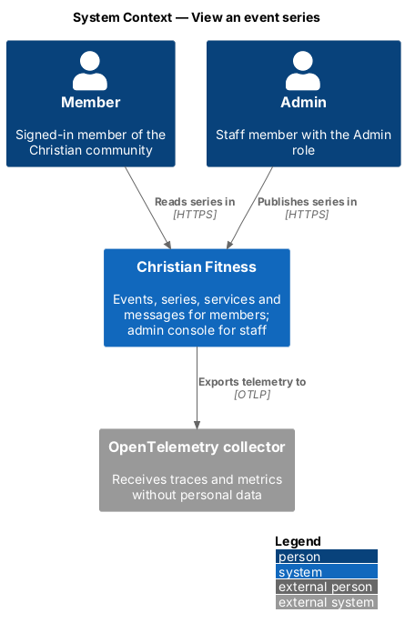
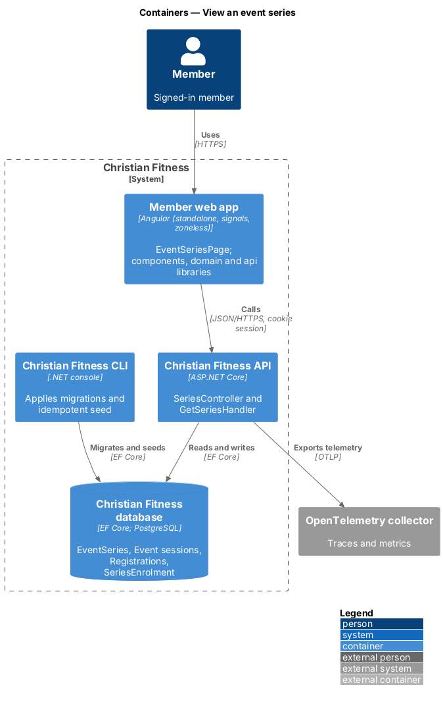
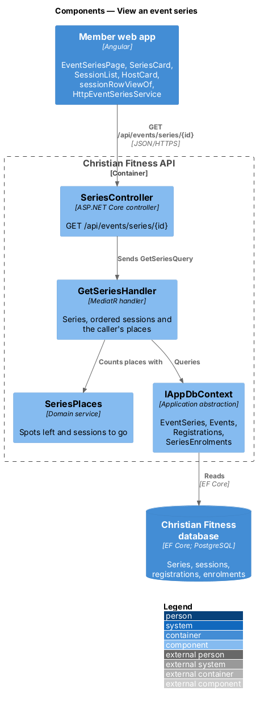
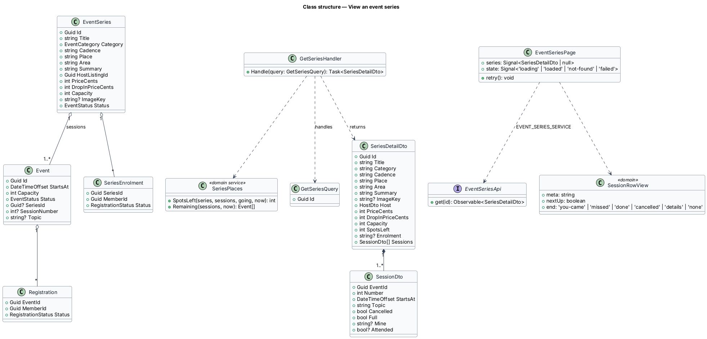
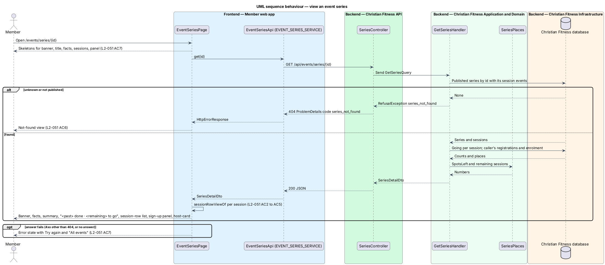

# View an event series

## Overview

Christian Fitness is a Christian community for health in body and spirit in the Greater Toronto Area. An _event_ is a gathering staff publish for members. The events subsystem lets a member find events and series, read their detail, and take a place within each one's capacity (`L1-005`).

- **event series** — program of dated sessions with one host, one place, one capacity and one group chat, such as eight Tuesdays of Couch to 5K
- **session** — one dated meeting of a series, stored as an `Event` that carries the series' id, its number and its topic
- **enrolment** — record that a member joined a series and holds a place at each of its sessions still to come
- **drop-in** — registration at one session of a series by a member who did not join the series
- **next session** — earliest session that is neither started nor cancelled

This feature covers the Event series screen at `/events/series/<id>` in the Member web app (mocks `docs/mocks/pages/event-series/default.html`, `loading.html` and `error.html`; the sign-up panel's states belong to `join-and-leave-series` and `drop-in-on-series-dates`). The screen shows the series' banner, facts, summary, ordered sessions with each one's state for the member, the sign-up panel and the "Hosted by" card.

**How a series relates to existing types.** A series is an `EventSeries` row; each session is an ordinary `Event` with `SeriesId`, `SessionNumber` and `Topic` set (see `browse-event-series`). A member's place at a session is an ordinary `Registration` at that event. The screen's "Details" link on a session therefore opens the existing Event detail screen (`L2-010`) for that event id.

## Description

The feature is a vertical slice from the Event series screen to the database.

- **`EventSeriesPage`** — new routed page in `projects/web/src/app/pages/event-series/`, at route `events/series/:id` with `loadComponent` and the title "Event series". It binds `EVENT_SERIES_SERVICE` to `HttpEventSeriesService` on its own `providers`. It holds the series and a `'loading' | 'loaded' | 'not-found' | 'failed'` state as signals. It shows skeletons for banner, title, facts, sessions and panel while loading; the existing not-found view on 404 `series_not_found`; and an error state with Try again and a back link to all events on any other failure (`L2-051` AC6, AC7). A 5xx opens the server-error screen, as on Event detail.
- **Layout** — the page uses the `split split--detail` layout with a `sticky-aside`: from LG the sign-up panel and host card sit beside the sessions and stay in view; below LG they follow the sessions in one column (`L2-051` AC8). This is a stylesheet rule, with no script.
- **`SessionList`** — new presentation component (`components/src/session-list/`, design-system page `session-list`). It renders the `session-list` ordered list of `session-row` items: date tile, "Session <n> · <weekday>" with the full date visually hidden, the topic, and an end slot. Modifiers `session-row--past`, `--next` and `--cancelled` style the row; each state also carries words ("Next up", "Done", "You came", "Missed", "Cancelled"), so colour never carries it alone. The end slot is content-projected and declared once.
- **`SeriesCard`** — new presentation component; this screen uses its panel and `series-progress` forms (see `join-and-leave-series`).
- **`HostCard`** — presentation component of design-system page `host-card` (block `host-card`, with `listing-mark` and `verified-mark`), shared with Event detail (`L2-010` AC4). It leads to the host's listing profile (`L2-055`).
- **`sessionRowViewOf`** — pure helper in `domain/src/events/session-row-view.ts`. From a `SessionDto`, the member's places and the current time it gives the row's modifier, "Next up", and the end: "You came" or "Missed" for a past session where the member held a place and staff recorded attendance, "Not recorded" where they did not, "Done" for a past session where they held none, "Cancelled" for a cancelled one, "Details" for a session still to come when the member is not picking dates, or nothing (`L2-051` AC2 to AC5). The helper carries a case table with one unit test per row.
- **`seriesHeadOf`** — pure helper giving "<category> series · <n> sessions", the cadence and time, the date range and "<past> done · <remaining> to go". Cancelled sessions count in neither "done" nor "to go" (`L2-051` AC4).
- **`EventSeriesApi.get(id)`** — returns a `SeriesDetailDto`. `HttpEventSeriesService` calls `GET /api/events/series/{id}`.
- **`SeriesController.Get`** — sends one `GetSeriesQuery`.
- **`GetSeriesQuery / GetSeriesHandler`** — loads the published `EventSeries` and its session events ordered by `SessionNumber`. An unknown or unpublished id is refused with 404 `series_not_found` (a new `RefusalCodes` entry, by analogy with `event_not_found`). It counts going per session in one query (`IRegistrationReader.GoingForAsync`), reads the caller's `Registration` rows at the sessions and the caller's `SeriesEnrolment`, and asks `SeriesPlaces` for spots left. It returns each session's number, start, topic, `Cancelled`, `Full`, the caller's place (`series`, `drop-in` or none) and `Attended`.
- **`SeriesPlaces`** — new domain service in `Domain/Events/`. `Remaining(sessions, now)` gives the sessions neither started nor cancelled. `SpotsLeft(series, sessions, going, now)` gives the smallest `Capacity − going` among them, so a member who joins holds a place at each one. A rule computed in both stacks shares one case table in both suites.
- **`SeriesDetailDto`** — the series' fields, `Host` (name, kind, mark, verified), `PriceCents`, `DropInPriceCents`, `Capacity`, `SpotsLeft`, the caller's `Enrolment` (`confirmed`, `reserved` or none) and `Sessions`. Money is served in cents and counts as numbers (AGENTS.md, Contracts).

The page binds its service on its own providers, so the request and the series are released when the member leaves (`L2-037`).

### Open questions

- Attendance is recorded by staff in the console (`L2-075`, design `admin-events/record-attendance`). `SessionDto.Attended` is `true`, `false` or `null` (not recorded); `null` reads "Not recorded" in the row, never "Missed" (`L2-051` AC3). Self check-in is deferred.
- The mocks show "Details" only on the next session, while `L2-051` AC5 gives it to every session still to come that has an event page. The design stores every session as an `Event`, so every session to come shows "Details"; see `browse-event-series` for the open rule on which sessions have event pages.
- "Spots left" is defined here as the smallest number of places left among the remaining sessions. The mocks' numbers (12 of 50 for Saturday Park Bootcamp, 38 going) agree with this and with "capacity minus enrolments" alike. The rule needs an ADR.
- The route `/events/series/:id` sits beside `/events/:id`; both are lazy children of the member shell, and the extra segment keeps them apart.
- `docs/mocks/pages/event-series/` has no `empty` state by design: a missing series is the not-found view (manifest).

## Requirements

The feature realizes the following level-2 (L2) requirements. Each L2 requirement refines a level-1 (L1) requirement, cited by identifier. The L2 specification states its requirements as acceptance criteria; the text below condenses those criteria faithfully.

| L2 ID    | Refines (L1) | Requirement |
| -------- | ------------ | ----------- |
| `L2-051` | `L1-005`     | Opening `/events/series/<id>` for a published series shall show image, "<category> series · <n> sessions", title, cadence and time, date range, place and area, summary, the sessions, the sign-up panel and a "Hosted by" card leading to the host's profile. The sessions shall be an ordered list in date order, each with date, "Session <n> · <weekday>" and topic, under "<past> done · <remaining> to go", the next marked "Next up" in words. A past session shall read "You came" or "Missed" to a member who held a place where staff recorded attendance, "Not recorded" where none is recorded, and "Done" to one who held none. A cancelled session shall read "Cancelled" with its topic struck through, cannot be picked and counts in neither "done" nor "to go". A session still to come with an event page shall offer "Details" to a member not picking dates. An unknown or unpublished id shall show the not-found view. Loading shall show skeletons for banner, title, facts, sessions and panel; a failure shall offer Try again and a way back to all events. From LG the panel and host card shall sit beside the sessions and stay in view; below LG they follow in one column. |
| `L2-037` | `L1-014`     | When a screen is left and destroyed, its subscriptions, timers, listeners and real-time handlers shall be released; after 50 moves between screens the heap shall return to within 10% of its level after the first visit. |

## Diagrams

### System context

A member reads a series in Christian Fitness; staff publish it.

### Containers

The Member web app asks the Christian Fitness API for one series; the API reads the series, its session events, their registrations and the caller's enrolment from the database.

### Components

`SeriesController` sends `GetSeriesQuery`; `GetSeriesHandler` reads through `IAppDbContext` and counts places with `SeriesPlaces`.

### Class structure

`GetSeriesHandler` returns a `SeriesDetailDto` of `SessionDto` items built from the series' `Event` rows and their `Registration` rows. `EventSeriesPage` words each row with `sessionRowViewOf`.

### Behaviour — open a series

The page shows skeletons, asks for the series, and shows the not-found view, the error state or the series with each session's state for the member.

