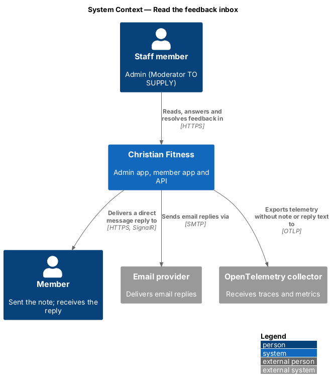

# Read the feedback inbox

## Overview

Christian Fitness is a Christian community for health in body and spirit in the Greater Toronto Area. The feedback subsystem lets members send the team ideas, problems, corrections and thanks, and lets staff read, answer and resolve each one (`L1-020`).

This feature covers the staff side: the Feedback screen of the admin console (mock `docs/mocks/pages/admin-feedback/`, states `default`, `loading`, `empty`, `error`, `correction`, `replying`, `replied`, `resolved`). Staff list every note newest first, filter by status, open one note in full, reply to the member and mark the note resolved or reopen it. Notes come from [send feedback](../send-feedback/README.md).

- **status** — where a note stands: New until staff act on it, Replied once a reply has gone, Resolved once staff mark it so; Reopen makes a Resolved note New again
- **reply** — staff's answer to the member who sent a note, delivered by email when the member allowed it and otherwise as a direct message from Christian Fitness
- **Christian Fitness sender** — account in whose name the system sends direct messages to members (shared with `L2-062` AC9)
- **New count** — number of notes with status New, shown on the navigation's Feedback link

## Description

### Admin web app

- **Route `/feedback`** — a child of the admin shell behind the staff guard, `loadComponent` `AdminFeedbackPage`, title "Feedback · Christian Fitness Admin". `ADMIN_FEEDBACK_SERVICE` is bound to `HttpAdminFeedbackService` on the page's `providers`.
- **Navigation** — the admin shell's `sidebar-navigation` gains Feedback in its Community group with `admin-nav__count` carrying the New count, and its accessible name in words ("2 new notes") (AC1). `ADMIN_AREAS` in `@cf/domain` gains a `feedback` area. The count's source is shared with the navigation design ([navigate the admin app](../../admin-access/navigate-admin-app/README.md)); this feature answers it from `GET /api/admin/feedback/counts`.
- **`AdminFeedbackPage`** — composes library components only: `tabs` (All, New, Replied, Resolved, each with its count; the chosen tab `aria-current="page"`), a list of `feedback-row`s, and the `feedback-row` component's detail part with the `description-list` facts, `textarea` "Reply to <first name>", and `button`s "Send reply", "Mark resolved" or "Reopen". It keeps the chosen note in the address (`/feedback?status=new&note=<id>`). At LG and wider the list and the note sit side by side; below LG the list comes first and the note follows in one column with no horizontal scroll (AC10). It shows `skeleton`s while loading, an `empty-state` "No feedback yet" saying notes come from "Send feedback" and a story's "Send a correction", "Nothing here." in an empty tab, and an error state with Try again (AC2, AC9).
- **`FeedbackRow`** — presentation component under its design-system name (`components/src/feedback-row/`). Inputs: kind, sender name, time, excerpt, status, current. A New note shows its sender in bold and its status in words (AC1). All member text is bound as text, never `innerHTML` (AC8).
- **`FeedbackInbox`** — pure helper in `domain/src/feedback/` with unit tests: the kind's icon and name, the reply hint for each kind (for example "Let them know we can reproduce it and when to expect a fix" for a problem), the first name for "Reply to <first name>", and the reply rule (an empty reply is not sent and the box says to write one; AC5).
- **Reply and status** — Send reply reads "Sending…" with the reply read-only (mock `replying`); success empties the box, marks the note Replied and shows a `toast` (mock `replied`); Mark resolved and Reopen change the status in place (mock `resolved`). A failure shows an `alert`, keeps the reply and leaves the status (AC7).
- **Correction** — for a correction about a story, "Open the story to correct it" uses the stored stable story id to lead an Admin to that story in the editor, even if its public slug changes (`L2-069`, mock `correction`, [ADR 0071](../../../adr/0071-addresses-and-slugs.md)) (AC4).
- **Screenshot** — shown as an `img` whose `src` is the staff-only screenshot address (AC3, AC8).
- **`AdminFeedbackApi` / `ADMIN_FEEDBACK_SERVICE`** — contract and token in `api/src/admin/admin-feedback.ts`: `list(status, cursor?)`, `note(id)`, `counts()`, `reply(id, text)`, `resolve(id)`, `reopen(id)`.

### Christian Fitness API

- **`AdminFeedbackController`** — routed at `api/admin/feedback`, so the staff area policy applies ([ADR 0020](../../../adr/0020-staff-roles-by-area.md)). `AuthenticationSetup.AreaSegments` gains `["feedback"] = StaffArea.Feedback`, a new `StaffArea` value. Each action sends one MediatR request: `GET` → `ListFeedbackQuery`; `GET counts` → `GetFeedbackCountsQuery`; `GET {id}` → `GetFeedbackNoteQuery`; `GET {id}/screenshot` → `GetFeedbackScreenshotQuery`; `POST {id}/replies` → `ReplyToFeedbackCommand`; `POST {id}/resolve` → `ResolveFeedbackCommand`; `POST {id}/reopen` → `ReopenFeedbackCommand`.
- **`ListFeedbackHandler`** — answers `FeedbackListDto`: the notes of the chosen status (or all), newest first by `SentAt` then `Id`, each with id, kind, sender name, sent time, the first `<TO SUPPLY>` characters of the text and status; the counts of all four tabs; and a next cursor. Pages of 50 keep the list bounded (`L2-037`); AC1 says "every note", so the cursor loads the rest on scrolling.
- **`GetFeedbackNoteHandler`** — answers `FeedbackNoteDto`: kind, status, sent time, full text, sender name and email, page route template and title, story id, device and browser, whether a screenshot exists and its address, and whether the member allowed email (AC3). Unknown ids are 404 `not_found`.
- **`GetFeedbackScreenshotHandler`** — streams the file from `IFeedbackScreenshotStore` with its content type, `Cache-Control: private, no-store`; the endpoint answers only a staff session, so the address works for nobody else (AC8).
- **`ReplyToFeedbackCommand` / validator / handler** — an `IAuditableCommand` (`feedback.replied`), a class so its text never prints. The validator refuses an empty reply with 400 `validation_failed` (maximum length `<TO SUPPLY>`). The handler loads the note and its member. When `MayEmail` is set it sends one `EmailMessage` to the member's address through `IEmailSender`; otherwise it sends a direct message from the Christian Fitness sender through `SendDirectMessageCommand`, which the messaging rule of `L2-065` AC5 shall not refuse (AC5, `L2-063` AC11). It sets the status to Replied, records `AuditTrail.Record(staffId, "FeedbackNote", noteId)` and saves once (AC11).
- **`ResolveFeedbackCommand`, `ReopenFeedbackCommand`** — auditable (`feedback.resolved`, `feedback.reopened`). `FeedbackNote.Resolve()` refuses a note already Resolved with 409 `status_conflict`; `Reopen()` makes a Resolved note New (AC6).
- **`FeedbackNote`** — the entity of [send feedback](../send-feedback/README.md) gains `Resolve()`, `Reopen()` and `MarkReplied(now)`, with `RepliedAt` and `ResolvedAt`.
- **Telemetry and audit** — routes recorded as templates; no span, metric or log carries a note's text, a reply, a name or an address; the audit entry holds only the staff member's id, the action, `FeedbackNote` and the note's id (AC11, ADR 0023).

### Open questions

- **Moderators.** `L2-074` names "staff"; `StaffAccess` gives Moderators only the console, Dashboard and Members, and the mocks README (open question 8) calls Feedback the likely next area. Until decided, `StaffArea.Feedback` is Admin only; AC4's "for an Admin" suggests Moderators may read feedback. An ADR is needed.
- **Christian Fitness sender.** Direct messages "from Christian Fitness" need a sender account the code does not have: a seeded system member, idempotent in `cf seed`, that cannot sign in. The design is shared with `L2-062` AC9 and `L2-073`; an ADR is needed.
- **Replies kept.** No requirement says whether a reply's text is kept with the note or shown later. A direct-message reply exists in the conversation; an email reply exists only in the mailbox. `<TO SUPPLY>`.
- **Email reply.** The From and Reply-To of a reply email (the relay sends as `no-reply@christian.fitness`, ADR 0047) and whether the member can answer it are `<TO SUPPLY>`.
- **Toast wording.** The `replied` mock's toast reads "He gets it by email."; the system records no gender, so the copy should name the member or the channel only ("Michael gets it by email.").
- **Kind names.** The inbox mock's Something's broken, Content and Praise differ from the member form's names (see [send feedback](../send-feedback/README.md)).
- **Screenshot.** No state of the mock shows a screenshot; a mock state is `<TO SUPPLY>`.
- **Deleted members.** A note's sender may be deleting or erased ([download and delete data](../../preferences/download-and-delete-data/README.md)); the list shows "A former member" until erasure removes the note, and a reply to a deleting member is refused (code `<TO SUPPLY>`).
- **Dashboard.** The amended `L2-020` and the Dashboard mock add a feedback line to the work awaiting staff; that belongs to [view the dashboard](../../admin-dashboard/view-dashboard/README.md) and reads the same New count.

## Requirements

The feature realizes the following level-2 (L2) requirements. Each L2 requirement refines a level-1 (L1) requirement, cited by identifier. The L2 specification states its requirements as acceptance criteria; the text below condenses those criteria faithfully.

| L2 ID | Refines (L1) | Requirement |
|-------|--------------|-------------|
| `L2-074` | `L1-020` | 1. Feedback shall list every note newest first with its kind's icon and name, sender, time and the start of its text; New notes show their sender in bold as well as by status, and the navigation's Feedback carries the New count in words. 2. The tabs All, New, Replied and Resolved shall each show their count and only notes of that status, the chosen tab current, and an empty tab "Nothing here." 3. A chosen note shall show its kind, status, time and full text, sender and email, page, device and browser, screenshot where added, and "Reply to <first name>" with a hint for the kind. 4. A correction about a story shall offer "Open the story to correct it", opening the story in the editor for an Admin. 5. "Send reply" shall read "Sending…", deliver the reply as `L2-063` AC11 states, mark the note Replied, empty the box and confirm with a toast; an empty reply is not sent and the box says to write one. 6. "Mark resolved" shall make a note Resolved; a Resolved note offers Reopen, which makes it New. 7. A failed reply or status change shall say so, keep the reply and leave the status. 8. Note text, page name and member name shall be rendered as text, never HTML, and a screenshot shown only to staff from an address that works only for a staff session. 9. Loading shall show skeletons; none shall show an empty state saying where notes come from; a failed load shall offer Try again. 10. Below LG the list shall come first and the note follow in one column without horizontal scroll. 11. A successful reply or status change shall leave an audit entry of who and which note, and no span, metric or log shall carry the note's or the reply's text. |
| `L2-063` | `L1-020` | 11. A staff reply shall reach the member by email when they allowed email, else as a direct message from Christian Fitness. |
| `L2-019` | `L1-008` | 3. A staff change that succeeds shall leave an audit entry of who, what, which record and when, without personal data in telemetry. |

## Diagrams

### System context

Staff read and answer members' feedback in the admin console; replies reach members by email or as a direct message in the member app.

### Containers

The Admin web app calls the API's admin feedback endpoints under the staff area policy; the API reads notes and screenshots, sends email replies through the provider and direct-message replies through the chat hub.

### Components

`AdminFeedbackController` sends one request per action; the reply handler chooses email or direct message, and the audit behaviour records each change.

### Class structure

`AdminFeedbackPage` depends on the `AdminFeedbackApi` contract and `FeedbackInbox`; the commands change a `FeedbackNote`'s status and are audited.

### Behaviour — list and open notes

The page loads one page of notes and the tab counts, then the chosen note in full; the screenshot comes from a staff-only address.

### Behaviour — reply, resolve and reopen

A reply goes by email or as a direct message, the note becomes Replied and an audit entry is saved with it; resolve and reopen change the status the same way.

