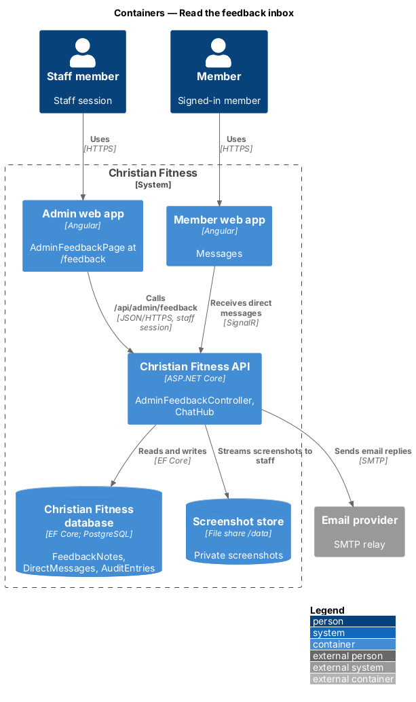
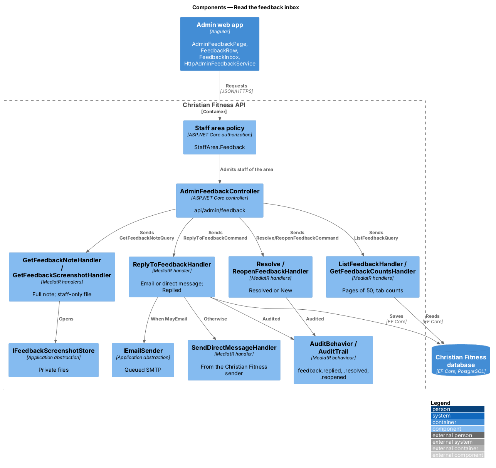
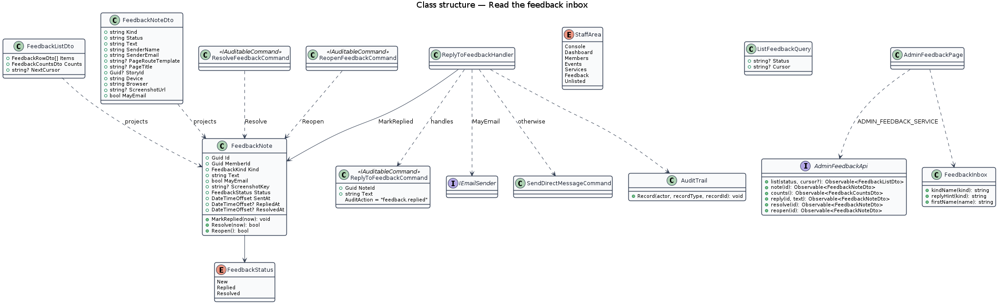
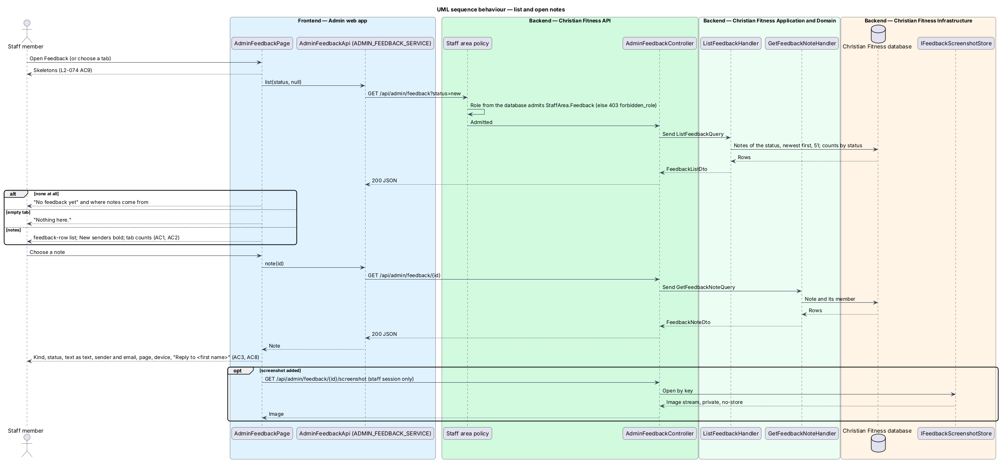
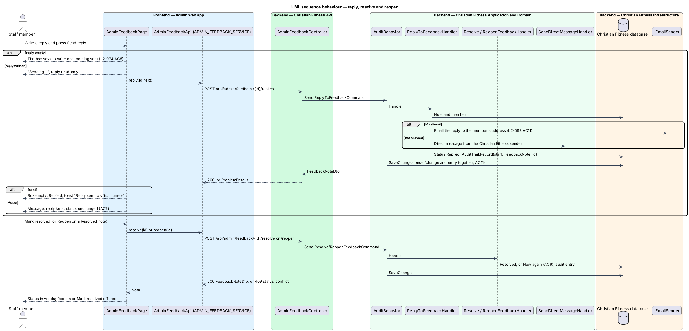

# Read the feedback inbox

## Overview

Christian Fitness is a Christian community for health in body and spirit in the Greater Toronto Area. The feedback subsystem lets members send the team ideas, problems, corrections and thanks, and lets staff read, answer and resolve each one (`L1-020`).

This feature covers the staff side: the Feedback screen of the admin console (mock `docs/mocks/pages/admin-feedback/`, states `default`, `loading`, `empty`, `error`, `correction`, `suspended`, `failed`, `replying`, `replied`, `resolved`). The `failed` state shows a reply refused for a deleting member. Staff list every note newest first, filter by status, open one note in full, reply to the member and mark the note resolved or reopen it. Notes come from [send feedback](../send-feedback/README.md).

- **status** — where a note stands: New until staff act on it, Replied once a reply has gone, Resolved once staff mark it so; Reopen makes a Resolved note New again
- **reply** — staff's answer to the member who sent a note, kept with the note and displayed in its inbox thread, delivered by email when the member allowed it and otherwise as a direct message from Christian Fitness; erased with the member
- **Christian Fitness sender** — account in whose name the system sends direct messages to members (shared with `L2-062` AC9)
- **New count** — number of notes with status New, shown on the navigation's Feedback link

## Description

### Admin web app

- **Route `/feedback`** — a child of the admin shell behind the staff guard, `loadComponent` `AdminFeedbackPage`, title "Feedback · Christian Fitness Admin". `ADMIN_FEEDBACK_SERVICE` is bound to `HttpAdminFeedbackService` on the page's `providers`.
- **Navigation** — the admin shell's `sidebar-navigation` gains Feedback in its Community group with `admin-nav__count` carrying the New count, and its accessible name in words ("2 new notes") (AC1). `ADMIN_AREAS` in `@cf/domain` gains a `feedback` area. The count's source is shared with the navigation design ([navigate the admin app](../../admin-access/navigate-admin-app/README.md)); this feature answers it from `GET /api/admin/feedback/counts`.
- **`AdminFeedbackPage`** — composes library components only: `tabs` (All, New, Replied, Resolved, each with its count; the chosen tab `aria-current="page"`), a list of `feedback-row`s, and the `feedback-row` component's detail part with the `description-list` facts, `textarea` "Reply to <first name>", and `button`s "Send reply", "Mark resolved" or "Reopen". It keeps the chosen note in the address (`/feedback?status=new&note=<id>`). At LG and wider the list and the note sit side by side; below LG the list comes first and the note follows in one column with no horizontal scroll (AC10). It shows `skeleton`s while loading, an `empty-state` "No feedback yet" saying notes come from "Send feedback" and a story's "Send a correction", "Nothing here." in an empty tab, and an error state with Try again (AC2, AC9).
- **`FeedbackRow`** — presentation component under its design-system name (`components/src/feedback-row/`). Inputs: kind, sender name, time, excerpt, status, current. The kind names and codes match the form: Idea (`idea`), Something's off (`problem`), Correction (`correction`), Thanks (`thanks`). A New note shows its sender in bold and its status in words (AC1). All member text is bound as text, never `innerHTML` (AC8).
- **`FeedbackInbox`** — pure helper in `domain/src/feedback/` with unit tests: the kind's icon and name, the reply hint for each kind (for example "Let them know we can reproduce it and when to expect a fix" for a problem), the first name for "Reply to <first name>", and the reply rule (an empty reply is not sent and the box says to write one; AC5).
- **Reply and status** — Send reply reads "Sending…" with the reply read-only (mock `replying`); success shows the kept reply in the thread, empties the box, marks the note Replied and shows a `toast` (mock `replied`); Mark resolved and Reopen change the status in place (mock `resolved`). A failure, including `member_deleting`, shows an `alert`, keeps the draft and leaves the status (AC7, AC12).
- **Correction** — for a correction about a story, "Open the story to correct it" uses the stored stable story id to lead an Admin to that story in the editor, even if its public slug changes (`L2-069`, mock `correction`, [ADR 0071](../../../adr/0071-addresses-and-slugs.md)) (AC4).
- **Screenshot** — shown as an `img` whose `src` is the staff-only screenshot address (AC3, AC8).
- **`AdminFeedbackApi` / `ADMIN_FEEDBACK_SERVICE`** — contract and token in `api/src/admin/admin-feedback.ts`: `list(status, cursor?)`, `note(id)`, `counts()`, `reply(id, text)`, `resolve(id)`, `reopen(id)`.

### Christian Fitness API

- **`AdminFeedbackController`** — routed at `api/admin/feedback`, so the staff area policy applies ([ADR 0020](../../../adr/0020-staff-roles-by-area.md)). `AuthenticationSetup.AreaSegments` gains `["feedback"] = StaffArea.Feedback`, a new `StaffArea` value that `StaffAccess` opens to Admins and Moderators ([ADR 0064](../../../adr/0064-moderator-areas.md)). Each action sends one MediatR request: `GET` → `ListFeedbackQuery`; `GET counts` → `GetFeedbackCountsQuery`; `GET {id}` → `GetFeedbackNoteQuery`; `GET {id}/screenshot` → `GetFeedbackScreenshotQuery`; `POST {id}/replies` → `ReplyToFeedbackCommand`; `POST {id}/resolve` → `ResolveFeedbackCommand`; `POST {id}/reopen` → `ReopenFeedbackCommand`.
- **`ListFeedbackHandler`** — answers `FeedbackListDto`: the notes of the chosen status (or all), newest first by `SentAt` then `Id`, each with id, kind, sender name, sent time, the first `<TO SUPPLY>` characters of the text and status; the counts of all four tabs; and a next cursor. Pages of 50 keep the list bounded (`L2-037`); AC1 says "every note", so the cursor loads the rest on scrolling.
- **`GetFeedbackNoteHandler`** — answers `FeedbackNoteDto`: kind, status, sent time, full text, sender name and email and suspended status, page route template and title, story id, OS family and browser family and major version, whether a screenshot exists and its address, the replies kept with the note, and whether the member allowed email (AC3). The inbox labels a suspended sender "Suspended". Unknown ids are 404 `not_found`.
- **`GetFeedbackScreenshotHandler`** — streams the file from `IFeedbackScreenshotStore` with its content type, `Cache-Control: private, no-store`; the endpoint answers only a staff session, so the address works for nobody else (AC8).
- **`ReplyToFeedbackCommand` / validator / handler** — an `IAuditableCommand` (`feedback.replied`), a class so its text never prints. The validator refuses an empty reply with 400 `validation_failed` (maximum length `<TO SUPPLY>`). The handler loads the note and its member; if the member is deleting, it refuses `member_deleting` without delivering or keeping the reply or changing the status (AC12). When `MayEmail` is set it sends one `EmailMessage` to the member's address through `IEmailSender`; otherwise it sends a direct message from the Christian Fitness sender through `SendDirectMessageCommand`, which the messaging rule of `L2-065` AC5 shall not refuse (AC5, `L2-063` AC11). It keeps the reply text with the note, sets the status to Replied, records `AuditTrail.Record(staffId, "FeedbackNote", noteId)` and saves once (AC5, AC11). The replies are erased with the member along with the note and screenshot (`L2-066` AC7).
- **`ResolveFeedbackCommand`, `ReopenFeedbackCommand`** — auditable (`feedback.resolved`, `feedback.reopened`). `FeedbackNote.Resolve()` refuses a note already Resolved with 409 `status_conflict`; `Reopen()` makes a Resolved note New (AC6).
- **`FeedbackNote`** — the entity of [send feedback](../send-feedback/README.md) gains a collection of reply texts, `Resolve()`, `Reopen()` and `MarkReplied(now)`, with `RepliedAt` and `ResolvedAt`.
- **Telemetry and audit** — routes recorded as templates; no span, metric or log carries a note's text, a reply, a name or an address; the audit entry holds only the staff member's id, the action, `FeedbackNote` and the note's id (AC11, ADR 0023).

### As built

[ADR 0113](../../../adr/0113-feedback-inbox.md) records what the build settled: the list holds the newest 100 notes of a tab with no cursor yet, the excerpt is 120 characters and a reply at most 2,000; a suspended member who did not allow email cannot be replied to (`member_unreachable`); `member_deleting` (AC12) is built with Delete my account; the navigation's count comes from `GET /api/admin/counts` (`newFeedback`).

### Open questions

- **Moderators.** Settled by ADR 0064 and `L2-019` AC1: a Moderator opens Feedback, reads, replies, resolves and reopens notes as an Admin does, and the Feedback link and its count show in their navigation (mock `admin-feedback/moderator.html`). Only "Open the story to correct it" stays Admin only, since Stories is (`L2-074` AC4): the button is not drawn for a Moderator, whose role the screen reads from the session through `canManage`.
- **Christian Fitness sender (resolved, ADR 0065).** Direct messages "from Christian Fitness" come from a seeded system member, idempotent in `cf seed`, that cannot sign in and cannot be replied to (`system_account`). The reply text is "Reply to your feedback:" and, after a line break, the Admin's text, rendered as text.
- **Email reply.** The From and Reply-To of a reply email (the relay sends as `no-reply@christian.fitness`, ADR 0047) and whether the member can answer it are decided in [ADR 0070](../../../adr/0070-html-email-headers-and-bulk-sending.md): From `no-reply@christian.fitness`, Reply-To only when `Email:ReplyTo` is set.
- **Toast wording.** For an email reply, the toast says "Reply sent. {Name} gets it by email.", rendering the member's name as text; for a direct message it confirms the reply without claiming an email was sent.
- **Suspended-member delivery.** A suspended member can send feedback (L2-063 AC12), but ordinary direct messages to a suspended recipient are refused (ADR 0043) and suspended members cannot sign in to read them. How a reply reaches a suspended member who did not allow email is `<TO SUPPLY>`; the appeal access mechanism in the send-feedback design must also account for delivery.
- **Screenshot.** `admin-feedback/screenshot` shows a thumbnail in the detail pane and `screenshot-open` the full size.
- **Deleting members.** A note's sender may be deleting ([download and delete data](../../preferences/download-and-delete-data/README.md)); the list shows "A former member" until erasure removes the note and its replies. A reply is refused with `member_deleting` (AC12).
- **Dashboard.** The amended `L2-020` and the Dashboard mock add a feedback line to the work awaiting staff; that belongs to [view the dashboard](../../admin-dashboard/view-dashboard/README.md) and reads the same New count.

## Requirements

The feature realizes the following level-2 (L2) requirements. Each L2 requirement refines a level-1 (L1) requirement, cited by identifier. The L2 specification states its requirements as acceptance criteria; the text below condenses those criteria faithfully.

| L2 ID | Refines (L1) | Requirement |
|-------|--------------|-------------|
| `L2-074` | `L1-020` | Staff shall read and answer feedback using the same kind names and codes as the form. A chosen note shall label a suspended sender, show its OS family and browser family and major version, and show replies kept with the note; the replies shall be erased with the member. A reply to a deleting member shall be refused with `member_deleting`, without delivery, retention or status change. The [acceptance criteria](../../../specs/L2.md#l2-074-feedback-inbox) specify the list, thread, actions, privacy and responsive states. |
| `L2-063` | `L1-020` | 11. A staff reply shall reach the member by email when they allowed email, else as a direct message from Christian Fitness. |
| `L2-019` | `L1-008` | 3. A staff change that succeeds shall leave an audit entry of who, what, which record and when, without personal data in telemetry. |

## Diagrams

### System context

Staff read and answer members' feedback in the admin console; replies reach members by email or as a direct message in the member app.

### Containers

The Admin web app calls the API's admin feedback endpoints under the staff area policy; the API reads notes and screenshots, sends email replies through the provider and direct-message replies through the chat hub.

### Components

`AdminFeedbackController` sends one request per action; the reply handler chooses email or direct message, and the audit behaviour records each change.

### Class structure

`AdminFeedbackPage` depends on the `AdminFeedbackApi` contract and `FeedbackInbox`; the commands change a `FeedbackNote`'s status and are audited.

### Behaviour — list and open notes

The page loads one page of notes and the tab counts, then the chosen note in full; the screenshot comes from a staff-only address.

### Behaviour — reply, resolve and reopen

A reply goes by email or as a direct message, the note becomes Replied and an audit entry is saved with it; resolve and reopen change the status the same way.

